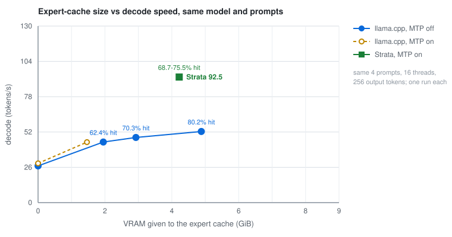

# 公平对比：llama.cpp 的 MoE 缓存到底能补多少（2026-11-11）

同一份 IQ2_XS、同一台 RTX 5080（GPU0）、同一组 4 条请求、16 计算线程与同一 CPU 亲和掩码、
每次输出 256 tokens。变量只有一个：llama.cpp 的专家放置与缓存开关，以及 MTP 是否开启。
Strata 用它的 profile 排名热专家缓存（`--expert-cache 3000`，实际约 3150 槽 ≈ 4.2 GiB）。
每轮先做一次不计入统计的预热；原始 SSE、引擎日志、采样与命令都保存在 `runs/<name>/`。

## 1. 结论先行

| 对照 | 端到端输出（中位） | 与 Strata 的差距 |
|---|---:|---:|
| llama.cpp，默认（CPU39 层专家，无缓存） | 27.5 tok/s | **2.86×** |
| llama.cpp，1.5 GiB MoE 缓存 + MTP | 39.8 tok/s | 1.98× |
| llama.cpp，5 GiB MoE 缓存（无 MTP） | 44.9 tok/s | 1.75× |
| Strata 0.1.58，约 3150 热专家槽 | 78.8 tok/s | — |

**开缓存把差距从约 2.9 倍压到约 2 倍。** 之前那份"约 4 倍"的结论用的是 llama.cpp 默认配置
（CPU 专家全部留在主机侧、缓存关闭），不能代表 llama.cpp 的能力上限；这一点现在有了实测。

## 2. 三组变量各自的贡献

### 2.1 MoE 缓存（主因）



| 缓存预算 | 实际分配 | 命中率 | 上传字节/轮 | decode 中位 | 端到端中位 |
|---:|---:|---:|---:|---:|---:|
| 0 | — | — | 0 | 27.0 | 25.0 |
| 2 GiB | 1998 MiB | 62.4% | 238.9 GiB | 44.6 | 40.1 |
| 3 GiB | 2997 MiB | 70.3% | 188.5 GiB | 48.0 | 42.3 |
| 5 GiB | 4999 MiB | 80.2% | 125.8 GiB | 52.4 | 44.9 |

命中率越高，需要经主机→显存搬运的专家越少，decode 越快。Strata 的 profile 排名缓存在
6554 槽（8.78 GiB）时命中率 84.1%，比 5 GiB 档的 80.2% 略高——两者剩余差距的方向与命中率一致。

### 2.2 `GGML_OP_OFFLOAD_MIN_BATCH`：几乎无效（修正我之前的判断）

| 配置 | decode 中位 | 变化 |
|---|---:|---:|
| 无 MTP，默认（阈值 32） | 27.03 | — |
| 无 MTP，阈值改 1 | 27.05 | **+0.07%** |
| 有 MTP，默认 | 28.91 | — |
| 有 MTP，阈值改 1 | 32.29 | +11.7%（含草稿接受率波动） |

**我上一轮的源码推导需要修正。** 我当时认为"llama.cpp 把 39 层专家留在 CPU、按默认阈值不上传，
所以 CPU 承担了 81% 的专家条目"是主因。实测把阈值降到 1 后，无 MTP 时引擎自报 decode
完全没变（27.03 → 27.05），有 MTP 时那 11.7% 也主要来自两次草稿接受率不同（0.765 对 0.701）。
真正的成本是**专家权重的搬运量**，不是"算子跑在 CPU 还是 GPU"。

按包内 `native_experts.txt` 计算：每个专家 blob 约 1.38 MiB，CPU39 配置下每个 token 要读
39 层 × 10 专家 = 390 个 blob ≈ **531 MiB**；在 27–29 tok/s 下相当于 **15–16 GB/s** 的主机→设备流量。
这解释了为什么"把缓存打开"（减少搬运）有效，而"改调度阈值"（不减少搬运）无效。

### 2.3 强制 tiled 内核：反而慢 2.6 倍

| 配置 | decode 中位 |
|---|---:|
| 默认 | 27.0 |
| `GGML_CPU_TILED_MM_FORCE=1` | 10.8 |

这条也要修正：我此前把"llama.cpp 的 tiled 多行内核默认要求每专家 ≥8 行、我们 1–4 行进不去"
写成了 llama.cpp 的劣势。实测强制进入后慢 2.6 倍——**默认不进 tiled 才是 1–4 行窗口下的正确选择**，
那个门槛是保护，不是 handicap。

### 2.4 `--moe-cache-cpu-share`：本机为负收益

| 缓存 | share 0 | share 0.5 |
|---:|---:|---:|
| 3 GiB | 48.0 | 31.7 |
| 4 GiB | — | 34.3 |

缓存满了以后让 CPU 算一部分 miss，比让 GPU 直接从 pinned 主机内存读要慢。这与 KVMem 文档里
"pinned 专家经链路全速上传时，CPU share 往往没有帮助"一致。

## 3. 与 Strata 的差距还剩在哪

1. **命中率**：80.2%（llama 5 GiB）对 84.1%（Strata 6554 槽）。Strata 的槽位是启动时按路由频率排名预填、
   不淘汰；llama.cpp 是带衰减的 LRU，同样的显存装不下同样多的热专家。
2. **专家条目的执行方式**：Strata 有 15 个 pool worker 的同层 CPU/GPU 分工与 AVX2 多 token 内核；
   llama.cpp 在 1–4 行窗口下走逐 token 点积（这正是它默认不进 tiled 的原因）。
3. **配置能力差异**：Strata 的原生 IQ 包**强制要求 `--spec ≥ 2`**（`--spec 1` 会被引擎拒绝），
   所以"两边都关 MTP"的对照做不到；本节所有跨引擎比较都是各自开 MTP 的配置。

## 4. 环境与失败记录（不隐去）

- 期间另一会话在同一张卡上并发运行（`runs/fair-*` 目录），造成一次显存不足与一次采样中断。
  我给批次加了"等显存与推理进程都清空"的门槛，并修了采样器对 `nvidia-smi` 单次失败的容错
  （加有界重试与 UTF-8 解码）。
- `llama-iq2-fair-cache45-3g-01` / `-3g-mtp-01`：缓存 3 GiB 叠加 MTP 草稿时在草稿上下文分配处崩溃
  （`GGML_ASSERT(ctx->mem_buffer != NULL)`，退出码 0xC0000409）。1.5 GiB 档正常，说明这是显存余量阈值。
- `llama-iq2-nomtp-cache45-5g-s05`：5 GiB + share 0.5 在图实例化时 CUDA OOM。
- `strata-iq2-nomtp-01`：Strata 拒绝 `--spec 1`（原生 IQ 包要求 ≥2）。
- `strata-iq2-fair-01/02`：Windows 提交内存不足（上限 119.35 GiB，另一会话占着页文件），
  `cudaMalloc(8.78 GiB)` 失败；未改页面文件设置，改用缩小缓存的 `strata-iq2-cache3000-01` 作为窗口内基准。
- 所有失败目录与日志保留在原处，未删除。

## 5. 局限

- 每个配置只跑一轮（4 条请求取中位），没有重复测量与置信区间；短请求对调度噪声敏感。
- MTP 的草稿模型在两边不同（Strata Q2_0/缩减词表，llama.cpp 完整 Q4_K_M），跨引擎比较含这部分差异。
- 只测了短输入（44–54 tokens）+ 256 输出；没有复测长上下文（上一轮测过 32K 上下文、SSD 溢出）。
- 分块大小、线程数、KV 精度未扫描。

## 6. 复现

```powershell
$py  = 'C:\Users\Administrator\Documents\Code\tasks\strata-lab\Strata\.venv\Scripts\python.exe'
$lab = 'C:\Users\Administrator\Documents\Code\tasks\strata-lab'

# 基线
& $py "$lab\scripts\llama_experiment.py" --output "$lab\runs\llama-iq2-nomtp-base-01" `
  --requests "$lab\configs\llama-iq2-fair-requests.json" --cpu-moe-layers 39 --port 18081

# 开缓存（3 GiB）
& $py "$lab\scripts\llama_experiment.py" --output "$lab\runs\llama-iq2-nomtp-cache45-3g-01" `
  --requests "$lab\configs\llama-iq2-fair-requests.json" --cpu-moe-layers 45 `
  --moe-cache-mib 3000 --moe-cache-cpu-share 0.0 --port 18081

# 阈值因果 / tiled 强制
& $py "$lab\scripts\llama_experiment.py" --output "$lab\runs\llama-iq2-nomtp-offbatch1-01" `
  --requests "$lab\configs\llama-iq2-fair-requests.json" --cpu-moe-layers 39 --port 18081 `
  --env GGML_OP_OFFLOAD_MIN_BATCH=1

& $py "$lab\scripts\analyze_fair_batch.py"   # 汇总 fair-batch-results.json
```
