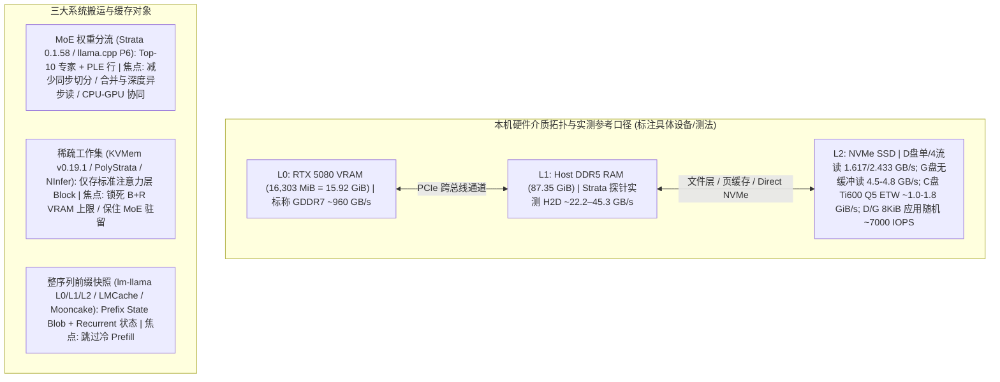
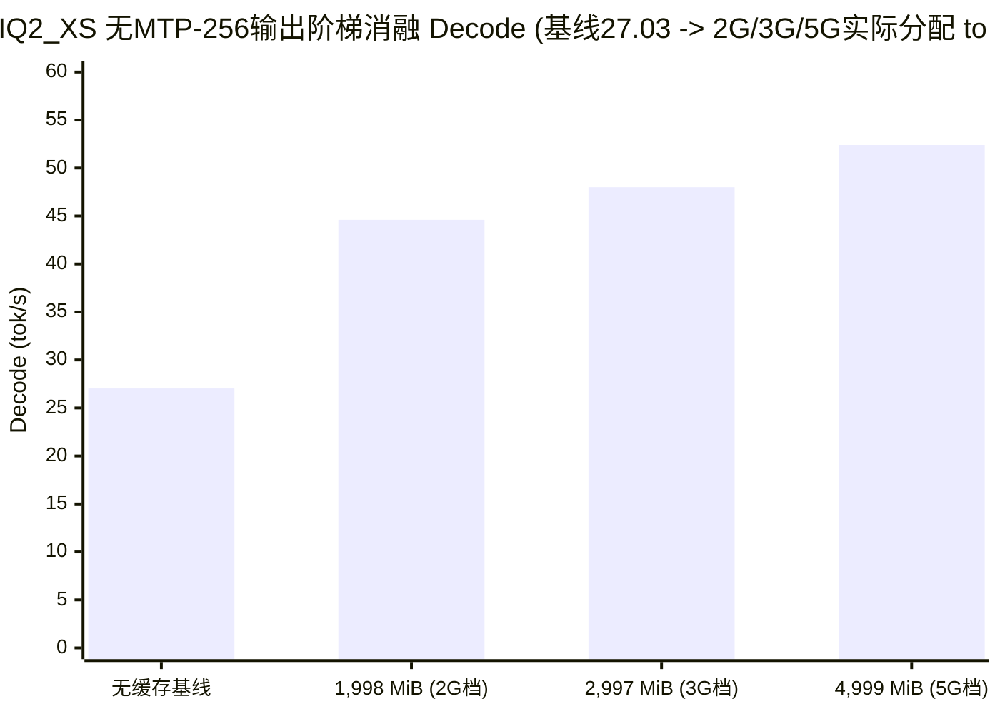
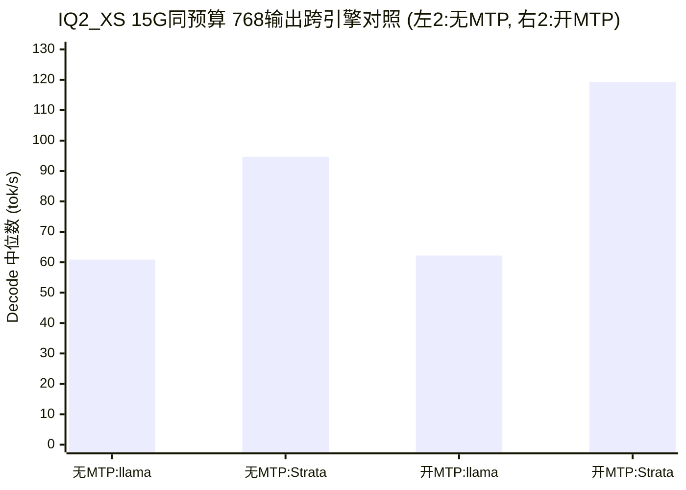
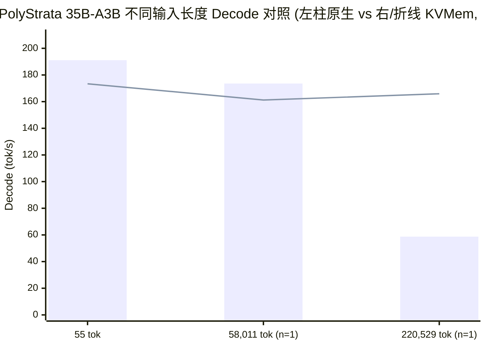
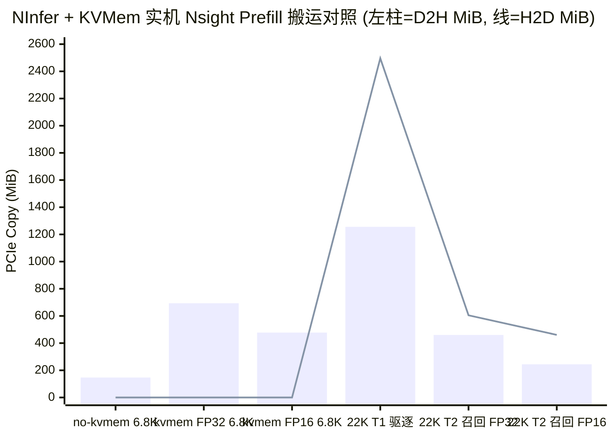

# 本地大模型推理栈终极技术报告：原版 `llama.cpp` vs `Strata`、高性能基线引入 `KVMem` 的真实得失、实验归因与架构优化路线

> **范围与基准机器**：本报告综合工作区 `lm-llama`、`strata-lab`、`Ficus-KB` 以及本机闭环实测的一级报告、响应 JSON、引擎日志、Nsight Systems 时间线、ETW/SMART 设备计数与对应源码快照撰写（并已对照 `codex-cli 0.169.0` 只读交叉审核结果完成全面数据与源码口径订正）。测试硬件位于同一台 Windows 11 工作站（OS `10.0.26200` / Core Ultra 7 270K Plus 24C24T / ~87.35 GiB 物理内存 / GPU 0 = NVIDIA GeForce RTX 5080 `16,303 MiB` ≈ `15.92 GiB`，标称 16 GB GDDR7，标称显存带宽 ~960 GB/s / GPU 1 = RTX 5060 Ti `16,311 MiB` / 四块 NVMe SSD，含 `C:` 盘 `ZHITAI Ti600 1TB`、`G:/F:` 盘 `BIWIN X570 1TB`、`D:` 盘 `Seagate ZP1000GV30012`）。
>
> **交互式可视化与关联产物**：[5-Tab 交互式 Profiling 仪表盘 (HTML)](../assets/llama-strata-kvmem/llama-strata-kvmem-dashboard.html) · [NInfer + KVMem RTX 5080 实验收敛](ninfer-kvmem-rtx5080-experiments.md) · [Codex CLI 交叉审核原文](../runs/ninfer-kvmem-20261126/codex_review.md) · [NInfer Nsight 摘要 JSON](../runs/ninfer-kvmem-20261126/ninfer_nsys_results.json) · [NInfer 消融摘要 JSON](../runs/ninfer-kvmem-20261126/ninfer_ablation_results.json) · 既定专题：[同一 IQ2_XS 对照](llama-vs-strata-report.md) / [公平对比](fair-compare-report.md) / [Q5 三方对照](q5-strata-compare-report.md) / [Q5 I/O 深度](q5-io-depth-report.md) / [KVMem 安装边界](kvmem-report.md) / [源码对比](llama-vs-strata-source-analysis.md)

---

## 执行摘要与核心证据边界

如果用一句话概括全部实验的物理本质：**在单卡 `16,303 MiB` 显存约束下，推理吞吐与上下文容量受制于“显存容积硬墙”与“跨介质带宽落差（标称 ~960 GB/s GDDR7 vs CUDA/PCIe 实测探针 ~22.2–45.3 GB/s vs NVMe 设备读 ~1.0–4.8 GB/s）”之间的张力；不同系统表现出看似矛盾的快与慢，本质上是它们把“计算、同步、权重驻留、KV 驻留”四件事摆在了不同的硬件层级与同步边界上。**

综合全量复算后的实测数据，本报告确立以下五项核心结论：

1. **原版 `llama.cpp` vs `Strata` 不是简单的“4 倍差距”**：
   - 在未启用 `--moe-cache-mib` 的早期 `CPU39` 配对（44 / 50 输入 → 256 输出，双边各自开启 MTP）下，原版 `llama.cpp` decode 为 **`28.32 / 29.78 tok/s`**，`Strata 0.1.58` 为 **`119.2 / 122.6 tok/s`**（约 **4.1–4.2×**）。
   - 一旦在 ~15,000 MiB 整卡显存目标下启用并调优 `llama.cpp` 原生 `ClassLRU` 显存专家缓存，短解码中位数差距显著收敛：**无 MTP 时为 `60.89 vs 94.70 tok/s`（1.56×），开启 MTP 后为 `62.21 vs 119.25 tok/s`（1.92×）**；但在 `1,560` 输入 prefill 上 `Strata`（chunk 2048）仍快 **4.2–5.6×**，在 `long-28k`（9,801 输入 → 128 输出）端到端输出速率上 `Strata` 领先 **5.28×**（`6.34 vs 1.20 tok/s`，引擎 prefill `577.6 vs 97.30 tok/s`，客户端 TTFT `17.10 vs 100.74 s`）。
2. **超出主机内存（Out-of-Core `UD-Q5_K_XL` 147.416 GiB）同约束三方对测下，`llama.cpp P6` 的 decode 中位数反超 `Strata`，但后者 READY 后首字更快**：
   - 在严格对齐 **24 GiB 进程工作集上限、约 4 GiB GPU 专家 cache、关闭 MTP、完整路由（`tail_skip=0`）、相同强制 token 轨迹**（P6 与 Strata 另配 16 GiB 专家 RAM 池，原生走 `mmap`）的 3 轮对测下：**`llama.cpp P6` decode 中位数为 `2.359 tok/s`（相对原生关闭预取 `1.747 tok/s` 提升 +35.1%），略高于同期 `Strata 0.1.58` 中位数 `2.207 tok/s`**（P6 对 Strata 逐轮一负两胜，Strata 第 1 轮出现 `0.76 tok/s` 慢段拉低其算术均值至 `1.837 vs P6 2.372`）。`Strata` 的 READY 后 TTFT 仍快 **2.57×**（`11.28 s vs 28.97 s`，若把首个内存样本至 READY 的预置耗时分段相加则两者接近 `33.58 s vs 32.00 s`）。历史上 `Strata` Q5 曾测出的 `8.5 / 10.1 tok/s` 源于开启 `MTP + tail_skip=7` 且占用 `1,946 GPU 槽（7.25 GiB）+ 6,432 RAM 槽（24 GiB）`，不可混作同口径比较。
3. **在高性能基线上引入 `KVMem`：充裕区存在确定性搬运/同步负税，逼近显存拐点或超预算时才是净正收益**：
   - 当上下文 KV 与热点权重皆能驻留显存时，引入 `KVMem` 必然产生“Packed K/V & GDN 快照归档、Mean-K 采集与额外 CUDA 同步”开销：`PolyStrata`（`35B-A3B`）在 55 tokens 降 **`-9%`**（`191.1 → 173.4 tok/s`），58K TTFT 慢 **`+17%`**、decode 降 **`-7%`**；`llama-kvmem` 在 2K–14K 降 **`-9.2% ~ -30.2%`**；`NInfer` 在 8.2K 无复用降 **`-9.24% / -2.54%`**。
   - 一旦发生显存争夺或硬溢出，收益急剧反转：**`PolyStrata 220K` 联合效应**下，`B=8192` 锁死 KV 扩张把被挤出的 MoE GPU 专家命中率从 `89.8%` 拉回 **`100%`**，该单次长请求实现 **Decode `2.83×`（`58.7 → 165.9 tok/s`）、TTFT `1.538×`（`94.935 → 61.740 s`，降 34.97%）、端到端 `1.60×`**；**`NInfer`** 在 16 GB 卡上从 `--no-kvmem 200K` 启动准入失败转为 `10,745 MiB`（`10.493 GiB` / `11.267 GB`）稳定运行、104.5K 五针从 32K 滑窗的 **`40%` 升至 `100%`**，并在紧主机池 `HostMiB=1536/2560` 下启用文件层溢出将 3×66K 跨会话回访 TTFT 从 **`38.71 / 38.45 s` 压到 `1.90 / 1.99 s`（20.36× / 19.28×）**。
4. **“稀疏近似工作集（`KVMem`）”与“无损整前缀分层（`L0/L1/L2`）”各司其职，不可混为一谈**：
   - `NInfer + KVMem` 在真实 `PI (:low)` 4 轮多模态工具编码闭环（3 次工具调用）中实现 **`0% / 99.7% / 57.9% / 99.9%`** 缓存命中与 **`1.2 s / 203 ms / 4.0 s / 222 ms`** TTFT；而 `lm-llama` 的 `pi-cache-bench`（21 请求 SWE-bench 轨迹）证实：**只要并发工作集（`1,506 MiB`）小于配额且双客户端能用原生双槽位（`-np 2`）常驻 L0（`58.45 s`），原生双槽就优于单槽位外挂 4 GiB RAM 缓存（`80.84 s`）**。
5. **当前 `v0.19.1` 运行时兼容性提示**：实测的 `PolyStrata 0.1.45` 与 `NInfer v0.19.1` 均拒绝 `IQ2_XS / UD-Q5_K_XL` 所使用的 `qwen4exp` 架构；`KVMem` 高性能长上下文实证主要落在 `Qwen3.6-35B-A3B`、`Swift-1.5-27B (GSQ-RCO-NInfer)` 与 `Qwen3.8-27B` 上。

> [!WARNING]
> **严禁跨口径混用（Evidence Hygiene）**
> 1. `IQ2_XS`（`63.354 GiB`，`33.02 GiB` 专家全驻 `87.35 GiB` RAM）反映 **RAM–PCIe–GPU 调度能力**；`UD-Q5_K_XL`（`147.416 GiB`）反映 **NVMe 文件层与受限 24 GiB 工作集调度能力**，两者的绝对速度与读盘行为不可直接移植。
> 2. `KVMem` 是**有损工作集稀疏选择**（存在召回遗漏风险），而 `llama.cpp P6` 与 `lm-llama` 固定前缀快照测试的是 **bit-exact / 零数值偏差路径**；开启 `Strata --tail-skip` 则是另一档有损近似，不能与全计算基线混排。

---

## 第一部分：架构全景与跨媒介带宽物理模型

在对比二十余组实验前，须先区分每套测量所使用的真实硬件通路与口径边界（标称值、进程探针与设备层计数器互相独立）：

### 理想重叠条件下的两类成本估算关系（仅作量级边界，实际需按依赖关键路径计）

1. **单步解码吞吐量级估算（理想完美重叠近似下界）**：

$$\text{Time}_{\text{step}} \gtrsim \max\Big(T_{\text{GPU\_compute}} + T_{\text{sync\_wait}},\; \frac{B_{\text{PCIe\_miss}}}{BW_{\text{PCIe}}},\; \frac{B_{\text{SSD\_miss}}}{BW_{\text{SSD}}},\; T_{\text{CPU\_experts}}\Big)$$

- 以 `CPU39` 默认无缓存估算：假设每次每步需经 PCIe 传 ~`531 MiB` 专家载荷、按 `15–32 GB/s` 有效吞吐纯除法估算约 **`27–57 步/s`**（实际叠加核计算与同步后落在 `27–30 tok/s`）。
- 以 `Q5` Out-of-Core 估算：ETW 实测每步冷盘读 **`461.2–574.4 MiB`**，按 `1.0–1.8 GB/s` 有效读速纯除法估算约 **`1.66–3.72 步/s`**（实测中位数落在 `1.75–2.36 tok/s`）。真实执行时因同步等待、GPU/CPU 不完全重叠，实际耗时大于单纯除法项。
2. **前缀/会话恢复盈亏平衡条件（面向首字 TTFT 与生命周期）**：

$$T_{\text{lookup}} + T_{\text{read+install}} + T_{\text{suffix\_prefill}} \;<\; T_{\text{full\_cold\_prefill}}, \qquad r \times \Delta T_{\text{saved}} \;>\; C_{\text{export+flush}} + C_{\text{interference}}$$

---

## 第二部分：原版 `llama.cpp` vs `Strata`（`IQ2_XS`、`Nsight` 显微剖面与 `Q5` OOC 三方对测）

### 2.1 `Qwen3.8-Flash-Next IQ2_XS`（63.354 GiB，专家全驻主存）：从开箱 `4×` 到调优 `1.56×–1.92×`

#### 实验设计理由（Why）
`Qwen3.8-Flash-Next`（48 层、每层 512 专家、Top-10 路由）的 `IQ2_XS` 约 `33.02 GiB` 路由专家在本机 `87.35 GiB` 主存下完全无需走磁盘淘汰，是剥离磁盘 I/O、纯粹检验 **显存缓存命中 + PCIe 搬运 + CPU/GPU 调度并行度** 的理想对照组。

#### 实测汇总表（`IQ2_XS` on RTX 5080，严格区分解码速率与端到端输出速率）

| 实验组别与实配参数 | 测试负载与请求口径 | 原版 `llama.cpp` (`b12211`) | `Strata 0.1.58` | 性能比 (`Strata/llama`) | 关键对照与资源注解 |
|---|---|---|---|---|---|
| **早期开箱配对 (`llama-vs-strata-report`)** (`CPU39` 无 `--moe-cache-mib` vs `Strata 6554槽 tail_skip=0`, **双方均开各自 MTP**) | 短提示 P1/P2（`44 / 50` 输入 → 256 输出） | 引擎 Decode： **28.32 / 29.78 tok/s** TTFT: 1.22s / 0.75s | 引擎 Decode： **119.2 / 122.6 tok/s** TTFT: 0.51s / 0.34s | **4.1–4.2×** (Decode) | `llama` 每步从主存传 ~`531 MiB` 专家；`Strata` 历史 `tail_skip=7` 曾测 `145.1 / 142.6` |
| **有缓存短文 (`r1` 运行日志)** (`llama` 实开 **`6,700 MiB MoE cache + mmap + MTP`**) | 短输入 / 中短输出 | 端到端输出速率：31.98 / 33.43 引擎 Decode：**36.30 / 35.73** | 端到端输出速率：105.61 / 107.02 引擎 Decode：**113.9 / 114.8** | **~3.1–3.3×** | `r1` 原生并非未开缓存；仍受路由同步与 CPU/GPU 分工限制 |
| **`r2` 14G 有界账本** (`goal-llama-r2` vs `strata`) | 中文短请求 & 英文长请求 | **端到端输出速率**： 短 `36.16` / 长 **`9.86 tok/s`** | **端到端输出速率**： 短 `36.58` / 长 **`16.69 tok/s`** | 短 `1.01×` / 长 **`1.69×`** | 指标为端到端输出速率（非 prefill/decode 分拆） |
| **同预算 15,000 MiB 目标 · 无 MTP** (`fair-compare-20261109`，轮换顺序、未清除冷页缓存) | 768 输出中位数 (`llama` 6,756 槽 / 9.08 GiB) | 引擎 Decode： **60.89 tok/s** | 引擎 Decode： **94.70 tok/s** | **1.56×** | `llama` ClassLRU 命中 **90.0%**；CPU **`0.96`** 核、GPU **`72%`**；`Strata` CPU **`15.55`** 核、GPU **`97%`** |
| **同预算 15,000 MiB 目标 · 开启 MTP** (`fair-compare-20261109`) | 768 输出中位数 (`llama` 减至 4,865 槽 / 6.54 GiB) | 引擎 Decode： **62.21 tok/s** | 引擎 Decode： **119.25 tok/s** | **1.92×** | 量化完整词表草稿权重 **`2,305.68 MiB`** 加辅助缓冲使原生少配 ~**`2.54 GiB`** 专家槽（-1,891 槽），命中跌 **`9.7` 个百分点（90.0%→80.3%）**；CPU **`0.97 vs 14.46`** 核，GPU **`62% vs 98%`**；MTP 接受率 `72.3% vs 64.1%` |
| **长提示 Prefill (`fair-compare-20261109`)** | `1,560 / 1,564` 输入 → 128 输出 | Prefill: **331–349 tok/s** TTFT: **4.51–4.73 s** | Prefill: **1,440–1,851 tok/s** TTFT: **0.86–1.12 s** | **4.2–5.6×** | `Strata` 日志启用后台 `Stager` + fused INT8 专家路径 |
| **超长上下文 `long-28k` 运行** (`goal-llama-long28k` 9,801 输入 → 128 输出) | 9,801 tokens 输入长文 | 端到端：`1.20 tok/s` (`106.73s`) TTFT：**100.74 s** 引擎 Prefill：**97.30 tok/s** 引擎 Decode：**21.22 tok/s** | 端到端：`6.34 tok/s` TTFT：**17.10 s** 引擎 Prefill：**577.6 tok/s** 引擎 Decode：**39.9 tok/s** | 端到端 **`5.28×`** TTFT **`5.89×`** | `llama` 退出日志 `ubatch <= 8` 桶占 `74.45%`，大批路径执行 `34,812` 次从 cache 复制（`15,947.44 MiB`）；源码 slot-map 选择边界为 `max_batch=32`（`llama-moe-cache.cpp:369,695`） |

#### `--moe-cache-mib` 阶梯消融（256 输出，`fair-compare-report.md`）与同轮开关证伪
- **独立阶梯（无 MTP）**：从基线 **`27.03 tok/s`**（未开显存专家缓存）阶梯增加实际分配配额 **`1,998 / 2,997 / 4,999 MiB`**（对应 2/3/5 GiB 挡位），GPU 命中率在 2→5 挡依次达到 **`62.4% → 70.3% → 80.2%`**，每轮上传降至 `238.9 → 188.5 → 125.8 GiB`，Decode 中位数同步提升至 **`44.6 → 48.0 → 52.4 tok/s`**。（注：另有一组开 MTP 对比的端到端 HTTP 中位数为 `27.5 → 39.8 → 44.9` vs Strata `78.8 tok/s`；同轮开启 MTP 的 `CPU39 无缓存` 对 `CPU48+GPU缓存` 消融则测得 **`27.75 / 26.40 → 64.69 / 63.21 tok/s` [2.33–2.39×]**）。
- **三项负优化/无效开关证伪**：`GGML_OP_OFFLOAD_MIN_BATCH=1`（无 MTP 仅 `27.03 → 27.05 tok/s`，+0.07%）、`GGML_CPU_TILED_MM_FORCE=1`（暴跌至 `10.8 tok/s`，-60%）、`--moe-cache-cpu-share 0.5`（3 GiB 档从 `48.0` 跌至 `31.7 tok/s`，-34%）。

---

### 2.2 Nsight Systems 硬件微架构剖面：`llama.cpp b12211` vs `Strata 0.1.58`（`strata-profiling-20261109`）

在 `strata-profiling-20261109`（`Nsight Systems 2026.1.3` + Windows ETW + 1 kHz 板卡采集，`decode_short-zh` 为 44→256 中文请求，`prefill_long-en` 为 1,560→**64** 英文请求，补抓与主表均无显式丢失诊断）中，拆解出了硬件级时间线差异：

| 显微对比维度 | `llama.cpp b12211` (无 MTP, 256 Decode) | `Strata 0.1.58` (无 MTP, 256 Decode) | `llama.cpp` (`prefill_long-en`, 1560→64) | `Strata` (`prefill_long-en`, 1560→64) | 诊断口径说明 |
|---|---|---|---|---|---|
| **NVTX 阶段墙钟** | **4.955 s** | **2.961 s** | **4.840 s** | **1.249 s** | 开启 MTP 下节点级会严重扰动测量，Strata 自报曾从 `79.7`（节点）升至 `107.5 tok/s`（整图） |
| **CUDA Kernel 事件 / 图节点** | `791,128` (`783,654` 图节点) | `472,339` (`472,088` 图节点) | — | — | 两者在解码期都启用了 CUDA Graph |
| **主机 CUDA Graph Launch** | **12,351 次** (`767.5 ms`) | **250 次** (`231.0 ms`) | — | — | `llama` 图被每层同步打碎在 **63 条 Stream** 上；`Strata` 收敛在 **4 条 Stream** |
| **CUDA 同步 API 总数与并集** | **36,377 次 / `2,745.35 ms`** | **688 次 (`626 Stream + 62 Event`) / `141.50 ms`** | `sync` 并集 **2.800 s** | `sync` 并集 **0.371 s** | **`llama` 的 `2,745.35 ms` 中有 `2,433.74 ms` 与 GPU 活动重叠，纯阻塞未重叠为 `311.61 ms`（占墙钟 `6.29%`）**；`Strata` 未重叠仅 `28 ms` (Prefill `1.360s vs 0.006s`) |
| **GPU 无已记录 CUDA 活动空洞** | **2.047 s** (`7,878` 个 ≥50µs 空洞) | **0.363 s** (另含 **`382.7 ms` 纯轮询**) | — | — | `Strata` GPU 忙占比 `87.74%`（剔除轮询后 `74.8%`），`llama` 为 `58.68%` |
| **显式 H2D / D2H 拷贝** | H2D: **50,642 次 / 15.11 GiB** D2H: 242.0 MiB | H2D: **3,166 次 / 3.76 GiB** D2H: 未见显式 | H2D: **46.73 GiB / 81,775 次** D2D: 17.99 GiB | H2D: **26.85 GiB (-42.5%) / 19,978 次** D2D: <0.01 GiB | `Strata` 另外由 `fetch_blobs_kernel` 直接跨 PCIe 读映射主机内存，不计入显式 `cudaMemcpyAsync` |
| **板卡 SM Active / ETW 调度核** | `37.8%` / **`1.49` 核** (开MTP `21.4% / 1.48核`) | `57.0%` / **`15.39` 核** (开MTP `61.1% / 14.61核`) | SM `12.8%` / Tensor `2.0%` | SM `40.4%` / Tensor `11.5%` | `Strata` 解码期间 `DRAM Read` 均值 **`37.11%`（p95 `56%`）**、`SM Issue` **`11.93%`** |

#### 2.2.1 关键单开关消融（`--backend-sampling`）与逐 Kernel / Memcpy 载荷频谱
- **`--backend-sampling` 消融边界**：去掉完整词表 logits D2H（`993,280 B × 255` 降至 `0`，改为 `4 B × 765`）后，原生解码速率由 `51.45` 微变为 `50.84 tok/s`，同步 API 并集 `2.745 → 2.755 s`，路由 ID D2H 仍为 `12,214 → 12,203` 次。该单开关试验**证伪了“全词表回传是瓶颈主因”的猜想**；由于同预算对测还同时存在 cache 分配、CPU 15 核 `ExpertPool` 与融合核差异，逐层 `40 B` 路由回读 + 同步是有直接源码与时间线支撑的**候选主因**（尚待其余变量控制消融独立剥离权重）。
- **Top Kernel 与载荷差异（`kernels.csv` / `memcpy-sizes.csv`）**：
  - `llama.cpp` 主力为未融合算子 `mul_mat_vec_q`（107,383 次 / `1,061.2 ms`）、`mul_mat_vec_f`（123,159 次 / `877.8 ms`）、`rms_norm_f32`（`126.9 ms`）、`quantize_q8_1`（`118.2 ms`）；载荷频谱中除了 **`D2H 40 B × 12,214 次`**（路由 ID），还含 **`H2D 2,048 B × 12,258 次`**（将 slot map **上传** 至 GPU）以及四档分角色拷贝（`524,800 B × 15,142`、`460,800 B × 11,285`、`422,400 B × 5,868`、`358,400 B × 1,560`）。
  - `Strata` 使用融合算子 `native_iq4_xs_mmvq_kernel`（45,108 次 / `577.5 ms`）、`wait_flag_ge_kernel`（36,084 次 / `421.3 ms`，门铃轮询）、`fetch_blobs_kernel`（12,028 次 / `256.4 ms`）、`native_gu_swiglu_kernel`（`237.4 ms`）、`native_down_multi_kernel`（`120.0 ms`）、`gr_{up,down}_v3_kernel`（`237.4 + 230.9 ms`）；H2D 仅见打包整专家（`1,510,400 B × 1,968`、`1,305,600 B × 639`、`1,177,600 B × 185`）与 `256 B × 250` 步元数据，零 `40 B` D2H 路由回读。

---

### 2.3 `UD-Q5_K_XL`（147.416 GiB，超内存 Out-of-Core）：`llama.cpp` 原生 vs `P6` vs `Strata 0.1.58`

#### 实验设计理由（Why）
`UD-Q5_K_XL` 合计 **`147.416 GiB`**（`91.614 GiB` 专家 + `50.664 GiB` PLE + `5.127 GiB` 其余张量 + `11,024,890 B` 文件头/对齐开销），远超本机 `87.35 GiB` 主存，真实暴露磁盘直读与有限工作集调度差异。

#### 三方同约束实测对照（24 GiB 进程工作集上限、约 4 GiB 专家 GPU cache、强制同 token 轨迹、Zero MTP & `tail_skip=0`；P6/Strata 另有 16 GiB 专家 RAM 池，原生走 `mmap`）

| 指标 | 原版 `llama.cpp` (`noprefetch`) | **`llama.cpp P6` (实验分支)** | `Strata 0.1.58` (`tail_skip=0`) | 历史非对称 `Strata` Q5 (仅供背景参考) (`7.25 GiB GPU [1,946槽] / 24 GiB RAM [6,432槽] / MTP+tail_skip=7`) |
|---|---|---|---|---|
| **Decode 3 轮中位数** | **`1.747 tok/s`** | **`2.359 tok/s` (+35.1% 相对原生)** | **`2.207 tok/s`** (范围 `0.76 – 2.54`) | `8.5 / 10.1 tok/s` |
| **Decode 3 轮算术均值** | `1.752 tok/s` | **`2.372 tok/s`** | `1.837 tok/s` (受第 1 轮慢读拉低) | — |
| **READY 就绪 / READY 后 TTFT** | `5.86 s` / `76.96 s` | **`2.63 s`** / `28.97 s` (估总 `32.00 s`) | `22.32 s` / **`11.28 s`** (估总 `33.58 s`) | — |
| **ETW Q5 分片物理读（127步均摊）** | `129.9 MiB/tok` | `461.2 MiB/tok` | `574.4 MiB/tok` | `52.478 + 42.477 = 94.95 GiB` 整盘两段各 256 输出（约 `209.9 / 169.9 MiB/输出`） |
| **磁盘队列 `QD/I` p50/p95** | `0 / 0` | `0 / 0` | **`5 / 18`** | 深队列无缓冲 IOCP |

- **P5/P6 与 I/O 深度消融的关键修正**：
  - 在 `48 GiB` 工作集、六组 P5/P6 短测中，P6 把角色字节按真实大小精确分组（`1,126,400 / 1,344,000 / 1,740,800 B` 随角色与层变化），将 16 GiB RAM 池由 **`9,868` 增至 `12,875` 槽**，载荷利用率从 **`76.717% → 99.997%`**，排除 prefill 及前 32 步的应用逻辑读从 **`464.107 → 385.392 MiB/decode`（-16.96%）**，短测 decode 提速 **`+9.26%`**（未达预设 `+10%` 门禁）；历史 Q5 短测末检查点显示 P6 GPU/RAM 存在 `3.43 GiB` 重叠；长轨迹上 P6 与原生 GPU 实现了 **`1,907,097,600` 个 logits 逐位一致**，三方对比固定验证了强制 token IDs 与完整路由；P6 文件模式显式要求关闭 MTP 与 `cpu_share=0`（`llama-context.cpp:201`）。另注意在另一组 **48 GiB** 同 GPU cache 对照中原生 `mmap` 曾跑出 `4.442 vs P5 2.259 tok/s`，且 P6 历史长测亦存在 `1.082 tok/s` 慢段。
  - P5 长测整轮耗时 `74.74 分钟`（`2.0467 tok/s`），其中的 `245.576 GiB` 流量与 `0` 目标进程 pagefile hard-fault 仅覆盖 **`183.955 s`** 的已留存 ETW 窗口。
  - `q5-io-depth` 把 P6 槽深 `1 → 2 → 4 → 8` 测得 `1.34 → 2.29 → 2.48 → 2.60 tok/s`（相对默认 2 提速 **`+13.5%`**，有效盘读 `1.03 → 1.17 GiB/s`，`QD/I` 依次 **`0/0 → 0/0 → 0/0 → 0/1`**）；原轮深度 1 的 `31.9 s` 长步无完整 ETW，补采轮 `13.42 s` 慢步可归因于连续 p95 `18.64 ms` 盘读堆积。`map_probe`（`1,536` 应用读 / `1,543` 物理读）测得**释放被动映射相对保留映射**为 `-3.0% / +6.1%`，证明保留未访问只读 `mmap` 本身并未卡死直读，但不能外推至主动缺页或内存紧压场景。

### 2.4 源码架构对照关键锚点（修正版本号与精确行号）

- **`Strata`（实测二进制 `0.1.58 / 8a42a9457db6...`；工作区 `strata/` `f33c8c3` 为 `0.1.59`）**：
  - 互补分配 `pin_cache_complement`（`expert_source.cpp:3524`）、RAM 交换提交（`expert_source.cpp:4366`）、GPU D2H 换出（`generate.cpp:13382`）、文件层重选与释放映射（`generate.cpp:10484,10524-10536`）、直读排序合并（`expert_source.cpp:2752`）、tail-skip 置零（`4963,5261`）。
  - GPU Doorbell（RTX CUDA 分支 **`verify.cpp:2264-2270`**，`2257` 为 HIP 分支）、等待与映射主存读取（`2390-2416`）、PLE IOCP（`src/platform/direct_file.cpp:179`）与 `100ms/60s` 保活（`generate.cpp:5356-5365`）。
- **`llama.cpp`（工作区当前 `HEAD` 为 `b12211` 上叠加 P6 实验补丁）**：
  - `llama-expert-store.cpp:55,105,335,446,516,563,597,665`；`llama-moe-cache.cpp:507-520`（ClassLRU 槽初始化与分配）、`b12211:799-800` / `P6:809-810`（路由同步往返）、`958`（一般上传路径，对 miss 绕过 RAM 准入）；`llama-context.cpp:201`（文件模式禁用 CPU share、限单序列与无 MTP）。

---

## 第三部分：在高性能基线上引入 `KVMem` 与 `L0/L1/L2` 的实证剖析

### 3.1 `PolyStrata 0.1.45 + KVMem v0.19.1`（`Qwen3.6-35B-A3B-UD-IQ3_S`，关闭 MTP、Q8 KV、`B=8192/R=512/H=12 GiB`）

| 负载长度 | 指标 | `PolyStrata` 原生 | `PolyStrata + KVMem` | 实测对比 | 边界与说明 |
|---|---|---|---|---|---|
| **55 tokens** | Decode | **191.1 tok/s** | 173.4 tok/s | **0.91× (-9%)** | 全显存驻留下为纯管理负税 |
| **58,011 tokens**（单次） | TTFT / Decode | **13.924 s / 173.6** | 16.329 s / 161.2 | TTFT `1.17×` 慢 / Decode `-7%` | 合成重复长文单次测试 |
| **220,529 tokens**（单次） | TTFT / Decode / E2E GPU 峰 / RSS / 专家命中 | 94.935s / 58.7 / 4.94 14,934M / 14.64G / `89.8%` | **61.740s / 165.9 / 7.90** **14,174M** / 16.94G / **`100%`** | **Decode 2.83× / E2E 1.60×** TTFT **1.538× (-34.97%)** | 注意：`10.2%` 专家 miss 域是算子查找占比，**不能直接等同于 `10.2%` PCIe 传输字节**，且性能跃升同时包含注意力扫描窗口缩小至 8K 的贡献 |

- **59,656 tokens 三针 Recall**：普通路径与 KVMem RAM/SSD 均做到 **3/3 全对**。RAM（619.6 MiB 归档）与 SSD（`H=128 MiB, D=2 GiB`，文件层逻辑写 `492.7 MiB`、逻辑读 `189.6 MiB`，0 错误）首题分别复用 `59,135`（`replay=0`，`0.607 / 0.614 s` vs 原生 `0.157 s`），**仅 Q2/Q3 两题**复用 `59,660` 并运行 **`37-token` 有界重放**（`0.347–0.378 s` vs 原生 `2.077–2.084 s`）。

---

### 3.2 `Qwen3.8-27B` vs `Qwen3.6-35B-A3B` 与 193K 极端推理（`llama-kvmem-server.exe` + 知识库 Nsight 摘要）

> **架构严正订正**：两款模型虽然 FFN 分别属于 **Dense (`27B-UD-IQ3_XXS`)** 与 **MoE (`35B-A3B-UD-IQ2_XXS`)**，但 **27B 的主干网络同样采用 `full_attention_interval=4`（3:1 GDN:Attention 混合架构）**，并非“全层标准注意力”。两者在 12K Nsight 显微对比中的 **`5.12×` 总字节搬运差**（27B 总 `4,764.0 MB` [`2,074.3 D2H + 1,418.1 H2D + 1,271.6 D2D`] vs 35B 总 `931.1 MB` [`358.2 + 566.0 + 6.9 MB`]；若只看 D2H+H2D 为 **`3.78×`**，同步次数 **`3,051 vs 2,032 = 1.50×`**，同步累计耗时 **`5.36s vs 1.74s = 3.08×`**）主要来自不同的 KV 维数/量化精度与活跃工作集规模，而非层类型比例不同。

- **中短上下文（12K/14K）**：27B 在 2.3K–14K 开 KVMem 分别降至 `25.84`（`-23.7%`）、`11.69 tok/s`（`-12.9%`），`np=4` 降为 `34.41 tok/s`（`-30.2%`）；35B MoE 在 2.3K 仅有 `73.39 tok/s` 基线观测（缺 KVMem 对照组），14K 为 `34.40 → 31.23 tok/s`（`-9.2%`），`np=4` `127.55 → 124.91`（`-2.1%`）；26.8K 分别节省显存 **`552 MiB`** 与 **`272 MiB`**。
- **105K/128K（`B=4096, R=1024`）**：Prefill `88.76s → 54.60s`，Decode `37.7 → 57.88 tok/s`，省 **`3,790 MiB`** VRAM，3/3 全对。
- **193,113 输入 / 256K（`B=2048, R=512`, `Beta-3=350kW` 双轮轨迹）**：`--no-kvmem` 溢出至共享显存路径 Prefill 速率为 `14.65 tok/s`（按该速率外推约 `3.66 小时`）；`KVMem + none`（T1 `2/4`, T2 `2/3`）、`medium`（T1 `2/4`, T2 `2/3`）、**`xhigh`**（T1 输出达 **`16,384` tokens** 上限、`53,667` 思考字符、`0/4` `length` 截断；**T2 TTFT `3.38 s` / 总耗时 `53.48 s`、`5,901` 思考字符、命中前文路径后取得 `3/3 (100%)`**——此系单条双轮因果轨迹，不同首轮输出下不可单独切分思考强度与 KVMem 的各自贡献）。

---

### 3.3 本机 `NInfer + KVMem v0.19.1` 7 组控制变量实验 + PI Agent（RTX 5080）

| 实验与配置 | 实测对照数据（精确对照原始任务日志） | 实验设计与边界解释 |
|---|---|---|
| **Exp 1：显存准入** | `--no-kvmem 200K`：**启动准入失败**（runtime reservation `7,625,669,376 B` + headroom `1,073,741,824 B`，权重后仅剩 `7,299,137,536 B`） `--no-kvmem 128K`：显存占用 `14,147 MiB`（`free 1.25 GiB` 引擎账本） **`KVMem 200K (B=36864, R=16384)`**：`10,745 MiB`（`10.493 GiB / 11.267 GB`，`free 4.57 GiB`） | `10,745 MiB` 来自显存观测，`4.57 / 1.25 GiB` 为引擎空闲账本；KVMem 将 200K 逻辑上下文锁在 53,248 GPU 槽内 |
| **Exp 2：104.5K 五针** | 32K 滑窗：**`2/5 (40%)`**（`~30,428` tok，每问 `15.29–15.52 s`） **KVMem：`5/5 (100%)`**；25%/75% 缓存命中（`cached=103,997`）TTFT **`1.6725 s / 1.7681 s`**（`155.5 / 174.91 tok/s`）；其余三问（含首问 5% 与 50%/95%）`cached=0`，TTFT **`62.35–62.99 s`** | 单 `prompt_cache_key` 下直接改写用户问题导致仅 25%/75% 命中最长共享前缀，提醒业务需使用分叉 key 或严格追加前缀 |
| **Exp 3A：3×66K 多会话文件层溢出**（`HostMiB=2560`） | **`G1 (No SSD)`**：`spill=0`，`SESS_A/B` `cached=0`，TTFT **`38.7084 s / 38.4462 s`**（`wall 38.86 / 38.60 s`） **`G2 (+SSD 16G)`**：`spill_bytes=5,923,860,480`（`5.52 GiB`），`cached=65,987/66,018`，TTFT **`1.9011 s / 1.9941 s`**（**`20.36× / 19.28×`** 提速，`wall 2.03 / 2.15 s`） **`G3 (16G RAM)`**：`spill=0`，TTFT **`0.5741 s / 0.5559 s`**（`wall 0.71 / 0.69 s`） | **边界说明**：`HostMiB=2560` 限定的是应用归档池，`SpillFile`（`spill_io.cpp:242`）在 Windows 使用带缓存 overlapped I/O，系统页缓存仍可参与；本实验证明“开启文件层后避免重算”，尚未拆出纯设备物理盘读耗时 |
| **Exp 3B：99K 单会话文件层复用**（`HostMiB=1536`） | 首次入库 `99,013` tok 总耗时 **`65.13 s`**，真实 **`spill_bytes=2,215,133,184 B` (`2.06 GiB`)** 冷查询 5% 锚点 `cached=99,014/99,042`：**TTFT `1.4861 s`（总耗时 `1.63 s`）**，命中 `ORION-5591-DELTA` | 证明紧主机池下 99K 单会话可借助文件层实现 1.5s 级回访 |
| **Exp 4：`gen_reserve`** | 6,144 物理池对比（request output limit `8,192`）： `--no-kvmem` 硬停在 **`6,088` 输出 tokens**（`46.99s`） **`KVMem (B=4096, R=2048)`** 连续输出 **`8,137` tokens**（`stop token` 自然结束，`63.92s`） | 证明突破 `6,144` 物理 GPU KV 上限并可自然完整收尾（在 8,192 输出限额内运行） |
| **Exp 5：Speculative** | `SD_Off`: 散文 `75.75` / 代码 `75.25 tok/s` `MTP4_Adaptive`: 散文 **`123.65` (+63.2%, `45.9%` accept)** / 代码 **`204.53 tok/s` (+171.8%, `65.7%` mixed accept)** `+Ngram31`: `123.19` / `198.13 tok/s` | 默认 `Adaptive` 本身已含 N-gram 混合草稿（`16/410`），显式 `+Ngram31` 后变为 `16/832`；结构化代码提速接近 2.72× |
| **Exp 6：8K 无复用对照** | `--no-kvmem` vs `--kvmem`（`8,210 / 8,211` 输入，两次输出有别）：按两次自报速率均值复算，Prefill **`-9.24%`**，Decode **`-2.54%`** | 验证无复用场景下开启 KVMem 存在稳定正开销 |
| **Exp 7：PI 3D Pelican** | **`:low`**（`61.0 s`，**4 个模型请求 / 3 次工具调用**）：四轮 cache 命中率依次为 **`0% / 99.7% / 57.9% / 99.9%`**，TTFT 约 **`1.2 s / 203 ms / 4.0 s / 222 ms`**，Decode **`157.5–182.4 tok/s`**，产出 559 行可运行网页。 **`:xhigh`**：单轮输出触及 **`32,768` tok 上限**（`240.6s`，`141.0 tok/s`，**mixed speculation `48.5%` 接受率**；`32,768/4,096=8` 仅反映配额比值，未直接计数换出事件） | 展示完整闭环下“前缀命中 + 轻量 MTP”的交互收益与 `:xhigh` 配额截断风险 |

#### 3.3.1 `NInfer + KVMem v0.19.1` 实机 Nsight Systems 显微剖析（`6,860` 输入 & `19,479→19,515` 召回）

> **边界提示**：本组 8K 剖面使用 `6,860` 输入 + `B=8192`（与 Exp 6 的 `8,210` 输入 + `B=36K` 属不同脚本条件）；因 `no-kvmem-8k` 客户端 `decode_8k` 区间未成功挂收到底层 GPU 事件（`0` kernel），下表单独并列客户端可比的 `decode` 墙钟（`1,501.48 vs 1,418.84 ms`），`no-kvmem-8k` 的 `generate−prefill` 仅作近似代理差值参考、不与开启组的完整 `decode_8k` 混作同口径。

| 显微对比维度 | `no-kvmem-8k` Prefill (`6,860` tok) | `kvmem-8k` Prefill (`6,860`, `B=8192`) | `+ --gdn-state-fp16` 8K Prefill | `kvmem-24k` Turn 1 驱逐 (`19,479`, `B=4096`) | `kvmem-24k` Turn 2 召回 (`19,515`, 99.8%命中) | `+ --gdn-state-fp16` Turn 2 召回 |
|---|---|---|---|---|---|---|
| **阶段墙钟耗时** | **3,574.28 ms** | **3,848.96 ms** (+7.7%) | **3,799.87 ms** | **10,827.47 ms** | **369.77 ms** (快 **29.28×**) | **335.77 ms** (**-9.2%** vs FP32 T2) |
| **`cudaStreamSynchronize` + Event** | **10 次 (`8 Stream + 2 Event`)** `1,853.9 ms` | **50 次 (`StreamSync`, 6.25×)** `2,033.5 ms` | **50 次** (`1,910.97 ms`) | **317 次** (`6,103.6 ms`) | **49 次** (`127.8 ms`) | **49 次** (`109.08 ms`) |
| **GPU H2D 拷贝** | 52 次 / **0.05 MiB** | 108 次 / **0.06 MiB** | 108 次 / **0.06 MiB** | 3,823 次 / **2,496.22 MiB** (含 `1,972 MiB = 2.068 GB`) | 671 次 / **604.71 MiB** | 671 次 / **460.71 MiB** (-23.8%) |
| **GPU D2H 拷贝** | 164 次 / **146.82 MiB** (含 `61,440×48` 等) | 730 次 / **693.47 MiB** (含 `1.9MB×102` + `3.1MB×144`) | 730 次 / **477.47 MiB** (**-216 MiB / -31.1%**) | 1,743 次 / **1,256.01 MiB** | 574 次 / **460.23 MiB** | 574 次 / **244.23 MiB** (-46.9%) |
| **GPU D2D 拷贝** | 198 次 / **293.67 MiB** (含 `3,145,728×96 = 288 MiB`) | 54 次 / 241.29 MiB | 54 次 / 241.29 MiB | 119 次 / **703.29 MiB** | 39 次 / 2.23 MiB | 39 次 / 2.23 MiB |
| **主力计算核 `mul_mat_q`** | `2,608.07 ms` (`3,501`次) | `2,646.01 ms` (`2,723`次) | `2,628.10 ms` (`2,723`次) | **`7,713.50 ms`** (`8,947`次) | **`55.70 ms`** (`778`次, **-99.3%**) | **`55.68 ms`** (`778`次) |

- **8K 跨轮及 Decode 口径**：客户端可比 decode 为 `no-kvmem 1,501.48 ms`（MTP `35.4%`, `106.8 tok/s`）vs `kvmem FP32 1,418.84 ms`（MTP `48.3%`, `117.9 tok/s`, D2H `215.57 MiB` / `215` 次 sync）vs `kvmem FP16 1,392.35 ms`（MTP `48.5%`, `117.9 tok/s`, D2H `142.56 MiB` `-33.9%`）。在 Turn 2 召回子区间 `engine.admission_policy` 中，FP32 耗时 `26.83 ms`（H2D `304.60 MiB`，DMA 累计 `7.27 ms`，板卡 27 个采样点下 `PCIe RX` p95 `79%`、均值 `21.22%`），开启 `--gdn-state-fp16` 降至 `24.03 ms`（H2D `232.60 MiB`, `-23.6%`）且同样无误召回 `ALPHA-7742-ZETA`。
- **消融 B：`gen_reserve` 连续环绕的 SSE 片段间隔对比（`1,431` 输入 + `1,600` 输出 = `3,031` > `2,048+512`）**：
  - `--no-kvmem`（`449` 个非空 SSE 片段间隔，客户端 decode `9.422 s`，引擎自报 `170.4 tok/s`, 混合接受 `53.2%`）：片段间隔 `p50 = 20.08 ms`, `p95 = 30.70 ms`, `p99 = 31.00 ms`, **`max = 32.25 ms`**；Decode 同步 API `450 次`（并集 `8,964.04 ms`），`D2H 232.72 / H2D 2.08 / D2D 15.38 MiB`。
  - `KVMem B=2048, R=512`（`438` 个非空 SSE 片段间隔，客户端 decode `9.452 s`，引擎自报 `175.6 tok/s`, 混合接受 `58.7%`）：片段间隔 `p50 = 20.67 ms`, `p95 = 31.04 ms`, `p99 = 31.96 ms`, **`max = 58.01 ms`**（另有 `34.58 / 33.93` ms 等）；Decode 同步次数 **`1,616 次`（3.59×）**，区间并集略降为 `8,687.54 ms`，H2D 净增 **`+70.08 MiB`**（总 `72.16 MiB`），D2D 净增 **`+82.89 MiB`**（总 `98.27 MiB`），D2H `645.14 MiB`。注：`58.01 ms` 为片段级最大到达间隔，未与单次换出时间点做时间戳一一配对。

---

### 3.4 `lm-llama` 原生 `L0/L1/L2` 前缀缓存实验（`prefix-state-bench` & `pi-cache-bench`）

1. **`prefix-state-bench`（固定边界 C++ 基准，`360` 次正式测量，15 探针全词表 logits 最大误差 `0.0`）**：
   - `4K / 8K / 16K` 固定前缀下，无缓冲 SSD 恢复到引擎首 token 中位数 **`187.6 / 219.2 / 295.6 ms`**（冷重算 `2,200.1 / 4,296.2 / 8,718.1 ms`，设备有效读率包含 open/close 约 `4.5–4.8 GB/s`，安装包含状态装载约 `7.7–7.9 GB/s`）；首次导出+落盘耗时 `337.3 / 422.5 / 602.2 ms`（需反复使用同一刚写出的热文件，设备端内部缓存仍可能未冷）。模型拟合盈亏门槛约 **`135 tokens`**、`110 MB/s`；若用首次导出+落盘总成本除以单次净节省，新增 SSD 写入侧回访比例门槛按 `5–11%` / 总成本配对约 `16.8% / 10.4% / 7.2%`。
2. **`pi-cache-bench`（Pi 0.85.1 + `llama-server b9209` 2 个 marshmallow 任务，真实跑分 `76/77` 与 `25/25`，`21` 请求轨迹回放 `106,687` tokens）**：
   - 2 客户端 1 槽位对照：无缓存 `111.20 s` → 槽位+检查点 `87.52 s`（prefill `25.12 s` / `40,918` tok）→ 再加 4 GiB RAM prompt cache `80.84 s`（prefill 时间降 **`29.6%`** 至 `17.69 s`，prefill tokens 降 **`35.18%`** 至 `26,523`）。
   - **单次原生双槽位部署校准（`-np 2`, 关闭 RAM 池）**：仅 **`58.45 s`**（TTFT 中位数 `0.646 s`，总输入 token 缓存命中比例 **`87.4%`**，`13,457` prefill tokens）。除工作集峰值 **`1,506 MiB` < `4,096 MiB`** 外，在源码层面：`b9209` 的 `f_keep` 检查在 `line 1154`（`line 1595` 为后续参考快照），**且不仅 `f_keep < 0.5` 时才看缓存，未命中最长槽转走 LRU 分支同样会触发缓存更新**，加之 `2048` 定期检查点与状态切换成本（`1.63 s`）制约了单槽 RAM 组收益。

---

## 第四部分：底层机理源码级归因与全实验设计矩阵

### 4.1 四个核心源码锚点解释全部“跨介质行为”

1. **原始位置与物理槽分离（零 Re-RoPE 恢复）**：
   - `kvmem` 将逻辑坐标 `orig_pos_start` 与物理 `gpu_slot` 分离（`memory_contract.hpp`, `kvmem_store.hpp`）。在 `llama-memory-kvmem.cpp` 中，**`layout_gpu_slots_by_orig_pos:2332` 负责对已驻留块按原逻辑顺序整理或 D2D 迁移**，**`write_block_to_gpu:4450` 才负责把缺块从 host 的 packed K/V 恢复回物理槽**（物理槽与原位置元数据安装见 `2272–2298`），`prepare_ubatches:2769` 生成批次映射。它无需反量化与 re-RoPE，但无法消除跨历史任意拼接或稀疏丢块造成的注意力近似差异。
2. **异步采集与 Hybrid 边界约束（精确代码条件）**：
   - `decode_mean_ingest:4219` 仅在 `want_decode_mean()` 条件成立时同步计算 Mean-K 统计（`llama-memory-kvmem.h:155`），真实注意力打分与采样则位于 **`llama-kvmem-attention.cpp:280–286`**。
   - `use_gdn_replay`（`llama-memory-kvmem-hybrid.cpp:14–40`）要求 **显式 `mode == 2`、单序列、`LLM_ARCH_QWEN35` Dense、MTP `1–5` 与 CUDA/ROCm 条件**；自动模式（`mode != 2`）留用检查点快照，并非 `35B MoE` 走 GDN replay。
3. **Hybrid 模型的 `156.9 MB` Recurrent 体积剪刀差**：
   - Qwen3.5/3.6/3.8 Hybrid（`llama-memory-recurrent.cpp:161–216`, `llama-memory-hybrid.cpp:133–202`）的 recurrent 状态在 `27B q4_0` 下为 **`149.626 MiB` (`156.9 MB`)**，Attention KV 为 `18,452 B/token`。按块切分时，状态与 KV 的字节比在 `256 / 784 / 2,048 / 8,192` tokens 下分别为 `33.2× / 10.8× / 4.2× / 1.04×`，直至 **约 `8,503` tokens 时两者体积才相等（`1:1`）**——该数值刻画的是体积比例而非经济盈亏点。
4. **Windows 页缓存、设备计时与 `H3` 口径边界**：
   - `H3`（D 盘 `4 个主文件合计 42.47 GB = 39.55 GiB` + G 盘 LoRA `1.956 GB = 1.822 GiB` = `41.37 GiB`）冷加载 SMART 增量 **`43.161 GB`**（`84,299 data units`）；在另一干净全窗口下，D 盘 Windows 原始设备读为 **`17.768 GB`**，而进程逻辑读高达 **`235.598 GB`**（稳态期间仅约 `0.0001 GB` 设备读属剔除加载段后的估算，不可直接与全窗进程读比值相除）。注意：`1.617 / 2.433 GB/s` 测自 D 盘，Q5 运行则使用 C 盘 `Ti600`！

### 4.2 全项目实验设计逻辑与归因总矩阵（22 项核心实证清单）

| 实验 / 测评项 | 验证目标 | 严谨口径下的实测结论 | 主要局限与源码依据 |
|---|---|---|---|
| **1. `llama-vs-strata` (`IQ2` 默认)** | 摸底未配 GPU cache 的 `CPU39` 差距 | Decode `28.32/29.78 vs 119.2/122.6` (`4.1–4.2×`, 44/50→256 含 MTP) | 双方各开 MTP；仅测主存可驻的 `IQ2_XS` |
| **2. `fair-compare` (`2/3/5G` 阶梯)** | 验证逐步加 `ClassLRU` 显存缓存边际 | `27.03` (0缓存无MTP) → `44.6 / 48.0 / 52.4 tok/s` (`62.4%→80.2%`) | 另组带 MTP 为 `27.5` E2E；`OFFLOAD_MIN_BATCH=1` `+0.07%` |
| **3. `fair-compare` 负向消融** | 检验通用 `TILED_MM` 与 `cpu-share=0.5` | `TILED_MM` 跌至 `10.8 tok/s`；`cpu-share=0.5` 跌 `48→31.7 tok/s` | `ggml_cpu` 图切分无锁协同优势 |
| **4. `fair-compare-20261109` (15G目标)** | 同显存目标下双引擎能力上界 | 无 MTP `60.89 vs 94.70 (1.56×)`；开 MTP `62.21 vs 119.25 (1.92×)` | 轮换顺序未清页缓存；MTP 占 `2,305.68 MiB` 致少配 ~2.54G 槽 |
| **5. `r1 / r2 / long-28k` 监控运行** | 验证长输入与受限内存表现 | `r1` (`6700M cache`) E2E `32.0/33.4 vs 105.6/107.0`；`long-28k` E2E `1.20 vs 6.34` (`5.28×`), Prefill `97.3 vs 577.6` | `llama` 退出日志 `ubatch<=8` 占 `74.45%`，源码 `max_batch=32` |
| **6. `strata-profiling` Nsight + GPU 采样** | 寻找开缓存后 1.56× 剩余差距成因 | `36,377 vs 688` Sync (`2.745s` 中 `2.434s` 重叠 GPU, `311.6ms` 未重叠)；`63 vs 4` 流；`40B×12,214` D2H | `--backend-sampling` 消融仅测短请求无 MTP (`51.45→50.84`)，待更多独立消融分摊占比 |
| **7. `ooc-p5/p6` & `q5-strata-compare`** | 147.4G 超内存模型三方同约束对测 | **中位数 `P6 2.359 > Strata 2.207 > 原生 1.747` (+35.1%)**；算术均值 Strata 受慢轮降为 `1.837`；READY 后 TTFT `Strata 11.28s` | 仅 3 轮；原生走 `mmap`；`16 GiB` 仅限 P6/Strata 池；P6 关闭 MTP 与 cpu_share |
| **8. `q5-io-depth` (1/2/4/8) & `map_probe`** | 检验队列扩展与被动映射影响 | 深度 `1→8` 为 `1.34→2.60 tok/s` (`+13.5%` 对 2)，`QD/I` 仅 `0/0→0/1`；释放被动映射 `-3.0%/+6.1%` | 浅队列卡在槽内“读-传-事件”串行；被动对照不含主动缺页竞争 |
| **9. `PolyStrata 0.1.45 + KVMem`** | 高性能 MoE 在 55/58K/220K 下协同 | 55 (`-9%`) → 58K (`-7%`) → **220K Decode `2.83×` (`58.7→165.9`) / E2E `1.60×`** | 58K/220K 为合成文本单次测试；`qwen4exp` 不被当前包支持 |
| **10. `llama-kvmem` 27B vs 35B-A3B** | 对比 Dense FFN vs MoE FFN 搬运负担 | 12K 总搬运 `4,764 MB vs 931 MB` (`5.12×`, D2H+H2D `3.78×`, Sync `3.08×`) | **27B 同样是 3:1 GDN 混合架构**；2.3K 35B 缺开启组 |
| **11. `llama-kvmem` 105K & 193K 极压** | 测算力逆转点与不同思考强度效果 | 105K `37.7→57.88 tok/s` (`-3,790M`)；193K `--no-kvmem` 14.65 tok/s，`:xhigh` T1 `0/4` (`16,384` out) 后 T2 `3/3` (`53.48s`) | 193K 为单条双轮不同首轮轨迹，不可单独分解贡献 |
| **12. `NInfer` Exp 1 & 6 (准入 & 8K税)** | 显存准入上限与无复用固定代价 | `no-kvmem 200K` 启动准入失败；`KVMem` `10.493 GiB`；8.2K 无复用 Prefill `-9.24%` / Decode `-2.54%` | `free 4.57 GiB` 来自引擎账本，占用来自外部显存观测 |
| **13. `NInfer` Exp 2 (104.5K 五针)** | 对比 32K 滑窗与长文检索精确度 | 32K SW **`2/5 (40%)`** vs KVMem **`5/5 (100%)`**；25%/75% 命中 TTFT `1.67 / 1.77 s` | 单 `prompt_cache_key` 改写末问导致 5%/50%/95% miss (`62.3–63.0s`) |
| **14. `NInfer` Exp 3A & 3B (文件层溢出)** | 紧主机缓存池下文件层恢复效应 | Exp 3A TTFT `38.71/38.45 → 1.90/1.99 s` (`20.36×/19.28×`) vs `0.57/0.56 s` RAM；Exp 3B `65.13s` 建库→`1.4861s` TTFT | `SpillFile` 允许 Windows 页缓存参与，证明文件层避免重算而非纯设备速度 |
| **15. `NInfer` Exp 4 (`gen_reserve`)** | 物理 6,144 KV 槽输出跨越验证 | `--no-kvmem` 停在 `6,088` tok；`KVMem` 自然 `stop` 在 `8,137` tok（限额 `8,192`） | 证明单个长输出可安全越过物理 KV 槽容量 |
| **16. `NInfer` Exp 5 (`MTP-4` vs `Ngram`)** | 验证不同草稿机制增益 | 散文 `75.75→123.65` (`+63.2%`), 代码 `75.25→204.53` (`+171.8%`, **65.7% mixed**) | 默认 Adaptive 含 N-gram (`16/410`), 额外 `+Ngram31` (`16/832`) 微降 |
| **17. `NInfer` Exp 7 (PI 3D Pelican)** | Agent 真实多轮闭环实测 | `:low` `61.0s` (4 请求/3 工具调用, 命中 `0/99.7/57.9/99.9%`, `157.5–182.4 tok/s`); `:xhigh` `32,768` (`240.6s`, `48.5%` 混合) | `32,768/4,096=8` 仅估算环绕数，未直接计换出事件数 |
| **18–19. `NInfer` Nsight (`8K/22K` & FP16)** | 解构 8K 负税、22K 召回与 `--gdn-state-fp16` | 8K D2H `146.8→693.5` (FP16 `477.5 MiB`)；22K T2 `369.8 ms` (`FP16 335.8 ms`, `mul_mat_q -99.3%`) | `no-kvmem-8k` `decode_8k` 缺失底层事件；8K 含不同输入长度不可直接跨轮减法混标 |
| **20. `gen_reserve` 环绕 SSE 片段间隔** | 实时换出下输出节奏波动 | 片段间隔 `p50 20.08→20.67`, `p99 31.00→31.96`, `max 32.25→58.01 ms`; Sync `450→1,616次` (并集 `8,964→8,688ms`) | `449/438` 为 SSE 片段间隔而非精确单 token TPOT，最大值未逐点配对换出事件 |
| **21. `prefix-state-bench` & `pi-cache-bench`** | 固定前缀可行性与 SWE-bench 真实对比 | SSD 恢复 `187.6–295.6 ms` (Logits 零差)；21 请求 1槽+RAM `80.84s`，**原生 2 槽仅 `58.45s` (`87.4%` 输入命中)** | 固定实验用热盘；Pi 双槽为单次部署校准，工作集仅 `1,506 MiB` |
| **22. `h3-ssd-bench` (30 分钟生图盘压)** | 验证系统页缓存造成的测量错觉 | 冷读 SMART `43.161 GB`；另一干净窗 D 盘硬件读 `17.768 GB` vs 进程 `235.598 GB` | 证明必须区分进程逻辑读写与真实物理盘设备计数 |

---

## 第五部分：可落地优化点与架构演进路线

### 1. MoE Out-of-Core 引擎层面（`llama.cpp P6+` 与 `Strata`）
- **消除 `llama.cpp` 逐层 `40 B` 路由往返气泡（待消融证实占比）**：借鉴 `Strata` (`verify.cpp:2264-2270, 2390-2416`) 把层间交互由“48 次 CUDA Stream Sync + 图拆段”改为“单图内联门铃轮询 + 异步主机准备”，并留意评估门铃自身带来的 GPU 空转 polling 成本（在 Strata 上占 `382.7 ms`）。
- **解决 `llama.cpp P6` 当前 `3.43 GiB` GPU/RAM 重叠并实现读-传双环解耦**：引入类似 `pin_cache_complement` 互补机制（避免把 RAM 当成 GPU 热权重的重复镜像），并把 `llama_expert_session` 当前的统一 staging 槽（深度 8 下 `QD/I` 仍为 `0/1`）解耦为独立的“NVMe 重叠读环”和“H2D 队列”，再针对小 gap 同分片区间做有物理读放大约束的合并实验。
- **补充 CPU 异构能力与控制 Strata 读放大**：`llama.cpp` 绝不可直接套用原生 `cpu-share=0.5`（已测跌 `34%`），应探索定长预量化布局并行算子；`Strata` Q5 侧则需控制合并带来的 `574 MiB` 物理读放大并优化预启动 `22.3s READY` 拆分。

### 2. `KVMem` 与 Hybrid 长上下文协同层面
- **增加“低水位激活门限（Zero-Overhead Bypass）”**：本机 Nsight 显示在 `B=8192 > 6860` 的零淘汰阶段，`KVMem` 依然执行了 `184.9 MiB` Packed K/V + GDN 快照归档并把 sync 拉高 5×（`10→50 次`）。若在距离淘汰阈值远低于安全水位的窗口跳过重型归档与实时 `Mean-K` 采集（待临近水位前平滑开启），有望消去这部分非必要的 `-7% ~ -24%` 短上下文税。
- **默认搭配 `--gdn-state-fp16` 与联合显存分配**：实机 Nsight 已证实 `--gdn-state-fp16` 直接砍半单次 GDN 快照体积（`3.15 → 1.57 MB`），降低 8K `D2H 216 MiB` 与 22K 召回 `H2D 144 MiB`（`232.6 vs 304.6 MiB` admission_policy），且在 `ALPHA-7742-ZETA` 验证上保持准确召回；在 16 GB 显卡下应将 `KVMem (B+R)` 与 MoE 专家槽 / 轻量化 MTP 显存做统一全局规划。
- **分支级前缀目录与 `:xhigh` 配额保护**：在服务端把单 `prompt_cache_key` 扩展为前缀分支哈希，避免 Exp 2 中末尾改写即全洗白（`62.5s`）；在 Agent harness 中给 `:xhigh` 设置受控思考预算（避免 16K/32K 输出配额被无界反思打满而 `length` 截断）。

### 3. 工程选型推荐矩阵

| 场景与硬约束 | 推荐架构路线 | 实证预期与核心提醒 |
|---|---|---|
| **并发 1–2 个 Agent、工作集 < 显存** | **调优原生多槽 `llama.cpp`** (`-np 2` + 充分 `--moe-cache-mib`) | `pi-cache-bench` 单次校准 `58.45s` (`87.4%` 输入命中)，避免单槽+外挂 RAM 额外开销；短上下文切勿盲目开 KVMem |
| **MoE 主存可装 (`IQ2/Q3`)、追求高单流/交互速率** | **`Strata / PolyStrata / NInfer + 紧凑 MTP`** (限支持模型架构) | `Strata IQ2` 无 MTP `94.7` / 开 MTP `119.3 tok/s`，`NInfer 27B` 代码可达 `204.5 tok/s`；**注意 `v0.19.1` 拒载 `qwen4exp`** |
| **16 GB 单卡挑战 100K–250K 或 220K MoE 极压** | **开启 `KVMem`（控 `B=8K~36K`） + `--gdn-state-fp16`** | 避免准入失败、保住 MoE 100% 驻留（`PolyStrata 220K 2.83×`）；必须关注有损稀疏淘汰的漏召回风险并匹配分支 key |
| **多会话总工作集超出应用内存池、需保存上下文状态** | **启用 `KVMem SSD/文件层`（或完整边界 `L0/L1/L2`）** | `NInfer Exp 3A/3B` 把 `38.7s / 65.1s` 冷算压至 **`1.9s / 1.49s` TTFT**；Hybrid 模型若走无损 `L1/L2` 仅宜在 ~8K+ 高价值边界落快照 |
| **超大权重 Out-of-Core (`UD-Q5_K_XL` 147.4 GiB)** | **精确逐位选 `llama.cpp P6` / 注重首字选 `Strata`** | 同约束下 `P6` decode 中位数 `2.359 > Strata 2.207 tok/s`，`Strata` READY 后 TTFT `11.28s` 更短；开启 `tail_skip` 属有损质量降档 |

---

## 附录：核心源码、Profiling 工件与 Codex 审核订正说明

- **源码索引（与实跑/审计提交严格对齐）**：
  - `llama.cpp`（`b12211` + P6 补丁）：`src/llama-expert-store.{h,cpp}:55,105,335,446,516,563,597,665`、`src/llama-moe-cache.cpp:369,507-520,695,809-810,958`、`src/llama-weight-rows.cpp:5,18`、`src/llama-context.cpp:201`、`b9209` `server-context.cpp:1154`、`src/llama-memory-recurrent.cpp:161-216`、`src/llama-memory-hybrid.cpp:133-202`。
  - `Strata`（实跑 `0.1.58 / 8a42a9457db6...`，工作区 `strata/` `f33c8c3` 为 `0.1.59`）：`src/core/expert_source.cpp:2465,2752,3524,3583,4366,4963,5041,5140,5261,5370`、`src/core/verify.cpp:2264-2270,2390-2416`、`src/program/generate.cpp:5356-5365,8132,10484,10524-10536,13382`、`src/platform/direct_file.cpp:179`、`src/prefill/prefill.cpp:702,820,3795`。
  - `KVMem`（`2abbd50`）：`kvmem/kvmem/include/kvmem/{memory_contract,kvmem_store,kvmem_runtime,pinned_kv_tier,spill_io}.hpp`、`kvmem/kvmem/src/host/spill_io.cpp:242`、`kvmem/src/adapter/llama-memory-kvmem.h:155`、`llama-memory-kvmem.cpp:2272-2298,2332,2676,2769,3585,4219,4450`、`llama-kvmem-attention.cpp:280-286`、`llama-memory-kvmem-hybrid.cpp:14-40`。
- **Profiling 与审核记录**：
  - `strata-profiling-20261109/`：保留 `.nsys-rep` / `.sqlite` 及提取出的 `phases.json`, `kernels.csv`, `cuda-apis.csv`, `memcpy-sizes.csv`、ETW 线程核当量与板卡计数。
  - `q5-strata-compare-20261111/`（[归档目录](../runs/q5-strata-compare-20261111/REPORT.zh-CN.md)）& `q5-io-depth-20261111/`（[归档目录](../runs/q5-io-depth-20261111/REPORT.zh-CN.md)）：核级 ETW DiskIO 与 `QD/I`（`h3-ssd-bench` 使用 NVMe SMART + Windows 原始性能计数器 + typeperf，不含 ETW DiskIO）。
  - **本机 `NInfer + KVMem v0.19.1` Nsight 捕捉**：7 组 `Nsight Systems 2026.1.3` 解析摘要保存在 [ninfer_nsys_results.json](../runs/ninfer-kvmem-20261126/ninfer_nsys_results.json) 与 [ninfer_ablation_results.json](../runs/ninfer-kvmem-20261126/ninfer_ablation_results.json)，原始大 trace 已清理；交互图见 [5-Tab 仪表盘](../assets/llama-strata-kvmem/llama-strata-kvmem-dashboard.html)。
  - **外部交叉审核**：经 `codex-cli 0.169.0 (gpt-6.2-sol)` 只读交叉审核（[codex_review.md](../runs/ninfer-kvmem-20261126/codex_review.md)），以上正文已修正全部已确认的阶段误标、中位数/均值混淆、同步重叠区间口径、源码版本行号及 `27B` 混合架构定义。
