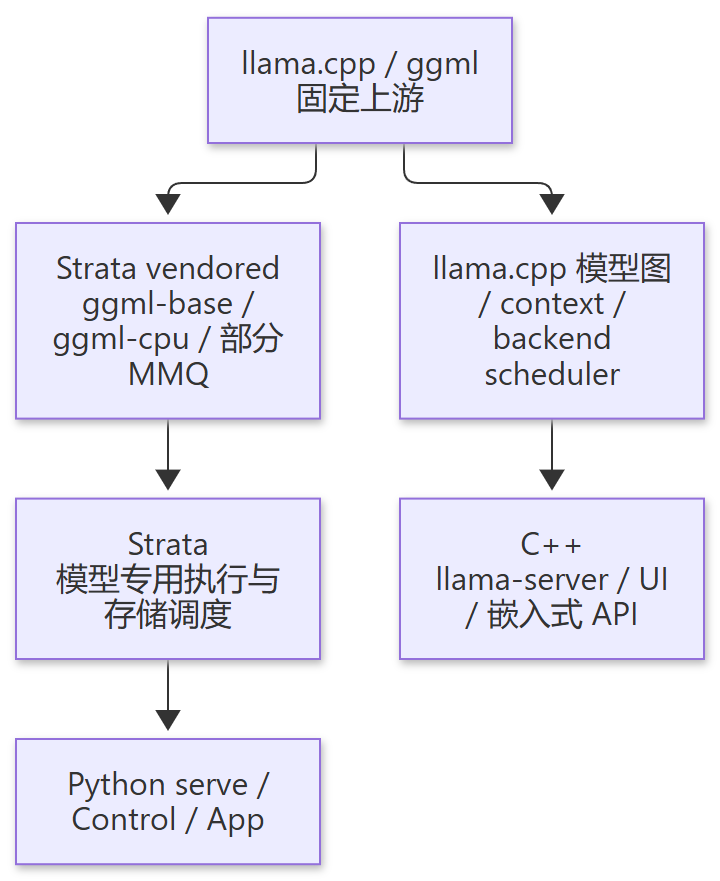
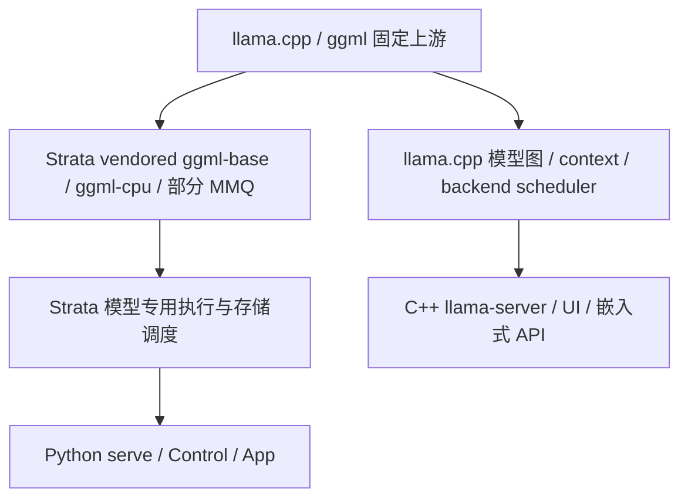
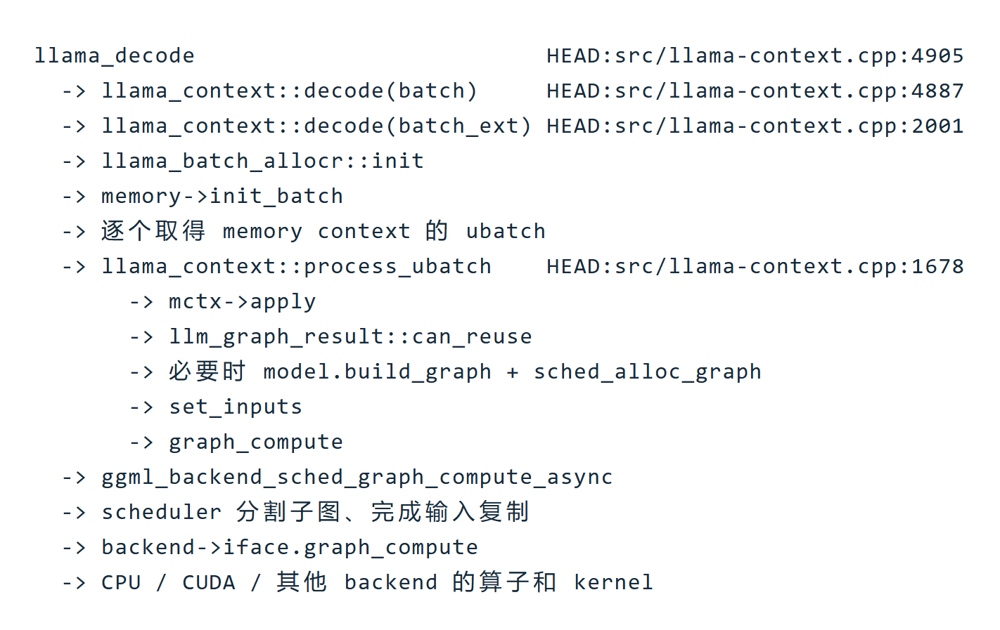
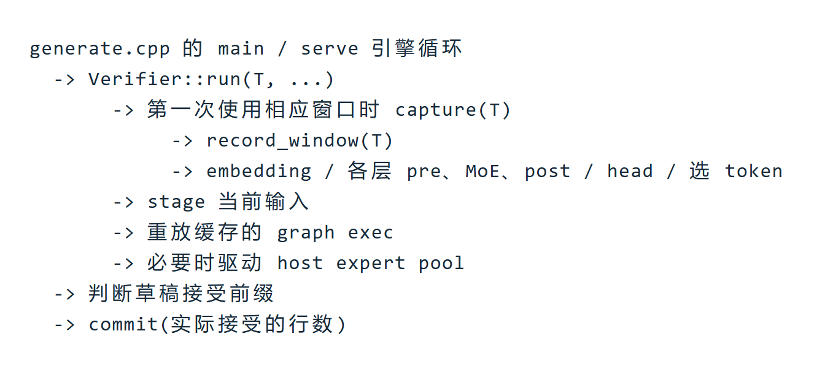
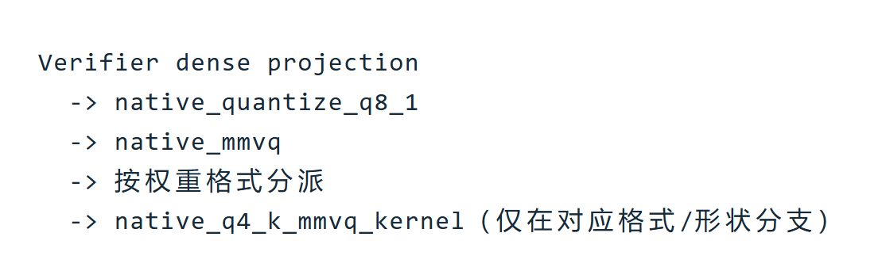

# Strata 与 llama.cpp 综合源码区别分析

> 图片已随文档同步；每张图下方保留原始图代码和 SVG。见[完整图片索引](llama-vs-strata-image-gallery.md)。

分析日期：2026-11-12。本文面向需要阅读、修改推理引擎和评估分层缓存的开发者。范围包括模型加载、执行图、MoE 权重、prefill、KV/会话状态、投机解码、服务调度、后端和本工作区的实验补丁。

本文的源码事实来自本地固定快照；设计收益属于静态推断；性能数字只引用已有本机实验。本次没有运行模型、重新编译引擎或新增性能测量。

## 1. 比较基线与证据边界

| 标记 | 对象 | 精确身份 | 解释 |
| --- | --- | --- | --- |
| S | `strata/` | `f33c8c30588ff00e24b6b63bad0bf6a14da19081`，提交时间 2026-11-09 | 工作树干净；App/Terminal 0.2.13，engine 0.1.59 |
| L | llama.cpp 上游基线 | `7d7f0287530bc8981690f361d8c1627dbae1c99a`，提交时间 2026-11-08 | 比较上游能力时以 `git show HEAD:<path>` 为准 |
| P | `llama.cpp/` 当前工作树 | L 加未提交的文件专家源和 PLE 行缓存补丁 | 16 个已跟踪文件有改动，另有 6 个未跟踪文件，不能统称为“原生 llama.cpp” |
| G | Strata vendored ggml | `3cf03257f219afbe7334045ff7c6a06ac68c627d`，2026-09-20 | S 的共享底层依赖版本，不等于 L 的版本 |
| B | 历史跨引擎实测 | 2026-11-11，Strata engine 0.1.58、llama.cpp b12211 和 P6 | 用于约束性能结论，不能直接代表 S 的 0.1.59 |

S 的版本信息见 [Strata 架构与版本说明][S-AGENTS]，G 的来源和修改清单见 [vendored 上游清单][S-UPSTREAM]。L 和 P 的差别由本次 `git status --short`、`git diff --stat` 和逐文件检查确认。本文不把本地提交声称为截至分析日的互联网最新提交，也没有执行 `pull`、`checkout` 或改写现有补丁。

阅读时保留以下边界：

- **同一 GGUF 不意味着同一计算。** CPU/GPU 算术、prefill 分块、KV 表示、投机验证与专家跳过都可能不同。
- **缓存至少有三种对象。** 专家权重、PLE/词表行和 token 前缀运行状态，不能互相替代。
- **机制存在不等于默认开启。** 每个环境变量、模型族和设备组合都要核对实际分支。
- **源代码继承、设计借鉴、二进制等价是三件事。** 本工作区有借鉴 Strata 的设计计划，但不足以声称其实现为直接复制。

## 2. 先看整体区别

最重要的区别是运行时的组织中心：**llama.cpp 以通用张量图、模型适配器和后端调度为中心；Strata 的主要 Flash-Next 路径以特定模型的验证窗口、专家放置和显式 CPU/GPU 协作为中心。** Strata 同时复用了 ggml 的 CPU 和 MMQ 组件，不能描述为完全脱离 ggml 的重写。

| 维度 | llama.cpp | Strata | 对源码修改的影响 |
| --- | --- | --- | --- |
| 核心抽象 | 模型对象、`ggml_tensor`、算子 DAG、backend scheduler | 模型族专用引擎、权重引用、验证窗口、专家源和设备缓冲 | 添加同一功能时，扩展点位置不同 |
| 模型适配 | 多个 `src/models/*.cpp`，读取运行时 hparams | 少数公开模型族；Flash-Next 的 kernel shape 受编译期 geometry 约束 | 通用模型支持与专用优化的成本分配不同 |
| 专家存储 | 已有 GPU MoE cache；主机 tensor、mmap 或 host buffer 为后备 | GPU 热专家、RAM 补集、文件源、CPU 池、PCIe/辅助 GPU 路径 | 差异在协调放置、读取和计算 |
| Prefill | ubatch 图、后端分割和选中专家上传 | 独立 Stager、host/GPU ring、按层或按路由供给 | 短 decode 和长 prompt 要分别分析 |
| 状态复用 | sequence memory、slot token 前缀、RAM state cache、状态文件 API | live 会话、checkpoint、conversation snapshot/file、token/图像前缀验证 | 两边都有真实数值状态的保存与恢复 |
| 投机解码 | 多种 drafter，经 common/server 和模型层组合 | MTP、DFlash2、suffix/lookup 等，耦合专用 verifier | 要区分候选生成、验证和状态提交 |
| 服务层 | C++ HTTP 服务与模型 context 直接协作 | Python HTTP/协议适配层管理原生引擎子进程 | 取消、排队、错误恢复和 IPC 边界不同 |
| 结构化输出 | 可在采样时应用 grammar 约束 | 已查主服务路径采用提示引导和输出后校验 | 同名 `json_schema` 不意味着同一种生成保证 |
| 多设备 | ggml 层分割、张量切分、RPC 等 | layer split、split engine、辅助专家 GPU、replica | 同叫 split 也可能并行化不同对象 |
| 工程范围 | 通用推理库、转换和量化工具、server/UI | 引擎、Terminal/Control、桌面 App、安装与更新产品链 | 不能只看引擎目录判断整个项目复杂度 |

上述总表的具体源码依据在后续各节展开。它表达架构取向，不是速度或质量排名。

## 3. 血缘关系：复用了哪一层

### 3.1 不是以 llama.cpp 引擎主体为底的普通功能分支

Strata 的 `third_party/strata-ggml/UPSTREAM.md` 明确列出从 llama.cpp 固定提交复制的内容：ggml-base、x86/Arm ggml-cpu、部分 ggml-cuda MMQ/量化文件。它没有把 llama.cpp 的模型执行主体和完整 backend 注册系统一起带入这份 vendored tree。[S-UPSTREAM]

当前构建通过 `strata_ggml_resolve` 选择 vendored tree，亦允许 `STRATA_GGML_DIR` 指向外部 llama.cpp；随后关闭 ggml 的完整 CUDA backend 和动态 backend 等配置，再编译 Strata 自己的 GPU 引擎。源码见 [ggml 构建选择][S-GGML-CMAKE]。

因此更准确的关系是：



图 1：3.1 不是以 llama.cpp 引擎主体为底的普通功能分支 · [SVG 原图](../assets/llama-vs-strata/source-analysis/figure-01.svg)

<details>
<summary>查看原始图代码</summary>



</details>

这里不能简化成“Strata 只改了 llama.cpp 的缓存参数”，也不能简化成“Strata 没有使用 llama.cpp 代码”。图片编码和部分 pack 工具还有其他 llama.cpp 依赖；vendored 清单本身就注明 mtmd、gguf-py 等没有全部迁入。[S-UPSTREAM]

### 3.2 两边的共享底层不是同一时点

S 使用的 G 比 L 早。比较 MMQ、CPU 点积和量化数值行为时，应区分“执行架构不同”和“底层版本不同”。不能默认两个仓库同名 kernel 完全相同，也不能将 L 后来的优化算作 Strata 的代码。

## 4. 源码规模与阅读地图

以下为本次静态统计：从各仓库 `git ls-files -z` 枚举已跟踪文件，读取当前工作树，以 `bytes.splitlines()` 统计物理行；包含空行、注释、测试与已跟踪第三方代码。未跟踪的 P 新文件不在表内。没有遍历 `build`、`.git` 或未跟踪下载内容。此口径用于定位代码，不能用来比较原创比例、效率或质量。

| 统计项 | llama.cpp | Strata |
| --- | ---: | ---: |
| Git 已跟踪文件 | 4,085 | 6,112 |
| `.cpp` 文件 / 行 | 754 / 548,732 | 597 / 319,144 |
| `.cu` + `.cuh` 文件 / 行 | 287 / 49,415 | 221 / 135,337 |
| `.py` 文件 / 行 | 254 / 90,702 | 1,081 / 264,379 |
| `.metal` 文件 / 行 | 38 / 14,434 | 40 / 13,996 |
| `.github/workflows/` 中有效 YAML 文件 | 61 | 12 |

`.cpp` 不包括 `.h/.hpp`，CUDA 统计不包括其他扩展名的 shader。Git 跟踪的第三方与生成代码并未剔除，Strata 的 SYCL 移植也有大量对应代码，因此不要拿语言总行数推导核心引擎的大小。

更适合阅读的局部地图如下：

| 区域 | 规模或入口 | 重点 |
| --- | --- | --- |
| L `src/models/` | 176 个 `.cpp`；含相关头文件共 50,640 行 | 各架构的 hparams、权重与图构建 |
| L `ggml/src/ggml-cpu/` | 69 个代码文件，95,880 行 | CPU 算子、量化点积、体系结构实现 |
| L `ggml/src/ggml-cuda/` | 289 个代码文件，49,939 行 | GPU 算子和矩阵内核 |
| L `tools/server/` | 73 个所统计扩展名代码文件，41,128 行 | HTTP、slot、任务队列、推理循环与测试 |
| S `src/core/` | 68 个代码文件，34,769 行 | verifier、专家来源/缓存、会话状态 |
| S `src/program/` | 7 个代码文件，22,215 行 | 参数、初始化、推理和 serving 引擎循环 |
| S `src/prefill/` | 44 个代码文件，27,809 行 | prompt 专用供给和计算 |
| S `src/kernels/` | 182 个代码文件，80,726 行 | CUDA 与 CPU 专用算子 |
| S `src/dsv41/` | 45 个代码文件，36,860 行 | DeepSeek 专用路径 |
| S `src/qwen35/` | 5 个代码文件，5,348 行 | 另一 Qwen 模型族的独立执行实现 |
| S `src/split/` | 78 个代码文件，25,278 行 | split engine 和相关内核 |
| S `sycl/src/` | 149 个代码文件，114,066 行 | 独立 SYCL 移植，不能等同一个注册插件 |

这些目录行数包含测试。Strata 的 `generate.cpp` 21,583 行、`setup.py` 11,142 行、`serve/server.py` 10,479 行；理解一条功能时应按调用链阅读，避免从大文件首行顺序通读。`setup.py` 在这里承担源码安装和配置编排，不能按普通 Python 包的几行打包脚本理解。[S-AGENTS]

## 5. 执行模型与模型适配

### 5.1 llama.cpp：用通用 DAG 表达模型

`ggml_tensor` 同时描述数据和计算节点：它有 dtype、shape、stride、buffer，也有 `op`、`op_params`、`src[]` 和 view 关系。`ggml_mul_mat` 创建结果 tensor、设置算子和输入边，构图时并不立即执行矩阵乘。`ggml_build_forward_expand` 再递归纳入输出所依赖的节点。[L-TENSOR][L-BUILD-GRAPH]

模型通过 `llama_model_mapping` 创建具体架构对象，其钩子为 `load_arch_hparams`、`load_arch_tensors`、`build_arch_graph`。因此通常可以在 `src/models/<arch>.cpp` 里同时找到模型的参数、权重和计算结构，设备执行细节则在 ggml backend。[L-MODEL-MAPPING][L-MODEL-EXAMPLE]

HEAD 上的一次 decode 主链如下。这里的 `HEAD:` 行号来自上游快照；P 的插入会使当前工作树对应行后移：



图 2：5.1 llama.cpp：用通用 DAG 表达模型 · [SVG 原图](../assets/llama-vs-strata/source-analysis/figure-02.svg)

<details>
<summary>查看原始图代码</summary>

```text
llama_decode                          HEAD:src/llama-context.cpp:4905
  -> llama_context::decode(batch)     HEAD:src/llama-context.cpp:4887
  -> llama_context::decode(batch_ext) HEAD:src/llama-context.cpp:2001
  -> llama_batch_allocr::init
  -> memory->init_batch
  -> 逐个取得 memory context 的 ubatch
  -> llama_context::process_ubatch    HEAD:src/llama-context.cpp:1678
       -> mctx->apply
       -> llm_graph_result::can_reuse
       -> 必要时 model.build_graph + sched_alloc_graph
       -> set_inputs
       -> graph_compute
  -> ggml_backend_sched_graph_compute_async
  -> scheduler 分割子图、完成输入复制
  -> backend->iface.graph_compute
  -> CPU / CUDA / 其他 backend 的算子和 kernel
```

</details>

注意以下实现区别：

- **同一 decode API 也处理 prompt。** 由 batch/ubatch 大小和状态决定执行方式；多序列 decode 也可能有多行，不能以 `n_tokens > 1` 简单定义为语义上的 prefill。
- **复用图不等于复用旧结果。** `can_reuse` 检查形状、序列布局、输出、sampler 等兼容条件，随后仍填入本次输入；这是省去构图和分配成本。KV/prompt 命中才是跳过已有前缀计算。[L-GRAPH-REUSE]
- **临时内存和持久状态分开管理。** `ggml_gallocr` 按节点生命周期回收/复用中间缓冲；memory 模块负责 KV、recurrent 或 hybrid 状态。它们不是一个缓存淘汰器。[L-ALLOC][L-MEMORY]
- **权重放置和执行放置有联系，但不是一回事。** scheduler 会考虑权重 buffer 的后端支持，也可以选取更优先设备 offload，再切分图和插入复制。CPU 是后端优先级列表的最后项，不代表所有 host 权重只能由 CPU 算。[L-SCHEDULER]

CUDA 路径还会依 dtype、shape 和设备能力在 MMVQ/MMQ、浮点 kernel、cuBLAS 或融合路径之间选择。同一个 `MUL_MAT` 节点并不固定对应一个 CUDA kernel。[L-CUDA-DISPATCH]

### 5.2 Strata Flash-Next：显式模型流水线捕获为设备图

Flash-Next 的 `Verifier::record_window` 显式组织每层 pre/post、GDN/QSA 分支、专家计算、结果合并和 head；`Graph` 封装相应设备图的捕获、实例化与重放。这里存在 CUDA Graph，却不是把模型表达为与 ggml 同等的通用 tensor/operator DAG。[S-VERIFY][S-GRAPH]

S 也有轻量权重描述符 `WeightRef`，保存地址、二维尺寸、格式和 native GGUF 等信息。正确表述是“没有沿用 llama.cpp 的通用模型算子图作为主要中间表示”，而不是“完全没有 tensor/权重抽象”。[S-WEIGHT-REF]

Flash-Next native pack 的当前 decode 主链：



图 3：5.2 Strata Flash-Next：显式模型流水线捕获为设备图 · [SVG 原图](../assets/llama-vs-strata/source-analysis/figure-03.svg)

<details>
<summary>查看原始图代码</summary>

```text
generate.cpp 的 main / serve 引擎循环
  -> Verifier::run(T, ...)
       -> 第一次使用相应窗口时 capture(T)
            -> record_window(T)
            -> embedding / 各层 pre、MoE、post / head / 选 token
       -> stage 当前输入
       -> 重放缓存的 graph exec
       -> 必要时驱动 host expert pool
  -> 判断草稿接受前缀
  -> commit(实际接受的行数)
```

</details>

`T` 是验证窗口的计算行数；没有草稿时也可以运行单 token 验证路径。native pack 不应再按旧循环概括成 `session_run_token -> block_layer_pre/post`：CLI 明确转入 verifier，serve 路径也直接调用 `ver.run`。[S-GEN-DECODE][S-VERIFY-RUN][S-VERIFY-COMMIT]

一个可跟到 kernel 的例子是：



图 4：5.2 Strata Flash-Next：显式模型流水线捕获为设备图 · [SVG 原图](../assets/llama-vs-strata/source-analysis/figure-04.svg)

<details>
<summary>查看原始图代码</summary>

```text
Verifier dense projection
  -> native_quantize_q8_1
  -> native_mmvq
  -> 按权重格式分派
  -> native_q4_k_mmvq_kernel（仅在对应格式/形状分支）
```

</details>

这说明选择 kernel 的职责更直接地出现在模型专用执行器中。它仍会使用 cuBLAS、ggml 点积/MMQ 和其他库；不能称为所有计算全部重新实现。[S-VERIFY-DENSE][S-NATIVE-MMVQ]

### 5.3 不同模型族不能共用一条说明

| S 的模型族/源码名 | 主要执行入口 | 不能外推的地方 |
| --- | --- | --- |
| Qwen3.8-Flash-Next / `qwen4exp` | `src/program/generate.cpp`、`core/Verifier`、`prefill/Prefill` | 本文多数专家和状态细节来自此路径 |
| Qwen3.6-35B-A3B / `qwen35moe` | `main -> qwen35::run -> Engine::process/forward/layer` | 是另一套执行器，不是只换 Flash-Next 的层数 |
| DeepSeekV4.1-Flash | 独立 `strata-dsv41`，`src/dsv41/` | 构建说明标明 Project Maya 移植来源，不能把整个目录称作 Flash-Next 自研代码 |

入口和构建见 [Qwen35 分派][S-Q35-ENTRY]、[Qwen35 执行器][S-Q35-ENGINE]、[DeepSeek 构建][S-DS-BUILD]。

`q4_lite/mid/big/deep` 的 geometry header 是 synthetic shape；看到这些文件不等于已经验证了对应公开模型。[S-SYNTHETIC] 同样，CMake 可构建某条模型族路径和发布包承诺支持它，也属于不同证据层次。

### 5.4 应比较完整执行链

应比较“模型图构造 + 状态安排 + 数据供给 + 最终执行”整个链条。只对照 `ggml_cuda_mul_mat_q` 和一个 Strata GEMV kernel，会遗漏专家 miss、CPU/GPU 分工、窗口验证、图捕获和状态提交这些可能主导延迟的环节。

## 6. MoE 权重：缓存、文件读取与异构计算

### 6.1 原生 llama.cpp 已经有 GPU 专家缓存

L 的 `llama_moe_cache` 逻辑键是 `(layer, expert)`。gate/up/down 或 gate_up/down 各有角色 bank，但共用专家 slot 映射；兼容布局的同 GPU 层可以共享 bank 和替换器。它缓存选中的专家，不是按整层换入，也不是每 token 都上传整层。[L-MOE-BANK]

其替换器为 **ClassLRU**：8 个频次等级、按 128 token 半衰期衰减并结合新近性。将它描述成“llama.cpp 没有热点感知，只会普通 LRU”不符合当前代码。`--moe-cache-cpu-share` 还能让一部分 miss 在 CPU 上计算，设备侧计算命中并处理其他 miss。[L-MOE-POLICY][L-MOE-DOC]

小批次路径仍需要取得实际路由 ID、规划命中/fill/slot，再把计划交还设备。这里的主机依赖和同步成本，与命中率是两个不同问题。

### 6.2 Strata 把数据来源和计算去向一起安排

| 组件 | 对象和职责 | 与 L/P 的对应关系 |
| --- | --- | --- |
| `ExpertCache` | VRAM 中的专家 blob，包含相应角色；容器 `admit` 满时可拒绝 | 对应 GPU 专家驻留，但容器本身不负责完整自适应政策 |
| `ExpertSource` / `FileExpertSource` | 提供 blob/角色切片、文件范围和 RAM/PCIe 可访问地址 | L 是 host tensor 来源；P 增加显式文件 session |
| GPU/RAM complement | 根据 profile，先填 GPU，再选择 GPU 之外的专家驻 RAM | P 的 RAM cache 与 GPU cache 独立保留，不保证互补 |
| 自适应换入/换出 | 驱动层按同层热度更新 GPU 驻留，必要时把 GPU 换出者交回 RAM | 不等同 ClassLRU；也不只是调用 `admit()` |
| host expert pool | 计算分派给 CPU 的专家并汇合结果 | L 有 CPU miss 能力；P 的当前文件模式明确禁用 |
| PCIe lane | 部分 host 专家经上传/staging/可访问地址由 GPU 计算 | 与“CPU 计算 miss”是不同的 lane |

源码分别见 [ExpertCache 准入][S-EXPERT-CACHE]、[专家源接口][S-EXPERT-SOURCE]、[RAM 补集][S-COMPLEMENT]、[自适应策略][S-ADAPT]、[专家分派][S-EXPERT-DISPATCH]。

Flash-Next 部分驻留时，verifier 通过映射通知数据把路由/激活交给 host，主机可并行组织 CPU jobs 和 GPU/PCIe/helper 工作，再在设备图依赖点合并。全驻留时可以跳过主机专家服务。它仍有同步和数据搬运，不能称为“无同步”或“SSD 到显存直连”。[S-VERIFY-HOST][S-EXPERT-DISPATCH]

**命中率统计口径不同。** L 当前批次按专家去重后规划并计数；S 的一些指标按 token×top-k 路由条目计数，PCIe/helper 路径另列。同一个专家服务多行时，两个分母会明显不同；不要只比较各自日志中的百分比。[L-MOE-COUNTERS][S-EXPERT-COUNTERS]

### 6.3 文件路径：mmap 需求分页和显式流式读取

S 的 native GGUF 专家布局会记录每个角色的 shard、offset、stride，直接从原分片取指定专家；canonical pack 则可以用 `experts.bin`。并不是任意 GGUF 都无需适配即可进入同一文件路径。[S-GGUF-EXPERT]

Windows 显式路径可以对齐、排序、适度合并同文件区间并批量提交，随后分散到所需角色缓冲；Linux 有相应 direct 分支。建立 RAM 副本后还可能释放专家映射。与之相比，L 的默认 mmap 路径让 tensor 引用文件映射，物理驻留与缺页主要由 OS 负责；“权重在文件里”和“程序显式安排文件读取”是两个层次。

P 已增加 Windows 无缓冲文件源，所以当前工作树也不再只是原生 mmap；不过它保留既有映射用于 tensor 地址/身份，文件队列默认仅两个槽，且没有 S 同等的跨角色读取批次和互补放置。这些差异见第 13 节。

上面这些机制不能单独推出速度胜负：mmap 可能命中系统文件缓存，direct I/O 可能增加物理读，合并可能增加间隙读取。只有固定工作量、资源约束与物理 I/O 观测才能分辨。[R-Q5-REPORT]

### 6.4 remote、peer、exchange 的实际含义

| 名称 | 核实后的含义 | 常见误解 |
| --- | --- | --- |
| `RemoteExperts` | 同机另一张 CUDA GPU 承担专家计算，使用 pinned host 返回行等通道 | 不是网络 RPC |
| `PeerExperts` | 辅助 GPU 持有主 GPU 之外的专家并参与计算，可有热度替换 | 不能直接等同主 GPU 远程读取全部副卡权重 |
| exchange rotation | GPU/RAM 专家换位时轮转 host buffer 所有权，省去一段 host memcpy | H2D/D2H 仍发生；不是免复制全部数据 |
| ORCA | OrcaRouter 模型的量化兼容/准备流程 | 不是专家缓存算法 |
| llama-swap | 外部多模型代理，按需启停模型进程 | 不是同一模型内部的专家交换 |

依据见 [RemoteExperts][S-REMOTE]、[PeerExperts][S-PEER]、[exchange rotation][S-ROTATION]、[ORCA][S-ORCA]、[llama-swap 集成][S-LLAMA-SWAP]。L 的 RPC 是另一种远端设备执行协议，见第 10 节。

### 6.5 PLE/n-gram 表是独立的权重行流

S 的 `src/ngram/ple_reader.cpp` 读取模型查表权重，当前缓存为八路组相联、组内轮转；它可以按页组织 I/O。P 的 `llama_weight_rows` 则取原量化行并映射为紧凑输入，缓存采用四路组相联及独立预算。[S-PLE-READER][P-WEIGHT-ROWS]

这里的 n-gram 是模型 PLE 权重查表，不是投机解码根据历史 token 复制候选的 lookup cache。两者的数据、命中键和正确性契约完全不同。

## 7. Prefill 与 decode 的不同组织

L 通过 ubatch 和同一套模型 DAG 处理 prompt 与生成，后端按形状选择批量矩阵运算和相关 kernel。大批量专家上传也会按实际 ID 选择所需数据；不能把 L 的原生 prefill 描述为上传完整模型。[L-GRAPH-REUSE][L-MOE-DOC]

S 的 Flash-Next 有独立 `Prefill::run -> run_impl -> chunk -> layer` 流程。dense 投影可以经过 `Gemm::native`，再走反量化到 FP16 scratch 与 cuBLAS；专家则有 fused 路径和直接调用 ggml MMQ 的路径，具体选择取决于格式、设备与配置。[S-PREFILL-RUN][S-PREFILL-GEMM][S-PREFILL-MMQ]

| 环节 | S 的组织方式 | 对比时要核查 |
| --- | --- | --- |
| 专家供给 | 后台 `Stager` 从 source 取 blob 到 pinned host ring | 文件读取、预取是否实际启用 |
| H2D | 独立 copy stream 将 host ring 搬到 GPU ring | event 何时允许复用槽，是否与计算重叠 |
| 批量计算 | 按 chunk/layer 或路由分组计算专家 | 量化格式、分组与融合分支 |
| 临时容量 | 可在条件允许时借 GPU 专家槽，随后恢复 | 借用成本和被逐出专家是否重新读取 |
| 循环状态 | GDN 等专用批量投影及 recurrence | chunk 变化可能改变浮点顺序 |

`Stager` 与后续 ring 供给见 [prefill 实现][S-PREFILL-STAGER]。P 已实现一般大批量文件专家上传、D2D 命中、RAM miss 不准入及图工作区回退；缺的是同等独立组织，而不是缺少所有 prefill 支持。

此外，S 的 **KVA 是默认关闭的近似 prefill**，不是普通的精确缓存命中优化。它必须单列计算/质量档位；不能与原样执行主模型的速度放在同一列而不注明。[S-KVA]

## 8. KV、前缀缓存与会话持久化

### 8.1 命中不是简单比较消息文本或一个 hash

| 项目 | L | S 的 Flash-Next |
| --- | --- | --- |
| 文本前缀判等 | 比较 token IDs，取得最长公共前缀 LCP | 检查 live/候选 checkpoint 的整段 token 前缀 |
| 多模态身份 | 媒体 chunk ID、token 数等 | 前缀内图片的 `(start, hash)`，及执行模式 |
| 可恢复位置 | 普通 KV 可细至 token LCP；recurrent/SWA 不足时退到可用 checkpoint | live 状态或实际保存的 checkpoint；不是任意 LCP 都有 recurrent 状态 |
| 消息边界 | 服务模板最终转换成 token 和状态操作 | 可选的 checkpoint 选址，不替代 token/图片验证 |
| 非前缀片段 | `--cache-reuse N` 尝试足够长的相同片段，并配合 KV shifting | 本次核实的是已保存前缀候选，不应声称为通用非前缀状态复用 |

L 的判等与复用分支见 [token/multimodal LCP][L-LCP]、[slot 复用循环][L-PREFIX-REUSE]；S 的候选和状态见 [conversation cache][S-CONV-CACHE]。

S 的 `STRATA_CACHE_MESSAGE_BOUNDARY=1` 默认关闭，选择长前缀中靠近尾部的 turn 边界，默认阈值为前缀至少 8,192 token、尾部最多 1,024 token。它解决“编辑最后一条消息时 checkpoint 太远”的问题，代价是可能分割 prefill chunk、增加快照成本。不能将其说成纯消息级 cache 或固定 block hash cache。[S-MESSAGE-BOUNDARY]

### 8.2 L 的 slot、共享 RAM cache 和文件接口

| 层次 | 数据结构/接口 | 语义 |
| --- | --- | --- |
| live memory | `llama_kv_cache`、recurrent/hybrid memory | 各层实际数值状态；后端可为 GPU 或 CPU，不能硬说全部都在显存 |
| slot prompt | `server_prompt` | token 历史、状态引用与相关 checkpoint |
| 共享 RAM cache | `server_prompt_cache::states` | 保存主/draft 的 sequence state 字节，可恢复到其他目标 slot |
| 显式磁盘保存 | `llama_state_save/load_file`、`llama_state_seq_save/load_file` | 全 context 或某 sequence 状态，供调用方/slot 操作使用 |

unified KV 下一个 stream 的 cell 可以属于多个 sequence；`seq_cp` 在同 stream 内可能只增加归属，并非复制完整 KV tensor。非 unified 时 stream 组织不同。[L-KV-STREAMS]

共享 RAM cache 不局限原 slot，也不是天然跨进程服务。超预算删除 RAM 条目并不自动写入磁盘；有状态文件 API，仍不等于具备自动 L0→L1→L2 淘汰系统。[L-RAM-CACHE][L-SLOT-SAVE]

L 的 RAM cache 还会去除被更长前缀覆盖的条目，超预算从旧端删除；恢复后把条目从 RAM cache 移出。这个行为不宜简单称为常规“命中即提升”的 LRU。[L-RAM-CACHE]

另外，本快照 `defrag_thold` 已废弃。不能沿用旧教程把传统按阈值 defrag 当成当前 KV 调度中心；模型专用 KV 与 recurrent memory 也应分别检查。[L-CONTEXT-PARAMS][L-KV-UPDATE]

### 8.3 S 的 conversation 四组文件分别做什么

| 文件组/类型 | 真实职责 | 是否独立包含历史 K/V |
| --- | --- | --- |
| `conversation_state.cpp` / `ConversationCheckpoint` | token、图片标识、GDN recurrent、PLE history、indexer tail/dead/block position 等捕获恢复 | checkpoint 本身不含完整历史 KV 页，依赖对应 positional KV 仍有效 |
| `conversation_snapshot.*` / `SavedConversation`、`ConversationKv` | 完整会话镜像，关联运行状态和 K/V、scale、pooled indexer 等数值 | 是 |
| `conversation_file.*` | 上述状态的磁盘编码和校验，也可从 device/host pool 流式写 | 是，不只是聊天文本 |
| `conversation_memory.*` | RAM/cgroup/限额遥测、保存与恢复准入判断 | 不是存储会话的第四个容器 |

数据结构与捕获恢复见 [conversation 类型][S-CONV-TYPES]、[完整状态捕获][S-CONV-CAPTURE]、[文件接口][S-SESSION-FILE]、[内存准入][S-CONV-MEMORY]。

S 的 streamed KV 可以让 host pool 成为活动会话的权威 K/V，VRAM slot 保存当前驻留副本；这又区别于将一个暂不活跃会话停放为 `SavedConversation`。因此不能按“显存 KV→RAM snapshot→SSD”一条直线描述所有 S 配置。[S-KV-HOST]

活动 checkpoint 链通常保 root 并限制条目数；停放会话另受 RAM 字节和 slot 数量约束，可保护 pinned/guarded 条目。自动 RAM 预算策略会保留物理余量，并对可用量取比例及封顶；这属于会话缓存预算，不能与 `resident-budget-gib` 的专家权重预算相加混称同一配额。[S-CONV-POLICY][S-CONV-MEMORY]

### 8.4 两边的数值文件都不是通用 KV 交换协议

| 项目 | L | S |
| --- | --- | --- |
| 格式标识 | 全状态 GGSN/version 11；sequence GGSQ/version 4 | `STRSESS` 加版本字节，v1 |
| 内容 | token 列表、memory payload，含 cell/position/sequence 和真实 K/V 等 | geometry、layer range、running state、checkpoint、各层 K/V 等 |
| 校验重点 | 架构、层数、stream、dtype、行大小等 | header/payload 校验、模型和配置 fingerprint |
| 身份限制 | 检查布局不等于证明同 shape 不同权重可安全互用 | 配置含 engine/backend/KV/RoPE；模型 fingerprint 为采样而非全文件 SHA |
| 跨引擎互读 | 未定义 | 未定义 |

L 的版本见 [公共常量][L-STATE-VERSIONS]，payload 见 [KV state 编码][L-KV-STATE]；S 的格式、身份和采样范围见 [session 编码][S-SESSION-CODEC]、[session identity][S-SESSION-IDENTITY]。

S 的模型指纹包含文件大小与首尾 MiB，不覆盖任意中段更改。L 的全状态读取还留有模型身份加强检查的 TODO。两者都不应作为无需版本和模型约束的 portable cache；也不能把 state API 的名字理解成完整的进程、HTTP 会话和 sampler 快照。

### 8.5 缓存对象与指标要分开

| 名称 | 缓存的数据 | 主要影响 |
| --- | --- | --- |
| 专家 cache | 固定模型权重 | 数据读取、上传、MoE 计算 |
| PLE row cache | 模型查表行 | 查表 I/O 和相应前向计算 |
| prompt/conversation cache | 已处理 token 的运行状态 | 重复前缀 prefill 与 TTFT |
| 图/graph exec cache | 计算拓扑、执行计划和缓冲绑定 | 构图、分配、launch 成本 |
| OS page cache | 文件物理页 | mmap/direct 路径的实际存储流量 |

例如 S 的 `serve/cache_drop.py` 清理模型文件的 OS 页缓存，`DISJOINT_EXPERT_CACHE.md` 讨论专家重复驻留，二者都不能当作 conversation KV 的淘汰实现。[S-CACHE-DROP][S-DISJOINT]

## 9. 投机解码与数值契约

### 9.1 两边都有 MTP，不能用“有无投机”概括区别

| 层次 | L | S 的已核实实现 |
| --- | --- | --- |
| 草稿来源 | 独立 draft model、EAGLE3、MTP、DFlash、DSpark，以及多种 n-gram 方法 | Flash-Next 的 MTP、DFlash2、suffix/lookup、可扩展 draft source |
| 组合层 | `common/speculative.*`，由 server/工具调度 | `DraftPolicy` 与窗口规则，加主生成循环 |
| 主模型验证 | 将草稿纳入 batch，取得 target 分布并处理接受 | `Verifier::run(T)` 验证窗口 |
| 状态提交 | 接受后保留正确主/draft sequence 状态 | 提交接受前缀的 recurrent/KV/PLE 等状态 |
| 控制器证据 | 注册项和调用路径可核对 | `Controller` 有定义/测试，但未核实主路径使用，不能只凭文件名当成生产调度核心 |

L 的类型注册和 MTP driver 见 [spec 类型][L-SPEC-TYPES]、[MTP driver][L-SPEC-MTP]。S 的来源和选择见 [draft source][S-DRAFT-SOURCE]、[draft policy][S-DRAFT-POLICY]、[window rule][S-WINDOW-RULE]。

S Flash-Next 的 MTP 实现是单 trained head 递归产生草稿，草稿专家有独立常驻策略；不能用 target 专家缓存预算推断草稿器也同样分层。其他模型族的草稿布局和支持条件应分别核对。[S-MTP]

本快照 L 使用 `--spec-draft-model`、`--spec-draft-n-max` 和 `--spec-ngram-*` 等参数；旧的 `--draft-max` 已被移除。写部署或对照命令时不能直接套旧参数表。[L-SPEC-ARGS]

### 9.2 “验证”包含不止一种接受规则

两边都可看到以下机制，但默认和适用范围要看实际配置：

1. **匹配接受：** target 在各位置选择/采样 token，与候选一致则继续，遇到首个不一致停止；全接受还可产生 bonus token。
2. **概率拒绝采样：** 在实际提供草稿分布 `q` 且启用相应分支时，用 `min(1,p/q)` 接受；拒绝后从归一化的 `max(0,p-q)` 残差分布采样。
3. **共享随机数的 coupled draft：** 增加 target/draft 匹配机会，但与实现 p/q 拒绝采样是不同机制。

L 的匹配和概率路径见 [common sampling][L-SPEC-SAMPLING]；S 的 coupled/probability 路径见 [coupled draft][S-COUPLED]、[GPU sampler][S-SAMPLER]。不能看到一个“spec”开关就声称所有模式严格使用同一接受算法。

S 的 gated proposal 还有限定组合，某些置信门分支的源码明确讨论潜在分布偏差。因此“存在正确的拒绝采样实现”不等于“所有开关组合都严格保原分布”。[S-GATED]

### 9.3 专家尾跳与近似 prefill 要单独标质量档位

S 的 route tail skip 可以对每行路由都处在尾部且 GPU miss 的专家跳过读取/计算并置零贡献；其他专家的权重不因此全部重归一化。这改变主模型计算，与只增加候选再验证的投机过程不同。[S-TAIL-SKIP]

同理，第 7 节的 KVA、精度转换、量化 pack 和 prefill chunk 改变，都需独立记录。公平实验至少要列出完整 top-k、tail skip、KVA、草稿器、实际 offered/accepted、KV dtype、chunk/ubatch 和执行设备；输出 token 数相同不足以认定同工作量。

## 10. Serving、并发与多设备

### 10.1 进程边界

L 的单模型 `llama-server` 是 C++ HTTP 线程池、进程内任务队列和推理主循环，直接操作同进程 model/context。router 模式则可以启动模型子进程并通过本地 HTTP 代理，因此“llama.cpp 永远单进程”不准确。[L-HTTP][L-ROUTER]

S 的 Python server 启动独立原生引擎，以 stdin/stdout pipe 通信：单请求 `GEN`，输出 `T <token_id>` 和 `DONE`；批量请求另有 `BGEN`、`BT`、`BDONE` 等。pump 线程分流引擎输出，再由 Python 做协议、工具调用和 HTTP/SSE 封装。内部 token 通道不是 HTTP，也不是 Python 执行 tensor 计算。[S-PIPE][S-BATCH-IPC]

S 因而多出 IPC、解析与故障恢复边界；L 的同进程路径减少这一边界。这个静态差别不能单独推出 TTFT 的大小：模型加载、排队、prefill、缓存和输出缓冲可能更大。

### 10.2 API 兼容面应按当前路由检查

| 接口 | L | S |
| --- | --- | --- |
| OpenAI Chat Completions | 有 `/v1/chat/completions` 等 | 有 |
| Anthropic Messages | 有 `/v1/messages` | 有，另有 `count_tokens` |
| Responses | 有 `/v1/responses` 等 | 有 |
| completion / embedding / rerank / infill / tokenize / apply-template | 主 server 有对应路由 | 本次主 POST 分派未见逐项等价接口 |
| slot/state/配置/观测 | 有 slots、props、metrics 等 | 有引擎/会话管理、telemetry、metrics 等 |
| MCP | 可作为 stdio MCP client 连接工具 | 另有管理型 MCP server；serve 也有工具相关组件 |

路由依据见 [L 路由注册][L-ROUTES]、[S POST 分派][S-ROUTES]；MCP 方向见 [L MCP 说明][L-MCP]、[S MCP 工具][S-MCP]。API 名称存在不代表实现完整云端语义，例如两边的 Responses 适配都拒绝 `previous_response_id`。[L-RESPONSES][S-RESPONSES]

S 的某些结构化输出会先缓冲和验证再交付内容，这会影响“第一个可见内容事件”的时间。测 TTFT 时应区分引擎首 token、角色/空 SSE、推理内容、答案内容和完整 JSON 交付。[S-STRUCTURED-STREAM][R-TIER-EVAL]

### 10.3 同叫 parallel，批处理对象也不完全相同

L 的 slot 对应共享 context 中的独立 sequence。continuous batching 循环先加入生成中的 token，再按空间和配置纳入 prompt 工作。`--parallel` 是 slot 数，`n_batch` 是逻辑 token batch 上限，`n_ubatch` 是物理微批上限，三个数不能互换。[L-CONT-BATCH]

S 也有原生 batch decode，不能概括为“Python 逐请求串行调用”。多个 slot 可在一验证窗口中各贡献 token；admission/prefill 控制通道则有自己的串行和 chunk yield 约束。[S-BATCH-IPC][S-BATCHING]

| S 对象 | 表示什么 |
| --- | --- |
| slot/session | 一条会话的活动状态 |
| batch group | 同一引擎内的 slot 分组，可用于多卡流水 |
| replica | 独立完整引擎，使用自己的 GPU 组 |

replica 路由会考虑未缓存 prompt 工作和在途负载，不只是 round-robin。[S-REPLICAS]

### 10.4 多卡与多机

| 机制 | 拆分对象和边界 |
| --- | --- |
| L `split-mode` | 当前有 none/layer/row/tensor；tensor 为实验性 |
| L `--tensor-split` | 设备分配比例，不等同 `split-mode=tensor` |
| L RPC | 远端 ggml 设备执行协议，可联合本地和远端设备 |
| S layer split | 连续层范围分配，prompt 可按 chunk 流水；部分 dense/session 等数据仍可每卡复制 |
| S split engine | 独立 `strata-split`，每层由多卡协作、交换部分结果；当前选择代码限制 Linux |
| S helper/peer experts | 同机辅助 GPU 的专家容量和计算 |
| S replica | 整个引擎/模型的副本路由 |
| S split serve | 本地两个引擎用 SAVE/RESTORE session 文件交接 prefill/decode；当前单请求且不重叠 |

依据见 [L split 参数][L-SPLIT]、[L RPC][L-RPC]、[S multi-GPU][S-MULTI-GPU]、[S split engine][S-SPLIT-ENGINE]、[S split serve][S-SPLIT-SERVE]。

S 的 split serve 不是已经完成的网络 P/D/KV 传输系统；同机 session 文件中转也不能视为 LMCache/RDMA connector 的现成替代。

### 10.5 可观测性与产品层

L `/metrics` 有 prompt/generated/cached token、处理/排队请求与投机等指标。S 同时有 telemetry 和 metrics，不同 metrics 路径/内容协商可使用不同命名兼容形式。S 的 ITL histogram 是由平均 decode 间隔构造，不能当作逐 token 实测延迟分布，与客户端 p99 直接横比。[L-METRICS][S-METRICS][S-PROMETHEUS]

S 的 App、Terminal/CLI、Control 和 engine/server 构成统一安装/管理产品链；L 本身也有 server/UI、router 和命令行工具，不能粗略归纳为“L 只有库，S 才有产品界面”。[S-AGENTS][L-ROUTES]

### 10.6 文本前后处理与结构化输出

L 的 tokenizer/vocabulary 位于 `src/llama-vocab.cpp`，聊天模板主要在 C++ common/chat 和 Jinja 组件。S 的当前 Python 服务则使用 `tools/strata_tokenizer.py` 的 BPE tokenizer，并在 `serve/frontend.py` 渲染模型模板。S 的 tokenizer 在遇到未知 pre-tokenizer 时会拒绝，不能因其读取 GGUF 词表就推断覆盖 L 的全部 tokenizer。[L-VOCAB][L-CHAT][S-TOKENIZER][S-TEMPLATE]

对 Agent 和工具调用尤其重要的差异是 **grammar constrained decoding 与生成后验证**：

- L 的 sampling 可以在选择 token 时应用 grammar sampler，JSON schema 也有转换到 grammar 的实现。这里讨论的是存在这条约束生成路径，不承诺任意 schema 的所有特性都可转换。[L-GRAMMAR][L-JSON-GRAMMAR]
- S 的 `serve/structured.py` 明确写明原生引擎没有 grammar decoder：通过提示引导，生成后校验，失败返回错误。`jsonschema` 还是可选依赖，未安装时 `json_schema` 只检查 JSON object 这一层；它不是完整 schema 的同等保证。[S-STRUCTURED]

因此 API 同名不足以判断工具输入可靠性。测试应包含非法 JSON、schema 违规、流式首内容时间和错误返回，而不能只确认某个正常请求成功。

## 11. 量化与模型文件：格式名不是兼容性保证

### 11.1 llama.cpp 的类型体系

L 的 `ggml_type` 声明有 **36 个当前有效枚举项**，不含 `GGML_TYPE_COUNT`，也不含已注释移除的类型。`GGML_TYPE_COUNT = 44` 是带历史空洞的编号上界，不能写成“支持 44 种量化格式”。这些类型还包括浮点、整数和中间表示，36 也不能直接叫模型量化档位数。见 [ggml 类型定义][L-GGML-TYPES]。

| 类型族 | L 的例子 | 与 S 的关系 |
| --- | --- | --- |
| 浮点/整数 | F32/F16/BF16/F64、I8/I16/I32/I64、F8_E4M3 | 基础 dtype 或中间数据，不是某个模型 pack 的完整适配承诺 |
| 经典量化 | Q4_0/Q4_1、Q5_0/Q5_1、Q8_0/Q8_1 | S 按权重角色、模型族和后端选择实际路径 |
| K-quants | Q2_K/Q3_K/Q4_K/Q5_K/Q6_K/Q8_K | S 的 K-quant 专家支持需看 gate/up/down 各自格式 |
| IQ | IQ1_S/IQ1_M、IQ2_XXS/XS/S、IQ3_XXS/S、IQ4_NL/XS | 两边共享部分编码和点积来源，运行调度仍不同 |
| 低比特扩展 | Q1_0、Q2_0、TQ1_0、TQ2_0 | 不等于 S 的 trellis 类型 |
| FP4 | MXFP4、NVFP4 | L 本身已有，不能作为 S 独有能力 |
| Strata trellis | TQ2_T、TQK6/TQK7、TQP5/TQP6/TQP7 | S 的扩展来自相应 fork/overlay，并非 L 原生类型 |
| Strata 特定 pack | NVFP4 GPTQ/QAD、DeepSeek EXL3 等 | 需要其 pack、scale、布局和 kernel；不能只按后缀推断可互换 |

### 11.2 Strata 为权重角色分别选路径

S 的构建清单明确列出了所编译 MMQ 类型，并按 K-quants、trellis 等选项补充实例。[S-GGML-CMAKE] 其 `QUANTS.md` 则按 gate/up/down 和设备分别列出内核；例如 UD-Q5_K_XL 的专家不同角色可以分别为 Q5_K/Q6_K 和 Q8_0。一个 pack 名称不是所有张量 dtype 一致的意思。[S-QUANTS]

trellis 的 144–149 是专门隔离的枚举值，不能送入普通 ggml 类型表当成普遍有效的 tensor dtype。上游 TQ1_0/TQ2_0 与这些 trellis 类型也不能混淆。[S-TQ-TYPES]

NVFP4 还需要区分量化方法、block scale、tensor scale 和 pack 表示。S 的文档区分 GPTQ、NVIDIA 与 QAD/FP4-Local 路径，PLE 行也可能有单独编码。仅有“都支持 NVFP4”不足以证明两套 pack 或数值结果兼容。[S-NVFP4]

## 12. 后端、构建与工程治理

### 12.1 后端抽象的组织差异

| 后端/执行方式 | llama.cpp | Strata |
| --- | --- | --- |
| CUDA | ggml CUDA backend，执行模型图 | 自有 GPU 引擎与 kernel，另复用一部分 ggml MMQ |
| HIP | ggml HIP 构建和 CUDA/HIP 共用实现 | CUDA 命名兼容层和 HIP 构建，仍有设备专用分支 |
| Metal | ggml Metal backend | `metal/` 独立 CMake 工程、运行时和 kernel 适配 |
| SYCL | ggml SYCL backend | `sycl/` 独立移植项目，顶层可跳转构建 |
| Vulkan/WebGPU/OpenCL | 有对应 ggml backend | 本快照未发现同等模型执行 backend |
| CPU | 通用模型图可落在 CPU；多种 ISA 实现 | 有 CPU expert 池、底层点积和 CPU 测试构建；不能据此承诺所有模型纯 CPU serving |
| RPC | ggml RPC backend 与 server 工具 | 有其他专家/分片机制，不能按名称视为同一设备 RPC 协议 |
| 其他设备 | CANN、Hexagon、OpenVINO、MUSA、virtgpu、zDNN、ZenDNN 等目录 | 没有逐项对应的通用模型 backend |

L 的后端组织可以直接从 `ggml/src/ggml-*` 和注册层核对。S 的 CUDA/HIP/SYCL 顶层入口见 [顶层构建][S-CMAKE]；Metal 是 [独立工程][S-METAL-CMAKE]。S 的 `CAPABILITIES.md` 还将“打包”“支持”“有测量”分开；具体模型族和设备组合必须看这一层，不能从 CMake 开关直接推出经过验证的支持。[S-CAPABILITIES]

这里的“本快照未发现”只陈述该比较范围，不证明项目未来不能添加这些后端。

### 12.2 新增模型与新增后端的维护代价

对于 L，新增架构通常围绕模型元数据、权重和 `build_graph` 适配；如果所需算子已存在，能够复用多个 backend。新增算子则需要各后端实现或显式 fallback。

对于 S 的 Flash-Next 路径，模型文件会提供 geometry，kernel 中固定的维度同时由 `kCompiledGeometry` 校验；另一个 shape 可以有独立 geometry header 和构建产物。这让编译期专门化和布局优化更直接，也把“新增一组维度”变成需要 kernel/构建验证的契约变更。[S-GEOMETRY]

这属于静态维护成本判断，不能由此推断某项目开发一定更快。S 已有 geometry 参数化和多个模型族，因此“只能跑一个写死模型”也不准确。

### 12.3 验证与贡献

两者主许可证均为 MIT；第三方文件仍需遵守各自声明。[L-LICENSE][S-LICENSE]

S 的 CI 区分 Linux/Windows/macOS CPU 检查、CUDA/HIP/SYCL/Metal 编译、Python serving/Control 和 App 检查。编译后端通过不等于有目标 GPU 数值或性能验证；源码中的 workflow 不能当成本次执行结果。[S-CI-CHECK][S-CI-BACKENDS]

L 的 workflow 则覆盖更多硬件和 backend 构建、server/UI、量化与行为检查。两个项目都要求贡献者对代码理解与证据负责，不能归纳成“一个有工程规范、另一个没有”。S 的贡献规则明确要求报告实际执行的验证并区分未运行项。[S-CONTRIBUTING]

## 13. 本地 P 补丁：当前工作区到底改了什么

### 13.1 功能落点

| 文件组 | 本地增加的行为 | 保留的 L 机制 |
| --- | --- | --- |
| `llama-model-loader.*`、`llama-model.*` | 利用 shard/offset/stride 登记专家源；相应张量强制 lazy、限制不支持组合 | GGUF 模型元数据、权重身份和正常其他权重放置 |
| 新 `llama-expert-store.*` | Windows direct/overlapped 文件读取、按大小分组的 RAM 角色 cache、读/上传双槽及租约 | 原始量化字节，不改变模型路由 |
| `llama-moe-cache.*` | miss 从文件 session 供给；大批量可用 bank D2D 命中，prompt miss 绕过 RAM 准入 | 原 GPU bank、slot 规划和专家计算 |
| 新 `llama-weight-rows.*`、`models/qwen4exp.cpp` | PLE 行排序去重、紧凑表、原行 ID 映射、本地 CPU `GET_ROWS` 输入 | 模型原有 hash/EOS/history 和原量化行 |
| `llama-context.*`、`llama-graph.*` | workspace 预检、ubatch 回退、强制专家算子设备、失败传播、受控 warmup | 模型 DAG 和 backend 执行主链 |
| `ggml-backend.*` | 可失败的 copy callback、保留显式设备分配的测量接口 | 未处理时的原复制方式，以及既有 callback 兼容入口 |
| 构建、测试、开发文档 | 注册新模块和资源/错误路径检查 | 原项目的 CMake 和测试体系 |

关键代码见 [P 配置和范围][P-DOC]、[文件源/RAM 分组][P-EXPERT-STORE]、[transfer 流水][P-TRANSFER]、[PLE 行适配][P-WEIGHT-ROWS]、[workspace 检查][P-WORKSPACE]。

### 13.2 与 Strata 的对应是设计语义，不是同一份实现

| P 的功能 | S 的语义对应 | 差别 |
| --- | --- | --- |
| 原 GGUF 专家文件范围 | `FileExpertSource` | S 有不同的批量读取、合并与布局选择 |
| RAM cache | 热专家/RAM 补集或模型族专用 store | P 缓存 gate/up/down 角色，按精确尺寸分组；不是完整 blob 补集 |
| 读与 H2D 生命周期 | pinned staging、copy event | P 以固定预算、一至两个槽约束；S 的一些 staging scratch 可以增长 |
| PLE cache | `PleReader` | P 四路 LRU＋紧凑图输入，S 八路轮转＋页组织 |
| GPU/RAM 保留 | 两级各自缓存 | P 可有重复驻留，没有 S 的统一互补交换 |
| CPU/helper experts | S 的 host pool/remote/peer | 没有移入 P 当前文件模式 |
| 更长 verifier graph | S 的窗口录图/重放 | 没有替换 P 原来的 ggml 模型执行器 |

因此本工作区确实在借鉴 Strata 的文件供给和分层思路，已有计划也明确说明这一目标；当前证据不足以声称“把某个 Strata 提交整段移植回 llama.cpp”。[R-OOC-PLAN] “完全没有关联”和“直接复制同一实现”都超过证据。

### 13.3 P 需要触及的 ggml 扩展点

**第一，tensor copy callback 可以返回 `ggml_status`。** `SUCCESS + handled` 表示本回调已处理，`SUCCESS + unhandled` 才允许默认复制；取消或 I/O 失败要中止并阻止依赖子图继续。否则原来只有“处理/未处理”的接口容易把失败误当成回退，触发不受控整张量复制。[P-COPY-API][P-COPY-FAILURE]

**第二，`ggml_backend_sched_reserve_size_assigned` 在测量时保留显式设备选择。** 文件专家的 `MUL_MAT_ID` 先被指定给支持设备，再测量工作区；测量会改图状态，所以 context 需要重建。该接口不在 L 的原基线中，亦不是 S 使用的同名接口；S 的对应职责主要在专用执行/文件源/事件层。[P-RESERVE-API][P-FILE-GRAPH]

这说明扩展 llama.cpp 时不能只添加一个文件读取类，还要与调度器的数据来源、默认回退和错误语义对齐。新增导出接口也意味着配套 library 构建与接口评审需要一起考虑。

### 13.4 边界和默认行为

`LLAMA_EXPERT_STORE=file` 才启用文件模式。当前范围是 Windows、单 CUDA、单条因果文本序列、非零 MoE GPU cache、CPU miss share 为 0；对 MTP、LoRA、多设备切分等组合明确拒绝。它不能被宣传成通用所有模型/平台的 out-of-core backend。[P-DOC][P-SCOPE]

默认配置包括 256 MiB 专家 RAM、32 MiB staging、depth 2、4096 MiB 图 workspace 和 64 MiB PLE RAM。各预算作用域不同；图 workspace 上限不包含常驻权重、KV、GPU cache、驱动及其他进程，也不是总显存上限。[P-DOC]

RAM 分组固定后不互借空间，遇到倾斜工作量仍可能闲置。GPU/RAM 重复字节也是实际限制，不能只用总分配字节推算独立专家覆盖率。

“功能默认关闭”还不等于“未启用时所有源代码路径逐字节不变”：P 在普通模式也加入了 `LLAMA_MMAP_PREFETCH` 控制，并改变部分 graph reserve 失败传播。这些应在后续回归中单独核验，不能自动继承 S 对另一个版本的默认路径承诺。[P-PREFETCH][P-RESERVE-FAILURE]

新增测试文件和历史 P5/P6 报告是已存在的验证资产；本次只核对源码和报告，没有重新执行它们，也不将其写成本次测试通过。

## 14. 已有性能证据怎样约束源码判断

### 14.1 2026-11-11 的 Q5 同条件对照

已有报告比较 Windows、单 RTX 5080、Qwen3.8-Flash-Next UD-Q5_K_XL，统一 24 GiB 测试进程工作集上限、约 4 GiB GPU 专家缓存和固定 token 轨迹；P6/S 专家 RAM 约 16 GiB。每组只有 3 个有效样本，Strata 为 engine 0.1.58，并关闭 MTP/lookup 与专家尾跳。[R-Q5-REPORT]

| 路径 | Decode 中位数 tok/s | READY 后请求 TTFT s | 启动到 READY s | 观察 |
| --- | ---: | ---: | ---: | --- |
| L 的 mmap 参考，关闭加载预取 | 1.75 | 76.96 | 5.86 | 仍可使用系统文件页缓存 |
| P6 | 2.36 | 28.97 | 2.63 | 有显式 RAM cache 和有界文件流水 |
| Strata 0.1.58 | 2.21 | 11.28 | 22.32 | 启动预装成本更高；3 次 decode 范围 0.76–2.54 |

这组结果支持“Strata 的 READY 后响应路径不同，且本次 TTFT 更短”，不支持“Strata 的 decode 普遍更快”。Strata 也出现慢读长尾。原生参考关闭了加载预取，不是完全未修改发布二进制。

将每轮启动到 READY 与请求到首 token 相加后，报告的 P6/S 中位数为 32.00/33.58 秒；这是阶段和估计，不能冒充单独实测的冷启动 TTFT。因此不能只展示 11.28 与 28.97 秒而隐藏初始化成本。[R-Q5-REPORT]

跨引擎强制 token IDs 一致只控制执行轨迹，不证明 logits、自然回答或质量一致。同 GPU 路径的 P6 有独立数值检查；不能把这份验证扩展成 P6 与 Strata 等价。

### 14.2 不把权重实验混进 KV 层实验

既有 KV 研究将收益基线设为调优后的原生 slot/cache 配置，且明确指出早期工作集没有超过 RAM 配额，不能证明 SSD 的额外容量收益。[R-TIER-EVAL]

专家权重分层主要改变模型数据供给与 decode/prefill 计算；前缀状态分层主要复用已有 prefill 状态。两者都可能访问 SSD，但工作集、命中键、写入时机和评价指标不同。不能用 Q5 的专家 SSD 实验来证明会话 KV 的 L2 ROI。

## 15. 对本工作区的改造取向

以下是从源码结构和既有实验得到的工程判断，不是已经实现或验证的收益。

| 可借鉴机制 | 适合落点 | 要保留或补齐的契约 | 判断收益所需证据 |
| --- | --- | --- | --- |
| 有界批量读、同文件区间排序/适度合并 | P 的文件源、`transfer` 读取端 | 固定 staging 预算、读放大统计、取消排空和消费租约 | 同轨迹物理 MiB/token、实际在途数、p95/p99 与端到端吞吐 |
| GPU/RAM 互补放置与换出交回 | 现有 MoE cache 与文件 session 的交界 | 两级对象身份、GPU slot 使用寿命、D2H/H2D 完成和并发访问 | 独立覆盖容量、miss、交换成本、真实读盘量 |
| 独立 prefill 数据供给流水 | context 的一般专家上传路径 | 先测图工作区，再分配 ring；禁止覆盖仍在消费的权重 | 长 prompt TTFT、其他请求受到的阻塞、启动时间 |
| CPU/GPU 混合专家计算 | 现有 CPU miss 分支的受控扩展 | 文件模式的主机数据寿命、量化点积、结果汇合和容差 | logits/质量检查与不同 PCIe/RAM 条件下的资源曲线 |
| checkpoint 的位置和尾部策略 | 原有 server prompt/state cache | token/图像一致性、recurrent 状态和拒绝分支回滚 | 多轮编辑、工具回合、跨 slot 的命中长度和实际客户端 TTFT |
| 更长 GPU 图与路由通知优化 | ggml scheduler/执行 callback 附近 | 图捕获限制、所有后端 fallback、错误传播 | kernel 时间线、主机空档和逐层同步消融 |

优先顺序应由目标决定：

1. **目标是减少超 RAM 模型的慢读：** 先沿用 P6 的正确性和预算边界，分开验证 I/O 并发、读取合并和驻留策略。既有 Q5 对照并没有证明 Strata 每步物理字节更少，不应先把全部收益归给互补驻留。[R-Q5-REPORT]
2. **目标是交互 TTFT：** 分开测启动、prefill、状态恢复和服务排队。按实际长提示、编辑历史、工具调用和并发干扰来判断；短 prompt 的 decode 测量不够。
3. **目标是 KV 的 L1/L2：** 先用引擎自己的完整 state API 保持语义，再确定对象键、预算、淘汰和恢复成本。不能把专家缓存的 `(layer, expert)` 方案直接套成 KV block 协议。
4. **目标是 LMCache 集成：** 需要明确选择 opaque prefix-state blob 桥接，还是实现 KV tensor connector。两边有状态保存并不自动给出 LMCache 所需的 token chunk/dtype/layout/生命周期接口；现有集成缺口研究已说明这一点。[R-LMCACHE]

本工作区的 P 本来就是“保留 llama.cpp 图与 GPU 专家缓存，在数据源边界引入受控文件/RAM 层”的路线。它与搬入 Strata 的 verifier、专家池和模型专用 kernel 是两种不同规模的工作。[R-OOC-PLAN] 对当前工程，值得借鉴的是边界明确、能独立测量的机制；直接迁移巨型生成循环会同时引入状态、调度、数值和平台耦合，难以判定收益来源。

要形成可维护的上游扩展，还要回答：文件源的所有权由 model 还是 context 承担、哪些算子能消费它、失败时 context 是否可重用、批处理与多序列怎么隔离，以及不支持的设备如何明确拒绝。这些问题比复制一个 LRU 容器更接近两者的真正源码差异。

## 16. 源码入口索引与复核方式

以下源文件链接指向当前本地文件。L 的已修改文件还需配合 `git show HEAD:<path>` 阅读，避免把 P 的新增内容误认成 L。引用行号是本次快照位置，后续改动可能移动。

建议按同一个 token 的执行顺序阅读：

| 要跟踪的问题 | L 入口 | S 入口 |
| --- | --- | --- |
| 模型如何表达计算 | [模型图示例][L-MODEL-EXAMPLE] → [tensor 节点][L-TENSOR] | [验证窗口录图][S-VERIFY] → [权重描述][S-WEIGHT-REF] |
| 操作如何到设备 | [backend scheduler][L-SCHEDULER] → [CUDA 分派][L-CUDA-DISPATCH] | [run/replay][S-VERIFY-RUN] → [专用 MMVQ][S-NATIVE-MMVQ] |
| 专家 miss 之后发生什么 | [MoE bank][L-MOE-BANK] → [P transfer][P-TRANSFER] | [expert source][S-EXPERT-SOURCE] → [dispatch][S-EXPERT-DISPATCH] |
| 长 prompt 如何执行 | 第 5 节 HEAD decode/ubatch 链 | [Prefill::run][S-PREFILL-RUN] → [Stager][S-PREFILL-STAGER] |
| 哪个前缀真的能恢复 | [LCP][L-LCP] → [共享 RAM cache][L-RAM-CACHE] | [candidate match][S-CONV-CACHE] → [snapshot][S-CONV-CAPTURE] |
| 草稿为何能接受 | [spec driver][L-SPEC-MTP] → [sampling][L-SPEC-SAMPLING] | [DraftPolicy][S-DRAFT-POLICY] → [GPU sampler][S-SAMPLER] |
| 请求为何排队或被合批 | [server continuous batch][L-CONT-BATCH] | [pipe admission/batch][S-BATCH-IPC] |
| JSON 输出有什么保证 | [grammar sampler][L-GRAMMAR] | [output validator][S-STRUCTURED] |

复核身份和补丁：

```powershell
git -C strata rev-parse HEAD
git -C strata status --short
git -C llama.cpp rev-parse HEAD
git -C llama.cpp status --short
git -C llama.cpp diff --stat
git -C llama.cpp show HEAD:src/llama-moe-cache.cpp
```

规模统计只枚举 `git ls-files -z` 返回的文件；按扩展名筛选后计算 `len(path.read_bytes().splitlines())`。不把编译目录、下载模型、历史日志或未跟踪测试产物混入。模型适配数量只指 `src/models/*.cpp` 文件数，不是支持模型名称的数量。

[S-AGENTS]: C:/Users/Administrator/Documents/Code/my-code/lm-llama/strata/AGENTS.md:1
[S-UPSTREAM]: C:/Users/Administrator/Documents/Code/my-code/lm-llama/strata/third_party/strata-ggml/UPSTREAM.md:1
[S-GGML-CMAKE]: C:/Users/Administrator/Documents/Code/my-code/lm-llama/strata/cmake/strata_ggml.cmake:7
[S-GEOMETRY]: C:/Users/Administrator/Documents/Code/my-code/lm-llama/strata/include/strata/core/geometry.hpp:1
[S-CMAKE]: C:/Users/Administrator/Documents/Code/my-code/lm-llama/strata/CMakeLists.txt:12
[S-METAL-CMAKE]: C:/Users/Administrator/Documents/Code/my-code/lm-llama/strata/metal/CMakeLists.txt:1
[S-CAPABILITIES]: C:/Users/Administrator/Documents/Code/my-code/lm-llama/strata/docs/CAPABILITIES.md:1
[S-QUANTS]: C:/Users/Administrator/Documents/Code/my-code/lm-llama/strata/docs/QUANTS.md:9
[S-NVFP4]: C:/Users/Administrator/Documents/Code/my-code/lm-llama/strata/docs/NVFP4.md:10
[S-TQ-TYPES]: C:/Users/Administrator/Documents/Code/my-code/lm-llama/strata/third_party/strata-ggml/ggml/src/ggml-cuda-tq/include/ggml.h:433
[S-CI-CHECK]: C:/Users/Administrator/Documents/Code/my-code/lm-llama/strata/.github/workflows/check.yml:68
[S-CI-BACKENDS]: C:/Users/Administrator/Documents/Code/my-code/lm-llama/strata/.github/workflows/backends.yml:57
[S-CONTRIBUTING]: C:/Users/Administrator/Documents/Code/my-code/lm-llama/strata/CONTRIBUTING.md:70
[S-LICENSE]: C:/Users/Administrator/Documents/Code/my-code/lm-llama/strata/LICENSE:1
[L-LICENSE]: C:/Users/Administrator/Documents/Code/my-code/lm-llama/llama.cpp/LICENSE:1
[L-GGML-TYPES]: C:/Users/Administrator/Documents/Code/my-code/lm-llama/llama.cpp/ggml/include/ggml.h:391
[L-TENSOR]: C:/Users/Administrator/Documents/Code/my-code/lm-llama/llama.cpp/ggml/include/ggml.h:690
[L-BUILD-GRAPH]: C:/Users/Administrator/Documents/Code/my-code/lm-llama/llama.cpp/ggml/src/ggml.c:7393
[L-MODEL-MAPPING]: C:/Users/Administrator/Documents/Code/my-code/lm-llama/llama.cpp/src/llama-model.cpp:44
[L-MODEL-EXAMPLE]: C:/Users/Administrator/Documents/Code/my-code/lm-llama/llama.cpp/src/models/llama.cpp:94
[L-GRAPH-REUSE]: C:/Users/Administrator/Documents/Code/my-code/lm-llama/llama.cpp/src/llama-graph.cpp:1491
[L-ALLOC]: C:/Users/Administrator/Documents/Code/my-code/lm-llama/llama.cpp/ggml/src/ggml-alloc.c:718
[L-MEMORY]: C:/Users/Administrator/Documents/Code/my-code/lm-llama/llama.cpp/src/llama-memory.h:82
[L-SCHEDULER]: C:/Users/Administrator/Documents/Code/my-code/lm-llama/llama.cpp/ggml/src/ggml-backend.cpp:1304
[L-CUDA-DISPATCH]: C:/Users/Administrator/Documents/Code/my-code/lm-llama/llama.cpp/ggml/src/ggml-cuda/ggml-cuda.cu:2263
[R-Q5-REPORT]: q5-strata-compare-20261111/REPORT.zh-CN.md
[R-TIER-EVAL]: C:/Users/Administrator/Documents/Code/my-code/lm-llama/research/llamacpp-tiered-cache-evaluation-and-implementation.md:5
[R-LMCACHE]: C:/Users/Administrator/Documents/Code/my-code/lm-llama/research/lmcache-llamacpp-kv-cache.md:75
[R-OOC-PLAN]: C:/Users/Administrator/Documents/Code/my-code/lm-llama/research/llamacpp-strata-out-of-core-plan-20261109.zh-CN.md:1
[L-CONT-BATCH]: C:/Users/Administrator/Documents/Code/my-code/lm-llama/llama.cpp/tools/server/server-context.cpp:3983
[L-CONTEXT-PARAMS]: C:/Users/Administrator/Documents/Code/my-code/lm-llama/llama.cpp/include/llama.h:392
[L-HTTP]: C:/Users/Administrator/Documents/Code/my-code/lm-llama/llama.cpp/tools/server/server-http.cpp:150
[L-KV-STATE]: C:/Users/Administrator/Documents/Code/my-code/lm-llama/llama.cpp/src/llama-kv-cache.cpp:2359
[L-KV-STREAMS]: C:/Users/Administrator/Documents/Code/my-code/lm-llama/llama.cpp/src/llama-kv-cache.cpp:85
[L-KV-UPDATE]: C:/Users/Administrator/Documents/Code/my-code/lm-llama/llama.cpp/src/llama-kv-cache.cpp:792
[L-LCP]: C:/Users/Administrator/Documents/Code/my-code/lm-llama/llama.cpp/tools/server/server-common.cpp:821
[L-MCP]: C:/Users/Administrator/Documents/Code/my-code/lm-llama/llama.cpp/tools/server/README.md:360
[L-METRICS]: C:/Users/Administrator/Documents/Code/my-code/lm-llama/llama.cpp/tools/server/server-task.cpp:1568
[L-MOE-BANK]: C:/Users/Administrator/Documents/Code/my-code/lm-llama/llama.cpp/src/llama-moe-cache.cpp:290
[L-MOE-COUNTERS]: C:/Users/Administrator/Documents/Code/my-code/lm-llama/llama.cpp/src/llama-moe-cache.cpp:889
[L-MOE-DOC]: C:/Users/Administrator/Documents/Code/my-code/lm-llama/llama.cpp/docs/moe-cache.md:1
[L-MOE-POLICY]: C:/Users/Administrator/Documents/Code/my-code/lm-llama/llama.cpp/src/llama-moe-cache.cpp:21
[L-PREFIX-REUSE]: C:/Users/Administrator/Documents/Code/my-code/lm-llama/llama.cpp/tools/server/server-context.cpp:4121
[L-RAM-CACHE]: C:/Users/Administrator/Documents/Code/my-code/lm-llama/llama.cpp/tools/server/server-task.cpp:1756
[L-RESPONSES]: C:/Users/Administrator/Documents/Code/my-code/lm-llama/llama.cpp/tools/server/server-chat.cpp:32
[L-ROUTER]: C:/Users/Administrator/Documents/Code/my-code/lm-llama/llama.cpp/tools/server/server-models.cpp:1215
[L-ROUTES]: C:/Users/Administrator/Documents/Code/my-code/lm-llama/llama.cpp/tools/server/server.cpp:178
[L-RPC]: C:/Users/Administrator/Documents/Code/my-code/lm-llama/llama.cpp/tools/rpc/README.md:76
[L-SLOT-SAVE]: C:/Users/Administrator/Documents/Code/my-code/lm-llama/llama.cpp/tools/server/server-context.cpp:3254
[L-SPEC-ARGS]: C:/Users/Administrator/Documents/Code/my-code/lm-llama/llama.cpp/common/arg.cpp:4166
[L-SPEC-MTP]: C:/Users/Administrator/Documents/Code/my-code/lm-llama/llama.cpp/common/speculative.cpp:1542
[L-SPEC-SAMPLING]: C:/Users/Administrator/Documents/Code/my-code/lm-llama/llama.cpp/common/sampling.cpp:690
[L-SPEC-TYPES]: C:/Users/Administrator/Documents/Code/my-code/lm-llama/llama.cpp/common/common.h:176
[L-SPLIT]: C:/Users/Administrator/Documents/Code/my-code/lm-llama/llama.cpp/common/arg.cpp:2799
[L-STATE-VERSIONS]: C:/Users/Administrator/Documents/Code/my-code/lm-llama/llama.cpp/include/llama.h:45
[P-COPY-API]: C:/Users/Administrator/Documents/Code/my-code/lm-llama/llama.cpp/ggml/include/ggml-backend.h:346
[P-COPY-FAILURE]: C:/Users/Administrator/Documents/Code/my-code/lm-llama/llama.cpp/ggml/src/ggml-backend.cpp:2126
[P-DOC]: C:/Users/Administrator/Documents/Code/my-code/lm-llama/llama.cpp/docs/development/file-expert-store.md:1
[P-EXPERT-STORE]: C:/Users/Administrator/Documents/Code/my-code/lm-llama/llama.cpp/src/llama-expert-store.cpp:335
[P-FILE-GRAPH]: C:/Users/Administrator/Documents/Code/my-code/lm-llama/llama.cpp/src/llama-context.cpp:3160
[P-PREFETCH]: C:/Users/Administrator/Documents/Code/my-code/lm-llama/llama.cpp/src/llama-model.cpp:2030
[P-RESERVE-API]: C:/Users/Administrator/Documents/Code/my-code/lm-llama/llama.cpp/ggml/src/ggml-backend.cpp:2421
[P-RESERVE-FAILURE]: C:/Users/Administrator/Documents/Code/my-code/lm-llama/llama.cpp/src/llama-context.cpp:3039
[P-SCOPE]: C:/Users/Administrator/Documents/Code/my-code/lm-llama/llama.cpp/src/llama-context.cpp:201
[P-TRANSFER]: C:/Users/Administrator/Documents/Code/my-code/lm-llama/llama.cpp/src/llama-expert-store.cpp:665
[P-WEIGHT-ROWS]: C:/Users/Administrator/Documents/Code/my-code/lm-llama/llama.cpp/src/llama-weight-rows.cpp:5
[P-WORKSPACE]: C:/Users/Administrator/Documents/Code/my-code/lm-llama/llama.cpp/src/llama-context.cpp:883
[S-ADAPT]: C:/Users/Administrator/Documents/Code/my-code/lm-llama/strata/src/program/generate.cpp:13155
[S-BATCH-IPC]: C:/Users/Administrator/Documents/Code/my-code/lm-llama/strata/serve/server.py:2229
[S-BATCHING]: C:/Users/Administrator/Documents/Code/my-code/lm-llama/strata/docs/BATCHING.md:1
[S-CACHE-DROP]: C:/Users/Administrator/Documents/Code/my-code/lm-llama/strata/serve/cache_drop.py:36
[S-COMPLEMENT]: C:/Users/Administrator/Documents/Code/my-code/lm-llama/strata/src/core/expert_source.cpp:3524
[S-CONV-CACHE]: C:/Users/Administrator/Documents/Code/my-code/lm-llama/strata/include/strata/core/conversation_cache.hpp:225
[S-CONV-CAPTURE]: C:/Users/Administrator/Documents/Code/my-code/lm-llama/strata/src/core/conversation_state.cpp:696
[S-CONV-MEMORY]: C:/Users/Administrator/Documents/Code/my-code/lm-llama/strata/include/strata/core/conversation_memory.hpp:70
[S-CONV-POLICY]: C:/Users/Administrator/Documents/Code/my-code/lm-llama/strata/include/strata/program/conv_cache.hpp:35
[S-CONV-TYPES]: C:/Users/Administrator/Documents/Code/my-code/lm-llama/strata/include/strata/core/conversation_cache.hpp:24
[S-COUPLED]: C:/Users/Administrator/Documents/Code/my-code/lm-llama/strata/include/strata/core/coupled_draft.hpp:3
[S-DISJOINT]: C:/Users/Administrator/Documents/Code/my-code/lm-llama/strata/docs/DISJOINT_EXPERT_CACHE.md:5
[S-DRAFT-POLICY]: C:/Users/Administrator/Documents/Code/my-code/lm-llama/strata/include/strata/spec/draft_policy.hpp:7
[S-DRAFT-SOURCE]: C:/Users/Administrator/Documents/Code/my-code/lm-llama/strata/include/strata/spec/draft_source.hpp:27
[S-DS-BUILD]: C:/Users/Administrator/Documents/Code/my-code/lm-llama/strata/cmake/strata_gpu_engine.cmake:515
[S-EXPERT-CACHE]: C:/Users/Administrator/Documents/Code/my-code/lm-llama/strata/src/core/expert_cache.cpp:751
[S-EXPERT-COUNTERS]: C:/Users/Administrator/Documents/Code/my-code/lm-llama/strata/src/core/expert_source.cpp:5247
[S-EXPERT-DISPATCH]: C:/Users/Administrator/Documents/Code/my-code/lm-llama/strata/src/core/expert_source.cpp:5042
[S-EXPERT-SOURCE]: C:/Users/Administrator/Documents/Code/my-code/lm-llama/strata/include/strata/core/expert_source.hpp:193
[S-GATED]: C:/Users/Administrator/Documents/Code/my-code/lm-llama/strata/src/program/generate.cpp:3152
[S-GEN-DECODE]: C:/Users/Administrator/Documents/Code/my-code/lm-llama/strata/src/program/generate.cpp:21089
[S-GGUF-EXPERT]: C:/Users/Administrator/Documents/Code/my-code/lm-llama/strata/src/core/expert_source.cpp:1716
[S-GRAPH]: C:/Users/Administrator/Documents/Code/my-code/lm-llama/strata/src/core/graph.cpp:47
[S-KV-HOST]: C:/Users/Administrator/Documents/Code/my-code/lm-llama/strata/include/strata/core/layer.hpp:233
[S-KVA]: C:/Users/Administrator/Documents/Code/my-code/lm-llama/strata/include/strata/prefill/kva.hpp:1
[S-LLAMA-SWAP]: C:/Users/Administrator/Documents/Code/my-code/lm-llama/strata/docs/LLAMA_SWAP.md:3
[S-MCP]: C:/Users/Administrator/Documents/Code/my-code/lm-llama/strata/tools/strata_mcp.py:2784
[S-MESSAGE-BOUNDARY]: C:/Users/Administrator/Documents/Code/my-code/lm-llama/strata/include/strata/program/message_boundary.hpp:9
[S-METRICS]: C:/Users/Administrator/Documents/Code/my-code/lm-llama/strata/serve/server.py:7822
[S-MTP]: C:/Users/Administrator/Documents/Code/my-code/lm-llama/strata/include/strata/core/mtp.hpp:3
[S-MULTI-GPU]: C:/Users/Administrator/Documents/Code/my-code/lm-llama/strata/docs/MULTI_GPU.md:95
[S-NATIVE-MMVQ]: C:/Users/Administrator/Documents/Code/my-code/lm-llama/strata/src/kernels/cuda/native_mmvq.cu:3554
[S-ORCA]: C:/Users/Administrator/Documents/Code/my-code/lm-llama/strata/docs/ORCA.md:3
[S-PEER]: C:/Users/Administrator/Documents/Code/my-code/lm-llama/strata/include/strata/core/peer_experts.hpp:3
[S-PIPE]: C:/Users/Administrator/Documents/Code/my-code/lm-llama/strata/serve/server.py:1101
[S-PLE-READER]: C:/Users/Administrator/Documents/Code/my-code/lm-llama/strata/src/ngram/ple_reader.cpp:32
[S-PREFILL-GEMM]: C:/Users/Administrator/Documents/Code/my-code/lm-llama/strata/src/prefill/gemm.cu:1507
[S-PREFILL-MMQ]: C:/Users/Administrator/Documents/Code/my-code/lm-llama/strata/src/prefill/moe_mmq.cu:490
[S-PREFILL-RUN]: C:/Users/Administrator/Documents/Code/my-code/lm-llama/strata/src/prefill/prefill.cpp:8001
[S-PREFILL-STAGER]: C:/Users/Administrator/Documents/Code/my-code/lm-llama/strata/src/prefill/prefill.cpp:702
[S-PROMETHEUS]: C:/Users/Administrator/Documents/Code/my-code/lm-llama/strata/serve/prometheus.py:45
[S-Q35-ENGINE]: C:/Users/Administrator/Documents/Code/my-code/lm-llama/strata/src/qwen35/q36_engine.cu:2434
[S-Q35-ENTRY]: C:/Users/Administrator/Documents/Code/my-code/lm-llama/strata/src/program/generate.cpp:3382
[S-REMOTE]: C:/Users/Administrator/Documents/Code/my-code/lm-llama/strata/include/strata/core/remote_experts.hpp:18
[S-REPLICAS]: C:/Users/Administrator/Documents/Code/my-code/lm-llama/strata/serve/replicas.py:513
[S-RESPONSES]: C:/Users/Administrator/Documents/Code/my-code/lm-llama/strata/serve/responses.py:432
[S-ROTATION]: C:/Users/Administrator/Documents/Code/my-code/lm-llama/strata/docs/EXCHANGE_ROTATION.md:3
[S-ROUTES]: C:/Users/Administrator/Documents/Code/my-code/lm-llama/strata/serve/server.py:8242
[S-SAMPLER]: C:/Users/Administrator/Documents/Code/my-code/lm-llama/strata/src/kernels/cuda/sampler.cu:1048
[S-SESSION-CODEC]: C:/Users/Administrator/Documents/Code/my-code/lm-llama/strata/src/core/conversation_file.cpp:38
[S-SESSION-FILE]: C:/Users/Administrator/Documents/Code/my-code/lm-llama/strata/include/strata/core/conversation_file.hpp:166
[S-SESSION-IDENTITY]: C:/Users/Administrator/Documents/Code/my-code/lm-llama/strata/include/strata/core/conversation_file.hpp:94
[S-SPLIT-ENGINE]: C:/Users/Administrator/Documents/Code/my-code/lm-llama/strata/docs/SPLIT_ENGINE.md:3
[S-SPLIT-SERVE]: C:/Users/Administrator/Documents/Code/my-code/lm-llama/strata/serve/split.py:378
[S-STRUCTURED-STREAM]: C:/Users/Administrator/Documents/Code/my-code/lm-llama/strata/serve/server.py:7306
[S-SYNTHETIC]: C:/Users/Administrator/Documents/Code/my-code/lm-llama/strata/include/strata/core/geometries/q4_lite.hpp:2
[S-TAIL-SKIP]: C:/Users/Administrator/Documents/Code/my-code/lm-llama/strata/src/core/expert_source.cpp:4872
[S-VERIFY]: C:/Users/Administrator/Documents/Code/my-code/lm-llama/strata/src/core/verify.cpp:2511
[S-VERIFY-COMMIT]: C:/Users/Administrator/Documents/Code/my-code/lm-llama/strata/src/core/verify.cpp:3886
[S-VERIFY-DENSE]: C:/Users/Administrator/Documents/Code/my-code/lm-llama/strata/src/core/verify.cpp:1639
[S-VERIFY-HOST]: C:/Users/Administrator/Documents/Code/my-code/lm-llama/strata/src/core/verify.cpp:3493
[S-VERIFY-RUN]: C:/Users/Administrator/Documents/Code/my-code/lm-llama/strata/src/core/verify.cpp:3279
[S-WEIGHT-REF]: C:/Users/Administrator/Documents/Code/my-code/lm-llama/strata/include/strata/core/weights.hpp:48
[S-WINDOW-RULE]: C:/Users/Administrator/Documents/Code/my-code/lm-llama/strata/include/strata/spec/window_rule.hpp:30
[L-VOCAB]: C:/Users/Administrator/Documents/Code/my-code/lm-llama/llama.cpp/src/llama-vocab.cpp:1
[L-CHAT]: C:/Users/Administrator/Documents/Code/my-code/lm-llama/llama.cpp/common/chat.cpp:714
[L-GRAMMAR]: C:/Users/Administrator/Documents/Code/my-code/lm-llama/llama.cpp/common/sampling.cpp:647
[L-JSON-GRAMMAR]: C:/Users/Administrator/Documents/Code/my-code/lm-llama/llama.cpp/common/json-schema-to-grammar.cpp:1025
[S-TOKENIZER]: C:/Users/Administrator/Documents/Code/my-code/lm-llama/strata/tools/strata_tokenizer.py:115
[S-TEMPLATE]: C:/Users/Administrator/Documents/Code/my-code/lm-llama/strata/serve/frontend.py:41
[S-STRUCTURED]: C:/Users/Administrator/Documents/Code/my-code/lm-llama/strata/serve/structured.py:1
