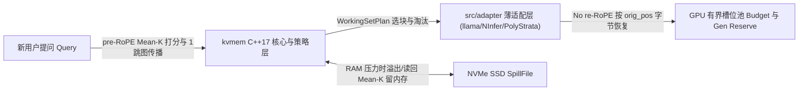

# NInfer + KVMem v0.19.1 (RTX 5080) 实测、PI Agent 闭环与边界总结

> [!NOTE]
> 本文档整理自本轮完整技术调研与本地 `RTX 5080 (16,303 MiB)` 实测，并已按 `codex-cli 0.169.0 (gpt-6.2-sol)` 只读交叉审核结果完成口径订正。全栈（原版 `llama.cpp` vs `Strata`、`PolyStrata`、`Q5 OOC` 与 `L0/L1/L2`）综合长报告见：[终极技术报告](llama-strata-kvmem-master-report.md) · [交互式 5-Tab 仪表盘](../assets/llama-strata-kvmem/llama-strata-kvmem-dashboard.html) · [实机 Nsight 摘要 JSON](../runs/ninfer-kvmem-20261126/ninfer_nsys_results.json) · [消融实验 JSON](../runs/ninfer-kvmem-20261126/ninfer_ablation_results.json)。

---

## 一、核心技术脉络梳理

### 1. KVMem 干了什么、如何实现？

KVMem 是一套面向消费级/单机显卡的 **KV Cache 虚拟内存与工作集管理系统**，核心采用三层解耦结构：

* **有界 GPU 槽位池（`budget + gen_reserve`）**：GPU 只保留当前步需要的稀疏历史块和生成预留区；当单轮超长生成写满 `gen_reserve` 时，通过环形淘汰把最老的已写满生成块转存到 Host RAM。
* **Graph Recall C**：截取旋转前的 `Mean-K`（FP32，体积极小）常驻内存，新用户问题到来时先算 `Q · Mean-K^T` softmax 初始分，再沿历史注意力出边与邻接边做 1 跳图传播，选出 Top-K 历史块调入 GPU。
* **No re-RoPE 原生格式恢复**：主仓产品路径保留逻辑原始位置 `orig_pos`（`llama-memory-kvmem.cpp:2332` `layout_gpu_slots_by_orig_pos` 与 `:4450` `write_block_to_gpu`），从 Host 恢复时直接按 GPU 量化格式字节拷贝，免去解量化和重新旋转。

### 2. 五大推理引擎在本机定位对比

| 引擎 | 技术栈 / 格式 | 核心定位 | 在单卡 RTX 5080 (16GB) 上的定位与兼容边界 |
|---|---|---|---|
| **NInfer** | 原生 C++/CUDA · `.ninfer` | 深融合算子、多种 KV 量化、自适应 MTP | **单卡（Batch=1）Dense/混合模型交互速度最快** |
| **llama.cpp** | 纯 C/C++ (`ggml`) · `.gguf` | 跨平台标准，支持 `--moe-cache-mib` 与实验性 P6 文件层 | **兼容性最广**；超内存 Q5 OOC 同约束下 P6 中位数反超 Strata（[Q5 对照报告](q5-strata-compare-report.md)） |
| **PolyStrata / Strata** | 原生 C++/CUDA · `.gguf` | 弹性专家缓存与门铃轮询流水 | `IQ2_XS` 与 35B MoE 极佳；**实测 `v0.19.1` 拒载 `qwen4exp`**（[KVMem 兼容边界报告](kvmem-report.md)） |
| **vLLM / SGLang** | Python + CUDA/Triton · `SafeTensors` | PagedAttention / RadixAttention 高并发吞吐 | Linux 数据中心高并发首选；消费卡低余量单路交互不及原生引擎 |

### 3. KVMem 与同类缓存/记忆方案的本质区别

| 方案 | 解决的核心痛点 | 缓存与恢复机制 | 与原生前缀复用的关系 |
|---|---|---|---|
| **原生 Prefix Caching** | 连续多轮前缀不变时省 Prefill | 显存内第 0 token 起的精确前缀树复用 | 显存被挤掉、超长截断、前文改一字即全废 |
| **Mooncake / LMCache / `lm-llama L1/L2`** | 高并发或固定大前缀下省重复 Prefill | 将**完整无损**的状态/KV 卸载至 RAM/NVMe | 零数值偏差，但恢复/执行受限于全量体积（如 Hybrid `156.9 MB` 状态） |
| **CacheBlend** | RAG 拼接多段非前缀文档时跨块失真 | 拼装不同位置的旧 KV，逐层重算高偏差 token | 与 KVMem 互补（选块 vs 修复） |
| **KVMem** | **单卡显存/原生窗口根本装不下超长历史** | 全历史存 Host/SSD，按 `Mean-K` **稀疏挑块**换入显存 | 允许有损稀疏拼装，用轻微近似代价换取 10×+ 逻辑容量 |

---

## 二、本机 RTX 5080 七组控制变量实验与 PI Agent 实测

* **硬件与模型**：Windows 11 / RTX 5080 (`16,303 MiB = 15.92 GiB`) / `87.35 GiB` RAM / `NInfer + kvmem v0.19.1` / `swift15_iq2xs_mtp.ninfer`（`Qwen3.8-27B` 3:1 GDN:Attention 混合架构）。

| 实验编号 | 测试场景 | 对照组 vs 实验组 | 经 Codex 审核对齐的精确结论 |
|---|---|---|---|
| **Exp 1** | **16GB 显存准入上限** | `--no-kvmem` vs `--kvmem` | 无 KVMem 开 **200K 启动准入失败**（runtime 需 `8.70 GB >` 剩余 `7.30 GB`）；128K 占 `14,147 MiB`（账本余 `1.25 GiB`）。**开启 KVMem 稳跑 200K**（`B=36864, R=16384`），占用 **`10,745 MiB`（`10.493 GiB` / `11.267 GB`，账本余 `4.57 GiB`）**。 |
| **Exp 2** | **104.5K 五针召回**（GPU 预算 32K 级） | 32K 滑动窗口 vs KVMem (6,144 槽) | 32K 滑窗仅命中近窗针，**`2/5 (40%)`**（约 `15.29–15.52 s/问`）；**KVMem 保持 `5/5 (100%)`**，命中缓存（`cached=103,997`）的 25%/75% 问句 TTFT **`1.6725 s / 1.7681 s`**（因单一 `prompt_cache_key` 末问改写，5%/50%/95% 问句 `cached=0` 耗时 `62.35–62.99 s`）。 |
| **Exp 3A** | **SSD 场景一：3×66K 多会话轮转**（`HostMiB=2560`） | `G1 No SSD` vs `G2 +SSD 16G` vs `G3 16G RAM` | • **G1（无 SSD）**：`spill=0, cached=0`，回访 `SESS_A/B` 真实 **TTFT `38.7084 s / 38.4462 s`**（`wall 38.86 / 38.60 s`） • **G2（+SSD）**：写盘 `5,923,860,480 B`（`5.52 GiB`），`cached=65,987/66,018`，**TTFT `1.9011 s / 1.9941 s`（`20.36× / 19.28×` 提速**，`wall 2.03 / 2.15 s`） • **G3（RAM）**：`spill=0`，**TTFT `0.5741 s / 0.5559 s`**。 *注：`SpillFile` 在 Windows 使用带缓存 overlapped I/O，系统页缓存仍可参与。* |
| **Exp 3B** | **SSD 场景二：99K 单会话冷块复用**（`HostMiB=1536`） | 首次灌入 vs 追问 5% 开头冷针 | 首次灌入 `99,013` tok 耗时 `65.13 s`，`spill_bytes=2,215,133,184 B`（`2.06 GiB`）；追问 5% 锚点 `cached=99,014/99,042`，**TTFT `1.4861 s`**（`wall 1.63 s`），精准答出 `ORION-5591-DELTA`。 |
| **Exp 4** | **`gen_reserve` 环形单轮长生成**（限额 `8,192`） | `--no-kvmem cap=6144` vs `KVMem B=4096,R=2048` | 无 KVMem 在 **`6,088` 输出 tokens**（`46.99 s`）硬撞物理上限；**KVMem 连续生成 `8,137` tokens**（自然 `stop` 结束，`63.92 s`）。 |
| **Exp 5** | **Speculative Decoding** | `SD_Off` vs `MTP4_Adaptive` vs `+Ngram31` | • 关闭：散文 `75.75` / 代码 `75.25 tok/s` • **`MTP4_Adaptive`**：散文 **`123.65 tok/s`（+63.2%, `45.9%` accept）** / 代码 **`204.53 tok/s`（+171.8%, `65.7%` mixed accept）** • 额外叠加 `Ngram31`：`123.19` / `198.13 tok/s`（Adaptive 本身已包含 N-gram `16/410`，加后变成 `16/832`）。 |
| **Exp 6** | **无提升边界：8.2K 无复用开销** | `--no-kvmem` vs `--kvmem` | 输入 `8,210 / 8,211` tokens、无缓存复用时，按自报速率均值复算 Prefill **`-9.24%`**、Decode **`-2.54%`**。 |
| **Exp 7** | **PI Agent (`pi`) 3D 编码真实闭环**（`gen_reserve=4096`） | `PI (:low)` vs `PI (:xhigh)` | • **`:low`**：总计 `61.0 s` 完成 **4 个请求 / 3 次工具调用**，缓存命中率 **`0% / 99.7% / 57.9% / 99.9%`**，TTFT 约 `1.2 s / 203 ms / 4.0 s / 222 ms`，Decode `157.5–182.4 tok/s`，产出 559 行可运行 3D HTML。 • **`:xhigh`**：单轮输出触及 **`32,768` tok 上限**（`240.6 s`, `141.0 tok/s`, **mixed `48.5%`** 接受率），因低比特模型长反思打满上限导致 `length` 截断。 |

---

## 三、实机 Nsight Systems 7 组显微剖面（归因验证）

在同机复测 `no-kvmem-8k` / `kvmem-8k` / `kvmem-24k-evict` 及 4 组消融（`--gdn-state-fp16` 与 `gen_reserve` 环绕 SSE 间隔）：
1. **8K 零淘汰为何仍慢 `-7.7% ~ -9.2%`？**：Prefill 下 `cudaStream/EventSynchronize` 从 `10 次`（`8 Stream + 2 Event`）暴增至 `50 次 StreamSync`（`6.25×`），D2H 从 `146.82 MiB` 升至 `693.47 MiB`（全量归档 Packed K/V 与 FP32 GDN 状态），尽管无需淘汰，仍多搬运与同步。
2. **22K 跨轮冷召回提速机制**：Turn 2（99.8% 命中）把主力矩阵核 `mul_mat_q` 从 `7,713.50 ms`（`8,947` 次）直接压至 **`55.70 ms`（`-99.3%`）**，墙钟从 `10,827.47 ms` 降至 **`369.77 ms`（`29.28×`）**；`admission_policy` 阶段装回 `304.60 MiB`（耗时 `26.83 ms`，PCIe RX 均值 `21.22%` / p95 `79%`）。
3. **`--gdn-state-fp16` 零回退降带宽**：单次 GDN 快照体积砍半，8K Prefill D2H 降至 **`477.47 MiB`（`-31.1%`）**、8K Decode D2H 降 **`-33.9%`**、22K T2 墙钟再快 `-9.2%`（`335.77 ms`），且精准通过 `ALPHA-7742-ZETA` 召回校验。
4. **`gen_reserve` 连续环绕 SSE 节奏**（`1,431 + 1,600 = 3,031 > 2,048 + 512`）：438 个 SSE 非空片段间隔 `p50/p95/p99` 为 `20.67 / 31.04 / 31.96 ms`（基线 `20.08 / 30.70 / 31.00 ms`），极大值由 `32.25` 抬至 **`58.01 ms`**；Decode 同步次数由 `450` 次增至 **`1,616` 次（`3.59×`）**，H2D 净增 `+70.08 MiB`、D2D 净增 `+82.89 MiB`。

---

## 四、实践选型建议

* **该开 KVMem**：16GB 单卡跑 `100K+` 上下文、多轮 Agent 需保前缀缓存且主存/显存紧张、单轮生成超物理 `gen_reserve`、或开启 `HostMiB` 配 SSD 防止跨会话重算（压至 `1.5–2.0 s` TTFT）。同时优先加 **`--gdn-state-fp16`**，并按会话分支设置独立的 `prompt_cache_key`。
* **不该开 KVMem / 更佳替代**：并发 1–2 个 Agent 且总工作集可驻显存时，调优原生双槽 `llama-server`（`-np 2`）比单槽外挂缓存更省时（[终极技术报告](llama-strata-kvmem-master-report.md) 第 3.4 节 `pi-cache-bench`）；短上下文 `<16K` 无复用不要开启 KVMem。
