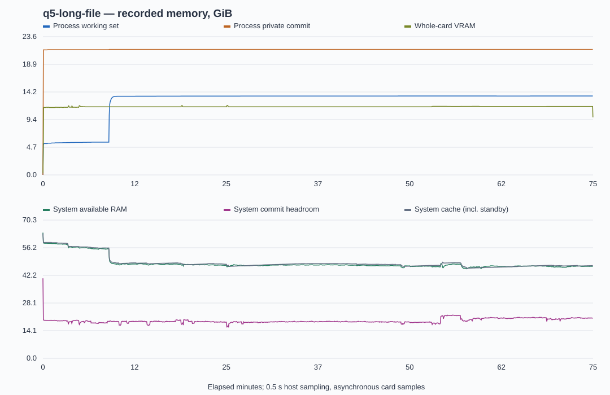

# P5 验收报告：受测 GPU 路径限定条件通过

2026-11-10；分支 `feature/file-expert-store-p0-p2`，基线 b12211 / `7d7f0287530bc8981690f361d8c1627dbae1c99a`。P0–P5 变更仍在当前工作区，未提交或推送。

P5 的实施、容量试验、预算扫描、性能对照与数值检查已完成。受测单卡 GPU 路径的容量和正确性通过；Q5 默认关闭回归及 IQ2 配对复核满足 3% 门槛。**原 IQ2 带 GPU 监测的短请求组、CPU fallback 跨路径数值比较仍有未通过项，因此结论是限定条件通过，不能表述为所有配置和测量条件无条件通过。**

自动审计覆盖 76 个应完成的验收运行，无缺失、异常退出、预算失败或预期之外的数值失败。全部 109 条探索/验收记录（含跳过和历史失败）保留。详细条件见 [acceptance-audit.json](acceptance-audit.json)。

## 验收状态

| 项目 | 当前判定 |
|---|---|
| Q5 超容量、实际 8K 输入 +512 输出 | 通过 |
| 多主题至少 4096 输出，再持续至少 30 分钟 | 通过：总计 7680 输出，追加 1865.89 秒 |
| 缓存预算、RAM/commit 余量、稳态专家文件读取 | 文件路径通过；观测口径见下文 |
| 相同 GPU 路径的 batch 3/16/32 logits | 通过，2,979,840 个 float 逐位一致 |
| 完整长测 logits | 通过：7680 个输出位置、1,907,097,600 个 float 逐位一致 |
| 默认阈值下 CPU fallback 与 GPU logits/PPL | 未通过既定容差，保留失败 |
| 未修改原生默认加载 | 部分探索样本触发 commit 保护，不能当作稳定完成 |
| 禁用预取、工作集不限的原生长测 | 未通过：首个预填充批次触发 RAM 保护 |
| 48 GiB 工作集上限下的完整原生重放 | 通过：同一 15 请求、7680 输出，正常退出 |
| Q5 两套六轮正式性能矩阵、同步/RAM=0 控制 | 完成，全部 logits 逐位一致 |
| Q5 默认关闭 ≤3% 回归 | 通过 prefill/decode 两项 |
| 固定文本 PPL | 通过，两段文本相对差为 0 |
| IQ2 六轮带 GPU 监测的默认关闭回归 | 未通过：decode/prefill 下降约 3.94%/3.63% |
| IQ2 六组配对复核（无运行期 GPU 查询） | 通过：decode +0.39%、prefill -0.48%；与原失败组分开报告 |
| Context 填满、越界拒绝、清空复用 | 通过，native/file 及复用前后逐位一致 |

## 模型、设备与参考条件

Q5 为同一套六分片 GGUF，完整大小 147.416 GiB，其中 routed experts 91.614 GiB、PLE 50.664 GiB。机器可见 RAM 约 87.35 GiB，两张卡合计显存约 31.85 GiB，完整模型大于两者之和。试验仅使用 RTX 5080，未使用另一张 5060 Ti，未停止其他任务、修改 pagefile 或清理全局页缓存。

Windows 11 工作站版 build 26200，Core Ultra 7 270K Plus（24 核/24 线程），驱动 616.64。CPU 线程数固定 16；32K context、单序列、完整 top-10、CPU miss share=0、Q8 KV、Flash Attention、关闭 MTP/repack。模型盘为 C / PhysicalDrive2（ZHITAI Ti600）；logits/ETW 位于 D / PhysicalDrive3。硬件记录见 [hardware.json](hardware.json)，完整方法见 [PROTOCOL.zh-CN.md](PROTOCOL.zh-CN.md)。

必须区分三种参考：

1. `native-bin`：未经修改的原始 b12211 二进制，保留探索成功和失败样本。
2. `native-noprefetch-bin`：同提交原生推理，仅增加 `LLAMA_MMAP_PREFETCH=on|off` 加载建议控制。核对了 248 个 src/include 文件：247 个仅换行不同，唯一实质源码改动为 `llama-model.cpp`；ggml DLL 使用原始二进制。它与原始 GPU 边界结果逐位一致。
3. 正式 Q5 参考：上述禁用预取的原生推理，加 **48 GiB 测试进程工作集硬上限**。native/off/file/sync 正式组统一此上限，不能把结果表述为无限制原生默认路径的性能。

新进程之间不清理 OS 缓存；这些是新进程、自然 OS 缓存状态的测量，不是受控冷启动。原生和文件路径分别使用独立调参提示选择配置，再在固定正式提示上测试。正式 Q5 使用全部六种模式顺序，另保留同 GPU/microbatch 的匹配对照。

## 本阶段代码变更

- 保留显式 backend assignment 的 workspace 测量 API；文件来源的专家 `MUL_MAT_ID` 在测量和分配前明确放到支持它的 GPU，修复 batch 3–31 可能越过缓存容量却落入 CPU 的边界。
- `llama_perf_context_print` 输出专家/PLE 计数和缓存驻留快照；关闭文件来源时直接返回。
- 增加默认 `on` 的 `LLAMA_MMAP_PREFETCH` 控制；文件模式仍始终关闭整段加载预取。
- 扩展 backend 回归，验证小 batch、host weights 的 GPU assignment 在测量后保留。相关 CTest 2/2 通过；真实模型边界回归通过相同 GPU 路径的逐位比较。

工作集上限、资源保护、采样和完整 logits 保存属于 `research` 验收驱动，不是给生产 CLI 新增的自动总内存管理功能。

## Q5 文件路径长测

固定配置：GPU 专家缓存 4096 MiB、RAM 专家缓存 8192 MiB、staging 32 MiB、depth=2、PLE RAM 64 MiB、实际 ubatch=512。一个 model/context，跨请求清 KV、保留权重缓存。

| 指标 | 结果 |
|---|---:|
| 正常退出码 | 0（Windows 进程句柄记录） |
| 总时长（进程创建至退出） | 4484.69 秒，约 74.74 分钟 |
| 请求/输出数 | 15 / 7680 token |
| 首请求实际输入/输出 | 8192 / 512 token |
| 前 8 主题输出 | 每主题 512，共 4096 |
| 4096 输出后的持续运行 | 1865.89 秒，约 31.10 分钟 |
| 模型加载/上下文就绪 | 2.389 / 2.532 秒 |
| 首请求 TTFT | 534.720 秒 |
| 全程 decode（同步计时） | 2.0467 token/s |
| decode 延迟 p50/p95/p99 | 470.14 / 800.96 / 983.57 ms |

该混合长测速度用于描述完成工作量，不代替正式公平性能比较。固定工作量忽略 EOS；首个 climate 请求出现 1 次 EOG，其他请求按记录列出，不能把 EOS 后 token 解释为自然回答长度。逐 token 时间包含 `llama_synchronize`；logits 写盘、NLL 计算及诊断位于 decode 计时之外，并包含在请求墙钟时间内。

| 全程资源观测 | 结果 |
|---|---:|
| 进程 working set 峰值 | 13.46 GiB |
| 进程 private commit 峰值 | 21.44 GiB |
| 系统可用 RAM 最小值 | 45.0705 GiB |
| 系统 commit 余量最小值 | 15.2839 GiB |
| 5080 整卡显存峰值 | 12122 MiB（约 11.84 GiB） |
| 最后 15 分钟 private 范围 | 相差约 3.32 MiB |
| 最后 15 分钟 private 线性斜率 | 0.106 MiB/分钟 |
| 主机采样最大间隔 | 0.516 秒 |
| GPU 查询错误 | 0 |

以上是采样观测峰值；短于采样间隔的瞬态不保证捕获。原始 [phase_memory](analysis.json) 分开记录加载、上下文、每个请求的 prefill/decode 和关闭阶段；很短阶段样本少，不把它们解释为精确峰值。GPU 为整卡异步采样，非进程独占显存。



已知 CUDA_Host 分配包括 32 MiB 专家 staging 和约 34.93 MiB compute 缓冲。15 次 PSAPI 当前工作集观测的 locked 字节为 0；这不能证明 CUDA 驱动没有锁页，因为统计仅覆盖被枚举的有效工作集页。CPU_Mapped 的约 142.91 GiB 是模型虚拟映射记账，不等同于 resident RAM。SystemCache 包含 standby，与 available RAM 重叠，不能叠加成总用量；定义与 Microsoft 来源见协议。

### 缓存与实际工作集

| 指标 | 专家 | PLE |
|---|---:|---:|
| RAM 分配 MiB（含条目元数据） | 8191.399 | 64.000 |
| 最终有效 payload MiB | 6287.720 | 8.985 |
| payload 峰值 MiB | 6327.637 | 8.985 |
| staging MiB | 32.000 | 1.000（pageable） |
| RAM hits | 1,230,619 | 110,176 |
| 淘汰次数 | 4,135,006 | 220 |
| 完成读取次数 | 5,224,793 | 55,640 |
| 逻辑读取 MiB | 6,228,493.238 | 9.021 |
| 对齐读取 MiB | 6,248,873.902 | 225.754 |
| peak in-flight | 2 | 2 |
| 最终 in-flight / leases / failures | 0 / 0 / 0 | 0 / 0 / 0 |

检查点预算核验通过。固定专家槽按最大 role 分配，8 GiB arena 的有效 payload 约 6.14 GiB，不能把 allocated 字节当成有效缓存容量。PLE 本次未填满 64 MiB；220 次淘汰来自有限组相联替换，P4 的小缓存压力测试另覆盖容量耗尽。

专家 session 的成功逻辑读取加 RAM hit payload 约 7,788,847.988 MiB，可用于重建本 session 提交的 H2D 有效数据量，不含显存内拷贝或其他模型输入；MiB 日志保留三位小数。读取等待累计 2698.49 秒，上传等待累计 524.22 秒；这些是 CPU 等待计时，不是独占 SSD/GPU 时间，不能简单相加解释总运行时间。GPU cache 原生日志的 uploaded 计数另有作用域，不把它冒充一般路径全部 H2D 流量。

另外排除全部 prefill 和每请求前 32 个输出，剩余 7185 次实际 decode 的检查点差分为：每次 decode 平均文件逻辑读取 664.084 MiB、对齐读取 666.121 MiB、session H2D payload 861.138 MiB；对齐字节放大约 1.0031 倍。该范围 RAM 请求命中率约 22.895%，累计 read/upload CPU wait 为 2133.82/289.35 秒。它明确计入 SSD miss，且不是把长 prompt 的扫描流量平均摊给输出 token。物理磁盘字节仍以独立 ETW 窗口为准。

MCT1 读取验证完整 top-10，累计 23,251 个去重 routed experts、93,073,664,000 字节（约 86.68 GiB）。这是 GPU cache lookup 路径的累计工作集，包含小 batch prefill，排除一般路径的大 batch 扫描；日志名 `routed decode experts` 不应被解释为纯 decode 统计。

GPU cache 原生日志的 ubatch<=8 组累计 hits/misses 为 1,929,971/1,749,529，较大 batch 组为 1,026/37,494。它们与一般路径的文件 session 统计作用域不同，分别保留，不把两者相加作为统一命中率。

最终 GPU payload 4,282,291,200 B，RAM/GPU 重复 role payload 2,556,185,600 B；结合 RAM payload，驻留并集约 7.75 GiB，显著低于累计路由工作集。一般专家路径累计调用 3126 次，持续读取并不只来自 PLE。

### 稳态磁盘与匿名换页

4096 输出后采集了 183.955 秒 ETW 窗口，lost buffers/events 均为 0。按发起 PID 69272、每条 DiskIO 事件汇总：

| 目标进程读取 | 字节 |
|---|---:|
| 专家所在分片 4 | 138,911,027,200 |
| 专家所在分片 5 | 116,239,499,264 |
| 专家所在分片 6 | 8,534,982,656 |
| 三个专家分片合计 | 263,685,509,120（245.576 GiB） |
| PLE 分片 3 | 53,248 |
| 同期其他进程对模型盘读取 | 265,680,896 |
| 目标进程 pagefile hard-fault 字节 | 0 |

专家分片块设备读取平均约 1.335 GiB/s，证明启动之后仍在反复读权重。它是主机块设备接口流量，不是 SSD 内部 NAND 读取量。此窗口目标进程其他硬缺页仅出现在输出 result.json/文件系统元数据；全系统存在其他进程的 pagefile 读取，不能据此归因给模型。结论限定为这段无丢事件的稳态窗口，不能宣称整个系统或所有时刻绝无换页。

本机 xperf `diskio -summary` 的累计字节在 2^32 处回绕。例如分片 4 显示 1,472,073,728，而逐事件之和为 138,911,027,200。报告使用 [etw-early-analysis.json](runs/q5-long-file/etw-early-analysis.json) 和对应 `diskio-detail.txt`，不使用回绕后的汇总字节。空闲噪声及全程整盘计数也保留，不能把整盘计数当成进程专属读取。

原生参考在 48 GiB 工作集上限下的对应稳态窗口已采集：181.799 秒，lost buffers/events=0，专家分片读取 18,856,751,104 B（17.562 GiB），PLE 读取 36,966,400 B，目标 pagefile hard-fault 字节=0。模型文件读取全部归属于测试 PID 18152。两个窗口的 DiskIO 明细覆盖起止时间；原生 raw ETL 约 860 MiB，低于 1 GiB 环形上限，未出现起始窗口被覆盖的迹象。见 [原生 ETW 明细汇总](runs/q5-long-native-ws48/etw-early-analysis.json)。

这说明原生参考同样通过文件映射缺页持续取权重，并非以匿名页换入代替受控权重 I/O。它允许更大的 mapped working set，也可能命中系统 standby；这与文件路径的 8 GiB RAM cache 不是等有效缓存容量的微基准。固定时间窗口内完成的 token 数也不同，不能仅用累计磁盘字节评价速度。性能结论以固定工作量的正式矩阵为准，资源使用单独列出。

原生完整重放正常退出，2997.31 秒、7680 输出；本次 decode 为 3.6562 token/s。观测 working set 峰值约 48 GiB（比配置值多一个 4 KiB 页）、private 峰值约 13.33 GiB，最低 available RAM 约 12.47 GiB、commit 余量约 25.69 GiB。它在这次长测中的 decode 比小 RAM 文件配置更快，同时使用更大的驻留工作集；本轮不宣称文件路径普遍提速。原生进程 `IO_COUNTERS.read_bytes` 不包含全部 mmap 缺页流量，不能与文件路径的 ReadFile 计数直接相除评价读放大。

## 缓存预算扫描

独立调参提示为 128 输入、128 输出。下表为该次探索的请求墙钟秒数（不含模型加载）；每个配置仅一次，不据此作统计显著性或全局最优结论。正式提示另行固定，并使用六轮轮换次序。

| RAM 专家预算 | GPU 2 GiB | GPU 4 GiB | GPU 8 GiB |
|---|---:|---:|---:|
| 8 GiB | 115.69 | 91.70 | 106.23 |
| 16 GiB | 85.63 | **78.07** | 79.98 |
| 32 GiB | 预检跳过 | 预检跳过 | 预检跳过 |

32 GiB 组合需要至少 54 GiB commit 余量，本机当时不满足；跳过记录包含实际余量和门槛。没有降低预留、修改 pagefile 或停止其他任务。GPU 8 GiB 文件配置因完整图工作区与显存余量约束，从请求的 ubatch 512 回退到实际 4；2/4 GiB 组合实际为 512。因此这张表同时包含不同 prefill 算法配置的影响。

GPU 4 GiB / RAM 16 GiB 下，staging 8 MiB、depth 1/2 分别为 87.49/78.91 秒；staging 32 MiB、depth 1/2 分别为 84.74/78.07 秒。最终选择 32 MiB、depth 2 进入正式组，另用相同预算 depth 1 做六轮同步控制。长时容量试验独立固定 RAM 8 GiB，没有用调参选出的更大缓存替换。

原生参考在禁用预取、WS 48 GiB 条件下重新扫描：GPU 2/4/8 GiB、ubatch 512 分别为 124.16/45.64/38.93 秒；分别补测 ubatch 1/2/4 为 75.66/57.60/45.70 秒。原生正式组选择 GPU 8 GiB / ubatch 512。顺序执行可能受自然 OS 缓存影响，完整扫描及早期原生默认加载失败都保留在 [EVIDENCE.md](EVIDENCE.md)。

## 已确认的失败与处理

- **原生加载 commit 峰值**：默认原生预取非 lazy 专家分片，多次触发 4 GiB commit 保护。PLE 本身是 lazy；早期仅根据最后一条 PLE 日志作出的怀疑已由源码核对纠正。有限 buffered/mmap PLE 预热均未解决，探索记录保留，正式组不做该预热。
- **原生无限制工作集**：`q5-long-native` 在 87.27 秒触发 available RAM 保护，working set 达 56.31 GiB。正式参考增加进程工作集上限，保留这个失败，不改低保护线。这是预定余量保护主动停止，不等于观察到系统 OOM，也不能据此断言原生 mmap 不支持超容量模型。
- **CPU/GPU 边界数值**：batch 3 的 NMSE 0.0013698867、max abs 0.53943、PPL 相对差 1.4938%；batch 16 的 NMSE 0.0435877115、max abs 4.53197、PPL 相对差 1.6584%。超出预定 NMSE 5e-4 / PPL 0.5% 门槛；12 个 argmax 相同也不能算通过。batch 32 逐位一致。该差异原因尚未归结为普通舍入误差，正式结论限定匹配的 GPU 路径。
- **观测器编码**：UTF-8 生成文本使旧 Python 驱动按 GBK 读取失败。模型与主机采样始终运行；修正读取编码后恢复附加观测。文件长测退出码由事先保留的 Windows 句柄确认，summary 从不变的命令、样本和结果恢复；原异常和恢复口径均保留。
- **早期 GPU 监控**：一次同步 nvidia-smi 超时中断探索；随后改为异步 GPU 查询，主机 RAM/commit 采样不再被阻塞。未知退出码的旧样本明确标注，不计为通过。

## 正式性能与数值结果

完整长测比较见 [comparison-q5-long-native-ws48--q5-long-file.json](comparison-q5-long-native-ws48--q5-long-file.json)：所有请求提示、强制 token 轨迹与 logits 形状对应，差值为零。两份 MCT1 均验证 top-10、368,318 条 cache-lookup 记录、相同去重专家工作集。

### Q5 各自调参后的主对照

固定正式提示 128 输入、128 输出（127 次逐 token decode），六轮全部顺序排列；同一 teacher-forcing 轨迹。所有 native/off/file 比较逐位一致，即使 GPU 预算不同也未出现数值差异。以下为每轮指标的中位数；延迟分位数则合并该组全部逐 token 样本计算。

| 路径 | GPU / RAM 专家 GiB | 就绪 s | TTFT s | Prefill token/s | Decode token/s | 请求墙钟 s | Decode p50 / p95 / p99 ms |
|---|---|---:|---:|---:|---:|---:|---|
| 原生推理参考（预取 off、WS 48 GiB） | 8 / OS mmap | 2.463 | 21.211 | 6.343 | 5.122 | 46.234 | 171.60 / 358.61 / 481.44 |
| 改造版功能关闭（同参考约束） | 8 / OS mmap | 2.419 | 15.471 | 8.274 | 5.690 | 37.892 | 159.83 / 330.45 / 467.44 |
| 文件路径（WS 48 GiB） | 4 / 16 | 2.454 | 25.512 | 5.017 | 2.254 | 82.111 | 390.01 / 777.52 / 1147.32 |

| 六轮全程资源极值 | 原生参考 | 功能关闭 | 文件路径 |
|---|---:|---:|---:|
| 进程 working set 峰值 GiB | 48.000 | 48.000 | 20.787 |
| private commit 峰值 GiB | 17.332 | 17.332 | 29.450 |
| 最低 available RAM GiB | 13.934 | 13.822 | 41.596 |
| 最低 commit 余量 GiB | 24.254 | 23.364 | 13.467 |

文件路径在这组测量中的 decode 约为原生参考的 44.0%，请求墙钟约为 1.776 倍；working set 峰值减少约 56.7%，但有限 RAM 缓存需要 private commit，不能同时宣称 commit 也下降。它提供可控权重驻留和读取，不代表本机普遍更快。

功能关闭的 decode/prefill 中位数比值为 1.1108/1.3043，均通过 0.97 下限；请求墙钟比值 0.8196。原生六轮 decode 范围 4.140–6.334 token/s、prefill 4.059–8.907，说明自然 OS 缓存及共享机器噪声明显；不把功能关闭组观测到的更快速度宣传为代码优化收益。完整各轮、范围和采样结果见 [EVIDENCE.md](EVIDENCE.md)、[performance.json](performance.json)。

### Q5 同 GPU 预算与同步控制

GPU 统一 4 GiB、ubatch 512、相同轨迹，六轮全部顺序排列；两个文件组 RAM 均为 16 GiB、staging 均为 32 MiB，只改变 depth。原生仍允许 OS mmap 和 standby，不能把“相同 GPU 预算”称作“相同有效 RAM 缓存容量”。

| 路径 | TTFT s | Prefill token/s | Decode token/s | 请求墙钟 s | Decode p50 / p95 / p99 ms |
|---|---:|---:|---:|---:|---|
| 原生参考 | 22.433 | 5.707 | 4.442 | 51.203 | 205.11 / 405.60 / 567.17 |
| 文件 depth=2 | 24.845 | 5.152 | 2.259 | 82.352 | 397.11 / 762.14 / 1097.99 |
| 文件 depth=1 | 27.564 | 4.644 | 2.001 | 91.411 | 435.36 / 884.10 / 1504.26 |

双缓冲相对同步控制的 decode 中位数提高约 12.9%、prefill 提高约 10.9%，请求墙钟减少约 9.9%。这是当前固定工作负载的端到端测量，不是直接 GPU/SSD 时间线剖析；`overlap` 计数也不能替代设备 profiling。三组所有比较逐位一致。两种文件组峰值 working set 均约 20.78 GiB、private 29.45 GiB；原生分别为 48.00/13.32 GiB。文件组最低 commit 余量 11.57 GiB，全部检查点预算及会话排空检查通过。

专家 RAM=0、depth=1 的独立控制也正常完成，128 个输出的全量 logits 与同 GPU 原生逐位一致，预算及排空检查通过。该单次记录 decode 1.229 token/s、请求墙钟 132.389 秒；它是无 RAM 命中路径的正确性控制，不用单次值作统计提速结论。PLE 缓存仍为 64 MiB，不能将此配置称为总 RAM 为零。

### 固定文本条件 perplexity

两段预先固定的文本共 175 个评测 token、43,456,000 个 float logits，全部逐位一致，max abs/RMSE/NMSE 均为 0、argmax 全部一致，PPL 相对差为 0。结果见 [固定文本比较](comparison-q5-ppl-native--q5-ppl-file.json)。

| 文本 | 评测 token | 原生参考 PPL | 文件路径 PPL |
|---|---:|---:|---:|
| science | 92 | 6.183249662 | 6.183249662 |
| software | 83 | 17.357955756 | 17.357955756 |

这是有限固定语料上的条件 PPL 回归，不能外推为通用模型质量排名。长测、正式轨迹、同步控制和 RAM=0 控制另外覆盖持续 miss、淘汰与重读。

### IQ2 默认路径回归及测量复核

使用未经修改的原生 b12211、默认预取 on、GPU 4 GiB、WS 上限 48 GiB。先运行三轮，再因回归门槛失败补齐全部六种顺序；所有 native/off/file logits 逐位一致，加载和资源保护均未失败。

| 带运行期 GPU 监测，六轮 | Prefill token/s | Decode token/s | 请求墙钟 s | TTFT s |
|---|---:|---:|---:|---:|
| 原生 | 25.764 | 18.643 | 11.974 | 4.969 |
| 功能关闭 | 24.830 | 17.908 | 12.260 | 5.156 |
| 文件路径，RAM 16 GiB | 9.439 | 6.125 | 34.380 | 13.568 |

这组功能关闭的 decode/prefill 比值 0.96059/0.96373，**未通过 0.97 门槛**。初始三轮及六轮结果均留档，没有丢弃慢样本。原生/default-off 的图复用、缓存命中、上传量及完整路由 trace 相同；未发现多算专家或重复建图。不能据此断言完全没有 CPU 指令层面的额外开销。

为改善约 7 秒 decode 窗口的测量，另预先固定六组 AB/BA 配对：关闭运行期每约 2 秒的 `nvidia-smi` 查询，保留启动前 GPU 检查、0.5 秒主机监控和 RAM/commit 保护；推理二进制、输入、模型和预算均不变。这些样本独立报告，不覆盖原失败组。

| 配对复核，六组 | Prefill token/s | Decode token/s | 请求墙钟 s | Decode p50 / p95 / p99 ms |
|---|---:|---:|---:|---|
| 原生 | 25.800 | 18.478 | 12.029 | 48.29 / 101.70 / 143.62 |
| 功能关闭 | 25.677 | 18.551 | 11.995 | 48.39 / 100.80 / 144.74 |

复核的 decode/prefill 比值为 1.00393/0.99521，两项通过门槛，全部 logits 仍逐位一致。由于 GPU 观测和配对顺序都改变、其他系统活动未锁定，不能宣称 `nvidia-smi` 是已证明的唯一根因，也不能称所有原始测量条件都通过。没有为追求通过而修改推理代码或放宽阈值；诊断过程见 [DIAGNOSIS.md](DIAGNOSIS.md)。

IQ2 原生、off、file 的六轮 working set 峰值分别为 19.971/19.971/17.112 GiB，private 峰值 10.687/10.687/26.813 GiB。默认原生首次加载最低 commit 余量为 5.567 GiB，仍高于 4 GiB 保护线；文件组最低 10.356 GiB。配对复核不提供运行期 VRAM 峰值，其 GPU 资源证据来自保留的完整监测组，不能混用口径。

### Context 边界与复用

独立 probe 读取实际单序列容量 512，先输入 511 个 token，再 decode 到最后有效位置 511；位置 512 的额外请求在 native/file 均返回预期的无槽状态 1。清空 KV 后在同一 model/context 重复，结果与首次逐位一致；native/file 共 993,280 个 float logits 逐位一致。参考/文件进程均正常退出，分别用时 119.84/74.72 秒；此测试不进入性能矩阵。

该 probe 单独编译，性能测试使用的 `model_probe.exe` 和推理 DLL 未更换。见 [context 比较](comparison-context-native--context-file.json)、[静态审查及补测说明](REVIEW.md)。

## 本机复现入口

完整验收由 [run_acceptance.py](run_acceptance.py) 驱动，读取 [long.json](long.json)、[formal.json](formal.json)、[evaluation.json](evaluation.json)。它会复用已有完成记录；重跑新的独立测量应改用新的 run 名称并保存新配置，不能覆盖原始证据。每次命令、环境、二进制 hash、资源保护及退出状态在 `runs/<name>/command.json`、`summary.json` 中；大体积 logits、MCT1、ETL 在 `D:\llama-ooc-p5-20261110\runs`。

下面是同一文件路径、8 GiB RAM 专家预算的本机 CLI 示例（正式数值和计时证据来自 public API probe）。使用新的 PowerShell 窗口执行：

```powershell
$env:CUDA_VISIBLE_DEVICES = 'GPU-bf0ccb9a-491e-34cc-aab1-6d5e96272e4b'
$env:LLAMA_EXPERT_STORE = 'file'
$env:LLAMA_EXPERT_RAM_MIB = '8192'
$env:LLAMA_EXPERT_STAGING_MIB = '32'
$env:LLAMA_EXPERT_IO_DEPTH = '2'
$env:LLAMA_EXPERT_GRAPH_MIB = '4096'
$env:LLAMA_PLE_RAM_MIB = '64'
$env:GGML_OP_OFFLOAD_MIN_BATCH = '1'
$model = 'C:\Users\Administrator\Documents\Code\tasks\strata-lab\data\models\unsloth-UD-Q5_K_XL\Qwen3.8-Flash-Next-UD-Q5_K_XL-00001-of-00006.gguf'
& 'D:\llama-ooc-p0-p2-20261110\build\bin\llama-cli.exe' -m $model `
    --fit off --load-mode mmap --no-repack --no-warmup -ngl 999 `
    --moe-cache-mib 4096 --moe-cache-cpu-share 0 `
    -c 32768 -b 512 -ub 512 -t 16 -tb 16 -fa on -ctk q8_0 -ctv q8_0 `
    --simple-io --single-turn --temp 0 -n 512 -p 'Explain how a rainwater collection system works.'
```

此配置的测试驱动加载前要求 available RAM 至少 24 GiB、commit 余量至少 30 GiB，运行中保留 4 GiB 保护线；普通 CLI 不自动执行这些系统级保护。缓存预算也不是进程全部内存上限，KV/GDN、图工作区、固定权重、驱动仍单独占用。当前交付限单 CUDA 卡、单因果文本序列、受测 Qwen3.8/qwen4exp 布局；MTP、LoRA、多卡、多 context、稠密模型不在本阶段范围。

## 归档与最终检查

- [machine-and-build.json](machine-and-build.json)：分支/HEAD、22 个变更源码的 SHA256、三套二进制身份、完整 Q5/IQ2 分片 SHA256、硬件与构建缓存。模型全量 hash 在所有性能与 context 测试结束后读取，避免影响计时期间的磁盘/OS 缓存。
- 源码快照：`D:\llama-ooc-p5-20261110\p5-source`；本阶段差异见 [p5-vs-p4.patch](p5-vs-p4.patch)。原生参考的唯一推理源码差异另存 [native-noprefetch.patch](native-noprefetch.patch)，ggml DLL 与原始二进制相同由归档断言验证。
- 最终相关 CTest **2/2 通过**，见 [ctest-final.log](ctest-final.log)；Python 脚本语法与 `git diff --check` 通过。源码、构建、研究脚本、原始失败和复核数据均保留，未提交或推送。

测量支持继续以专家 miss 字节、固定槽的有效 payload 损失和 RAM/GPU 重复驻留为 P6 优化依据。当前每 decode 约 664 MiB 的逻辑文件读取说明 I/O 仍是重要成本；任何后续优化都应保持 top-k、量化和 logits 语义，并重复容量与数值检查。本阶段不据此承诺未来吞吐。
