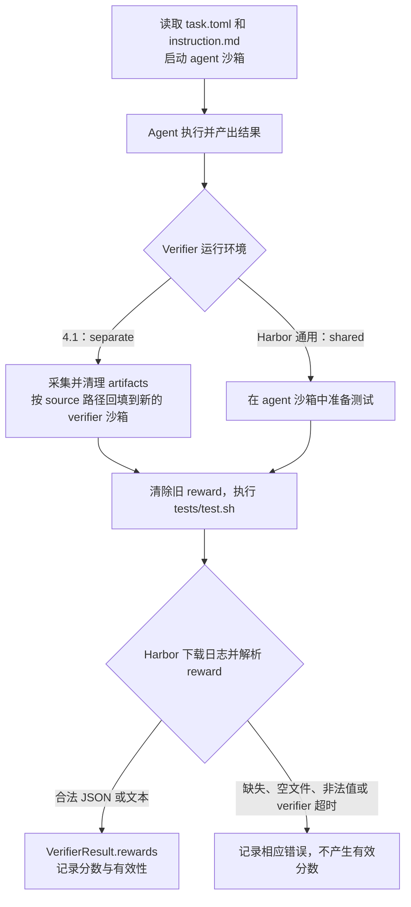

# Terminal-Bench 的任务结构与判分体系

> Terminal-Bench 定义任务和结果验收条件，Harbor 运行 agent、移交产物并读取 verifier 的分数。任务源码以 `v4.1.0` 为准，Harbor 行为与评审流程以查阅时的官方文档和源码为准。本地仅做静态统计，未构建镜像或执行试验。证据版本见文末。

## 1. 一个任务的解剖

`v4.1.0` 的 Linux 任务以 `task.toml` 声明配置，`solution/solve.sh` 提供 Oracle 入口，`tests/test.sh` 提供 verifier 入口。发布树中的 66 个目录均有 `task.toml` 和 `tests/test.sh`，任务根目录的 `task.yaml` 和 `run-tests.sh` 出现次数均为 0。抽查的四题均使用 `environment/Dockerfile` 和 `tests/Dockerfile` 两套构建定义。Compose 也是合法的环境定义，下表给出实际样本。 [官方任务目录 API，`name` / `type`](https://api.github.com/repos/harbor-framework/terminal-bench/contents/tasks?ref=v4.1.0) · [发布递归树 API，`tree[].path`](https://api.github.com/repos/harbor-framework/terminal-bench/git/trees/v4.1.0?recursive=1) · [Harbor Separate verifier，Image selection](https://docs.harborframework.com/tasks/separate-verifier.md#image-selection) · [Harbor Solution，Required script](https://docs.harborframework.com/tasks/solution.md#required-script)

| 文件或目录 | 字段或入口 | 作用与证据 |
| --- | --- | --- |
| `task.toml` | `schema_version`、`[task].name/version/description/authors`、`[metadata]` | 前者标识配置 schema，`[task]` 登记单题包身份和版本，独立于数据集版本。`[metadata]` 记录作者、`category`、`subcategory`、`tags` 与 `expert_time_estimate_hours`。 [cad-model/task.toml:2–19](https://github.com/harbor-framework/terminal-bench/blob/v4.1.0/tasks/cad-model/task.toml#L2-L19) |
| `task.toml` | 顶层 `artifacts` | 声明需要保存并交给 verifier 的绝对路径，放在第一个 TOML section 前。支持字符串或包含 `source`、`destination`、`exclude`、`service` 的对象。`destination` 改变宿主保存位置，进入 verifier 时按 `source` 回填。 [task-template.toml:4](https://github.com/harbor-framework/terminal-bench/blob/main/docs/task-template.toml#L4) · [Harbor Artifacts，Advanced options / Separate verifiers](https://docs.harborframework.com/tasks/artifacts.md) |
| `task.toml` | `[agent]`、`[verifier]`、`[environment]` | 前两个 section 分别控制执行预算，例如 `timeout_sec`、`user`、`environment_mode`。`[environment]` 提供 `build_timeout_sec`、`cpus`、`memory_mb`、`storage_mb`、`gpus` 和可选的 `gpu_types` 等。独立 verifier 可用 `[verifier.environment]` 指定自己的环境及资源。 [fp8-rmsnorm-gemm/task.toml:21–35](https://github.com/harbor-framework/terminal-bench/blob/v4.1.0/tasks/fp8-rmsnorm-gemm/task.toml#L21-L35) · [Harbor Resources，Task fields / Enforcement policies](https://docs.harborframework.com/tasks/resources.md) |
| `instruction.md` | 输入、产物路径、验收目标与必要约束 | Agent 看到的题面。Canonical 结尾给出与 `[agent].timeout_sec` 对齐的时间预算及禁止搜索本题现成答案的要求。 [cad-model/instruction.md:3–5](https://github.com/harbor-framework/terminal-bench/blob/v4.1.0/tasks/cad-model/instruction.md#L3-L5) · [TASK_REVIEW_AUTOMATION.md:184–186](https://github.com/harbor-framework/terminal-bench/blob/main/docs/TASK_REVIEW_AUTOMATION.md#L184-L186) |
| `environment/Dockerfile` 或 `environment/docker-compose.yaml` | 基础镜像、依赖、`WORKDIR`、初始文件，或 `services` | Dockerfile 定义 agent 沙箱初态。Compose 可声明 `main` 和 sidecar，例如 `ctr-optimization` 的 `api`，该题把 API 服务的快照作为 `service = "api"` 的 artifact 交接。 [cad-model/environment/Dockerfile:3–9](https://github.com/harbor-framework/terminal-bench/blob/v4.1.0/tasks/cad-model/environment/Dockerfile#L3-L9) · [ctr-optimization/environment/docker-compose.yaml:1–13](https://github.com/harbor-framework/terminal-bench/blob/v4.1.0/tasks/ctr-optimization/environment/docker-compose.yaml#L1-L13) · [ctr-optimization/task.toml，顶层 `artifacts`](https://github.com/harbor-framework/terminal-bench/blob/v4.1.0/tasks/ctr-optimization/task.toml) |
| `solution/solve.sh` 和同目录文件 | Oracle 入口 | Harbor 将整个 `solution/` 复制到 `/solution`，在任务工作目录运行参考脚本。Oracle 用它证明至少一种做法可通过。Harbor 允许公开任务省略这套文件，省略后无法使用 Oracle。 [Harbor Solution，Required script / When to include a solution](https://docs.harborframework.com/tasks/solution.md) |
| `tests/Dockerfile` 或 `tests/docker-compose.yaml` | verifier 镜像及依赖 | 专用镜像以 `tests/` 为构建上下文，把入口、评测代码和数据装入 `/tests`，并准备 artifact 的落盘目录。专用镜像由镜像提供测试，Harbor 仅在回退到 agent 环境定义时上传测试到新沙箱。 [SEPARATE_VERIFIER_CONVERSION.md:17–26](https://github.com/harbor-framework/terminal-bench/blob/main/docs/SEPARATE_VERIFIER_CONVERSION.md#L17-L26) · [Harbor Separate verifier，Image selection](https://docs.harborframework.com/tasks/separate-verifier.md#image-selection) |
| `tests/test.sh`、测试源码、fixture、`reward.toml` | 运行检查并导出结果 | `test.sh` 调用 pytest、RewardKit 或自定义评测程序，可读取 verifier 自带的参考数据。`reward.toml` 可配置 RewardKit 聚合。Harbor 读取 `reward.json` 或 `reward.txt`，`ctrf.json` 供 CI 和人工检查用。 [Harbor Verifier，Required script / Reward files](https://docs.harborframework.com/tasks/verifier.md) · [RewardKit Quick start，How scores are combined](https://docs.harborframework.com/rewardkit/quick-start.md#how-scores-are-combined) · [TASK_REVIEW_AUTOMATION.md:503–520](https://github.com/harbor-framework/terminal-bench/blob/main/docs/TASK_REVIEW_AUTOMATION.md#L503-L520) |

### 四个真实任务

以下任务展示了结构化数据、源码和完整工作树怎样交给独立 verifier。每行证据均指向发布标签。

| 任务与验收目标 | 配置和 agent 环境 | Oracle 与 verifier |
| --- | --- | --- |
| `fin-saccr-rwa` · Operations / Finance。根据给定资产组合重算资本风险指标，交付结果表与计算工作簿。 [instruction.md:3](https://github.com/harbor-framework/terminal-bench/blob/v4.1.0/tasks/fin-saccr-rwa/instruction.md#L3) · [task.toml:3–7](https://github.com/harbor-framework/terminal-bench/blob/v4.1.0/tasks/fin-saccr-rwa/task.toml#L3-L7) | 交接 `sa_ccr_results.csv`、`sa_ccr_workings.xlsx` 和 `portfolio.csv`。Agent 镜像提供输入数据，verifier 时限 600 秒。 [task.toml:3–26](https://github.com/harbor-framework/terminal-bench/blob/v4.1.0/tasks/fin-saccr-rwa/task.toml#L3-L26) · [environment/Dockerfile:10–14](https://github.com/harbor-framework/terminal-bench/blob/v4.1.0/tasks/fin-saccr-rwa/environment/Dockerfile#L10-L14) | Oracle 安装固定版本的表格库并运行 `solve.py`。独立镜像预装测试依赖，`test.sh` 调用 `checks.py` 验证 CSV 的结构、数值和算术一致性，以及工作簿可审阅性，按 `all-pass` 聚合。 [solution/solve.sh:6–9](https://github.com/harbor-framework/terminal-bench/blob/v4.1.0/tasks/fin-saccr-rwa/solution/solve.sh#L6-L9) · [tests/Dockerfile:10–24](https://github.com/harbor-framework/terminal-bench/blob/v4.1.0/tasks/fin-saccr-rwa/tests/Dockerfile#L10-L24) · [tests/test.sh:3–7](https://github.com/harbor-framework/terminal-bench/blob/v4.1.0/tasks/fin-saccr-rwa/tests/test.sh#L3-L7) · [tests/checks.py:2–8](https://github.com/harbor-framework/terminal-bench/blob/v4.1.0/tasks/fin-saccr-rwa/tests/checks.py#L2-L8) · [tests/reward.toml:2–7](https://github.com/harbor-framework/terminal-bench/blob/v4.1.0/tasks/fin-saccr-rwa/tests/reward.toml#L2-L7) |
| `fp8-rmsnorm-gemm` · ML / Kernels。实现 H100 上的融合 kernel，验收数值、性能和依赖约束。 [instruction.md:3–22](https://github.com/harbor-framework/terminal-bench/blob/v4.1.0/tasks/fp8-rmsnorm-gemm/instruction.md#L3-L22) | 声明 1 张 H100，仅交接 `fp8_rmsnorm_gemm.cu`。Agent 镜像提供 CUDA、锁定的 Python 依赖和工作树。 [task.toml:4–35](https://github.com/harbor-framework/terminal-bench/blob/v4.1.0/tasks/fp8-rmsnorm-gemm/task.toml#L4-L35) · [environment/Dockerfile:25–38](https://github.com/harbor-framework/terminal-bench/blob/v4.1.0/tasks/fp8-rmsnorm-gemm/environment/Dockerfile#L25-L38) | Oracle 复制参考实现并构建。Verifier 用自带构建脚本和 dispatch，检查链接约束后跑 pytest。自定义 harness 以低权限子进程加载候选库，由父进程写分数。 [solution/solve.sh:4–11](https://github.com/harbor-framework/terminal-bench/blob/v4.1.0/tasks/fp8-rmsnorm-gemm/solution/solve.sh#L4-L11) · [tests/Dockerfile:24–32](https://github.com/harbor-framework/terminal-bench/blob/v4.1.0/tasks/fp8-rmsnorm-gemm/tests/Dockerfile#L24-L32) · [tests/test.sh:5–60](https://github.com/harbor-framework/terminal-bench/blob/v4.1.0/tasks/fp8-rmsnorm-gemm/tests/test.sh#L5-L60) · [tests/conftest.py:306–409](https://github.com/harbor-framework/terminal-bench/blob/v4.1.0/tasks/fp8-rmsnorm-gemm/tests/conftest.py#L306-L409) |
| `math-eval-grader` · ML / Evaluation。抽取数学答案，提交数学等价性判定程序和指定模型的评估输出。 [instruction.md:3–15](https://github.com/harbor-framework/terminal-bench/blob/v4.1.0/tasks/math-eval-grader/instruction.md#L3-L15) | 交接 `extracted.jsonl`、`grader.py` 和 `results.json`。Agent 镜像预缓存固定 revision 的模型并提供 PDF / JSONL。 [task.toml:6–10,23–41](https://github.com/harbor-framework/terminal-bench/blob/v4.1.0/tasks/math-eval-grader/task.toml#L6-L41) · [environment/Dockerfile:26–38](https://github.com/harbor-framework/terminal-bench/blob/v4.1.0/tasks/math-eval-grader/environment/Dockerfile#L26-L38) | Oracle 复制参考 grader 后生成两个输出。独立的 Python verifier 镜像运行 pytest，用 `Worker` 调候选 `grade()`，参考答案与比较逻辑留在可信侧。这里运行模型生成是题目的工作负载，代码和结果由程序化测试评分。 [solution/solve.sh:5–16](https://github.com/harbor-framework/terminal-bench/blob/v4.1.0/tasks/math-eval-grader/solution/solve.sh#L5-L16) · [tests/Dockerfile:12–27](https://github.com/harbor-framework/terminal-bench/blob/v4.1.0/tasks/math-eval-grader/tests/Dockerfile#L12-L27) · [tests/test.sh:4–14](https://github.com/harbor-framework/terminal-bench/blob/v4.1.0/tasks/math-eval-grader/tests/test.sh#L4-L14) · [tests/test_outputs.py:129–193](https://github.com/harbor-framework/terminal-bench/blob/v4.1.0/tasks/math-eval-grader/tests/test_outputs.py#L129-L193) |
| `wal-recovery-ordering` · Software / Databases。验收写前日志恢复、并发和顺序行为。 [instruction.md](https://github.com/harbor-framework/terminal-bench/blob/v4.1.0/tasks/wal-recovery-ordering/instruction.md) | 交接整个 `/app/`。Agent 镜像预置应用。 [task.toml:3–39](https://github.com/harbor-framework/terminal-bench/blob/v4.1.0/tasks/wal-recovery-ordering/task.toml#L3-L39) · [environment/Dockerfile:1–8](https://github.com/harbor-framework/terminal-bench/blob/v4.1.0/tasks/wal-recovery-ordering/environment/Dockerfile#L1-L8) | Oracle 修改阶段实现和日志模块。Verifier 先跑 gate，再跑十次确定性回归。可信侧通过 `_sandbox.py` 启动 `Worker` 并收集结构化观测，在外部 pytest 进程中断言。 [solution/solve.sh:99–147](https://github.com/harbor-framework/terminal-bench/blob/v4.1.0/tasks/wal-recovery-ordering/solution/solve.sh#L99-L147) · [tests/Dockerfile:1–24](https://github.com/harbor-framework/terminal-bench/blob/v4.1.0/tasks/wal-recovery-ordering/tests/Dockerfile#L1-L24) · [tests/test.sh:13–63](https://github.com/harbor-framework/terminal-bench/blob/v4.1.0/tasks/wal-recovery-ordering/tests/test.sh#L13-L63) · [tests/_sandbox.py:27–43,95–127](https://github.com/harbor-framework/terminal-bench/blob/v4.1.0/tasks/wal-recovery-ordering/tests/_sandbox.py#L27-L127) · [tests/_worker.py:27–43](https://github.com/harbor-framework/terminal-bench/blob/v4.1.0/tasks/wal-recovery-ordering/tests/_worker.py#L27-L43) |

## 2. 任务集规模与分类

GitHub `releases/latest` 返回 `tag_name = v4.1.0`、`published_at = 2026-11-03T20:39:05Z`。发布说明列出 **66 题修改、零增删**，另有 **63 题 CPU-only** 发行包。对 `ref=v4.1.0` 的 `contents/tasks` 计数为 66 个子目录，清单有 66 项 `[[tasks]]`。七个域及其分类规则见 `TAXONOMY.yaml`。表中数量取自逐题的 `[metadata].category` / `subcategory`，按官方分类聚合。对照递归树的路径和对象 SHA 后，用与标签相同的 `main` 任务内容复核分布。 [Release API，`tag_name` / `published_at` / `body`](https://api.github.com/repos/harbor-framework/terminal-bench/releases/latest) · [任务目录 API，`type`](https://api.github.com/repos/harbor-framework/terminal-bench/contents/tasks?ref=v4.1.0) · [dataset.toml:18–280](https://github.com/harbor-framework/terminal-bench/blob/v4.1.0/tasks/dataset.toml#L18-L280) · [递归树 API，`tree[].path` / `sha`](https://api.github.com/repos/harbor-framework/terminal-bench/git/trees/v4.1.0?recursive=1)

| 域 | 任务数 | 子域分布 | 官方分类位置 |
| --- | ---: | --- | --- |
| Software | 18 | Systems 5，Frontend 4，Algorithms 3，Databases 3，Data engineering 3，Languages 0 | [TAXONOMY.yaml:29–44](https://github.com/harbor-framework/terminal-bench/blob/v4.1.0/docs/TAXONOMY.yaml#L29-L44) |
| Science | 14 | Chemistry 4，Biology 3，Physics 2，Math 2，Earth 1，Robotics 1，Linguistics 1 | [TAXONOMY.yaml:6–27](https://github.com/harbor-framework/terminal-bench/blob/v4.1.0/docs/TAXONOMY.yaml#L6-L27) |
| ML | 11 | Inference 4，Training 3，Evaluation 3，Kernels 1 | [TAXONOMY.yaml:46–58](https://github.com/harbor-framework/terminal-bench/blob/v4.1.0/docs/TAXONOMY.yaml#L46-L58) |
| Operations | 9 | Claims 3，Logistics 2，Finance 1，Supply chain 1，Compliance 1，Marketing 1 | [TAXONOMY.yaml:60–75](https://github.com/harbor-framework/terminal-bench/blob/v4.1.0/docs/TAXONOMY.yaml#L60-L75) |
| Security | 5 | Cryptography 2，Forensics 2，AppSec 1，Reverse engineering 0 | [TAXONOMY.yaml:77–88](https://github.com/harbor-framework/terminal-bench/blob/v4.1.0/docs/TAXONOMY.yaml#L77-L88) |
| Hardware | 5 | CAD 4，RTL 1 | [TAXONOMY.yaml:90–98](https://github.com/harbor-framework/terminal-bench/blob/v4.1.0/docs/TAXONOMY.yaml#L90-L98) |
| Media | 4 | Design 2，Music 2 | [TAXONOMY.yaml:100–108](https://github.com/harbor-framework/terminal-bench/blob/v4.1.0/docs/TAXONOMY.yaml#L100-L108) |
| **合计** | **66** | 66 个 `task.toml` 都声明 `environment_mode = "separate"`，所有目录都有 `tests/Dockerfile` 和 `tests/test.sh` | [发布任务目录](https://github.com/harbor-framework/terminal-bench/tree/v4.1.0/tasks) · [递归树 API](https://api.github.com/repos/harbor-framework/terminal-bench/git/trees/v4.1.0?recursive=1) |

## 3. verifier 与 reward 机制

Terminal-Bench 的 outcome-based 原则是检查提交结果是否满足题面。共享模式可以直接看 agent 容器的最终状态，4.1 的独立 verifier 只能从移交产物和自己的基准材料重建可判分状态。程序化重跑提交代码、读取文件或启动提交的系统做验证，都可以属于结果验收。官方指南允许用过程证据检查是否作弊。 [task-guidelines.md:1–15,53–57](https://github.com/harbor-framework/terminal-bench/blob/main/docs/task-guidelines.md#L53-L57) · [Harbor Separate verifier，Artifact transfer](https://docs.harborframework.com/tasks/separate-verifier.md#artifact-transfer)

图示为默认 `Verifier` 路径。独立模式的镜像优先级为 `verifier.environment.docker_image` → `tests/` 构建定义 → `[environment].docker_image` → `environment/` 构建定义。未声明专用镜像但选择 separate 时，复用的是 agent **环境定义**的新实例。`/logs/artifacts/` 当前还会自动收集，文档已标注计划移除。 [Harbor Separate verifier，Mode resolution / Image selection / Artifact transfer](https://docs.harborframework.com/tasks/separate-verifier.md) · [Harbor Artifacts，Multi-step 节后的警告](https://docs.harborframework.com/tasks/artifacts.md#multi-step) · [Harbor verifier.py:198–310](https://github.com/harbor-framework/harbor/blob/e26966a026f872925979d8479b7ace236b68303f/src/harbor/verifier/verifier.py#L198-L310)

| 形态 | 由谁判定 | Harbor 接口与证据 |
| --- | --- | --- |
| `test.sh` / `test.bat` + 脚本 | 作者编写检查，按文件、结构、行为、指标等写分 | 默认 `Verifier` 执行对应 OS 的入口脚本。 [Harbor Verifier，Required script](https://docs.harborframework.com/tasks/verifier.md#required-script) |
| `test.sh` + pytest | pytest 执行断言，任务脚本或插件决定如何把结果映射为 reward | `math-eval-grader` 将 pytest 退出码 0/1 映射为 1/0，其他退出码保留为报错。 [tests/test.sh:10–14](https://github.com/harbor-framework/terminal-bench/blob/v4.1.0/tasks/math-eval-grader/tests/test.sh#L10-L14) |
| Separate verifier | 判定逻辑可用本表任一沙箱内做法，separate 控制的是运行位置和传入状态 | `[verifier] environment_mode = "separate"` 或 `[verifier.environment]`。 [Harbor Separate verifier，Configuration / Mode resolution](https://docs.harborframework.com/tasks/separate-verifier.md) |
| RewardKit 程序化条件、LLM judge 或 agent judge | Python 条件、模型按 rubric 给分，或具备文件和工具访问能力的 agent 按 rubric 给分，可混用 | 套件默认写 `reward.json`，明细另存。 [RewardKit Quick start，Using with Harbor / Output](https://docs.harborframework.com/rewardkit/quick-start.md) |
| Custom `BaseVerifier` | Job 指定一个可导入的 Python 类，在 Harbor 进程执行 `verify()`，可调用沙箱接口 | `verifier.import_path`、`verifier.kwargs`，直接返回 `VerifierResult`。上传、执行和评分由该类负责。 [Harbor Custom verifiers，默认与自定义接口对照表](https://docs.harborframework.com/jobs/custom-verifiers.md) |

**reward 的数据契约。** `reward.txt` 是一个有限数字，由 Harbor 归入 `{"reward": value}`。`reward.json` 是带名称的数值映射，例如 `{"reward": 1.0, "correctness": 0.9}`，两个文件都存在时 JSON 优先。`VerifierResult.rewards` 的类型为 `dict[str, float | int] | None`，JSON 值须为数值且有限。Harbor 对名为 `reward` 的分数提供主分约定，也允许仅有多个命名维度。`reward-details.json` 和 CTRF 是解释与检查结果的证据。 [Harbor Verifier，Reward files](https://docs.harborframework.com/tasks/verifier.md#reward-files) · [verifier.py:69–124,299–310](https://github.com/harbor-framework/harbor/blob/e26966a026f872925979d8479b7ace236b68303f/src/harbor/verifier/verifier.py#L69-L124) · [models/verifier/result.py:4–5](https://github.com/harbor-framework/harbor/blob/e26966a026f872925979d8479b7ace236b68303f/src/harbor/models/verifier/result.py#L4-L5) · [RewardKit Quick start，Multi-reward tasks / Output](https://docs.harborframework.com/rewardkit/quick-start.md)

**失败与缺失。** 测试判定失败可显式写 `0`，这是一个有效分数。默认 verifier 两个文件都找不到会抛 `RewardFileNotFoundError`，空文件抛 `RewardFileEmptyError`，解析或数值校验失败抛 `VerifierOutputParseError`。有 JSON 但 JSON 损坏时也走错误分支。默认 trial 策略把这些错误以及 verifier 超时标为无有效 reward，无效 trial 不进入 Harbor 的 reward 均值分子或分母。Agent 自身的超时或非零退出仍可由 verifier 判定已产出的结果。`wal-recovery-ordering` 对断言失败写 `0`，对 pytest 基础设施错误清除 reward 并退出，恰好展示了两条路径。 [verifier.py:69–124,299–310](https://github.com/harbor-framework/harbor/blob/e26966a026f872925979d8479b7ace236b68303f/src/harbor/verifier/verifier.py#L299-L310) · [Harbor Error classification，Exception types](https://docs.harborframework.com/jobs/error-classification.md) · [wal-recovery-ordering/tests/test.sh:18–45](https://github.com/harbor-framework/terminal-bench/blob/v4.1.0/tasks/wal-recovery-ordering/tests/test.sh#L18-L45)

**Harbor Job 均值与官方 resolution rate。** Harbor 在未配置 metric 时默认使用 `Mean`。最终 Job 聚合按 agent / model / dataset 分组，只纳入 `reward_valid` 的 trial，逐指标取算术均值，某个有效 trial 缺少该指标键时该维按 0。官方榜单代码对所纳入的 trial 将 `reward > 0` 判为解决，再算解决数除以总 trial 数，报错无分及被取消资格的 trial 按失败计。它还按每题通过比例与重复次数计算标准误，榜单显示 95% CI。示例中三个 trial 的主分为 `1`、`0`、无有效分，Harbor 默认均值为 `1/2`，官方榜单常规计算为 `1/3`。4.0 榜单迁移到 4.1 时还执行了第 5 节的历史分数回退规则。 [Harbor job.py:859–862,1203–1227](https://github.com/harbor-framework/harbor/blob/e26966a026f872925979d8479b7ace236b68303f/src/harbor/job.py#L1203-L1227) · [metrics/mean.py:5–12](https://github.com/harbor-framework/harbor/blob/e26966a026f872925979d8479b7ace236b68303f/src/harbor/metrics/mean.py#L5-L12) · [metrics/base.py:14–35](https://github.com/harbor-framework/harbor/blob/e26966a026f872925979d8479b7ace236b68303f/src/harbor/metrics/base.py#L14-L35) · [Terminal-Bench v4.1.0 leaderboard/core/metrics.py:19–49,77–90](https://github.com/harbor-framework/terminal-bench/blob/v4.1.0/leaderboard/src/leaderboard/core/metrics.py#L19-L90) · [官方榜单，Resolution rate](https://www.tbench.ai/leaderboard/terminal-bench/4.1)

**多步与环境配置。** Harbor 可在 `[[steps]]` 的里程碑间交错 agent 和 verifier，分步指定 instruction、测试、参考解、artifacts、超时和独立 verifier。`min_reward` 可为主分阈值或多个键的阈值，缺键会停止后续步骤。`multi_step_reward_strategy = "mean"` 对有 verifier result 的步骤逐维取均值，缺键按 0，未执行的步骤不进分母。`"final"` 取最后执行步骤的 verifier result。 [Harbor Multi-step，Format / Trial reward / Early stopping](https://docs.harborframework.com/tasks/multi-step.md)

`[environment].skills_dir` 将镜像内预置的 `SKILL.md` 和资源目录交给兼容的 agent 集成，Job 提供的同名 skill 可覆盖它。CPU/RAM 可按 provider 配置预留或限额，GPU、TPU 和磁盘参数仅在支持的 provider 上生效。网络有 `public`、`allowlist` 和 `no-network`，`[agent]` 覆盖仅作用于 `agent.run()`，`[verifier]` 可覆盖评分阶段，独立 verifier 可另设启动基线，具体支持取决于 provider。Terminal-Bench 作者模板面向开放互联网，Harbor 的限网能力属于可选配置。 [Harbor Skills，How Harbor passes task skills / Combine task and job skills](https://docs.harborframework.com/tasks/skills.md) · [Harbor Resources，Enforcement policies / Provider support](https://docs.harborframework.com/tasks/resources.md) · [Harbor Network policies，Phases / Capabilities / Built-in web tools](https://docs.harborframework.com/tasks/network-policies.md) · [task-template.toml:23–29](https://github.com/harbor-framework/terminal-bench/blob/main/docs/task-template.toml#L23-L29)

## 4. RewardKit 与 LLM-judge 边界

RewardKit 是可独立使用的 Python 包，解决重复编写检查、评分脚本难复用和多指标汇总的问题。它按目录发现程序化 Python 条件和 TOML judge，支持并行、部分分与条件间文件系统隔离。程序化条件可用 `@criterion` 定义并返回 `bool`、`float` 或带 `score` 的字典。内置条件覆盖文件、命令、JSON/CSV/XLSX/SQLite、HTTP、图像及 ATIF 轨迹。需要执行提交代码时，另用 `Worker` 把候选执行与可信断言分开，条件之间的 overlayfs 解决的是互相修改工作区的问题。 [RewardKit Motivation & design，Motivation / Design principles](https://docs.harborframework.com/rewardkit/motivation-and-design.md) · [Quick start，Programmatic criteria / Isolation / Running submitted code](https://docs.harborframework.com/rewardkit/quick-start.md) · [Built-in criteria，各类别表](https://docs.harborframework.com/rewardkit/built-in-criteria.md)

Judge criteria 是交给模型判断的具体 rubric 条目。`[judge]` 配置模型或 agent、要读的 `files`、可选 `reference` 和 ATIF 轨迹。`[[criterion]]` 写 `description`、稳定 `id`、`type`、权重等。支持 `binary`、`likert`、`numeric` 和 `rubric` 四种类型，按文档规则归一化。默认批量判，`individual` 逐条判，`samples` 多次调用并取有效样本的中位数。Agent judge 还可读文件和运行命令。`[scoring]` 聚合同一个 judge 的条目，`reward.toml` 聚合不同程序化文件和 judge 的分数，可用 `weighted-mean`、`weighted-sum`、`all-pass`、`any-pass`、`threshold`、`required-pass`。维度分可与显式主分并存。 [RewardKit Judge criteria，Individual mode / Sampling the judge / Configuration reference / Score normalization](https://docs.harborframework.com/rewardkit/judge-criteria.md) · [Quick start，How scores are combined / Multi-reward tasks](https://docs.harborframework.com/rewardkit/quick-start.md)

**结果是评分对象，硬测试和 LLM judge 是不同的判定手段。** 模型按 rubric 阅读最终报告或代码也可做 outcome-based 评估。显式传入 trajectory 则可评估过程。Terminal-Bench 的提交指南要求可客观且可靠地验证，LLM-as-a-judge 只在罕见情况下允许，要求展示接近无误并记录为何程序化等替代办法不足。`fin-saccr-rwa` 使用 RewardKit 的程序化字段和数值检查，`math-eval-grader` 使用 `Worker` 执行评分程序，两者的可信断言都是硬测试。PR 的 LLM rubric 审查和事后轨迹分析属于质量检查，也有自己的 rubric 和输出。 [task-guidelines.md:8–15,53–57](https://github.com/harbor-framework/terminal-bench/blob/main/docs/task-guidelines.md#L8-L15) · [Judge criteria，Trajectory evaluation](https://docs.harborframework.com/rewardkit/judge-criteria.md#trajectory-evaluation) · [fin-saccr-rwa/tests/checks.py:2–8](https://github.com/harbor-framework/terminal-bench/blob/v4.1.0/tasks/fin-saccr-rwa/tests/checks.py#L2-L8) · [math-eval-grader/tests/test_outputs.py:154–190](https://github.com/harbor-framework/terminal-bench/blob/v4.1.0/tasks/math-eval-grader/tests/test_outputs.py#L154-L190) · [TASK_REVIEW_AUTOMATION.md:254–274,304–314](https://github.com/harbor-framework/terminal-bench/blob/main/docs/TASK_REVIEW_AUTOMATION.md#L254-L274)

Judge 错误也有配置语义。配置参考的 `on-error = "fail"`（默认）在某条件没有有效样本时终止而不写 reward，`"drop"` 忽略失败样本并在无有效样本时给该条件 0。`guard` 默认 `off`，可 `flag` 或 `penalize`，后者让被标记的提交得 0。官方同页的 Individual mode 对超时另有简述，见第 8 节。 [RewardKit Judge criteria，`[judge]` section / Guarding the judge / Individual mode](https://docs.harborframework.com/rewardkit/judge-criteria.md)

## 5. 4.1 的 reward-hacking 加固

### 沙箱、artifact 与执行权限

| 防护层 | 机制 | 证据 |
| --- | --- | --- |
| 独立 verifier | Agent 沙箱和 grader 分开。独立沙箱获得声明的文件和 verifier 自带材料。转换指南区分纯文件、可执行代码与依赖、以及 live state。运行中的进程或为 sidecar 写入的状态要先变成可交接产物，或者由 verifier 重建。 | [SEPARATE_VERIFIER_CONVERSION.md:13–26,42–141](https://github.com/harbor-framework/terminal-bench/blob/main/docs/SEPARATE_VERIFIER_CONVERSION.md#L42-L141) · [Harbor Verify Harbor tasks in a separate sandbox，收益与约束](https://docs.harborframework.com/news/separate-verifier-sandboxes.md) |
| Artifact 清理 | Harbor 用 tar 归档、Python `tarfile` 的 `data` filter 解包再上传，丢弃指向 artifact 外的 symlink，过滤 FIFO、socket、设备等特殊条目，清除 setuid/setgid 并规范权限。留下来的文件内容仍须按不可信数据处理。 | [Harbor Separate verifier，Sanitize artifacts](https://docs.harborframework.com/tasks/separate-verifier.md#sanitize-artifacts) · [Harbor Cracking down on reward hacking，Sanitize artifacts](https://docs.harborframework.com/news/reward-hacking.md#sanitize-artifacts-before-the-verifier-reads-them) |
| Reward 文件与日志 | Harbor 在启动默认验证前删除陈旧的 `reward.txt` / `reward.json`，旧式本地自动日志和 artifact bind mount 改为 opt-in。执行候选代码时，由 verifier 内的权限隔离保护 `/tests` 和 `/logs/verifier`，可信 grader 写最终分。 | [Harbor Cracking down on reward hacking，Clear stale reward files / No automatic output mounts](https://docs.harborframework.com/news/reward-hacking.md) · [verifier.py:167–207](https://github.com/harbor-framework/harbor/blob/e26966a026f872925979d8479b7ace236b68303f/src/harbor/verifier/verifier.py#L167-L207) |
| RewardKit `Worker` | 在一次性 Linux verifier 内，由可信父进程准备输入，给候选执行分配新低权限 UID。默认封闭 `/tests` 和 `/logs/verifier`，提交文件进入临时工作目录，清理该 UID 启动的进程后才返回退出状态、stdout、stderr 尾部和声明的结果文件。父进程把这些观测当作数据并做断言。 | [RewardKit Quick start，Running submitted code](https://docs.harborframework.com/rewardkit/quick-start.md#running-submitted-code) · [RewardKit sandbox.py:60–133,175–215](https://github.com/harbor-framework/harbor/blob/e26966a026f872925979d8479b7ace236b68303f/packages/rewardkit/src/rewardkit/sandbox.py#L60-L133) |

### 44 个执行候选代码的任务

官方公告以 **4.0 的 44 题**为基数，指出在同一个 grader 进程中执行候选代码可能泄露参考数据、影响测试逻辑或污染 reward。4.1 将这类 verifier 统一到「候选代码低权限运行 → 回收进程 → 可信侧判定」的防护目标。`math-eval-grader` 让 Worker 执行每批 `grade()` 调用。`wal-recovery-ordering` 用 Worker 承载有状态的候选 API 交互，同时把断言留在 pytest。`fp8-rmsnorm-gemm` 的 CUDA 评测走自有降权子进程，`/logs/verifier` 为可信父进程所有，由父进程写主分。这几例证明加固可以通过不同实现落地。44 是官方按 4.0 执行行为统计的范围，逐题实现的完整清单待核。官方同时说明，Terminal-Bench 的 minor release 保持 agent 面向的环境，因此旧产物可以用于评估 verifier 改动的影响。 [Terminal-Bench 4.1，Verifier Improvements](https://www.tbench.ai/news/terminal-bench-4-1) · [math-eval-grader/tests/test_outputs.py:154–190](https://github.com/harbor-framework/terminal-bench/blob/v4.1.0/tasks/math-eval-grader/tests/test_outputs.py#L154-L190) · [wal-recovery-ordering/tests/_sandbox.py:27–43](https://github.com/harbor-framework/terminal-bench/blob/v4.1.0/tasks/wal-recovery-ordering/tests/_sandbox.py#L27-L43) · [fp8-rmsnorm-gemm/tests/conftest.py:306–409](https://github.com/harbor-framework/terminal-bench/blob/v4.1.0/tasks/fp8-rmsnorm-gemm/tests/conftest.py#L306-L409)

候选程序失败与隔离设施出错需要分别处理。`WorkerError` 可被评分逻辑记作候选失败，比如代码超时或输入无法复制。`WorkerSetupError` 应上抛，保留 verifier 失败状态。`math-eval-grader` 的 pytest hook 捕获后以退出码 2 结束，入口只在正常测试退出 0 或 1 时写 reward。Worker 的边界面向判分完整性，宿主边界仍依赖 Linux 沙箱及其网络、资源和权限配置。 [RewardKit Quick start，Running submitted code / Worker in a Harbor task](https://docs.harborframework.com/rewardkit/quick-start.md#running-submitted-code) · [math-eval-grader/tests/conftest.py:2–9](https://github.com/harbor-framework/terminal-bench/blob/v4.1.0/tasks/math-eval-grader/tests/conftest.py#L2-L9) · [math-eval-grader/tests/test.sh:11–14](https://github.com/harbor-framework/terminal-bench/blob/v4.1.0/tasks/math-eval-grader/tests/test.sh#L11-L14)

### Regrade 与 `$0` 的边界

`harbor job regrade` 或 `harbor trial regrade` 接收本地 job/trial 或 Harbor Hub UUID，与新任务按同名匹配。源 trial 必须完成，`result.json` 和 `artifacts/manifest.json` 可读，更新后的 verifier 使用 separate，所有新 verifier 需要的 artifact 已在旧 trial 采集并仍可访问，多步试验还须保持步骤一致。Harbor 将输入复制到新 trial，构建新 verifier、复验并写新结果，agent 阶段不启动。Hub 的 job sharing 提供结果存放、权限和追溯入口，本地 job 同样可以作为 regrade 来源。 [Harbor Regrade，Requirements / How it works](https://docs.harborframework.com/jobs/regrade.md) · [Harbor Stop zipping your job results，上传和分享权限](https://docs.harborframework.com/news/job-result-sharing.md)

4.0 榜单提交累计 **$116k 推理费**，官方说重判其已保存产物的 **新增推理开销为 $0**。成立前提是沿用已保存输入、无需重新求解，且所用 verifier 不引入新的付费推理。重判仍需 verifier 镜像和沙箱算力，采用付费 LLM judge 的其他任务也可能发生额外推理开销。版本化的 `harbor run --diff` 按单题版本决定 patch 复用、minor 重判、major 重跑。 [Terminal-Bench 4.1，开篇及 Updated Leaderboard](https://www.tbench.ai/news/terminal-bench-4-1) · [Harbor Regrade，How it works](https://docs.harborframework.com/jobs/regrade.md#how-it-works) · [Harbor Cracking down on reward hacking，Update tasks & results often](https://docs.harborframework.com/news/reward-hacking.md#update-tasks-and-results-often)

官方从 **11,550** 次 trial 中发现 **162** 次重判分数翻转，人工归为 **134** 次预期变化和 **28** 次运行间测量差异。预期变化包括原来误判为失败的 **89** 次与误判为成功的 **45** 次，约占总 trial 的 **1.16%**。测量差异、重判报错、缺少 artifact 的记录沿用 4.0 分数。官方称 35 个榜单 agent 的 4.1 汇总均落在各自 4.0 报告的 95% CI 内。 [Terminal-Bench 4.1，Updated Leaderboard](https://www.tbench.ai/news/terminal-bench-4-1)

## 6. 任务评审流水线

这张表描述查阅时的仓库评审流程。任务 PR 开启或更新时自动跑检查，维护者根据执行结果、rubric 和代码审读决定是否合并，需要真实 agent 证据时按需派发。 [TASK_REVIEW_AUTOMATION.md:23–38](https://github.com/harbor-framework/terminal-bench/blob/main/docs/TASK_REVIEW_AUTOMATION.md#L23-L38) · [REVIEWING.md:5–52](https://github.com/harbor-framework/terminal-bench/blob/main/docs/REVIEWING.md#L5-L52)

| 阶段 | 目的 | 自动化程度 | 出处 |
| --- | --- | --- | --- |
| Task overview | 提取树、元数据和完整题面，让 reviewer 对齐需求与变更范围 | PR 打开及每次 push 自动，`/overview` 可重触发 | [TASK_REVIEW_AUTOMATION.md:89–104](https://github.com/harbor-framework/terminal-bench/blob/main/docs/TASK_REVIEW_AUTOMATION.md#L89-L104) |
| 静态 CI | 检查 canary、测试/参考解泄漏、路径、元数据、镜像 pin 和 lockfile、separate 配置、评分时联网取依赖等 | 每次 task PR push 自动，无需模型 | [TASK_REVIEW_AUTOMATION.md:106–174,212–242](https://github.com/harbor-framework/terminal-bench/blob/main/docs/TASK_REVIEW_AUTOMATION.md#L106-L242) · [task-template.toml:4–29](https://github.com/harbor-framework/terminal-bench/blob/main/docs/task-template.toml#L4-L29) |
| Implementation rubric | 检查可验证性、题面与测试是否一致、实质难度、防作弊和安全边界 | reviewer agent 在沙箱里产出逐项 verdict，自动运行，可 `/review`。人审使用同一 rubric | [TASK_REVIEW_AUTOMATION.md:254–274](https://github.com/harbor-framework/terminal-bench/blob/main/docs/TASK_REVIEW_AUTOMATION.md#L254-L274) · [task-implementation.toml](https://github.com/harbor-framework/terminal-bench/blob/main/docs/prompts/task-implementation.toml) |
| Docker build | 检查镜像可构建，及运行依赖是否在当前环境可用 | 每次 push 自动，可 `/validate` | [TASK_REVIEW_AUTOMATION.md:277–283](https://github.com/harbor-framework/terminal-bench/blob/main/docs/TASK_REVIEW_AUTOMATION.md#L277-L283) |
| Oracle | 用参考解验证任务可解、artifact 交接完整，且 verifier 能给正例正确判分 | 与 build 同次自动运行。当前 hosted validation 还要求 Oracle 的 CTRF 可用 | [TASK_REVIEW_AUTOMATION.md:281–283,503–520](https://github.com/harbor-framework/terminal-bench/blob/main/docs/TASK_REVIEW_AUTOMATION.md#L503-L520) · [SEPARATE_VERIFIER_CONVERSION.md:165–173](https://github.com/harbor-framework/terminal-bench/blob/main/docs/SEPARATE_VERIFIER_CONVERSION.md#L165-L173) |
| No-op（`nop`） | 以不做任何改动的 agent 验证初始状态不能过关 | 与 Oracle 自动运行，也检查 CTRF | [TASK_REVIEW_AUTOMATION.md:281–283,503–520](https://github.com/harbor-framework/terminal-bench/blob/main/docs/TASK_REVIEW_AUTOMATION.md#L281-L283) |
| Maintainer review | 核题面、测试断言、解答是否合理、环境泄漏、任务本质难度，决定批准或要求修改 | 人工直接评审并批准合并，自动结果供参考 | [REVIEWING.md:20–52](https://github.com/harbor-framework/terminal-bench/blob/main/docs/REVIEWING.md#L20-L52) · [task-guidelines.md:1–15](https://github.com/harbor-framework/terminal-bench/blob/main/docs/task-guidelines.md#L1-L15) |
| Agent trials | 用多个 agent/model 实跑量难度，结合轨迹分析检查题面、超时、拒答与可疑得分 | 维护者 `/run` 或手动 dispatch，自动执行和分析 | [TASK_REVIEW_AUTOMATION.md:289–323](https://github.com/harbor-framework/terminal-bench/blob/main/docs/TASK_REVIEW_AUTOMATION.md#L289-L323) |
| 对抗 cheat trials | 测试 verifier 面对有作弊动机的试验时的韧性。得 1 仍需看轨迹判别是否实际作弊 | 维护者 `/cheat` 或手动 dispatch，自动运行并给出轨迹分析 | [TASK_REVIEW_AUTOMATION.md:334–342](https://github.com/harbor-framework/terminal-bench/blob/main/docs/TASK_REVIEW_AUTOMATION.md#L334-L342) |
| Regrade | 用历史产物测 verifier 改动引起的翻分，并标出 error、缺产物和需要复核的变化 | 维护者 `/regrade`，自动重判和可选模型分析，人工核变化是否合理 | [TASK_REVIEW_AUTOMATION.md:344–355](https://github.com/harbor-framework/terminal-bench/blob/main/docs/TASK_REVIEW_AUTOMATION.md#L344-L355) |
| Hacker–fixer 迭代 | 在维护者启动的对抗实验中迭代发现薄弱点与提出修复，达到迭代上限时可保留阶段结果 | 可选 `/fortify`，自动迭代并产出建议与记录，维护者审阅后决定是否采纳 | [TASK_REVIEW_AUTOMATION.md:357–365](https://github.com/harbor-framework/terminal-bench/blob/main/docs/TASK_REVIEW_AUTOMATION.md#L357-L365) · [REVIEWING.md:43](https://github.com/harbor-framework/terminal-bench/blob/main/docs/REVIEWING.md#L43) |

## 7. 判分可信度风险表

| 风险 | 机制 | 证据 | 4.1 处理状态 |
| --- | --- | --- | --- |
| 文件交接越界或权限继承 | 非法链接和特殊节点会使 verifier 读取非预期内容或阻塞，权限位可能改变候选程序权限 | [Harbor Separate verifier，Sanitize artifacts](https://docs.harborframework.com/tasks/separate-verifier.md#sanitize-artifacts) | Harbor 已过滤这些形态并规范权限。常规文件内容仍需验证 |
| 候选代码影响测试、参考答案或 reward | 同进程或同权限执行会把可信评分状态暴露给候选。留存的后台进程也会影响评分时序 | [Terminal-Bench 4.1，Verifier Improvements](https://www.tbench.ai/news/terminal-bench-4-1) · [RewardKit Quick start，Running submitted code](https://docs.harborframework.com/rewardkit/quick-start.md#running-submitted-code) | 官方已针对这类任务加固，覆盖是否完整仍取决于各题适配与执行环境 |
| 陈旧或预写的分数 | 共用输出目录或自动挂载使旧 reward 有机会被误读 | [Harbor Cracking down on reward hacking，Clear stale reward files / No automatic output mounts](https://docs.harborframework.com/news/reward-hacking.md) | 默认 verifier 清旧分，自动挂载改为 opt-in，4.1 另用独立环境 |
| 测试盲区导致假阳性 | 有限测试集可能接受只匹配可见样例的实现。Oracle 和 nop 只提供各一类正、反例证据 | [Harbor Cracking down on reward hacking，What counts as a reward hack / Ship multiple reference solutions](https://docs.harborframework.com/news/reward-hacking.md) · [TASK_REVIEW_AUTOMATION.md:281–283,334–342](https://github.com/harbor-framework/terminal-bench/blob/main/docs/TASK_REVIEW_AUTOMATION.md#L334-L342) | 部分规则修订并有按需对抗检查。有限用例仍有覆盖边界 |
| 隐含实现假设导致假阴性 | 合法的延迟解决导音或使用原生 3D primitives 的 CAD 解法，曾被窄化规则拒绝 | [Terminal-Bench 4.1，Updated Leaderboard，music-harmony / freecad-platform-drawing](https://www.tbench.ai/news/terminal-bench-4-1) | 两个已披露实例在 4.1 修正。新的正确解法仍可能暴露盲点 |
| 查答案、数据记忆与评估感知 | 开放网络和公开任务使得分可混入检索或训练记忆。识别正在评估也可能改变 agent 行为 | [task-guidelines.md:41–43,53–57](https://github.com/harbor-framework/terminal-bench/blob/main/docs/task-guidelines.md#L41-L57) · [Harbor Cracking down on reward hacking，Simplifying network restrictions / Minimizing eval awareness](https://docs.harborframework.com/news/reward-hacking.md) | Canary、过程审计与可选限网可缓解。4.1 未给出对已有记忆或检索的全覆盖证据 |
| Judge 注入、主观偏差与非确定性 | 候选文件会进入模型上下文，抽样之间可能不一致，超时与无有效样本也影响分数或计分可用性 | [RewardKit Judge criteria，Sampling the judge / Guarding the judge / `on-error`](https://docs.harborframework.com/rewardkit/judge-criteria.md) · [task-guidelines.md:10–15](https://github.com/harbor-framework/terminal-bench/blob/main/docs/task-guidelines.md#L10-L15) | RewardKit 提供 guard 和重复采样。该机制的启用和效果取决于具体 judge，4.1 未公布逐题采用率 |
| 素材遗失或 live state 缺失 | 评分所需的文件没有收集，或者真实运行状态没有存盘，新 verifier 没有复验输入 | [Harbor Regrade，Requirements](https://docs.harborframework.com/jobs/regrade.md#requirements) · [Harbor Separate verifier announcement，约束](https://docs.harborframework.com/news/separate-verifier-sandboxes.md) | 旧 trial 缺产物时官方保留旧分。完整性仍取决于任务声明和历史记录 |
| 运行波动或错误归类 | 同版 verifier 重跑也可翻分。资源、依赖与沙箱错误可导致无有效 reward。把 error 与 0 混合会改变比较的分母 | [Terminal-Bench 4.1，Updated Leaderboard](https://www.tbench.ai/news/terminal-bench-4-1) · [Harbor Error classification，Reward validity / Exception types](https://docs.harborframework.com/jobs/error-classification.md) | 4.1 修了部分 flaky verifier，人工排除了 28 次测量差异。剩余误差随任务和环境变化 |

## 8. 未核实与存疑

- **44 题的逐项归属。** 公告明确给出风险范围和加固原则，静态检索可以定位 Worker 路径和若干任务自有沙箱。检索无法验证间接调用、技术例外和运行时生效情况，也未逐项追溯所有 PR。 [Terminal-Bench 4.1，Verifier Improvements](https://www.tbench.ai/news/terminal-bench-4-1) · [4.1 milestone，已关闭 PR 和 issue](https://github.com/harbor-framework/terminal-bench/milestone/2?closed=1)
- **Judge 无有效样本。** Judge criteria 的 Individual mode 说超时给受影响条件 `0.0`，配置参考则明确区分默认 `on-error = "fail"` 和 `"drop"`。本文按配置参考记载契约，留待按 RewardKit 的固定版本验证极端情形。未逐一核查 66 题是否存在直接调用 judge API 的任务分。 [RewardKit Judge criteria，Individual mode / `on-error`](https://docs.harborframework.com/rewardkit/judge-criteria.md)
- **评审文档的版本差。** 当前 `REVIEWING.md` 仍写 30 条 implementation rubric，而本次查阅的 `main` rubric 静态数出 37 个 `[[criteria]]`。规范项以实际 rubric 为准。`SEPARATE_VERIFIER_CONVERSION.md` 的 bind mount 描述也早于 Harbor 公告中的本地自动挂载默认变更。本文按当前 Harbor 文档描述默认行为，保留转换指南用于理解任务结构。 [REVIEWING.md:9](https://github.com/harbor-framework/terminal-bench/blob/main/docs/REVIEWING.md#L9) · [task-implementation.toml](https://github.com/harbor-framework/terminal-bench/blob/c61847bac42e9148cef5b12effcf7f44cfd96499/docs/prompts/task-implementation.toml) · [SEPARATE_VERIFIER_CONVERSION.md:23–24](https://github.com/harbor-framework/terminal-bench/blob/main/docs/SEPARATE_VERIFIER_CONVERSION.md#L23-L24) · [Harbor Cracking down on reward hacking，No automatic output mounts](https://docs.harborframework.com/news/reward-hacking.md#no-automatic-output-mounts)
- **运行时验证与榜单。** 本次只读取公开材料并统计源码。未构建、执行试验、重判榜单或核账，因此 4.1 公告的翻分、置信区间和推理成本为官方报告值。第三方审计只通过官方公告得知，未用其博客作证。 [Terminal-Bench 4.1，Verifier Improvements / Updated Leaderboard](https://www.tbench.ai/news/terminal-bench-4-1)

## 证据表

| 证据等级 | 来源 | 核查位置 |
| --- | --- | --- |
| 官方一手 · Terminal-Bench 发布与源码 | `gh api` Releases、Contents、Git Trees。发布标签 `v4.1.0` 用于任务，评审文档取当时 `main`，提交 `c61847bac42e9148cef5b12effcf7f44cfd96499` | [发布 API](https://api.github.com/repos/harbor-framework/terminal-bench/releases/latest) · [v4.1.0 `tasks/`](https://github.com/harbor-framework/terminal-bench/tree/v4.1.0/tasks) · [评审文档快照](https://github.com/harbor-framework/terminal-bench/tree/c61847bac42e9148cef5b12effcf7f44cfd96499/docs) · [官方 4.1 公告](https://www.tbench.ai/news/terminal-bench-4-1) |
| 官方一手 · Harbor 源码 | `gh api` Contents，`main` 提交 `e26966a026f872925979d8479b7ace236b68303f` | [Verifier 执行与读分](https://github.com/harbor-framework/harbor/blob/e26966a026f872925979d8479b7ace236b68303f/src/harbor/verifier/verifier.py#L198-L310) · [试验错误策略](https://github.com/harbor-framework/harbor/blob/e26966a026f872925979d8479b7ace236b68303f/src/harbor/models/trial/error_policy.py#L71-L110) · [RewardKit Worker](https://github.com/harbor-framework/harbor/blob/e26966a026f872925979d8479b7ace236b68303f/packages/rewardkit/src/rewardkit/sandbox.py#L60-L133) |
| 官方一手 · Harbor 文档 | 官方 `.md` 页面，任务结构、结果、Judge 和运行边界以各节链接为准 | [Verifier](https://docs.harborframework.com/tasks/verifier.md) · [Separate verifier](https://docs.harborframework.com/tasks/separate-verifier.md) · [RewardKit Quick start](https://docs.harborframework.com/rewardkit/quick-start.md) · [Judge criteria](https://docs.harborframework.com/rewardkit/judge-criteria.md) · [Reward hacking](https://docs.harborframework.com/news/reward-hacking.md) · [Regrade](https://docs.harborframework.com/jobs/regrade.md) |
| 本机静态查验 | 对 API 响应按 `type=dir` 统计，用逐题 TOML 元数据聚合分类，核对任务目录对象 SHA，抽查四题脚本和测试入口 | [发布目录 API](https://api.github.com/repos/harbor-framework/terminal-bench/contents/tasks?ref=v4.1.0) · [发布递归树 API](https://api.github.com/repos/harbor-framework/terminal-bench/git/trees/v4.1.0?recursive=1) · [`main` 对照递归树 API](https://api.github.com/repos/harbor-framework/terminal-bench/git/trees/c61847bac42e9148cef5b12effcf7f44cfd96499?recursive=1) |
| 第三方博客 · 本机运行实测 | 本篇未引用第三方博客作为证据，未开展运行实测 | 采用上列官方一手材料及本机静态查验 |
