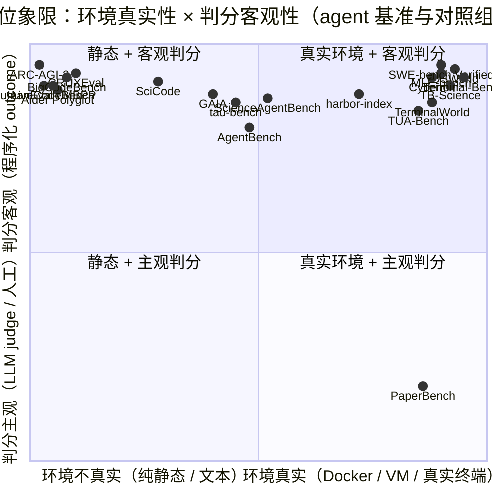

# Agent 基准生态：竞品与替代全景

> **一句话定位**：Terminal-Bench 处在「多轮自主 + 真实可执行环境 + 程序化判分」象限的稀疏区域，它真正的邻居不是某个单一基准，而是一整条从*通用助理问答*（GAIA）→*网页/GUI 操作*（WebArena/OSWorld）→*仓库级修 bug*（SWE-bench 家族）→*科学工作流*（PaperBench/ScienceAgentBench/TB-Science）的谱系；与它**同组织**的姊妹基准 `terminal-bench-science`（科学域）与 `harbor-index`（紧凑高信号）才是最近的邻居。
>
> **证据口径声明**：仓库类事实（star / 最后推送 / 归档 / 改名 / license）一律取自 `gh api repos/{owner}/{repo}` 的实时返回；数据集规模取自 Hugging Face 官方 dataset API 的 `cardData.dataset_info.splits`；论文规模取自 arXiv 官方 API 的 abstract；榜单数字取自官方站自身的数据文件或官方仓库中的提交文件。凡引用第三方来源均在文中显式标注。文中 `[E#]` 编号对应文末《证据表》。本文档只做生态测绘，**未构建、未运行任何基准**。

---

## 0. 官方自有姊妹基准（Harbor 自有）

> 本节按组织归属把 TB 最近的邻居单独拎出来：它们和 TB 共用同一套 harness、同一套 verifier 机制、同一套榜单提交流程，但**测的东西不同、规模不同、用途也不同**。

### 0.1 terminal-bench-science — 科学域姊妹基准

| 项 | 值 | 证据 |
|---|---|---|
| 仓库 | `github.com/harbor-framework/terminal-bench-science` | [E27] |
| 活跃度 | 944★，Apache-2.0，最后 push 2026-11-19，建仓 2026-01-25，live | [E27] |
| 任务规模 | **96 个专家撰写任务**，覆盖 5 个科学域（生命 / 物理 / 地球 / 数学 / 工程），目标 100+ | [E27] README「Task Coverage」 |
| 域分布结构 | `tasks/` 下按 `life-sciences` / `physical-sciences` / `earth-sciences` / `mathematical-sciences` / `engineering-sciences` 五目录分组，再按子领域分层 | [E27] 仓库树 |
| 判分方式 | **outcome-based**：任务必须「produce outcomes that can be objectively verified in a terminal environment」 | [E27] README Overview |
| LLM 的已核实用途 | 官方说明列出 LLM 辅助任务 QA，包括 `harbor check` 的实现审查和任务提案评分。逐题 verifier 的 LLM 使用情况未清点 | [E27] README「Task Review Automation」 |
| 环境 | Dockerfile + oracle/nop 双重校验（环境能构建、参考解通过、no-op 必须失败）；Harbor 沙箱（推荐 Modal / Daytona） | [E27] README |
| 共用 harness | 是。`harbor run -d terminal-bench-science/terminal-bench-science@latest -k 5 --agent oracle --n-concurrent 32 --env modal` | [E27] README「Running the Benchmark」 |
| 对外榜单 | 是。`terminal-bench-science.ai` + Harbor Hub tagged releases + Zenodo concept DOI `10.5281/zenodo.22110253` | [E27] README |
| 特色机制 | 反作弊（cheat trials 检测 reward hacking）、TF-IDF 相似度查重、任务修复 PR 流程 | [E27] README |
| 当前状态 | 「Terminal-Bench-Science 2.0」PR 开放至 2026-12-15；由 Stanford AI Lab + Laude Institute 主办，Harbor 团队构建 | [E27] README |

**与 TB 的分工**：TB 4.x 的 66 题横跨软件工程 / 系统 / 数据 / 科研杂项；TB-Science 把同一 harness 用在**科研工作流**上（生物信息学、蛋白结构、光子波导、基因组排序等），并引入「领域专家写任务 + 领域专家评审」的持续供给机制。它是 TB 的**纵向加深**，不是横向替代。

### 0.2 harbor-index — 紧凑高信号基准

| 项 | 值 | 证据 |
|---|---|---|
| 仓库 | `github.com/harbor-framework/harbor-index` | [E28] |
| 活跃度 | 49★，**license 未声明（NOASSERTION）**，最后 push 2026-08-03，建仓 2026-07-07，live | [E28] |
| 任务规模 | **80 题**（`tasks/` 下 80 个 task.toml，逐一核对）；由 **6,000+ 候选任务**经反复模型跑测、自动坏题识别、人工审计、reward hacking 监督蒸馏而来 | [E28] README + 仓库树 |
| 判分方式 | **混合**：大部分任务用程序化 outcome verifier；一部分任务（`hle-*`、`omnimath-*`、`gaia2-*`、`widesearch-*`）用 **LLM judge 集成** | [E28] `job-config.yaml` |
| LLM judge 配置 | `JUDGE_MODELS: '["claude-opus-5"]'`、`JUDGE_REPEATS: "3"`（单 judge 3 票）；历史上曾用 `gpt-5.4 / claude-opus-4-6 / gemini-3.5-flash` 集成 | [E28] `job-config.yaml` 注释 |
| 环境 | Harbor 沙箱；`ALLOWED_HOSTS` 白名单控制出网；`cybergym-*` 任务为网络受限任务 | [E28] `job-config.yaml` |
| 共用 harness | 是，完全 Harbor 原生 | [E28] |
| 榜单要求 | 每任务 **≥5 trials**、`timeout_multiplier` 必须恰为 1.0、trial 需公开可读、走 PR 提交 + 维护者审阅轨迹 | [E28] README + `job-config.yaml` |
| 反作弊 | 400 条 judge goldset；`spurious_pass` 判定直接**取消该 trial 资格** | [E28] `leaderboard/judge-goldset` + 提交文件 `disqualified_trials` |
| 公开榜单样本 | Codex + GPT-5.6 Terra (max)：accuracy **35.0%**（stderr 1.59），1,710,752,293 tokens，**$688.95**，4 个 trial 因 `spurious_pass` 被取消 | [E28] `leaderboard/submissions/2026-07-14-gpt-5-6-terra-max-codex.json` |

**关键发现——harbor-index 是「生态缩影」**：它的 80 个任务前缀直接暴露了被蒸馏来源：`gaia-*` / `gaia2-*`（GAIA）、`arcagi2-*`（ARC-AGI-2）、`hle-*`（HLE）、`omnimath-*`、`scicode-*`（SciCode）、`swebenchpro-*`（SWE-bench Pro）、`swebenchverified-*`（SWE-bench Verified）、`swesmith-*`（SWE-smith）、`swtbenchverified-*`（SWT-Bench Verified）、`tb-*`（Terminal-Bench）、`cybergym-*`、`spider2-*`、`usaco-*`、`skillsbench-*`、`featurebench-*`、`algotune-*`、`gso-*`、`bix-*`、`labbench-*` 等。[E28] 仓库树

这意味着 **harbor-index 不是新能力维度，而是把各家基准压成 80 题的「横切信号板」**——它测的不是新东西，而是「这个 agent 在各家基准的典型任务上分别处在什么水位」。对 TB 而言，它既是**替代**（低成本冒烟信号）也是**互补**（跨基准的同一把尺子）。

### 0.3 其余 Harbor 组织资产（非基准本体）

`harbor-framework` 的公开仓库清单见[官方栈篇](01-official-stack.md)。除基准本体外还有：

| 仓库 | 星 | 状态 | 性质 |
|---|---|---|---|
| `harbor` | 7,224 | live, Apache-2.0, 2026-11-19 | 框架本体（见 §4） |
| `harbor-cookbook` | 281 | live, Apache-2.0, 2026-10-31 | **用法层资产**：10 个任务 recipe 示例（`simple-task`、`multi-container`、`mcp-tools`、`multi-reward`、`simulated-user`、`computer-use-ubuntu`、`computer-use-windows`、`dns-blacklisting`、`skills`、`multi-step`）[E30] |
| `skills` | 15 | live, Apache-2.0, 2026-05-12 | **用法层资产**：3 个 Agent Skill——`harbor-task-creator`、`harbor-adapter-creator`（「Build adapters that convert external benchmarks into Harbor tasks」）、`harbor-cli` [E31] |
| `adapters` / `harbor-adapters-experiments` | 14 / 9 | live | 外部基准 → Harbor 任务的适配层 |
| `harbor-datasets` | 47 | live, 无 license | 数据集托管 |
| `awesome-harbor` | 62 | live | 生态清单 |
| `terminal-bench-1` / `-2` / `-2-1` | 2,623 / 450 / 140 | live | 历代数据集仓库（见 §1.9） |
| `harbor-docs` / `docs` / `benchmark-template` | — | **ARCHIVED** | 已并入 `harbor-docs` / `docs` |

> **`harbor-adapter-creator` 这一条对本文档的主题最有价值**：Harbor 官方提供了一个「把外部基准包装成 Harbor task」的标准化路径——这是 SWE-rebench V2.1 得以用 Harbor 原生格式分发、也是 harbor-index 能聚合各家基准的技术前提。

---

## 1. SWE-bench 家族

### 1.1 一览表

| 名称 | 仓 / 数据 | 规模 | 判分 | 环境 | 头部饱和度 | 维护状态 |
|---|---|---|---|---|---|---|
| **SWE-bench** | `SWE-bench/SWE-bench` 6,217★ MIT 2026-09-18 [E1]；HF `SWE-bench/SWE-bench` | test **2,294** / dev 225（12 个 Python 仓）[E2][E43] | FAIL_TO_PASS + PASS_TO_PASS 单测 | 每实例一个 Docker 镜像 | Full(split `Test`) **52.62%**（Sonar Foundation Agent + Claude 4.5 Opus, 2025-12-19）[E3] | live，主仓 2026-09 后无新推 |
| **SWE-bench Verified** | HF `SWE-bench/SWE-bench_Verified`（205 likes） | **500**，人工验证子集 [E2] | 同上 | 同上 | **79.2%**（Sonar + Claude 4.5 Opus 2025-12-05；live-SWE-agent + Claude 4.5 Opus medium 同分 2025-12-15）[E3] | live |
| **SWE-bench Lite** | HF `SWE-bench/SWE-bench_Lite` | **300** test + 23 dev（11 仓）[E2] | 同上 | 同上 | **60.33%**（ExpeRepair-v1.0 + Claude 4 Sonnet, 2025-06-25）[E3] | live；**基本被 Verified 取代** |
| **SWE-bench Full** | swebench.com 官方 tab | = 全量 2,294 test split（数据文件里叫 `Test`）[E3] | 同上 | 同上 | **52.62%**[E3] | live |
| **SWE-bench Multilingual** | HF `SWE-bench/SWE-bench_Multilingual`；仓 `SWE-bench/swe-bench-multilingual-tasks` | **300**，9 语言 / 41 仓 [E2] | 同上 | 同上 | **72.7%**（mini-SWE-agent + Gemini 3 Flash, 2026-02-13）[E3] | live |
| **SWE-bench Multimodal** | HF `SWE-bench/SWE-bench_Multimodal`；仓 `SWE-bench/swe-bench-multimodal-tasks` | 论文 **617** 实例 / 17 个 JS 库；HF 卡片写 **612** Issue-PR 对（见 §7）[E2][E43] | 同上 + 含图片 | 同上 | **35.98%**（GUIRepair + o3；Codefuse_Pycfuse_SVR 同分）[E3] | live |
| **SWE-bench Pro** | 仓 `scaleapi/SWE-bench_Pro-os` 567★ MIT 2026-09-22；HF `ScaleAI/SWE-bench_Pro` | 论文 **1,865** 题 / 41 仓（公开 11 + held-out 12 + 商业 18）；HF 默认 **V2 = 642**（go 256 / python 237 / js 145…），`hard` = 51，`v1` = 731 [E5] | fail_to_pass + pass_to_pass 隐藏测试 | 纯净容器 + 预构建镜像 | 未从官方榜核到 → §7 | live |
| **SWE-bench Live** | 仓 `microsoft/SWE-bench-Live` 263★ MIT 2026-11-08；`SWE-bench-Live/submission` 14★ | 未核 → §7 | 同上 | 同上 | 未核 → §7 | live（NeurIPS 2025 D&B） |
| **SWE-bench Bash-Only** | **不存在独立数据集** | — | — | — | — | 见 §1.2 |
| **SWE-bench Not Verified** | HF `SWE-bench/SWE-bench_Not_Verified` | — | 同上 | 同上 | — | 2025-09-16 后未更新 |
| **SWT-Bench** | 仓 `logic-star-ai/swt-bench` 93★ MIT 2026-11-04 | 论文未给单一数字；站 `swtbench.com`；已有 **SWT-Bench Verified** 变体（见 §7）[E7] | **测测试生成**：issue → 可复现失败的测试，用 issue reproduction rate + coverage 变化双指标 | 真实 GitHub 仓 + Docker | 未核 → §7 | live（NeurIPS 2024） |
| **SWE-rebench** | 仓 `SWE-rebench/SWE-rebench-V2` 94★ MIT 2026-11-17 | V1：**21,000+** Python 交互任务；V2：**32,079** 题 / 20 语言 / 3,617 仓，另附 120,000+ 带说明的任务；V2.1（HF `ibragim-bad/SWE-rebench-V2.1`）**21,272** 条重验任务 [E8] | FAIL_TO_PASS + PASS_TO_PASS（Harbor verifier） | 每实例预构建镜像 | 未核 → §7 | live |
| **SWE-Lancer** | 仓 `openai/SWELancer-Benchmark` 1,428★ **ARCHIVED** 2025-07-18，无 license [E9] | **1,400+** Upwork 任务，总价值 **$1M**（$50 到 $32,000 不等）[E43] | 独立任务：三重工程师验证的 e2e 测试；管理任务：与原始工程师的选择比对 | 统一 Docker 镜像；公开子集 = SWE-Lancer Diamond | 未核 → §7 | **已归档** |
| **SWE-PolyBench** | 仓 `amazon-science/SWE-PolyBench` 89★ MIT 2026-08-14 [E10] | **2,110** 实例 / 21 仓：Java 165、JS 1,017、TS 729、Python 199；`PB500` = 500（每语言 125）；`PBv` Verified = **382**（72/100/113/100）[E10][E43] | 仓库级执行判分 + AST 语法树分析指标 | GHCR 预构建实例镜像 | 未核 → §7 | live |
| **SWE-smith** | 仓 `SWE-bench/SWE-smith` 836★ MIT 2026-11-16（NeurIPS 2025 D&B Spotlight）；HF `SWE-bench/SWE-smith` | 单语包 59,136 实例 / 131 仓（Python）；另有 py/go/php/java/js/rs/ts/cpp 分语言包；另发 trajectories 5,017 条 [E11] | FAIL_TO_PASS + PASS_TO_PASS | 每实例可执行环境 | **训练数据集，非评测基准** | live；单语包 2025-12-14 起停止更新，改推分语言包 |

### 1.2 「SWE-bench Bash-Only」：不是数据集，是榜单过滤器

一手证据（`SWE-bench/experiments` README 原文）：

> The mini-SWE-agent "bash-only" runs used to live in `evaluation/bash-only/`. They are now regular Verified submissions under `evaluation/verified/`, and the leaderboard's *Bash Only* view is a filter on the Verified board rather than a board of its own. [E4]

仓库里确实还留有 `analysis/bash_only_get_extra_info.py` [E4]，说明它曾是一个独立的实验目录，但**官方明确声明它不是独立 board**。因此把「SWE-bench Bash-Only」当作和 Verified / Lite 并列的数据集变体是**错误的**；它是 Verified 榜上的一个 agent 形态过滤器（限制 agent 只用 bash）。榜单里对应的条目是 "Salesforce AI Research SAGE (bash-only)"，在 Full split 上 44.25% [E3]。

### 1.3 「SWE-bench Full」：是官方 split，不是另一个数据集

`swebench.com` 首页的 split 切换项为：**Verified / Multimodal / Multilingual / Lite / Full** [E3]。其中 Full = 全量 2,294 实例的 test split——在官方数据文件 `data/leaderboards.json` 里它的 board 名字叫 `Test` [E3]。Verified（500）与 Lite（300）都是它的子集。所以「Full」不是新数据集，只是未被裁剪的原始集。

### 1.4 改名与迁移记录

- `princeton-nlp/SWE-bench` → 302 → **`SWE-bench/SWE-bench`**（`gh api` 自动跟随重定向，返回 `full_name` 已变为新名）[E1]
- `princeton-nlp/SWE-bench_Verified`、`princeton-nlp/SWE-bench_Lite` → 404。Verified / Lite 只作为 **HF 数据集**存在，没有独立 GitHub 仓 [E2]
- `scaleapi/SWE-bench_Pro` → 404；实际仓名为 **`scaleapi/SWE-bench_Pro-os`** [E5]
- `SWE-bench-Live/SWE-bench-Live`（2★）与 `microsoft/SWE-bench-Live`（263★）并存，前者是旧址 [E6]

### 1.5 家族的整体判分与环境

- **判分**：全部为程序化 outcome——解析测试日志，判定 FAIL_TO_PASS 是否全绿、PASS_TO_PASS 是否未回归；不涉及 LLM judge，也不涉及人工评分。
- **环境**：每个实例一个 Docker 镜像（HF 数据集字段里直接带 `image` / `docker_image` / `dockerhub_tag`）[E2][E5]。
- **harness**：官方 `swebench` CLI（`pip install swebench`），配套 `SWE-bench/experiments`（287★，无 license）存放预测、日志、轨迹与结果，`SWE-bench/sb-cli`（85★ MIT）用于远程跑评测，`SWE-bench/swe-bench.github.io`（16★）是榜单站点 [E44]。

---

## 2. 非终端类 agent 基准

| 名称 | 仓 / 数据 | 测什么 | 判分 | 规模 | 饱和度 | 维护 |
|---|---|---|---|---|---|---|
| **OSWorld** | `xlang-ai/OSWorld` 3,268★ Apache-2.0 2026-11-14 [E12] | 真实操作系统（Ubuntu/Windows/macOS）上的通用计算机操作 | 每个任务自带 **execution-based 评测脚本** | 论文 **369** 个计算机任务 [E43] | 论文：最佳模型 **12.24%** vs 人类 **72.36%**（2024 口径）；实时榜 JS 渲染未核 → §7 | live |
| **WebArena** | `web-arena-x/webarena` 1,644★ Apache-2.0 2025-11-26 [E13] | 真实站点上的网页操作 | 规则 + 程序化 | — | 未核 → §7 | live |
| **VisualWebArena** | `web-arena-x/visualwebarena` 489★ MIT 2024-11-09 [E13] | 视觉理解的网页操作 | 同上 | — | 未核 → §7 | live，但 2024-11 后无推 |
| **τ-bench** | `sierra-research/tau-bench` 1,512★ MIT 2026-03-18 [E14] | 工具-代理-用户三方交互（retail / airline / telecom） | **会话结束后的数据库状态**与标注目标状态比对 | — | 论文：gpt-4o 类 function-calling agent 成功率 **< 50%**，retail 域 `pass^8 < 25%`（pass^k 可靠性指标）[E43] | live |
| **τ²-bench / τ-bench 2.0** | `sierra-research/tau2-bench` 2,480★ MIT 2026-11-10 [E15] | 双控（Dec-POMDP）场景：agent 与用户都能改共享世界 | 任务 reward + **post-hoc judges**（自然度 / 语音保真 / 工具使用），**judges 不改变任务 reward** | `text-v1`：6 语言 × 3 域 = **900** calls；`voice-v2`：900；`voice-v1`（English）：airline 50 + retail 114 + telecom 114 = **278**；新增 `intake`（τ-Entity）**200+** 任务；`banking_knowledge` 域 ~700 篇文档 [E15] | 站 `taubench.com` 有活榜；具体头部分数未核 → §7 | live |
| **GAIA** | HF `gaia-benchmark/GAIA`（gated auto，976 likes，2025-10-28 更新）；`gaia-benchmark/results_public` 2026-11-18 更新 [E16] | 通用助理：推理 + 多模态 + 联网 + 工具使用 | 精确答案匹配（答案保留给 leaderboard） | **466** 题（300 题保留答案供榜单），分 3 个 level [E43] | 论文：人类 **92%** vs GPT-4+plugins **15%**（2023 口径）；实时榜见 `results_public` | live |
| **AgentBench** | `THUDM/AgentBench` 3,827★ Apache-2.0 2026-02-08 [E17] | 8 个交互式环境的通用 agent 推理/决策 | 各环境自带（DB / OS / KG / WebShop / ALFWorld / 程序执行 / 问答 / 横向思维） | **8** 个环境 [E43] | 榜在 Google Sheets；未核 → §7 | 主分支已改为 **AgentBench FC**（function-calling 版，集成 AgentRL，2025-10-10）；旧版在 tag `v0.1` / `v0.2` |
| **AgentBench 2.0** | — | — | — | — | — | **未找到独立发布**，见 §7 |
| **MLE-bench** | `openai/mle-bench` 1,801★ license NOASSERTION 2026-04-24 [E18] | Kaggle 上的机器学习工程（训练模型、备数据、跑实验） | 与 **Kaggle 公开排行榜**对比（人类基线） | **75** 个竞赛 [E43] | 论文：o1-preview + AIDE 达到「至少铜牌」的竞赛占比 **16.9%** | live |
| **Cybench** | 官方站 `cybench.github.io`；官方 GitHub 仓未定位 → §7 [E19] | 专业级 CTF（漏洞识别 + 利用执行） | 任务完成 / **subtask** 中间步得分 | **40** 个 CTF 任务，来自 **4** 个 CTF 比赛；另拆中间步 subtask [E43] | 论文：GPT-4o / Claude 3.5 Sonnet 可解人类团队 ≤11 分钟的任务；最难任务人类需 24h54m | live |
| **ScienceAgentBench** | `OSU-NLP-Group/ScienceAgentBench` 185★ MIT 2026-11-16 [E20] | 数据驱动的科学发现（输出统一为一个自包含 Python 程序） | 程序输出 + 执行结果 + 成本三组指标 | **102** 个任务，来自 **44** 篇同行评审论文、4 个学科、9 位领域专家验证 [E43] | 论文：最佳 agent **32.4%**（3 次尝试）/ 34.3%（专家知识）；o1-preview self-debug **42.2%**，但成本 >10× | live |
| **SciCode** | `scicode-bench/SciCode` 246★ Apache-2.0 2026-11-16 [E21] | 科研级代码生成（16 个自然科学子领域） | 科学家标注的 gold 测试用例 | **338** 个子问题 / **80** 个主问题 [E43] | 论文：Claude 3.5 Sonnet 在最贴近真实的设定下仅解出 **4.6%** | live |
| **PaperBench** | `openai/preparedness` 1,344★ MIT 2026-10-12 [E22] | 复现 ICML 2024 Spotlight/Oral 论文 | **层级化 rubric**（与论文作者共同编写）+ **LLM judge**（另建 judge 基准评测 judge 本身） | **20** 篇论文，**8,316** 个可独立打分子任务 [E43] | 论文：最佳 agent 平均复现分 **21.0%**；人类 ML 博士基线未被超越 | live |
| **ARC-AGI** | `fchollet/ARC-AGI` 4,856★ Apache-2.0 2025-04-04（v1）；`arcprize/ARC-AGI` 91★（工具包，2026-11-12）；`arcprize/ARC-AGI-2` 749★（2025-05-22）[E23] | 从极少示例归纳符号规则（**无工具、非 agent**） | 网格输出精确匹配；每个测试输入允许 2 次尝试 | ARC-AGI-2：**1,000** 公开训练 + **120** 公开评测，另有半私有与全私有测试集 [E23] | ARC-AGI-2 README：公开评测集**人类平均 66%** | live |
| **TerminalWorld** | `terminalworld/TerminalWorld` 54★ Apache-2.0 2026-11-04；站 `terminalworld.ai`；HF `terminalworld/TerminalWorld` [E24] | 从 asciinema.org 真实人类终端录屏自动反向工程出的任务 | 可执行 Docker 环境 + 生成的测试套件（AllPassing / Nop / Partial 三重 trial） | 管线：80,870 录屏 → 9,492 高质量 → **5,035** 个可复现环境 → **1,530** 个已验证任务，18 个真实类别，1,280 条唯一命令；另有人工复核的 **Verified 子集 200 题** [E43] | 论文：**最高通过率仅 62.5%**（8 个前沿模型 × 6 个 agent）；**与 TB 的成绩相关性仅 Pearson r = 0.20** | live（NeurIPS 2026 Evaluations & Datasets Track） |
| **TUA-Bench** | `facebookresearch/TUA-Bench` 49★ license NOASSERTION 2026-10-03；站 `tuabench.ai`；license CC BY-NC [E25] | **通用**终端使用：日常数字活动（文档编辑、邮件管理、实时网页检索）+ 博士级专家共创的科学工程工作流 | **execution-based scoring protocol**，真实终端 + 确定性 setup 脚本 | **120** 个任务 / 5 个任务族 [E43] | 官方榜：**Claude Code + claude-opus-4.8 (max) = 0.658**（Pass@1 58.8% / Pass@5 64.2% / All-5 51.7%）；Codex gpt-5.5 xhigh 0.647；OpenHands SDK + opus-4.8 0.634；mini-swe-agent + gpt-5.5 0.624；Terminus-2 + gpt-5.5 0.601 [E25] | live |

### 2.1 三个「终端邻居」的直接对照

这是本节最值得强调的一组对比——**TUA-Bench、TerminalWorld、TB 是同一个终端里三种完全不同的取样方式**：

| | Terminal-Bench | TerminalWorld | TUA-Bench |
|---|---|---|---|
| 任务来源 | 领域专家手工撰写 | asciinema 真实人类录屏自动反向工程 | 手工设计（日常 + 博士级专家共创） |
| 规模 | 66（TB 4.x）[E26] | 1,530（Verified 200）[E24] | 120 [E25] |
| 难度取向 | 「难、专家级、真实性」 | 「日常真实，不人为制造难度」 | 「广度优先，覆盖通用终端使用」 |
| 头部成绩 | 见 §5 | 62.5% [E43] | 65.8% [E25] |
| 与 TB 成绩相关性 | — | **r = 0.20** [E43] | 未公开 |

**Pearson r = 0.20 是本节最有价值的一条证据**：TerminalWorld 论文明确说自己捕获的是「与专家策展基准（如 Terminal-Bench）不同的真实终端能力」，两者分数几乎不相关。这直接说明——**TB 和 TerminalWorld 是互补而非替代关系**，用 TB 分数推断真实终端日常使用能力会失效。

---

## 3. 编码能力类对照基准

| 名称 | 仓 | 规模 | 判分 | 饱和度 | 维护 |
|---|---|---|---|---|---|
| **LiveCodeBench** | `LiveCodeBench/LiveCodeBench` 979★ MIT，**最后 push 2025-07-16** [E35] | 初版 **400** 题（2023-05 ~ 2024-05），持续从 LeetCode / AtCoder / Codeforces 收集；4 个 split：code generation / self-repair / code execution / test output prediction [E43] | 单轮生成 + 单元测试 | 论文口径：18 base + 34 instruct 模型评测 [E43] | 仓自 2025-07 起无 push，但数据集在 HF 侧持续更新 |
| **BigCodeBench** | `bigcode-project/bigcodebench` 518★ Apache-2.0，**ARCHIVED**，2026-01-03 [E36] | **1,140** 个细粒度任务，**139** 个库，**7** 个领域；每任务 5.6 个测试用例、平均分支覆盖 99% [E43] | 单轮生成 + 测试 | 论文：**最高 60%** vs 人类 **97%** [E43] | **已归档** |
| **CRUXEval** | `facebookresearch/cruxeval` 174★ MIT，**ARCHIVED**，2024-10-11 [E37] | **800** 个 Python 函数（3–13 行），两个任务：input prediction / output prediction [E43] | 执行结果匹配 | 论文：最佳 GPT-4+CoT pass@1 **75% / 81%**（input / output）[E43] | **已归档** |
| **Aider Polyglot** | `Aider-AI/polyglot-benchmark` 229★ **无 license**，2024-12-22 [E38] | Exercism 六个语言轨道（C++/Go/Java/JavaScript/Python/Rust）提取的习题；仓库共 3,646 个文件（习题数量未核 → §7） | 单轮编辑 + 测试 | — | live 但 2024-12 后无 push |
| **HumanEval** | `openai/human-eval` 3,431★ MIT 2026-10-16；HF `openai/openai_humaneval` [E39] | test **164** [E39] | 单轮生成 + 单元测试 | 饱和参照 | live |
| **MBPP** | HF `google-research-datasets/mbpp`（279 likes，2024-01-04 后未更新）[E40] | 全量：train 374 / test **500** / validation 90 / prompt 10；sanitized：train 120 / test **257** / validation 43 / prompt 7 [E40] | 单轮生成 + 单元测试 | 饱和参照 | 数据已停止更新 |
| **SWE-Lancer** | 见 §1.1 | 1,400+ Upwork 任务 / $1M | e2e 测试 + 管理决策比对 | 未核 → §7 | **仓已归档** |

### 3.1 与 agent 端到端基准的根本差别

| 维度 | 编码能力类（§3） | agent 端到端（§1、§2 中的 TB / SWE-bench / TUA 等） |
|---|---|---|
| 交互轮次 | **单轮**：给题面 → 出一段代码/补丁 | **多轮自主**：模型自己决定读哪些文件、跑哪些命令、改什么、何时停 |
| 环境 | 通常无环境或只有本地执行 | 真实 Docker / VM / 终端 / 网页，需要自己探索状态 |
| 失败模式 | 语法错、逻辑错、API 用错 | 探索不足、误改环境、上下文丢失、奖励黑客、无法收敛 |
| 失败成本 | 秒级 | 分钟到小时级（TB 单任务 agent 超时上限 8 小时 [E26]） |
| 判分焦点 | 输出对不对 | 结果对不对（而且要能在真实环境里被客观观测） |
| 饱和状态 | HumanEval / MBPP / BigCodeBench **已饱和或已归档**；LiveCodeBench 靠持续换题维持有效性 | SWE-bench Verified 已到 79.2% [E3]；TB 4.1 官方榜区间 0.00%–71.21%（见[榜单与采用](06-leaderboards-and-adopters.md)）。TB 2.0 论文的前沿模型 <65% [E43] 属另一版任务集，不可与 4.x 横比 |

**这就是它们被放进「对照组」而非「竞品」的原因**：单轮生成基准测的是「模型会不会写这段代码」，agent 基准测的是「模型能不能在一堆信息里自己把事办完」。前者几乎不随 harness 变化，后者强相关——TB 4.0 榜的每一行都是「某个 agent + 某个模型 + 某个 reasoning effort」的三元组 [E26]。

---

## 4. 评测框架 / 工具层

harness 层不是「基准」，而是**基准与被测对象之间的执行与判分基础设施**。当前生态里的可选层：

### 4.1 框架本体

| 框架 | 仓 | 活跃度 | 定位 | 判分取向 |
|---|---|---|---|---|
| **Harbor** | `harbor-framework/harbor` | 7,224★ Apache-2.0 2026-11-19；DOI `10.5281/zenodo.20953922` [E29] | **TB 的缔造者出品**的 agent 评测框架：可评测任意 agent（Claude Code / OpenHands / Codex CLI…）、自建并发布 benchmark 与环境、在 Daytona / Modal / LangSmith / Blaxel / Novita Sandbox / Tensorlake / Runta / Sail 等 provider 上**并行跑成千上万个环境**、为 RL 生成 rollout。官方自述是 TB 2.0 的 official harness | 任务自带 verifier，outcome 为主；支持多 verifier（`multi-reward`）与 simulated-user |
| **SWE-bench harness** | `SWE-bench/SWE-bench` + `experiments` + `sb-cli` + `swe-bench.github.io` | 6,217★ / 287★ / 85★ / 16★ [E1][E44] | `swebench` CLI + Docker + log parser，专门跑仓库级 patch | 纯程序化（F2P/P2P） |
| **Inspect AI** | `UKGovernmentBEIS/inspect_ai` | 3,284★ MIT 2026-11-19 [E32] | 英国 AISI 出品：prompt engineering、tool usage、multi-turn dialog、**model graded evaluation** 一等公民；内置 **200+ 个预置评测** | 判分谱系最广（程序化 / 模型评分 / 人工混合） |
| **lm-evaluation-harness** | `EleutherAI/lm-evaluation-harness` | 14,501★ MIT 2026-11-04 [E33] | 学术与社区标准的**单轮**评测框架；2025-12 改为 `run`/`ls`/`validate` 子命令 + YAML 配置；2026-09 支持插件注册 | 主要是 log-likelihood / 生成匹配，**不做多轮 agent 环境** |
| **OpenHands** | `OpenHands/OpenHands` | 93,781★ MIT 2026-11-19 [E34] | 当前定位是「**Agent Canvas**——自托管的 coding agent 开发控制中心」，可跑 OpenHands / Claude Code / Codex / Gemini / Pi / OpenCode / 任意 ACP 兼容 agent | 它是**被测对象 + 可当 harness 用的 agent 实现**，不是基准 |
| 补充 | `SWE-agent/mini-swe-agent` 9,767★ MIT 2026-11-16（自述 SWE-bench Verified >74%）；`openai/evals` 19,769★ MIT；`openai/frontier-evals` 1,344★ MIT；`harbor-framework/adapters` 14★（外部基准 → Harbor 任务适配）[E42][E44] | | 生态中的其他可选件 | |

### 4.2 「用法层资产」——不是基准本体

以下两个 Harbor 官方组件属于**用法层资产**，不构成基准、不进入任何榜单：

- **`harbor-framework/harbor-cookbook`**（281★，Apache-2.0，2026-10-31）[E30]：「Realistic examples of building evals and optimizing agents using Harbor」。提供 10 个可直接 `harbor run -p harbor_cookbook/recipes/<name>` 的任务配方：`simple-task`（最小单容器）、`multi-container`（Compose + 本地 REST API）、`mcp-tools`（FastMCP 服务器给 agent 加工具）、`multi-reward`（多个独立 verifier 各出各的分）、`simulated-user`（agent 靠对话发现需求）、`computer-use-ubuntu` / `computer-use-windows`（GUI computer-use 参考实现）、`dns-blacklisting`（主机名黑名单）、`skills`（给 agent 装自定义 skill）、`multi-step`（有序多步 + 每步产物 + 早停）。这些配方同时也是**别的基准移植进 Harbor 的模板**。
- **`harbor-framework/skills`**（15★，Apache-2.0，2026-05-12）[E31]：「Public agent skills catalog for Harbor」，三个 skill：`harbor-task-creator`（造 Harbor 任务）、`harbor-adapter-creator`（**把外部基准转换成 Harbor 任务**）、`harbor-cli`（CLI 全量参考）。可用 `/plugin marketplace add harbor-framework/skills` 装到 Claude Code，或用 Codex 的 `skill-installer`。

### 4.3 harness 层的选择逻辑

| 你要做什么 | 该用哪层 | 理由 |
|---|---|---|
| 评测一个现成的终端 agent，且要和其他人比 | **Harbor** + Harbor Hub 榜单 | TB 官方链路，`harbor run` → upload → PR |
| 评测一个 repo 级修 bug agent | **SWE-bench harness** | F2P/P2P + Docker 是既定事实标准 |
| 自己写一套 agent 评测（含模型评分） | **Inspect AI** | 200+ 预置评测 + model graded 一等公民 |
| 测一个模型的单轮能力 | **lm-evaluation-harness** | 社区通用、任务数最多 |
| 想把自己的旧基准接进 Harbor 生态 | **harbor-adapter-creator + adapters** | 官方提供的标准路径 |

---

## 5. 定位矩阵

### 5.1 口径说明

四个轴的操作化定义（避免凭印象打分）：

- **环境真实性**：能否在真实可执行环境中求解——`真实可执行环境`（Docker 容器 / OS 虚拟机 / 真实终端 / 真实网页）> `半可执行`（本地单进程 / 静态数据集）> `纯静态`（文本题，无执行）。
- **判分客观性**：判分是否**不依赖模型或人**——`程序化 outcome`（单测 / 状态比对 / 精确匹配）> `混合`（程序化为主、部分任务用 LLM judge）> `judge 主导`（rubric + LLM judge）。
- **饱和度**：直接写当前**头部得分**与来源编号；无官方榜可核的写「未核」。
- **单次运行成本**：以「一次完整评测（≥5 次试次）」为口径——`低` = 纯单轮生成；`中` = 单容器 / 需外部 API；`高` = 多容器或长超时或需并行沙箱；`极高` = GPU 小时级。

> 格内 `[E#]` 指向文末《证据表》，每个单元格都有可核验来源；没有来源的判断一律写「未核」而不打分。

### 5.2 主矩阵

| 家族 | 环境真实性 | 判分客观性 | 饱和度（头部分数） | 单次运行成本 |
|---|---|---|---|---|
| **Terminal-Bench 4.1** | 每题定义可运行环境，以独立 verifier 沙箱验收 [E26] | 程序化 outcome 判分为主，详见[任务与判分](02-task-and-verifier.md) | 官方榜快照见[榜单与采用](06-leaderboards-and-adopters.md) | 66 题 × 5 试次为 330 trial。CPU、内存、GPU 和时限以各题 `task.toml` 为准 [E26] |
| **terminal-bench-science** | 真实可执行环境（Dockerfile + oracle/nop 校验）[E27] | 官方要求可客观验证的结果，文档另列 LLM 辅助任务 QA [E27] | 未核 → §7 | 主仓快照 96 题，官方 README 的 Oracle 校准例为五次重复 [E27] |
| **harbor-index** | 真实可执行环境（Harbor 沙箱，部分任务网络受限）[E28] | 混合，包含程序化 verifier 和部分任务的 LLM judge [E28] | 样本 **35.0%**（Codex + GPT-5.6 Terra max，2026-07-14）。只核到一条公开提交 [E28] | 80 题 × 5 试次为 400 trial。该提交记录 **1.71B tokens / $688.95** [E28] |
| **SWE-bench Verified** | 真实可执行环境（每实例 Docker）[E2] | 程序化 outcome（F2P/P2P）[E2] | **79.2%**[E3] | **高**：500 实例 × Docker |
| **SWE-bench Full (2,294)** | 真实可执行环境 [E2] | 程序化 outcome [E2] | **52.62%**[E3] | **高**：2,294 实例 × Docker |
| **SWE-bench Lite** | 真实可执行环境 [E2] | 程序化 outcome [E2] | **60.33%**[E3] | 高：300 实例 |
| **SWE-bench Multimodal** | 真实可执行环境 + 图片输入 [E43] | 程序化 outcome [E43] | **35.98%**[E3] | 高：617 实例 |
| **SWE-bench Multilingual** | 真实可执行环境 [E2] | 程序化 outcome [E2] | **72.7%**[E3] | 高：300 实例 |
| **SWE-bench Pro** | 真实可执行环境（预构建镜像）[E5] | 程序化 outcome（隐藏测试）[E5] | 未核 → §7 | **极高**：642 题，长 horizon，论文称专业工程师需「数小时到数天」[E43] |
| **SWE-rebench V2(.1)** | 真实可执行环境（每实例预构建镜像）[E8] | 程序化 outcome（Harbor verifier，F2P/P2P）[E8] | 未核 → §7 | **极高**：32,079 题 / 20 语言 / 3,617 仓 [E43] |
| **SWE-PolyBench** | 真实可执行环境（GHCR 实例镜像）[E10] | 程序化 outcome + AST 指标 [E10] | 未核 → §7 | 高：2,110 实例 |
| **SWT-Bench** | 真实可执行环境（真实 GitHub 仓）[E7] | 程序化 outcome（issue reproduction rate + coverage）[E43] | 未核 → §7 | 中 |
| **SWE-Lancer** | 真实可执行环境（统一 Docker 镜像）[E9] | 程序化 outcome（e2e 测试）+ 管理决策比对（**人工参照**）[E43] | 未核 → §7 | 高 |
| **SWE-smith** | 真实可执行环境（每实例可执行环境）[E11] | 程序化 outcome（F2P/P2P）[E11] | — （**训练集**，非评测基准） | 极高：59,136 实例 |
| **OSWorld** | **真实 OS 虚拟机**（Ubuntu / Windows / macOS）[E43] | 程序化 outcome（每任务自带执行脚本）[E43] | 论文：**12.24%** vs 人类 72.36%[E43]；实时榜未核 | **高**：369 任务，各需 VM 快照 |
| **TerminalWorld** | 真实可执行环境（Dockerfile + docker-compose，5,035 个复现环境）[E24] | 程序化 outcome（生成测试套件，AllPassing/Nop/Partial 三重 trial）[E43] | **62.5%**（最高）[E43] | 高：1,530 任务（Verified 200） |
| **TUA-Bench** | 真实终端 + 确定性 setup 脚本 [E43] | 程序化 outcome（execution-based scoring）[E43] | **65.8%**（Claude Code + opus-4.8 max）[E25] | 中：120 任务 × 5 试次 |
| **τ-bench / τ²-bench** | 半可执行（工具 API + 模拟用户 + 数据库）[E14][E15] | 程序化 outcome（**数据库状态比对**）；judges 只做 post-hoc 分析，不改 reward [E15] | 论文：<50%（τ-bench 口径）[E43] | 中：900 calls / 次 |
| **GAIA** | 半可执行（联网 + 工具，无沙箱）[E43] | 程序化（精确答案匹配）[E16] | 论文：人类 92% vs GPT-4+plugins 15%[E43]；实时榜见 `results_public` | 中：466 题 × 联网 |
| **AgentBench** | 半可执行（8 个模拟/容器化环境）[E17] | 各环境自带（DB 查询 / OS 命令 / KG / WebShop 模拟）[E43] | 未核 → §7 | 中 |
| **MLE-bench** | 真实可执行环境（Kaggle 竞赛）[E43] | 程序化 outcome（Kaggle 公开榜对比）[E43] | 论文：≥铜牌 **16.9%**[E43] | **极高**：75 个竞赛，每个需完整训练跑 |
| **Cybench** | 真实可执行环境（CTF 环境）[E43] | 程序化 outcome（任务/subtask 完成）[E43] | 论文：最强模型仅解人类 ≤11 min 的任务[ E43] | 中：40 任务 |
| **ScienceAgentBench** | 半可执行（Python 程序 + 执行）[E43] | 程序化（程序输出 + 执行结果 + 成本三指标）[E43] | 论文：**32.4%**（3 次尝试）/ o1-preview 42.2%[E43] | 中：102 任务 |
| **SciCode** | 半可执行（本地单进程）[E43] | 程序化（科学家标注 gold 测试）[E43] | 论文：**4.6%**（最贴近真实设定）[E43] | **低**：80 主问题，单轮 |
| **PaperBench** | 真实可执行环境（复现论文实验）[E43] | **judge 主导**：层级 rubric + LLM judge（judge 本身另建基准评测）[E43] | 论文：**21.0%**[E43] | 高：20 篇论文 + 8,316 子任务 × judge 调用 |
| **ARC-AGI / ARC-AGI-2** | 纯静态（网格 JSON，无执行、无工具）[E23] | 程序化（网格精确匹配，2 次尝试）[E23] | ARC-AGI-2 人类平均 **66%**[E23] | **低**：1,000 + 120 任务 |
| **LiveCodeBench** | 纯静态（单轮生成 + 单测）[E43] | 程序化（单元测试）[E43] | 未核 → §7 | **低**：400 题 |
| **BigCodeBench** | 纯静态 [E43] | 程序化（5.6 测试/任务，覆盖率 99%）[E43] | 论文：**60%** vs 人类 97%[E43] | 低：1,140 题 |
| **CRUXEval** | 纯静态 [E43] | 程序化（执行结果匹配）[E43] | 论文：**75% / 81%**（GPT-4+CoT）[E43] | 低：800 函数 |
| **Aider Polyglot** | 纯静态 [E38] | 程序化（习题自带测试）[E38] | 未核 → §7 | 低 |
| **HumanEval / MBPP** | 纯静态 [E39][E40] | 程序化（单元测试）[E39][E40] | 已饱和（饱和参照）[E43] | 低：164 / 500 题 |

### 5.3 二维象限：环境真实性 × 判分客观性

**读图要点**：

1. **TB 独占右上角**。右上方几乎全是「仓库级 / 终端级真实环境 + 程序化判分」——SWE-bench 家族、TerminalWorld、TUA-Bench、OSWorld、MLE-bench、Cybench。但 TB 与它们的差别在**难度定位**与**出题哲学**：SWE-bench 判分最硬（纯单测）但任务同质（都是修 Python bug）；TB 判分同样硬但任务异质（编译 FreeCAD、跑 proteomics、审计财务模型）。
2. **PaperBench 是唯一的「真实环境 + 主观判分」象限**——因为复现论文没有一个可自动判定的标准答案，只能用 rubric + LLM judge。这是它与 TB 最本质的分野。
3. **左上角（静态 + 客观）**是 §3 的编码单轮组。它们环境不真实但判分极硬，饱和度最高——这正是「单轮生成」和「多轮自主」的能力分层。
4. **左上角（半真实 + 客观）**是 τ-bench / GAIA / ScienceAgentBench 一类：环境是模拟的（模拟用户、模拟工具、模拟 DB），判分却可以程序化（状态比对、答案匹配）。它们的成本比真环境低一个量级，是 TB 之外性价比最高的一档。

### 5.4 成本—信号比的实际含义

- **预算按实跑配置比较。** Terminal-Bench 4.1 以五次重复运行 66 题时有 330 个 trial。PaperBench 还引入 rubric 判分开销，运行时间和费用取决于模型、环境、任务和判分配置。
- **Harbor Index 提供跨基准采样。** 一条公开提交耗用 1.71B tokens，报告费用为 $688.95 [E28]。比较它与 Terminal-Bench 的费用，需要相同模型、预算和计费边界下的实测。

---

## 6. 与 TB 的关系判定

关系定义：**互补** = 测的是不同能力维度，可叠加；**竞争** = 同一能力域，互为对照；**替代** = 可以换着用，不换就失去可比性；**历史** = 已被更好的版本取代，只作历史参照。

| 家族 | 关系 | 一句话理由 |
|---|---|---|
| **terminal-bench-science** | **同组织兄弟 / 互补** | 同一 Harbor harness 与 verifier 机制，但换成科学域专家工作流（96 题 / 5 科学域），是 TB 的纵向加深 [E27]。 |
| **harbor-index** | **同组织兄弟 / 替代 + 互补** | 80 题跨 20+ 家基准蒸馏出的紧凑横切信号板，低成本替代「跑全套」的冒烟检查；测的维度却与 TB 高度重叠 [E28]。 |
| **SWE-bench Verified** | **竞争** | 同为多轮自主修真实仓库 bug，判分同样纯程序化；它比 TB 更同质、更易复现，是 TB 最硬的对家 [E3][E26]。 |
| **SWE-bench Full (2,294)** | **竞争** | 未裁剪全集，含未经人工筛查的实例，存在不可解或欠规范噪声；通过率 52.62% 明显低于 Verified 的 79.2% [E3]。覆盖面更广，不适合当主对照。 |
| **SWE-bench Lite** | **历史** | 300 题子集，头部 60.33% 已被 Verified 的 79.2% 取代，除历史对照外不再推荐 [E3]。 |
| **SWE-bench Multilingual / Multimodal** | **互补** | 补的是语言与模态维度（9 语言 / 视觉 JS 仓），TB 不覆盖这两轴 [E2][E3]。 |
| **SWE-bench Pro** | **竞争（更狠）** | 长 horizon、企业级、41 仓，比 TB 更集中于「真实软件交付」；TB 更广，Pro 更深 [E5][E43]。 |
| **SWE-bench Live** | **互补** | 持续从活跃 GitHub issue 刷新，解决静态集的污染问题；TB 走的是「连续基准 + 专家策展」路线 [E6]。 |
| **SWE-bench Bash-Only** | **不存在** | 官方声明其为 Verified 榜上的**过滤器**而非独立 board [E4]。 |
| **SWE-rebench V2(.1)** | **互补 + 可作供给源** | 32,079 题 / 20 语言的去污染任务池，V2.1 每行就是一份原生 Harbor 任务，可直接进 TB 的 harness 跑 [E8]。 |
| **SWT-Bench** | **互补** | 测「从 issue 生成复现测试」这一上游能力，而非直接修 bug；其生成的测试可当 SWE-bench 的过滤器（论文称使 SWE-Agent 精度翻倍）[E43]。 |
| **SWE-Lancer** | **互补** | 加了「经济价值」维度（$1M 任务池）与「管理决策」维度（管路人对策），TB 不测这两者 [E43]。 |
| **SWE-PolyBench** | **竞争** | 4 语言（Java/JS/TS/Python）仓库级判分，规模 2,110，直接对标 TB 的多语言覆盖 [E10]。 |
| **SWE-smith** | **互补（供给侧）** | 它是训练数据引擎（59,136 实例）而非评测基准，为 TB 这类基准提供上游任务池 [E11]。 |
| **TerminalWorld** | **互补** | 真实人类录屏自动反向工程，1,530 题日常终端任务；论文实测与 TB 分数相关性仅 **r = 0.20**，互相不可替代 [E43]。 |
| **TUA-Bench** | **竞争（同一终端域，不同取向）** | 120 题通用终端使用（日常 + 专家科学工作流），execution-based 判分，头部 65.8%；与 TB「专家级难题」取向相反，是宽 vs 深之争 [E25][E43]。 |
| **OSWorld** | **互补** | GUI / 真实操作系统操作域，369 任务；TB 是命令行，OSWorld 是桌面，硬件与感知约束都不同 [E43]。 |
| **WebArena / VisualWebArena** | **互补** | 真实站点网页操作域；VisualWebArena 自 2024-11 起无更新 [E13]。 |
| **τ-bench / τ²-bench** | **互补** | 工具-代理-**用户**三方交互与策略遵循，判分靠数据库状态比对；TB 没有「模拟用户」这一轴 [E14][E15]。 |
| **GAIA** | **互补** | 通用助理问答（推理 + 联网 + 多模态），是 agent 能力的「广度基线」，可作 TB 的上游参照 [E16]。 |
| **AgentBench** | **历史** | 8 环境的通用套件（2023），主分支已转向 AgentBench FC；方法论参考价值仍在，但环境真实性远弱于 TB [E17]。 |
| **AgentBench 2.0** | **未核实** | 未找到该标题下的独立论文、仓库或数据集。官方材料另列 AgentBench FC [E17]，见 §7。 |
| **MLE-bench** | **互补** | ML 工程实验闭环（训练 + 数据 + 实验编排），TB 有 `sglang-qwen-burst`、`jax-speedrun-gpu` 等邻近任务但不成体系 [E18][E26]。 |
| **Cybench** | **互补** | 网络安全攻防域，40 个专业 CTF 任务 + subtask 分级；harbor-index 收了 2 个 cybergym 任务作为该域的样本 [E19][E28]。 |
| **ScienceAgentBench** | **互补** | 数据驱动科学发现（102 任务 / 44 篇论文），与 TB-Science 有重叠但判分口径不同（程序三指标 vs 终端 outcome）[E20][E27]。 |
| **SciCode** | **互补（偏对照组）** | 单轮科研代码生成（80 主问题 / 338 子问题），是 TB 里「科学计算」任务的单轮版本 [E21]。 |
| **PaperBench** | **互补** | 论文级复现，20 篇 ICML 论文 / 8,316 rubric 子任务；判分用 LLM judge，是 TB 的 judge 化对照 [E22][E43]。 |
| **ARC-AGI / ARC-AGI-2** | **互补（纯推理对照）** | 无工具、无环境，考的是从极少示例归纳规则；ARC-AGI-2 人类平均 66%，可作 agent 能力的「去工具上限」参照 [E23]。 |
| **LiveCodeBench** | **历史（对照组）** | 单轮持续换题的编码榜，已无法区分 agent 差异；仓库自 2025-07 起无 push [E35]。 |
| **BigCodeBench** | **历史** | 1,140 题多库函数调用单轮基准，**仓已归档** [E36]。 |
| **CRUXEval** | **历史** | 800 函数推理基准，**仓已归档**；输出/输入预测已被通用代码能力覆盖 [E37]。 |
| **Aider Polyglot** | **历史** | Exercism 习题编辑基准，2024-12 后无更新，无 license 风险 [E38]。 |
| **HumanEval / MBPP** | **历史（饱和参照）** | 164 / 500 题，已完全饱和，MBPP 数据自 2024-01 起停更 [E39][E40]。 |
| **Harbor** | **互补（底座）** | TB 的官方 harness，不是竞品；换 Harbor 等于换 TB 的执行层 [E29]。 |
| **Inspect AI** | **互补（替代性 harness）** | 通用 agent 评测框架，可写 model-graded 评测；如果 TB 判分方式不够用，换 Inspect 重写一套是现实选项 [E32]。 |
| **lm-evaluation-harness** | **互补（不同层）** | 单轮评测标准，不覆盖 agent 环境，替换会丢掉 TB 的全部意义 [E33]。 |
| **OpenHands** | **互补（被测对象 / 可作 harness）** | 它是 agent 实现与控制中心，既是 TB 榜上的参赛者也是可换用的执行层 [E34]。 |
| **harbor-cookbook / harbor skills** | **互补（用法层资产）** | 不构成基准、不进榜单；提供造任务 / 接外部基准 / CLI 的标准路径 [E30][E31]。 |

---

## 7. 未核实与存疑

按「会改变结论」的程度排序：

1. **「AgentBench 2.0」未找到独立发布**。arXiv 以 `ti:"AgentBench"` 检索只命中 2023 年原论文与三个无关基准（FHIR- / MCP- / BTS-）；GitHub 无 `AgentBench2` / `AgentBench-2` 仓库；HF 无对应数据集。`THUDM/AgentBench` 主分支 README 自述的演进是「**AgentBench FC**（function-calling 版，集成 AgentRL，2025-10-10）」，旧版在 tag `v0.1` / `v0.2`。**结论：任务清单里的「AgentBench 2.0」很可能记错了名字**，实际存在的是 AgentBench FC。需上游确认。
2. **「SWE-bench Bash-Only」不是数据集**——见 §1.2，官方 README 明确其为 Verified 榜过滤器。
3. **SWE-bench Multimodal 规模口径冲突**：论文（arXiv 2410.03859）写 **617** 个任务实例，HF `SWE-bench/SWE-bench_Multimodal` 卡片写 **612** 个 Issue-PR 对、17 个仓。两处均为一手，但数字不一致 [E2][E43]。
4. **SWE-bench Pro 的规模有三套数字**：论文 1,865 题 / 41 仓（含 12 个 held-out + 18 个商业仓的不可公开部分）；HF 默认 config（V2，2026-09-22）642 题；另有 `hard` = 51、`v1` = 731 [E5][E43]。对外引用时必须说明用的是哪一个 config。
5. **SWE-bench Live 的任务数与判分细节未核**。已确认仓库 `microsoft/SWE-bench-Live`（263★ MIT，2026-11-08，NeurIPS 2025 D&B）与旧址 `SWE-bench-Live/SWE-bench-Live`；但「持续刷新的具体机制、当前任务规模」未从一手来源核到 [E6]。
6. **Cybench 的官方 GitHub 仓未定位**。论文（arXiv 2408.08926）给出 `https://cybench.github.io` 为代码与数据发布地址，但 `infiltrate-io/cybench`、`cybench/cybench` 均 404；GitHub 搜索结果里排在前面的是第三方实现（如 `andyzorigin/cybench` 358★），**不可当作官方**。Cybench 在 harbor-index 中有 2 个 `cybergym-*` 任务，说明 Harbor 生态引入的是 CyberGym 而非 Cybench 本身 [E19][E28]。
7. **TB 4.0 与 harbor-index 的完整榜头未核**。Harbor Hub（`hub.harborframework.com`）是客户端渲染的 JS 应用，页面文本抓取只能拿到「Loading leaderboard…」，抓不到表格。`harbor-framework/terminal-bench` 的 `leaderboard/runs/*.json` 是**运行配置**（agent / model / n_attempts / n_concurrent_trials），**不含结果**；结果只存在于 Hub。harbor-index 侧仅有一份公开提交文件，故 §5 用了该单条作为代表值，**不代表榜头** [E26][E28]。
8. **OSWorld / WebArena / VisualWebArena / τ-bench / τ²-bench / AgentBench 的实时榜头未核**。OSWorld 官网与 `taubench.com` 均为 JS 渲染或仅给出版本演进叙述；`results_public`（GAIA）可读但未逐条解析。§5 中这些行填的是论文自述值（均已标注「论文」口径）。
9. **Aider Polyglot 的习题数量未核**。仓库 README 未写数量；git 树 3,646 个文件、0 个 `.exs`，题数需按语言轨道另算 [E38]。
10. **ARC-AGI-2 的 arXiv 编号存疑**。以 `ti:"ARC-AGI"` 检索到 `2603.06590` 标题为「ARC-AGI-2 Technical Report」，但返回的摘要内容却是一套**求解器系统**（LongT5 + TTT + 对称性解码）的描述，与官方报告不符。故本文件未采用该条摘要，ARC-AGI-2 的规模数字取自 `arcprize/ARC-AGI-2` README 一手描述 [E23]。
11. **Licence 状态需要留意**：`harbor-index`（NOASSERTION）、`TUA-Bench`（NOASSERTION，且 README 标注 CC BY-NC）、`openai/mle-bench`（NOASSERTION）、`SWE-bench/experiments`（NO-LICENSE）、`Aider-AI/polyglot-benchmark`（NO-LICENSE，且习题版权属 Exercism）、`harbor-datasets` / `harbor-cookbook` 部分资产无 license。若要**复用**这些资产（例如把 harbor-index 任务搬进自己的 harness），必须先确认许可 [E9][E18][E25][E28][E38][E44]。
12. **「TB 4.1 = 66 任务 / 7 域」中的「7 域」未逐项核到**。已用 git 树确认 `harbor-framework/terminal-bench` 的 `tasks/` 下**恰好 66 个 task.toml**（另 `legacy/` 90 个、`scripts/checks` 65 个模板）；但域别清单藏在 `chart/media/tb-domains.svg` 与各任务 `task.toml` 的 `category` / `subcategory` 字段中，本次未逐题汇总，故域数只引任务书给定值。`dataset.toml` 头部注释写 `terminal-bench/terminal-bench-3`，而 `leaderboard/leaderboard.yaml` 定义的是 `name: 4-0-0` / `dataset_version_refs: ['4']`，**仓库内版本号与榜号不完全一致** [E26]。
13. **TB 2.1 的 89 vs 90**：仓库 `tasks/` 下 89 个 task.toml（与论文「TB 2.0 89 tasks」一致），第 90 个在 `leaderboard/src/.../analysis-task-template/task.toml`，是 CI 模板而非任务 [E41][E43]。
14. **SWE-Lancer 仓已归档且无 license**（2025-07-18 后无推送）。论文口径是「1,400+ tasks」，HF / 仓库内的具体条数未核 [E9]。
15. **Saturation 数字的时间戳混杂**：§5 的 SWE-bench 榜头日期为 2025-05 ~ 2026-02，TB 论文为 TB 2.0 口径（<65%），TUA-Bench 榜头取自其 README 内嵌表。**跨基准的饱和度不可直接横比**（agent、模型、试次数、任务版本都不同）。

---

## 证据表

来源等级：**官方一手** = 仓库自身 API / 官方数据文件 / 官方站；**论文自述** = arXiv 官方 API 摘要（作者自报数字）；**第三方** = 二手博客或他人仓库；**二手汇总** = 聚合页。取证方式：`gh` = `gh api`；`HF` = Hugging Face dataset API；`arXiv` = arXiv 官方 API；`raw` = 官方仓库 raw 文件。

| # | 支撑的事实 | 来源 | 等级 | 取证 |
|---|---|---|---|---|
| E1 | `SWE-bench/SWE-bench` 6,217★ / MIT / push 2026-09-18 / live；`princeton-nlp/SWE-bench` 302 重定向至此 | `gh api repos/SWE-bench/SWE-bench` | 官方一手 | gh |
| E2 | SWE-bench 2,294/225；Verified 500；Lite 300+23；Multilingual 300/9 语言/41 仓；Multimodal 612/17 仓；Not_Verified 存在 | `huggingface.co/api/datasets/{SWE-bench/SWE-bench, SWE-bench_Verified, SWE-bench_Lite, SWE-bench_Multilingual, SWE-bench_Multimodal, SWE-bench_Not_Verified}` | 官方一手 | HF |
| E3 | 官方榜：Verified 79.2% / Full(`Test`) 52.62% / Lite 60.33% / Multimodal 35.98% / Multilingual 72.7%；split 标签 Verified·Multimodal·Multilingual·Lite·Full | `www.swebench.com` + `raw.githubusercontent.com/SWE-bench/swe-bench.github.io/master/data/leaderboards.json` | 官方一手 | raw + 站 |
| E4 | 「bash-only runs … now regular Verified submissions … the leaderboard's *Bash Only* view is a filter on the Verified board rather than a board of its own」 | `gh api repos/SWE-bench/experiments/contents/README.md` | 官方一手 | gh |
| E5 | `scaleapi/SWE-bench_Pro-os` 567★ MIT 2026-09-22；HF V2 642 / hard 51 / v1 731；`scaleapi/SWE-bench_Pro` 404 | `gh api repos/scaleapi/SWE-bench_Pro-os` + `huggingface.co/api/datasets/ScaleAI/SWE-bench_Pro` | 官方一手 | gh + HF |
| E6 | `microsoft/SWE-bench-Live` 263★ MIT 2026-11-08；旧址 `SWE-bench-Live/SWE-bench-Live` 2★；`SWE-bench-Live/submission` 14★ | `gh api repos/microsoft/SWE-bench-Live` 等 | 官方一手 | gh |
| E7 | `logic-star-ai/swt-bench` 93★ MIT 2026-11-04；站 `swtbench.com` | `gh api repos/logic-star-ai/swt-bench` | 官方一手 | gh |
| E8 | `SWE-rebench/SWE-rebench-V2` 94★ MIT 2026-11-17；V2.1 21,272 条，**每行 = 一份 Harbor task 目录**（`task.toml`/`instruction.md`/`solution/`/`tests/`），reward = 全部 F2P+P2P 通过 | `gh api repos/SWE-rebench/SWE-rebench-V2` + README | 官方一手 | gh |
| E9 | `openai/SWELancer-Benchmark` 1,428★ **ARCHIVED** 2025-07-18 无 license | `gh api repos/openai/SWELancer-Benchmark` | 官方一手 | gh |
| E10 | `amazon-science/SWE-PolyBench` 89★ MIT 2026-08-14；2,110 / 21 仓；PB500；PBv 382；GHCR 镜像 | `gh api repos/amazon-science/SWE-PolyBench` + README | 官方一手 | gh |
| E11 | `SWE-bench/SWE-smith` 836★ MIT 2026-11-16；HF 单语包 59,136 / 131 仓，2025-12-14 起停更改推分语言包；trajectories 5,017 | `gh api repos/SWE-bench/SWE-smith` + `HF API` | 官方一手 | gh + HF |
| E12 | `xlang-ai/OSWorld` 3,268★ Apache-2.0 2026-11-14 | `gh api repos/xlang-ai/OSWorld` | 官方一手 | gh |
| E13 | `web-arena-x/webarena` 1,644★ Apache-2.0 2025-11-26；`web-arena-x/visualwebarena` 489★ MIT 2024-11-09 | `gh api repos/web-arena-x/{webarena,visualwebarena}` | 官方一手 | gh |
| E14 | `sierra-research/tau-bench` 1,512★ MIT 2026-03-18 | `gh api repos/sierra-research/tau-bench` | 官方一手 | gh |
| E15 | `sierra-research/tau2-bench` 2,480★ MIT 2026-11-10；text-v1 900 / voice-v2 900 / voice-v1 278；τ-Entity 200+；judges 不改 reward | `gh api repos/sierra-research/tau2-bench` + README | 官方一手 | gh |
| E16 | `gaia-benchmark/GAIA` gated、976 likes、2025-10-28；`results_public` 2026-11-18（validation 96 / test 4,220 行） | `huggingface.co/api/datasets/gaia-benchmark/{GAIA,results_public}` | 官方一手 | HF |
| E17 | `THUDM/AgentBench` 3,827★ Apache-2.0 2026-02-08；README「AgentBench FC」2025-10-10；旧版 tag v0.1/v0.2；AgentBench 2.0 无对应仓 | `gh api repos/THUDM/AgentBench` + README + `gh api search/repositories` | 官方一手 | gh |
| E18 | `openai/mle-bench` 1,801★ NOASSERTION 2026-04-24 | `gh api repos/openai/mle-bench` | 官方一手 | gh |
| E19 | Cybench：论文给定 40 个 CTF 任务 / 4 场比赛 / subtask 机制，发布地址 `cybench.github.io`；官方 GitHub 仓未定位 | `http://export.arxiv.org/api/query?id_list=2408.08926` | 论文自述 | arXiv |
| E20 | `OSU-NLP-Group/ScienceAgentBench` 185★ MIT 2026-11-16 | `gh api repos/OSU-NLP-Group/ScienceAgentBench` | 官方一手 | gh |
| E21 | `scicode-bench/SciCode` 246★ Apache-2.0 2026-11-16 | `gh api repos/scicode-bench/SciCode` | 官方一手 | gh |
| E22 | `openai/preparedness` 1,344★ MIT 2026-10-12（PaperBench 代码所在） | `gh api repos/openai/preparedness` | 官方一手 | gh |
| E23 | `fchollet/ARC-AGI` 4,856★ Apache-2.0 2025-04-04；`arcprize/ARC-AGI` 91★；`arcprize/ARC-AGI-2` 749★ 2025-05-22；**1,000 训练 + 120 评测，人类平均 66%** | `gh api repos/{fchollet/ARC-AGI,arcprize/ARC-AGI,arcprize/ARC-AGI-2}` + ARC-AGI-2 README | 官方一手 | gh |
| E24 | `terminalworld/TerminalWorld` 54★ Apache-2.0 2026-11-04；管线 80,870 → 9,492 → 5,035 → 1,530；18 类、1,280 命令 | `gh api repos/terminalworld/TerminalWorld` + README | 官方一手 | gh |
| E25 | `facebookresearch/TUA-Bench` 49★ NOASSERTION 2026-10-03；120 题 / 5 族；execution-based；官方榜头 0.658（Claude Code + opus-4.8 max） | `gh api repos/facebookresearch/TUA-Bench` + README | 官方一手 | gh |
| E26 | `harbor-framework/terminal-bench` 1,088★ Apache-2.0 2026-11-19；`tasks/` **66** 个 task.toml（`legacy/` 90、`scripts/checks` 65）；task.toml 字段 `verifier.timeout_sec` / `agent.timeout_sec=28800` / `environment` 资源；`dataset.toml` 66 条 manifest；`leaderboard/runs/*.json` 为运行配置非结果；`leaderboard.yaml` 定义 `name: 4-0-0` | `gh api repos/harbor-framework/terminal-bench` + git trees + contents | 官方一手 | gh |
| E27 | `harbor-framework/terminal-bench-science`，Apache-2.0。主仓快照 96 题、5 科学域。README 要求可客观验证的结果，另列辅助任务 QA，含 Harbor 运行示例与 Zenodo concept DOI 10.5281/zenodo.22110253 | `gh api repos/harbor-framework/terminal-bench-science` + README + git trees | 官方一手 | gh |
| E28 | `harbor-framework/harbor-index` 49★ NOASSERTION 2026-08-03；80 个 task.toml；6,000+ 候选蒸馏；`JUDGE_MODELS=["claude-opus-5"]`、`JUDGE_REPEATS=3`；≥5 试次、timeout_multiplier=1.0；公开提交 accuracy 35.0 / 1.71B tokens / $688.95 / 4 个 spurious_pass 取消 | `gh api repos/harbor-framework/harbor-index` + README + `job-config.yaml` + `leaderboard/submissions/*.json` + git trees | 官方一手 | gh |
| E29 | `harbor-framework/harbor` 7,224★ Apache-2.0 2026-11-19；官方自述 TB 创造者的 agent 评测框架、并行沙箱 provider 列表、TB 2.0 official harness、DOI 10.5281/zenodo.20953922 | `gh api repos/harbor-framework/harbor` + README | 官方一手 | gh |
| E30 | `harbor-framework/harbor-cookbook` 281★ Apache-2.0 2026-10-31；10 个 recipe 清单 | `gh api repos/harbor-framework/harbor-cookbook` + README | 官方一手 | gh |
| E31 | `harbor-framework/skills` 15★ Apache-2.0 2026-05-12；3 个 skill（含 `harbor-adapter-creator`） | `gh api repos/harbor-framework/skills` + README | 官方一手 | gh |
| E32 | `UKGovernmentBEIS/inspect_ai` 3,284★ MIT 2026-11-19；内置 200+ 预置评测；model graded evaluation | `gh api repos/UKGovernmentBEIS/inspect_ai` + README | 官方一手 | gh |
| E33 | `EleutherAI/lm-evaluation-harness` 14,501★ MIT 2026-11-04；2026-09 插件、2025-12 子命令 + YAML | `gh api repos/EleutherAI/lm-evaluation-harness` + README | 官方一手 | gh |
| E34 | `OpenHands/OpenHands` 93,781★ MIT 2026-11-19；现名 Agent Canvas，支持 ACP 兼容 agent | `gh api repos/OpenHands/OpenHands` + README | 官方一手 | gh |
| E35 | `LiveCodeBench/LiveCodeBench` 979★ MIT，push 2025-07-16 | `gh api repos/LiveCodeBench/LiveCodeBench` | 官方一手 | gh |
| E36 | `bigcode-project/bigcodebench` 518★ Apache-2.0 **ARCHIVED** 2026-01-03 | `gh api repos/bigcode-project/bigcodebench` | 官方一手 | gh |
| E37 | `facebookresearch/cruxeval` 174★ MIT **ARCHIVED** 2024-10-11 | `gh api repos/facebookresearch/cruxeval` | 官方一手 | gh |
| E38 | `Aider-AI/polyglot-benchmark` 229★ NO-LICENSE 2024-12-22；Exercism 六语言轨道来源；git 树 3,646 文件 | `gh api repos/Aider-AI/polyglot-benchmark` + README + git trees | 官方一手 | gh |
| E39 | `openai/human-eval` 3,431★ MIT 2026-10-16；HF `openai/openai_humaneval` test = **164** | `gh api repos/openai/human-eval` + `HF API` | 官方一手 | gh + HF |
| E40 | `google-research-datasets/mbpp`：全量 train 374 / test 500 / val 90 / prompt 10；sanitized 120/257/43/7；2024-01-04 后未更新 | `huggingface.co/api/datasets/google-research-datasets/mbpp` | 官方一手 | HF |
| E41 | `laude-institute/terminal-bench` → `harbor-framework/terminal-bench-1`（2,623★）；`laude-institute/terminal-bench-2` → `harbor-framework/terminal-bench-2`（450★）；`terminal-bench-2-1`（140★）`tasks/` 89 个 task.toml + 1 个 CI 模板；TB 2.1 README：26 个任务被修改、community submissions 关闭 | `gh api repos/laude-institute/{terminal-bench,terminal-bench-2}` 等 + README | 官方一手 | gh |
| E42 | `harbor-framework` 的公开仓库元数据。`adapters`、`harbor-adapters-experiments`、`harbor-datasets`、`awesome-harbor`，以及已归档的 `harbor-docs`、`docs`、`benchmark-template` | `gh api orgs/harbor-framework/repos`，清单见[官方栈篇](01-official-stack.md) | 官方一手 | gh |
| E43 | 论文自述规模与结果：SWE-bench 2,294/12 仓；SWE-bench M 617/17 库；SWE-bench Pro 1,865/41 仓；SWE-Lancer 1,400+/ $1M；MLE-bench 75 竞赛、≥铜牌 16.9%；GAIA 466 题、人类 92% vs 15%；OSWorld 369 任务、12.24% vs 72.36%；AgentBench 8 环境；PaperBench 20 篇 / 8,316 子任务 / 21.0%；ScienceAgentBench 102 任务、32.4% / 42.2%；SciCode 338 子问题 / 80 主问题 / 4.6%；BigCodeBench 1,140 任务 / 139 库 / 60% vs 97%；CRUXEval 800 函数 / 75%-81%；LiveCodeBench 400 题；τ-bench <50%、pass^8 <25%；Cybench 40 任务 / 4 比赛；TerminalWorld 1,530 题 / Verified 200 / 62.5% / **r=0.20**；TUA-Bench 120 题 / 65.8%；TB 2.0 89 任务 / <65%；SWE-PolyBench 2,110 / 21 仓；SWE-rebench V2 32,079 / 20 语言 / 3,617 仓 | `http://export.arxiv.org/api/query?id_list={2310.06770,2406.12045,2506.07982,2404.07972,2311.12983,2308.03688,2410.07095,2408.08926,2410.05080,2407.13168,2504.01848,2403.07974,2406.15877,2401.03065,2502.12115,2504.08703,2406.12952,2410.03859,2509.16941,2605.22535,2606.28480,2408.08926,2505.20411,2602.23866,2601.11868}` | 论文自述 | arXiv |
| E44 | `SWE-bench/experiments` 287★ 无 license、`sb-cli` 85★ MIT、`swe-bench.github.io` 16★、`SWE-agent/mini-swe-agent` 9,767★ MIT、`openai/evals` 19,769★ MIT、`openai/frontier-evals` 1,344★ MIT | `gh api orgs/SWE-bench/repos` 等 | 官方一手 | gh |
