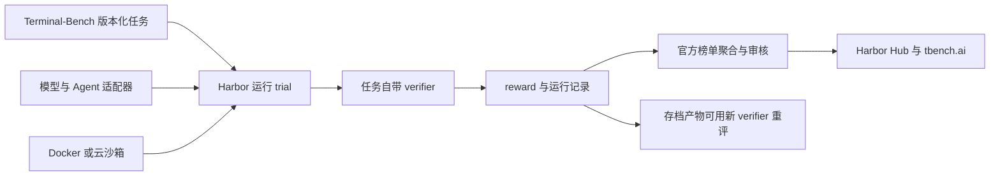

# Terminal-Bench 与 Agent 基准生态

截至 2026-11-19 的调研。以 Terminal-Bench 为中心，覆盖任务、运行框架、判分、榜单、衍生版本和相邻基准，也给出如何把它用于本工作区的 llama.cpp 缓存实验。

## 结论

**衡量通用终端 Agent 能否完成多步任务，优先用发布版 Terminal-Bench 的任务、Harbor 和对应 verifier。** 当次发布版、Agent、模型、推理预算和沙箱共同定义一次测量。测模型差异时固定 Agent。测实际产品时使用原生 Agent，并把分数归给整个组合。复现发布成绩时还要对齐官方榜的重试、超时、资源和聚合规则。社区提交目前关闭，官方榜由维护方运行。 [官方运行说明](https://github.com/harbor-framework/terminal-bench#running-the-benchmark) · [榜单规则](https://github.com/harbor-framework/terminal-bench/blob/main/leaderboard/SUBMIT.md)

**4.1 保留 4.0 的 66 道任务，主要修 verifier。** 维护方用已存档产物重评，35 个提交的新成绩均落在原公告使用的 95% 置信区间内。Epoch AI 的 Flawed 评级针对 4.0，依据是 66 题中 30 题有公开记录的评分缺陷。两份材料分别回答了「改判具体影响了多少已提交的成绩」与「有多少题存在可导致误判的缺陷」。本次未找到 Epoch 针对 4.1 的同口径复审。 [4.1 发布公告](https://www.tbench.ai/news/terminal-bench-4-1) · [Epoch 审计](https://epoch.ai/benchmarks/terminal-bench-4/review)

**引用成绩时带版本、完整配置和榜单来源。** 本次快照中，4.1 在 Harbor Hub 有 65 行，tbench.ai 首页按模型折叠为 52 行。榜单代码先处理逐任务重复试验，再聚合得到分数与区间。2.0 论文的 Table 2 还显示，同一模型换 Agent 脚手架，差异可达 16.9 个百分点。 [榜单观察](06-leaderboards-and-adopters.md) · [方法学](05-methodology-and-audits.md)

**对本工作区，Terminal-Bench 4.1 只能作辅助锚点，不能作主基准。** 官方 4.1 榜尾部模型通过率已在 0.00%–26.97% 区间，本机是 27B IQ3 量化模型、24K 上下文，很可能出现「全部 0 分」的地板效应，那样测不出缓存是否引入回归。更关键的是：单会话单槽位的运行全程命中 L0，**根本不会触发 L1 淘汰或 L2 读回**，要证明 SSD 层价值必须让交错会话数超过槽位数、且累计状态超过 RAM 预算。

**要下载到本地部署测试，首选 TUA-Bench**（`facebookresearch/TUA-Bench`，Harbor 原生、120 题、纯执行判分、每题时限 150–2400 s，与本机慢推理相容），SWE-bench Lite 保留为已在用的回归护栏。 [07 本工作区应用](07-implications-for-this-workspace.md)

## 生态怎么分工

| 想测什么 | 基准或证据 | 完成判据 |
|---|---|---|
| 真实终端里的通用任务 | Terminal-Bench，及侧重不同任务分布的 TerminalWorld、TUA-Bench | 检查最终产物或环境状态 |
| 修真实仓库的问题 | SWE-bench 家族 | 应用补丁后，通过目标测试并检查既有行为 |
| 科学研究工作流 | Terminal-Bench-Science、ScienceAgentBench、PaperBench | 针对研究产物或复现要求验证 |
| 桌面、网页、业务 API | OSWorld、WebArena、τ-bench | 检查界面操作后的状态或业务记录 |
| 代码生成或编辑能力 | LiveCodeBench、BigCodeBench、Aider Polyglot | 执行生成代码或验收编辑结果 |
| 本地缓存收益 | 固定轨迹回放、状态正确性探针、真实 Agent 任务评测 | 观测 TTFT、实际 prefill、状态正确性和任务结果。L2 另测越过 L1 RAM 预算后的重访 |

完整对照、评测框架和每项出处见[相邻基准篇](04-alternatives-landscape.md)。本地对照的执行设计见[本工作区应用篇](07-implications-for-this-workspace.md)。

## 按角色选路径

| 你要做的事 | 读哪几篇 |
|---|---|
| 设计本工作区的缓存实验 | [08 出分机制](08-benchmark-mechanics-and-evolution.md) → [07 本工作区应用](07-implications-for-this-workspace.md) → [02 §1–§3](02-task-and-verifier.md) |
| 判断一个引用过的 TB 数字能不能用 | [05 方法学与审计](05-methodology-and-audits.md) → [06 榜单与采用](06-leaderboards-and-adopters.md) → [08 发布图案例](08-benchmark-mechanics-and-evolution.md#发布图案例gemini-4-neon-的跨基准对比) |
| 查某个仓库、版本或官方条款 | [01 官方栈](01-official-stack.md)（查证手册，不必通读） |
| 找替代基准或衍生实现 | [03 衍生与复现](03-derivatives-and-replicas.md) → [04 相邻基准](04-alternatives-landscape.md) |
| 复核任意一条结论 | [证据索引](appendix-evidence.md)（含快照 commit 锁与复核命令） |

## 阅读入口

| 文档 | 回答的问题 |
|---|---|
| [08 出分机制与版本演化](08-benchmark-mechanics-and-evolution.md) | 一道题怎么出分、置信区间怎么读、各版本改变了什么、何时复用或重跑、厂商发布表的数字各来自哪里。**建议先读这篇** |
| [07 本工作区应用](07-implications-for-this-workspace.md) | TB 4.1 在本机是否适用、候选任务、接线、容量设计、阶段与 Stop/Go 门槛 |
| [01 官方栈](01-official-stack.md) | 哪些仓库定义和维护基准，版本如何演进，官方条款与文档在哪里 |
| [02 任务与判分](02-task-and-verifier.md) | 一道任务如何封装、执行和判分，4.1 如何加固 verifier 并支持重评 |
| [03 衍生与复现](03-derivatives-and-replicas.md) | 镜像、移植和研究变体各保留了什么，同一 Harbor 格式为何不足以保证同口径 |
| [04 相邻基准](04-alternatives-landscape.md) | SWE-bench、代码生成、科学、GUI、网页与工作流基准各测什么，如何选型 |
| [05 方法学与审计](05-methodology-and-audits.md) | 通过率、区间和试验层级如何计算，污染、判分错误和 Agent 配置怎样影响解读 |
| [06 榜单与采用](06-leaderboards-and-adopters.md) | 哪个榜有多少行，维护方、厂商和第三方数字如何对齐 |
| [证据索引](appendix-evidence.md) | 结论对应的发布页、官方文档、源码、论文与审计入口；含快照 commit 锁 |

## 证据与边界

- 版本和任务数按 GitHub release 标签及相应任务树核对。4.1 标签为 `v4.1.0`，发布于 2026-11-03，另提供 63 题 CPU-only 数据集。`laude-institute/terminal-bench` 当前重定向至 `harbor-framework/terminal-bench-1`，现行发布仓为 `harbor-framework/terminal-bench`。 [发行记录](https://github.com/harbor-framework/terminal-bench/releases) · [官方栈核查](01-official-stack.md)
- 仓库和文档核验为静态证据。榜单按 2026-11-19 的页面或官方 API 记录。厂商自测、第三方自跑、官方维护方成绩分别标注。无法由公开 API 单独复算的榜行，以及尚未对齐版本的第三方数字，见各章末尾。
- Terminal-Bench 公开允许互联网访问，题目指令禁止查找本题的在线解答或专用提示。准备复现实验时，应以相应版本的正式配置和提交规则为准。2.0 与 4.x 隔着不同任务集。 [官方贡献说明](https://github.com/harbor-framework/terminal-bench/blob/main/CONTRIBUTING.md#task-difficulty) · [2.0 论文](https://arxiv.org/abs/2601.11868)
- 本轮本机只探测工具链。Docker CLI 在位，当时 Linux engine 不可连接，当前 PATH 中未发现 Harbor。本次未启动容器或跑官方任务，本地 Agent 到 `llama-server` 的链路仍待动态验证。 [本机探测记录](07-implications-for-this-workspace.md#本机探测与验证边界)
