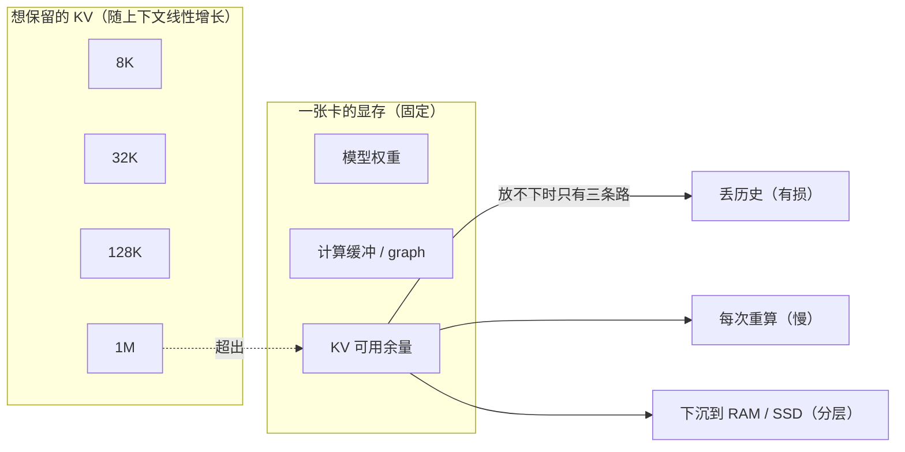
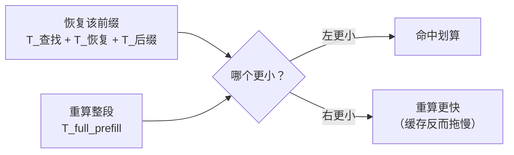
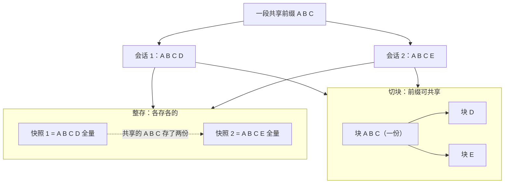
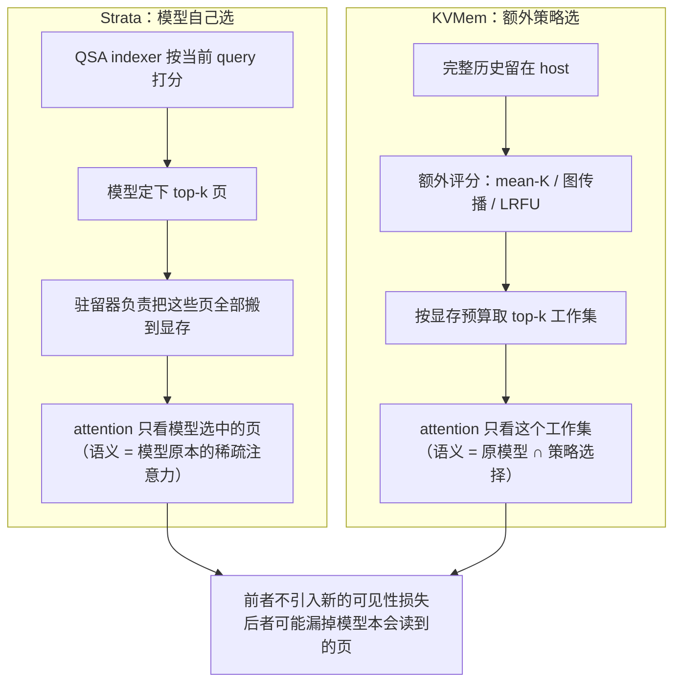
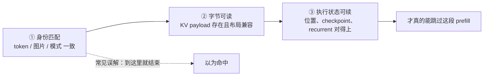

# 为什么 KV cache 要分层：五条原理

> 显存放不下想保留的历史时，分层是其中一种选择。下面从容量、延迟和恢复条件解释四家各自解决什么。

## 速览

```text
  原理一  显存固定 + KV 线性增长  ->  必须分层
  原理二  搬运收支不等式          ->  何时值得搬
  原理三  整存 vs 切块            ->  粒度取舍
  原理四  谁决定可见历史          ->  质量分水岭
  原理五  三个独立恢复条件        ->  能否真的续算

  四家的取舍
    Strata   细块 + 模型原生选页（不额外裁剪）
    KVMem    块级 + 接受额外裁剪，换更大工作区
    LMCache  块级 + 身份校验进 key（精确复用）
    Mooncake 不选 —— 字节容器，三条全部推给调用方
```
---

## 原理一：显存是固定的，KV 是线性增长的

普通全注意力下，一段上下文占用的 KV 字节数是：

```text
KV 字节 = 2 × 层数 × token 数 × kv_heads × head_dim × 每元素字节数
          ↑ K 和 V 两份
```

它随**保留的 token 数线性增长**，不随模型变小而变小。再叠加两件事：

- **并发会话累加**：N 个会话同时在服务，就是 N 份；
- **显存不只装 KV**：模型权重、计算缓冲、CUDA graph 都在同一张卡上。

于是出现一个硬边界：**KV 想留多少，和显存能给多少，是两条不同的曲线**。前者线性上升，后者是一条水平线。交点之后，只有三种选择——丢掉历史、重算历史、或者把历史放到更慢的介质上。**分层就是第三种。**



---

## 原理二：搬不搬，只取决于一个不等式

缓存命中本身不是收益。真正的判据是：

```text
T_查找 + T_恢复 + T_剩余后缀的 prefill  <  T_从头 prefill 整段
```

比较的是首 token 之前实际付出的时间。若查找、传输、恢复与计算有重叠，按关键路径上的等待来算。

- **命中长度和每次恢复的成本都要看。** 更长的命中通常少算更多 token，也要搬更多状态。实际收益受模型、带宽和排队影响，无法只由命中率或命中长度推断。
- **解码缺页会拖慢当前这一步。** 预取可以和前面的计算重叠。如果本步需要的页还没到，注意力计算就得等。



---

## 原理三：整存与切块，是两种不同的赌注

同样是"把历史放到别处"，粒度选择决定了你能拿到哪种收益：

| | **整会话 / 整序列存** | **块级存** |
|---|---|---|
| 一次存什么 | 一整条序列的状态（含所有相互依赖的部分） | 固定大小的 KV 块 |
| 天然优势 | **依赖关系一起走**——recurrent、位置、indexer 状态不必单独建模 | **公共前缀可共享**；可按需只调入一部分 |
| 天然代价 | 若只有整份快照，恢复只能回到已有检查点；不同会话会重复存各自的公共前缀 | 需要更多索引、调度和小笔 I/O；块边界必须和引擎对齐 |
| 谁这么做 | Strata 会话文件、llama.cpp `state_seq_*`、本工作区原型 | LMCache chunk、KVMem block、Strata 的 4-cell 页 |

**没有免费的那一边。** 块越细，共享越灵活，但索引与调度的开销越大，而且更容易被"小随机 I/O"拖垮。



---

## 原理四：搬回去 ≠ 让模型看见

这是四家最容易混淆、也最影响质量的一条。

- **完整搬回**（把模型这一步本来需要的历史全部恢复）→ 计算语义不变，只是省了 prefill。
- **为预算再筛一遍**（因为显存装不下，只放回一部分）→ 模型能利用的证据变了，答案可能变。

区别不在"有没有搬运"，而在**谁决定模型这一步能读到哪些页**：



**判据**：如果搬运层能保证"模型原生需要的页全部到齐"，它就不改变答案；一旦它为了预算再裁一次，就必须单独评估质量。KVMem 的召回属于后者——项目自记过 needle 召不回，也自记过相对 compaction 的成功率提升，所以任务质量**可升可降**。

---

## 原理五：查到候选、读到字节、能继续推理，是三个独立条件

初学者最容易把"前缀相同"当成"可以直接用"。实际上要同时满足三件事：



为什么第 ③ 条经常卡住：

- **KV 依赖它之前的全部上下文**——同一段 token 放在不同前缀后面，数值不同；
- **混合模型还需要同一边界的递归状态**（Qwen 的 GDN），attention KV 对上了但 recurrent 没对上，仍然不能续算；
- **位置编码参与身份**——M-RoPE 下多个 token 可能共享同一个 `pos`，按位置删会误伤邻居。

这解释了为什么四家都在"键"之外额外做身份校验：Strata 用 config + 模型采样指纹，LMCache 把 model/rank/dtype 编进 key，KVMem 用 `BackendIdentity`，Mooncake 干脆把这件事整个交给调用方。

---

## 把五条原理压成一句话

> **显存固定而 KV 线性增长（原理一）→ 于是要搬，但搬只有在省下的 prefill 覆盖搬运成本时才划算（原理二）→ 搬的粒度在"依赖一起走"和"前缀可共享"之间二选一（原理三）→ 如果搬运层再筛一次，就会改变模型能看见什么（原理四）→ 而能不能真的跳过 prefill，取决于身份、字节、执行状态三件事同时成立（原理五）。**

四家的全部差异，都是在这五条上做的不同取舍：

| | 取舍点 |
|---|---|
| **Strata** | 原理三选"细块 + 模型原生选页"，原理四承诺不额外裁剪 |
| **KVMem** | 原理三选"块级"，原理四主动接受额外裁剪以换取更大工作区 |
| **LMCache** | 原理三选"块级"，原理五把身份校验压进 key，原理四坚持精确复用 |
| **Mooncake** | 不选——它是字节容器，把原理三、四、五全部推给调用方 |

---

## 接下来读什么

- 想知道**这四家各自站在栈的哪一层** → [README 首屏的生态职责图](README.md)
- 想知道**一次请求里这些机制在什么时候发生** → [01 §2 一次请求的时间线](01-architecture-axis.md)
- 想知道**具体机制怎么实现** → 按 [README 的阅读顺序](README.md) 进 02–05
- 想**为 llama.cpp 做贡献** → 直接读 [06 集成形态与上游最小缺口](06-integration-and-gaps.md)
