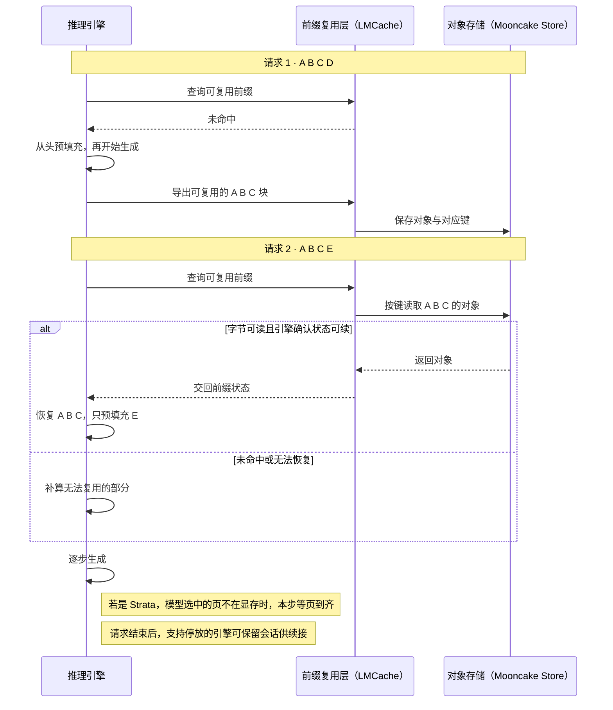

# 架构差异的主轴与四家定位

> 为什么四个项目看起来做法各异，却能放进同一张坐标系。

## 速览

```text
  四家定位
    Strata   完整引擎，自己执行模型与页驻留
    KVMem    引擎内工作集管理，决定模型本步能看见什么
    LMCache  引擎外缓存中间层，管跨请求复用
    Mooncake 对象存储 + 传输，只搬字节不解释语义

  请求时间线（前缀 A B C，后缀 D / E）
    请求1 A B C D : 未命中 -> 从头 prefill -> 导出 A B C 并保存
    请求2 A B C E : 命中   -> 恢复 A B C -> 只 prefill E
    解码期缺页 : 模型选中的页不在显存，本步等页到齐
```

## 1. 一句话定位

- **KVMem**：把长上下文会话的 KV 历史当成「虚拟内存」——GPU 只留当前请求的工作集，完整历史常驻主机 RAM（可下沉 SSD），按查询相关性**召回**所需块。目标场景是**单张消费级显卡上的长会话 Agent**（累计上下文可达 1M token）。
- **Mooncake**：集群级 KVCache 基础设施——Transfer Engine（C++）负责跨节点搬字节，Mooncake Store（C++）做分布式对象池（租约/副本/淘汰），Conductor（C++）做全局前缀索引。目标是**上百张 H200/H100 的 PD 解耦服务**。
- **Strata**：完整推理引擎。Flash-Next 路径把原生 QSA 选页、RAM 权威 KV/显存页驻留、前缀 checkpoint、停放会话及 session 文件分成不同机制；专家权重缓存另有预算。
- **LMCache**：推理引擎与 KV 存储之间的**中间层**——引擎侧 connector 负责「查 → 取 → 注 → 存」，存储侧插件负责实际搬运。目标场景是**长上下文 Agent 流量下的 prefill 复用**。

四者覆盖的层次有重叠也有区别：Strata 自己执行模型和管理会话；KVMem 为适配引擎增加历史保留与工作集选择；LMCache 编排外部 KV 对象复用；Mooncake 提供对象池与字节传输。需要分别比较“身份匹配”“计算会看到哪些历史”“数据驻留在哪里”。设计可组合不表示已有可用的跨项目 connector 或通用 KV 格式。

---

## 2. 一次请求的时间线

两次请求共享前缀 `A B C`，后缀分别是 `D` 和 `E`。下图用 **vLLM → LMCache → Mooncake Store** 说明前缀复用和对象读取。解码缺页和会话停放是另两种机制，按对应引擎单独标出。



- **前缀复用影响首 token 等待（TTFT）**。命中并恢复成功后可以跳过共同前缀的预填充，节省的计算须覆盖查询与恢复的时间。图中的 `A B C` 假定落在可复用块的边界。
- **活动 KV 缺页影响当前解码步**。以 Strata Flash-Next 为例，模型先选页，驻留器再从 RAM 补齐本步需要的页。会话停放则发生在请求结束或切换时，目标是将来能继续这一会话。
- **Mooncake Store 按键读写对象**。匹配前缀由复用层协调，恢复后能否续算由引擎负责。两种真实接法见 [07 §5.4](07-llamacpp-implications.md#54-现成可借的组合路径)。

### 2.1 架构总览对比

| 维度 | Strata（本次重点：Flash-Next） | KVMem（llama 适配路径） | LMCache（classic / MP） | Mooncake |
|---|---|---|---|---|
| **角色** | 完整推理引擎及本地会话管理 | 原生 KV 工作集管理核心 + 引擎适配层 | 引擎外 KV 复用与分层管理 | 分布式对象池 + 传输基础设施 |
| **缓存布局** | 每层 `[page][KV head][cell][dim]`；streamed 模式 host 权威、VRAM slot 驻留 | 逻辑块 + 原生 packed KV payload；逻辑位置与 GPU slot 分开 | `MemoryObj`/group 布局；默认 256-token chunk，不等于引擎物理 page | 不透明对象 + 不同介质的 Replica；不规定 token 布局 |
| **跨请求键语义** | token 精确前缀 + 图片 `(start,hash)` + 可恢复 checkpoint；文件另校验模型/配置身份 | 内容摘要筛候选，再作原生恢复证明；独立于召回评分 | prefix hash 链 + 模型/rank/dtype 或 group/salt；classic 与 MP 键格式不同 | 调用方提供 key + tenant；前缀索引位于引擎/Conductor |
| **选历史与驻留** | 模型 QSA indexer 选页；CLOCK 驻留器确保选中的不同页全部到齐 | Query/Pressure 等策略选择工作集，再执行 stage-out/stage-in | 普通路径复用已命中的前缀；CacheBlend 为另外的选择性重算路径 | 搬运调用方指定对象；不定义 attention 算法 |
| **淘汰单位** | VRAM 页、活动 checkpoint、停放会话分别管理 | GPU 工作集、host payload、内容谱系分别管理 | classic CPU/本地盘均有策略；MP L1/L2 各有控制器 | 对象/副本、租约与 pin、租户配额 |
| **SSD 与恢复** | 显式 session 文件；不是已证明的活动 KV 自动逐页 SSD 层 | 共享 RAM/SSD payload，当前为进程内 spill | 依 backend；classic LocalDisk 不能仅凭文件残留承诺重启可查 | 介质副本 + Master 元数据；恢复需分配置说明 |
| **传输边界** | 本地 mapped pinned host→VRAM、DMA staging、快照复制和文件 I/O | 原生 payload D2H/H2D + host/SSD 读写 | GPU connector 或 engine-driven 通路 + 后端接口；MP 有 IPC/SHM | TE 批次/切片、RDMA/TCP/SHM 等 |
| **集成成本** | 引擎内原生实现，不是 llama.cpp 的 cache 插件 | 基础 llama 补丁触及 50 文件 | 需引擎适配及布局/生命周期协议 | 已有多引擎 connector；Store 自身不解释模型状态 |

### 2.2 三处需要先纠正的常见误解

这些是本次源码核实中推翻的预设，值得单独列出：

1. **LMCache 没有 v0/v1 两套实现。** `lmcache/v0/` 目录**从未存在过**（`git log --all -- 'lmcache/v0/*'` 无记录）。旧的 v0 代码分三轮被删除：`d9a50a87`（2025-12-12，删 `cache_engine.py` / `storage_backend/*` / evictor / mem_pool / connector）、`842b1ec8`（2025-12-30）、`c075e85f`（2026-04-15）。顶层 `lmcache/storage_backend/` 现在只剩 `serde/`（CacheGen 编解码器），顶层 `lmcache/integration/` **不是 v0，而是当前活跃的引擎适配层**。真实的分叉是 **classic（进程内库）vs MP（多进程独立服务）**，两者共用 `lmcache/v1/` 命名空间下的不同子集，且**几乎不共享代码**（共享的只有 `memory_management.py`、`memory_allocators/**`、`platform/**`、`config*.py`）。
2. **Mooncake Store 不是 Go 实现。** `mooncake-store/go/mooncakestore/store.go:15-24` 的注释明说 Go 部分是 *"Go bindings … It wraps the C API (store_c.h) via CGo"*。真正的 Store 实现是 C++（`mooncake-store/src/master_service.cpp`、`real_client.cpp`、`eviction/`）。仓库里真正的 Go 主体是 `mooncake-p2p-store/` 与 `mooncake-common/etcd/`。
3. **KVMem 的召回有两个版本，不要混。** 早期 `kvmem/kvmem-llama.cpp`（v0.16 线）是 LRFU + GQA max；当前 `kvmem/kvmem` 主线换成了 **mean-K / page-softmax 打分 + 注意力图传播**，LRFU 退化为其中的历史衰减环节。

---

## 3. 并发模型

- **KVMem**：`--parallel P`（P=2..4）创建 P 个独立 target context 共享不可变权重，各 lane 自有 GPU 窗口 / recurrent 状态 / MTP follower / 捕获状态 / 传输暂存；`--kvmem-sessions N` 是内部内容分组数，物理槽上限 `C = max(2*N, P)`。**P=1 时代码强制拒绝 `n_seq_max > 1`**（`kvmem/src/adapter/llama-memory-kvmem.cpp:934-938`），请求串行。会话切换是**全量 drain + 全量 rebuild**，不是增量（`llama-memory-kvmem.cpp:2005` `swap_conv`）。
- **Mooncake**：集群级，Master 全局放置/复制/租户配额决策。
- **LMCache**：classic 是单进程多线程——`StorageManager` 自己起一个 asyncio event loop 线程（`v1/storage_backend/storage_manager.py:236-243`），所有异步后端操作经 `asyncio.run_coroutine_threadsafe` 投递；每个 vLLM TP worker 是独立进程。MP 是多进程：LMCache server（ZMQ ROUTER + FastAPI HTTP）+ 三个 controller 线程（store / prefetch / eviction）+ `mp_coordinator`（另一个独立 FastAPI 进程，做注册/心跳/配额）。

## 4. 主轴：交换粒度 × 状态可见性

比较引擎和复用层时，可以分别看两件事：交换多大一份状态，以及交换协议能否解释这份状态。这里的「状态可见性」指交换格式是否透明，解码时模型能读哪些历史见 [00 原理四](00-why-tiering.md)。

| | **不透明 blob**（引擎自己序列化，外部不理解其内容） | **可寻址数值**（外部能按块读写的 KV 字节） |
|---|---|---|
| **整会话/整序列粒度** | Strata 会话文件；llama.cpp `llama_state_seq_*_ext`；**本工作区原型** | —— |
| **块级粒度** | —— | LMCache chunk（默认 256 token）；KVMem block（32/128 token）；Strata 页（**4 cell**，模型专用） |

**Mooncake 不在这两个轴上。** 它的 Store 只收任意字节，粒度与可见性都由调用方决定——所以它既不做「整存」也不做「切块」，而是**同时服务两种路线**。这正是它能同时被 LMCache（块级）和 vLLM（引擎侧定粒度）当远端池用的原因。把它放进这张表的任何一格都会误导，见 [02 §2](02-cache-layout.md)。

**这张表解释了两个反直觉的现象：**

1. **opaque blob 天然携带 hybrid 的 recurrent 状态。** state blob 里本来就含 GDN/recurrent 部分，恢复时不需要额外建模——这正是本工作区原型（Qwen hybrid）的天然优势，也是 Strata 会话文件能把 GDN 一起写盘的原因。而走块级路线时，recurrent 必须被单独表达：LMCache 用 `KernelGroupInfo.recurrent_state` + `object_group_id` 分组，KVMem 用独立的字节快照通道，Strata 用 checkpoint 里的 `gdn` 向量。
2. **但 opaque blob 无法共享公共前缀。** 整序列一份，两个会话共享同一段长前缀就存两份；下沉 L2 也不减少重复。**块级路线才能让公共前缀被共享、被部分下放。** 这就是「整会话停放」与「块级分层」在容量收益上的分水岭。
