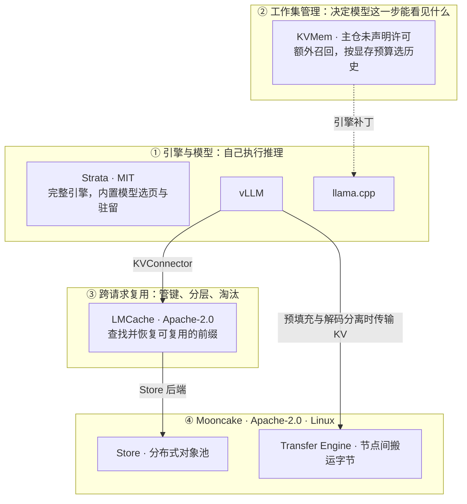

# KV Cache 生态研究系列

> 对 **Strata / KVMem / Mooncake / LMCache** 四个项目的源码架构、差异与生态做逐主题研究。
> 面向本工作区（`lm-llama`）的 llama.cpp 多级 KV/prompt 缓存（L0 显存 → L1 RAM → L2 SSD）与开源贡献规划。
> 全系列为**只读静态分析**：没有构建、没有运行测试、没有跑任何性能基准。

## 速览

```text
  这套文档回答三个问题
    1 有哪些开源框架，各自站在哪一层   -> 先看下面的职责图
    2 它们的基本架构和区别是什么       -> 01 定位 + 09 横向速查
    3 为什么不能只抄一个               -> 00 五条原理 + 06 上游缺口

  阅读顺序建议：先 00 原理，再 01 架构对比，最后按兴趣进专题
  全部结论为纯静态源码阅读，没有构建、没有跑测试、没有跑性能基准

  文中出现的 ../../strata/、../../kvmem/ 等路径均相对于工作区 lm-llama，
  原始工作区文档在 research/kv-cache-ecosystem/ 下
```

## 先看这张图



- **LMCache 和 Mooncake Store 可以组合。** LMCache 负责查找可复用的前缀，Mooncake Store 提供远端对象池，数据粒度由调用方决定。图中的 MP 后端有已合并的实现。见 [08 生态地图](08-ecosystem-map.md#93-lmcache-生态--策略层--插件后端)。
- **Strata 与 KVMem 的选页职责不同。** Strata 在引擎内调入模型原生选中的页。KVMem 通过补丁接入 llama.cpp，用显存预算进一步筛选本轮可见历史。见 [00 原理四](00-why-tiering.md#原理四搬回去--让模型看见)。

> 两个自测问题，答得出就说明这张图看懂了：
> - 为什么 LMCache 可以用 Mooncake？
> - 同样把历史搬进显存，为什么 Strata 和 KVMem 对「模型能看见什么」的承诺不同？

## 15 分钟路线

| 分钟 | 读什么 | 得到什么 |
|---|---|---|
| 0–3 | 上面这张图 + [00 五条原理](00-why-tiering.md) | 认清四家的职责，理解显存紧张时为什么值得考虑分层 |
| 3–8 | [01 请求时间线](01-architecture-axis.md#2-一次请求的时间线) + [07 现成组合](07-llamacpp-implications.md#54-现成可借的组合路径) | 跟着一对请求走完「第一次算并保存 → 第二次恢复共享前缀」，看清解码缺页发生在哪一步 |
| 8–12 | [00 交换粒度与状态恢复](00-why-tiering.md#原理三整存与切块是两种不同的赌注) + [09 横向速查](09-project-profiles.md#横向速查) | 比较四家交换什么、谁决定可见历史、主要开销在哪 |
| 12–15 | 按兴趣选：[06 上游缺口](06-integration-and-gaps.md) / [03 键语义](03-key-semantics.md) / [04 生命周期](04-eviction-lifecycle.md) | 找到自己的贡献入口 |

**首读路线刻意砍掉的**：07 的十六项实现建议、05 的接口签名清单、[README §1.1 的逐仓阅读量](#11-实际阅读量2026-11-18-复测)。这些是查证材料，不是理解路径。

## 阅读顺序

| # | 文档 | 内容 | 适合谁 |
|---|---|---|---|
| 00 | [为什么 KV cache 必须分层：五条原理](00-why-tiering.md) | **原理层**：线性增长 vs 固定显存；搬运的收支不等式；整存 vs 切块；搬运何时改变答案；三个独立恢复条件 | **先读这篇** |
| 01 | [架构差异的主轴与四家定位](01-architecture-axis.md) | 粒度 × 状态可见性这条主轴；四家分别落在哪个格子；并发模型 | 第二篇 |
| 02 | [缓存布局与数值格式](02-cache-layout.md) | 页/块/chunk/整序列状态的区别；权威副本放哪；K/V 数值格式 | 关心「数据长什么样、放在哪」 |
| 03 | [键语义与复用契约](03-key-semantics.md) | 前缀哈希链 vs 内容摘要；精确复用 vs 相似度召回；「键相同 ≠ 状态可恢复」 | 关心「怎么找到能用的旧状态」 |
| 04 | [淘汰、租约与生命周期](04-eviction-lifecycle.md) | 先说清淘汰的是谁，再比算法；pin/lease/guard 三档；hybrid 的 recurrent 另算 | 关心「什么时候扔、扔什么」 |
| 05 | [传输路径](05-transfer-paths.md) | 缺页调入、工作集切换、chunk 恢复、网络数据面 | 关心「字节怎么搬」 |
| 06 | [集成形态与上游最小缺口](06-integration-and-gaps.md) | in-process 补丁 / connector / sidecar 三种形态；llama.cpp 缺哪几个原语；哪些改动上游不会要 | **做开源贡献先读这篇** |
| 07 | [对 llama.cpp 三级缓存的落地建议](07-llamacpp-implications.md) | 能抄什么、不能抄什么；本工作区原型的定位与改造顺序；四个跨项目坑 | 准备动手时读 |
| 08 | [生态与衍生项目地图](08-ecosystem-map.md) | API 级核验的生态快照：谁被谁接入、哪些仓库已改名或迁移 | 查证用（星数、PR、迁移记录） |
| 09 | [四家速查档案](09-project-profiles.md) | 一页一家的定位、许可证、关键文件、活动度、成熟度 | 快速回忆 |
| 附录 | [关键源码位置与测试契约](appendix-evidence.md) | 每个结论的 `file:line` 入口；仓库里对应的测试断言 | 复核任何一条结论 |

## 本系列没深入的相邻项目

这些条目用于快速定位。仓库状态、集成记录及其他论文与实现见 [08 生态地图](08-ecosystem-map.md)。

| 项目 | 放在地图上的位置 |
|---|---|
| **SGLang HiCache** | SGLang 内置的分层前缀缓存，可对照 LMCache 的复用职责 |
| **vLLM Hybrid KV Cache Manager** | vLLM 内部的 KV 管理，处理不同注意力层的缓存分配与前缀复用 |
| **NIXL** | 传输库，可对照 Mooncake Transfer Engine，亦有后端集成关系 |
| **Tutti**（arXiv 2605.03375） | 研究 SSD I/O 控制路径的论文，本次未找到公开实现 |
| **FlexGen** | 推理卸载系统，仓库已归档，供历史对照 |
| **NVIDIA kvpress** | KV 压缩工具，关注减少每份 KV 的占用 |

## 版本基线

全系列固定以下本地快照，**未 fetch/pull**：

| 项目 | 仓库 | commit | 本地路径 |
|---|---|---|---|
| Strata | `github.com/Niko1221/Strata` | `f33c8c30588ff00e24b6b63bad0bf6a14da19081`（2026-11-09） | `../../strata/` |
| KVMem | `github.com/kvmem/kvmem` | `2abbd5030238281c30869afbe4e4e8029eb25be1`（2026-11-16） | `../../kvmem/` |
| Mooncake | `github.com/kvcache-ai/Mooncake` | `8916f63`（2026-11-16） | `../../Mooncake/` |
| LMCache | `github.com/LMCache/LMCache` | `a0e4a4c227f33a0ece99aad207b3ab1fae2e2bb4`（2026-08-27） | `../../LMCache/` |
| llama.cpp | `github.com/ggml-org/llama.cpp` | 工作区只读 clone | `../../llama.cpp/` |
| llama.cpp（改造版） | 本工作区 | 含 `POST /tier/:id_slot` 未提交改动 | `../../try-out/llama.cpp/` |

## 相关材料（同工作区）

- `../strata-vs-llamacpp-source-analysis-20261112.zh-CN.md`——Strata 与 llama.cpp 的既有源码差异分析（774 行），本系列的 Strata 侧部分结论与之互为交叉验证。
- `../llamacpp-strata-out-of-core-plan-20261109.zh-CN.md`——借鉴 Strata 的 llama.cpp 超内存模型推理实现计划。
- `../llamacpp-tiered-cache-evaluation-and-implementation.md`——本工作区三级缓存的当前方案与执行进展。

---

## 1. 证据口径与阅读边界

### 1.1 实际阅读量（2026-11-18 复测）

| 仓库 | 自研源码规模（排除 third_party/vendored/build） | 累计逐行读过的实现 | 占比 |
|---|---:|---:|---:|
| Strata | 约 243,000 行 | 约 3,100 行（KV streaming、prefill staging、kv_mode 选择、host pool 分配、会话文件读写、checkpoint 闭包） | ~1.3% |
| KVMem | 约 41,800 行 | 约 5,400 行（核心契约头文件读完 + 适配层 slot/position/harvest/layout/capture 约 1,500 行 + **125 KB 补丁逐 hunk**） | ~13% |
| LMCache | 约 183,000 行 | 约 3,100 行（插件契约、键语义、`cache_engine` 三路径、`storage_manager`、GPU connector、layer groups、MP 通路契约） | ~1.7% |
| Mooncake | 约 233,000 行 | 约 150 行直接阅读＋子代理的接口层摘要 | <0.1% |

**因此本系列仍不是四个项目的完整源码分析**，且深度很不均衡：**KVMem 读得最深（补丁逐 hunk），Mooncake 最浅（只到接口层）**。原因见 [06 §1](06-integration-and-gaps.md)：KVMem 与 LMCache 是单机路径，Mooncake 是集群路径且本机跑不了。

本系列覆盖的是「缓存布局、键语义、淘汰、传输路径」四个问题上的**契约级对齐**——读的是决定行为的接口、状态机、调用链和失败语义，而不是全部实现。

### 1.2 未读或只读片段的部分

- **Strata**：未读 `src/kernels` 的量化与注意力内核（`src/kernels` 共 177 文件／约 76,000 行）、`src/dsv41`（约 34,500 行）、`src/split`（约 18,900 行）、`src/program/generate.cpp`（21,426 行，仅读会话切换片段）；未覆盖 qwen35/Metal/SYCL 后端。`src/prefill/` 目录约 25,400 行／39 文件，其中 `prefill.cpp` 为 7,936 行，只精读了 KV staging 段。
- **KVMem**：未读 `src/adapter/llama-memory-kvmem.cpp` 全文（6,059 行，读了 slot/position/harvest/layout/capture 相关约 1,500 行）、`src/host/kvmem_store.cpp` 的选块实现、`src/host/host_kv_storage.cpp` 全文；补丁中 `common/reasoning-budget.cpp`、`common/sampling.cpp`、`ggml-cuda/norm.cuh`、`ggml/src/ggml.c` 算子表、ROCm 分支只过了一遍；未覆盖 ninfer/polystrata/radiance 后端。
- **LMCache**：未读 `v1/gpu_connector/kv_format/specs/**`（17 个 layout spec）、`v1/platform/torch_ops.py`（110 KB）、`v1/multiprocess/modules/blend.py`（144 KB）、`v1/multiprocess/misc/lmcache_driven_transfer.py`（65 KB，只读契约）、`v1/distributed/storage_controllers/prefetch_controller.py`（65 KB）、`v1/storage_backend/raw_block/core.py`（85 KB）、`csrc/**` 与 `rust/**` 原生扩展。
- **Mooncake**：`master_service.cpp`（10,900 行）、`real_client.cpp`（9,241 行）、`eviction/` 实现、`conductor/prefix_indexer.cpp` 均未读；传输只到接口层。
- **llama.cpp**：核对了普通 KV 层的独立 K/V tensor、cell 元数据、`slot_info::is_contiguous()`、sequence state API 的存在性与 `state_write` 的 cell range 内部机制；**未做模型级状态往返验证**，未读 `llama-memory-hybrid*` 的 `state_write` 全文。

### 1.3 结论的性质

- **纯源码静态阅读**。没有构建、没有运行测试、没有跑任何基准。所有「契约」结论来自测试**源码**而非运行结果。
- Strata 的四维对齐经独立复核，按复核意见修正了 HIP prefill DMA 例外、donor guard 的 borrow→take 回退、测试覆盖措辞与两处锚点；复核结论只覆盖那四条，**不等于动态数值或性能验收**。
- 文中所有量化示例（字节数、公式、阈值）都限定在所声明的模型族与几何，不外推。
- **KVMem**：未展开 ninfer / polystrata / radiance 三个后端的补丁实现（补丁文件 1.5 MB / 1.3 MB / 300 KB）；`backends/llamacpp/` 是空 submodule；未审计 `ui/` 与启动器逻辑。
- **Mooncake**：未读 `mooncake-store-rs/`、`mooncake-p2p-store` 的 Go 实现、`tent/`（下一代 TE）的实现；未逐页核对 `FAST25-release/` 论文原文；未验证 golden vector 与 vLLM 的实际一致性（只确认了 fixture 与比对脚本存在）。
- **LMCache**：未读 `v1/gpu_connector/kv_format/specs/**`（17 个 layout spec）、`v1/platform/torch_ops.py`（110 KB）、`v1/multiprocess/modules/blend.py`（144 KB）、`v1/distributed/storage_controllers/prefetch_controller.py`（65 KB）、`v1/storage_backend/raw_block/core.py`（85 KB）、`csrc/**` 与 `rust/**` 原生扩展；vLLM 版本兼容层（`lmcache_connector_v1_085.py` / `lmcache_mp_connector_0180.py` / `_0201.py`）只做了文件级确认。
- **Strata**：已对齐 Flash-Next QSA streaming、token/图片前缀、活动 checkpoint、停放会话、session 文件及部分测试源码。qwen35/dsv41、Metal/SYCL 等路径未作同等实现审计，未运行数值往返或性能测量。
- **llama.cpp 侧**：已补查普通 KV 层的独立 K/V tensor、cell 元数据与 sequence state API。未完成特定模型的完整布局转换、recurrent 恢复闭包及自定义 tier route 审计，因此 [07 §1.5](07-llamacpp-implications.md) 只给有边界的候选路线，不声称接入已实现。

---

## 2. 未确认事项

1. **KVMem 的 `gen_reserve` 环形缓冲是否已落地**：`kvmem/docs/architecture.md:141-145` 写的是 "First implementation cut"，源码中未找到 `gen_start_pos` 的实现确认。
2. **KVMem 的 layerwise 召回链实际启用状态**：文档称实验开关默认关闭，但 CLI `--kvmem-recall-strategy layerwise` 可用，其 llama.cpp 侧接线未逐一验证。
3. **Mooncake 的淘汰实际生效路径**：`include/eviction_strategy.h`（LRU/FIFO）与 `include/eviction/`（lease-age）两套框架并存，具体场景需 grep 实际调用方确认。
4. **Mooncake 论文中的集群规模数字**（如 256 节点 / 1600 GPU）未在开源仓库的源码与文档中找到对应描述。
5. **LMCache 文档与代码的一处冲突**：`docs/source/mp/l2_storage/supported_storages.rst` 把 `fs`/`mooncake`/`p2p`/`sagemaker` 归为「不暴露 capacity 旋钮」，这与 `L2AdapterInterface` 中 `max_capacity_bytes=0` → `supports_global_eviction=False` 的实现一致；但 `docs/source/index.rst:57` 同时宣称 LMCache 可作为独立守护进程与 classic 库式集成并存，未指明取舍时点。

---

## 3. 生态核验的残留边界

[08 生态地图](08-ecosystem-map.md) 已于 2026-11-17 完成核验，其残留边界如下：

- **仍是纯静态阅读**：没有构建、没有运行测试、没有跑基准。所有「契约」结论来自测试**源码**而非运行结果。
- **核验的是「仓库存在 + PR 已合并 + 代码仍在默认分支」，不是「集成效果良好」**：命中文件数只能证明集成代码没被删，不能证明它在生产里工作正常或性能达标。各项目的性能数字仍为项目自述。
- **`gh api search/code` 的命中数是关键词匹配数**，不是该项目的 Mooncake 代码总量；个别仓库（verl、production-stack）可能用别的命名，导致命中 0 但集成仍存在——verl 一例已通过 PR 状态与代码库人工确认补充。
- **未核验**：Mooncake 更新日志里未被点名的集成条目；TENT 的独立开源计划；`mooncake-store-rs` 与 `mooncake-conductor/rust` 的独立发布状态。
- **未覆盖的相邻项目**：vLLM 自带的 Hybrid KV Cache Manager、SGLang HiCache 的完整实现、以及各类「KV cache 数据库」形态的独立项目（本次只做索引，不做源码分析）。
- **Strata 与 llama.cpp 的新对齐边界**：核查范围与尚缺动态测量已在 [附录 §2](appendix-evidence.md) 与 [07 §3](07-llamacpp-implications.md) 列出；不把 cell 元数据等同于 vLLM 页协议，不再由缺少 V getter 推断无法完整保存。recurrent 的特定模型状态往返、引擎间布局转换与自定义 tier route 的端到端行为仍需后续独立验收。
