# AI Infra、KV Cache 与 llama.cpp Prompt Cache 学习地图

日期：2026-09-02

## 这篇文档解决什么问题

你要研究的是：AI Infra 里的 KV cache 为什么会命中、什么时候不命中、llama.cpp 的 prompt cache 到底在复用什么，以及如何用真实 trace 验证收益。

这篇文档不是泛泛介绍 Transformer，而是给出一条“先学什么、再看什么源码、最后怎么做实验”的路线。它补充已有调研：[LMCache Production Role and llama.cpp Analogy](./lmcache-llamacpp-kv-cache.md)。

## 一句话结论

先学 llama.cpp 自带缓存，再学 vLLM/SGLang 的块级 KV cache，最后看 LMCache 的多级缓存。不要一开始就跳到“接 LMCache”，否则容易把本来可以用 `--cache-ram` 验证的问题，做成一个很重的系统工程。

推荐学习顺序：

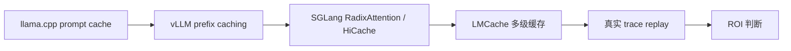

核心心智模型：

```text
请求 1：长前缀 A + 问题 X
        计算 A 的 KV cache，保存

请求 2：长前缀 A + 问题 Y
        命中 A，只计算问题 Y

收益 = 少算的 prefill 时间 - 查找/恢复/拷贝/维护成本
```

缓存主要改善的是 prefill 和 TTFT，不是每秒生成多少个新 token。vLLM 的 Automatic Prefix Caching 文档明确说明：prefix caching 减少 query/prompt processing，不直接减少生成新 token 的时间。现有本地 llama.cpp smoke 结果也符合这个规律：prompt speedup 明显，但 decode TPS 基本不变。

来源：[vLLM APC](https://docs.vllm.ai/en/stable/features/automatic_prefix_caching/)，[本地 smoke 结果](./llamacpp_realistic_cache_smoke_summary.md)

## 1. 先学 llama.cpp：它已经有一套本地缓存

### 1.1 先看 server README

入口：

- 本地：llama.cpp/tools/server/README.md (`../llama.cpp/tools/server/README.md`)
- 上游：<https://github.com/ggml-org/llama.cpp/blob/master/tools/server/README.md>

重点看这些参数：

| 参数 | 通俗解释 | 你要关注什么 |
|---|---|---|
| `cache_prompt` | 当前请求和之前请求有相同前缀，就少算重复部分 | 最基础的前缀复用 |
| `--cache-ram N` | 把 prompt state 放进进程内 RAM cache | 最值得先测 |
| `--cache-idle-slots` | 空闲 slot 的状态也可以保存进 prompt cache | 多 slot 时有用 |
| `--slot-save-path` | 把 slot prompt cache 显式保存到文件 | 接近“状态 blob 入盘” |
| `--cache-reuse N` | 尝试通过 KV shifting 复用非开头 chunk | 和普通 prefix cache 分开测 |
| `--metrics` | 打开 Prometheus 指标 | 做实验必开 |

你应该先形成这个图：

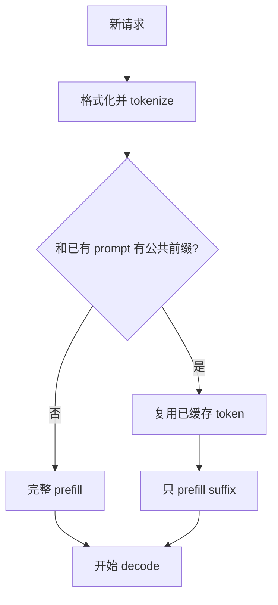

llama.cpp 返回里已经有可用指标：`cache_n`、`prompt_n`、`prompt_ms`、`prompt_per_second`。OpenAI-compatible usage 里也有 cached prompt token 计数。

本地锚点：`README.md` 中 cache 参数在 169、171、223、227 行附近；metrics 在 1124 行附近；返回 timing 示例在 1408 行附近。

### 1.2 再看 server 开发文档

入口：

- llama.cpp/tools/server/README-dev.md (`../llama.cpp/tools/server/README-dev.md`)

你要理解四个词：

| 词 | 通俗解释 |
|---|---|
| `server_context` | 整个 server 的大管家 |
| `server_slot` | 一个请求/对话的“座位” |
| `server_tokens` | 请求 token 序列 |
| `server_prompt_checkpoint` | 某些模型下保存的中间状态快照 |

图上看是这样：

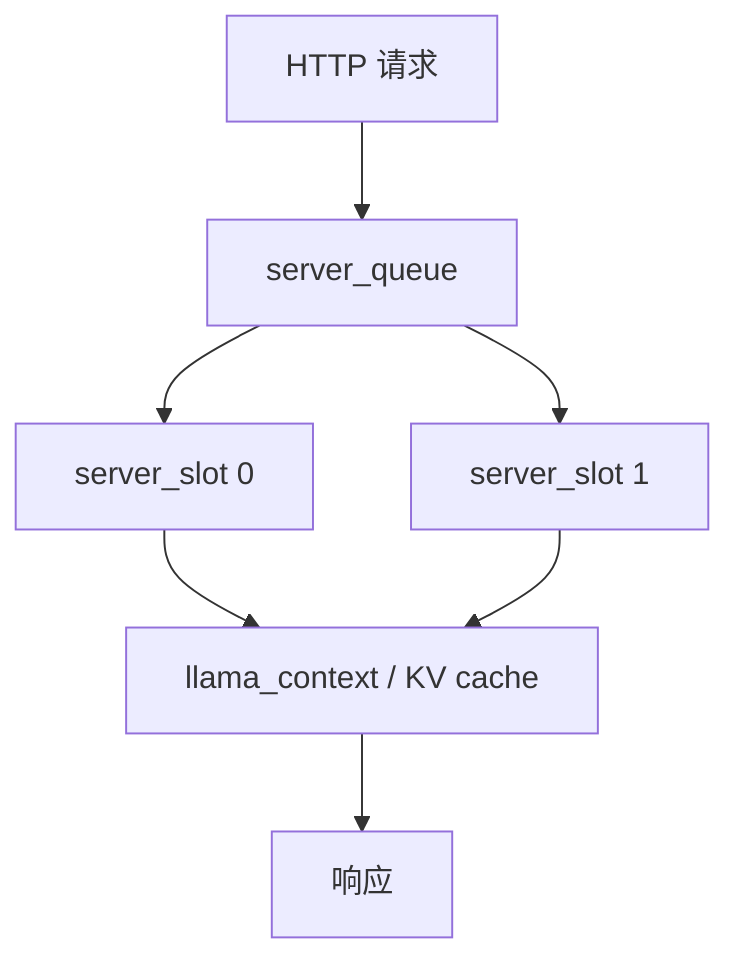

这一步的关键：llama.cpp 的缓存思路是围绕 slot 和 sequence state，而不是一开始就暴露类似 vLLM 的 block table。

### 1.3 重点源码：`server_prompt_cache`

入口：

- server-task.h (`../llama.cpp/tools/server/server-task.h`)
- server-task.cpp (`../llama.cpp/tools/server/server-task.cpp`)
- server-context.cpp (`../llama.cpp/tools/server/server-context.cpp`)

这里是理解命中逻辑的核心。

`server_prompt_cache` 存的不是“原始文本”，而是：

```text
prompt tokens + llama.cpp sequence state bytes
```

更像这样：

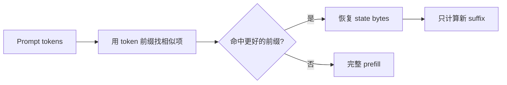

值得注意的实现点：

- `alloc` 会跳过已经完整存在的 prompt。
- `alloc` 会删除被新长 prompt 覆盖的旧短 prompt。
- `alloc` 会按内存限制淘汰旧状态。
- `load` 用 longest common prefix 找最相似的缓存项。
- `load` 不是见到一点重复就用，它还会比较 keep ratio 和 similarity ratio。
- 代码里有保护：如果复用会“糟蹋”大 prompt，keep ratio 低于 `0.25` 会跳过。

这说明 llama.cpp 已经有一个可学习的本地 prompt-state cache。你要做 LMCache-like 方案前，必须先证明你的方案比它多解决了什么。

本地锚点：

- `server_prompt_cache_state` / `server_prompt_cache`：`server-task.h` 约 597-630 行。
- `server_prompt_cache::alloc`：`server-task.cpp` 约 1711 行。
- `server_prompt_cache::load`：`server-task.cpp` 约 1793 行。
- `prompt_save` / `prompt_load`：`server-context.cpp` 约 299、325 行。
- prompt cache metrics 更新：`server-context.cpp` 约 3382 行。

### 1.4 state API：入盘和跨进程的桥

入口：

- llama.cpp/include/llama.h (`../llama.cpp/include/llama.h`)

重点 API：

```text
llama_state_seq_save_file
llama_state_seq_load_file
llama_state_seq_get_data_ext
llama_state_seq_set_data_ext
```

通俗讲，这些 API 可以把某个 sequence 的状态打包成 bytes，再恢复回来。

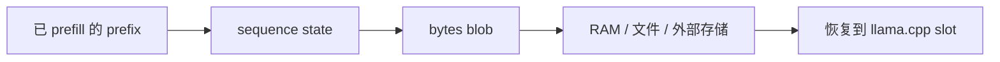

这就是“prefix state blob cache”的基础。它比直接暴露 KV tensor 简单很多。

但要安全复用，必须带 fingerprint：

```text
模型文件 + tokenizer + chat template + ctx size + RoPE 参数
+ KV dtype + backend + LoRA/adapters + llama.cpp build/version
```

### 1.5 最后才看 KV internals

入口：

- llama-kv-cache.cpp (`../llama.cpp/src/llama-kv-cache.cpp`)
- llama-kv-cache.h (`../llama.cpp/src/llama-kv-cache.h`)

这里能看到真正的 K/V tensor。

简化理解：

```text
每一层 attention 都有 K 和 V
K/V 是数值数组
它们存在 ggml tensor 里
state_write_data 会按层、按 cell range 写出
state_read_data 会读回来
```

图上看：

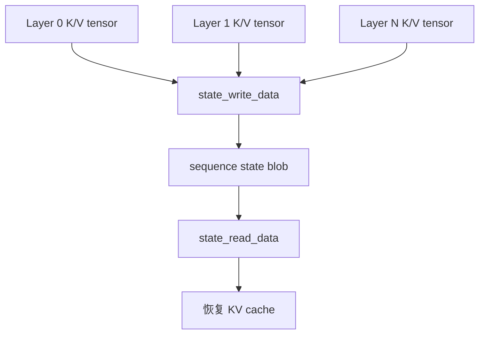

这部分很重要，但不要一开始就钻进去。因为暴露 tensor 级协议需要处理 token-to-cell mapping、dtype/layout、设备拷贝、V transpose、SWA/recurrent/MLA 等问题。

## 2. 学 vLLM：理解块级 prefix cache

### 2.1 Automatic Prefix Caching

入口：

- <https://docs.vllm.ai/en/stable/features/automatic_prefix_caching/>

最值得学的点：

- 新请求如果和旧请求共享 prefix，可以复用旧请求的 KV cache。
- 它减少的是 prefill/query processing。
- 如果回答很长、decode 时间占主导，收益会变小。
- 如果请求之间没有公共前缀，收益也很小。

把它翻译成实验规则：

```text
必须分开看 prompt_ms 和 predicted_ms
必须设置无公共前缀的 negative control
不能只看总延迟，否则容易误判
```

### 2.2 Prefix Caching Design

入口：

- <https://docs.vllm.ai/en/latest/design/prefix_caching/>

这里值得学 block hash。

通俗图：

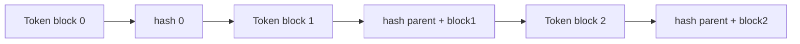

为什么要 parent hash？因为同一个 block 内容放在不同前缀后面，语义位置不同，不能随便当成同一个缓存。

对 llama.cpp 的启发：

- cache key 应基于最终 token ids，不应基于原始文本。
- chunk 边界会影响命中率。
- 多租户场景要有 cache salt，避免串租户。

### 2.3 PagedAttention 论文

入口：

- <https://arxiv.org/abs/2309.06180>

这篇不是教程，但它是理解 vLLM KV cache 的底层系统论文。

它告诉你：KV cache 不只是“存不存”的问题，更是内存管理问题。

```text
请求变长 -> KV cache 变长
并发变高 -> KV cache 碎片变多
prefix 共享 -> 需要 block table 和引用管理
```

如果你将来要让 llama.cpp 像 vLLM/SGLang 一样暴露 tensor 信息，这篇是必读背景。

## 3. 学 SGLang：理解 Radix 和多级缓存

### 3.1 HiCache Design

入口：

- <https://docs.sglang.ai/advanced_features/hicache_design.html>

SGLang 的价值在于它把多级缓存讲得很清楚：

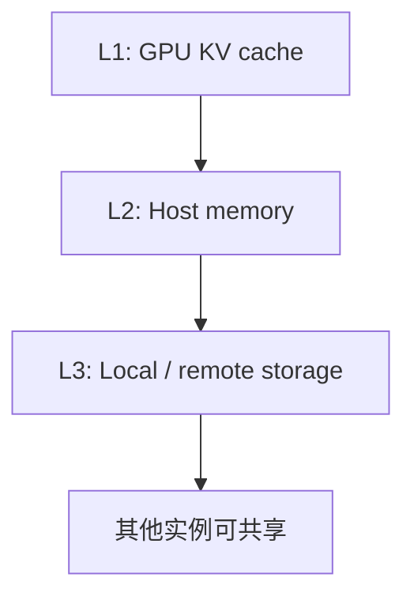

你要学的是分层命中：

| 命中位置 | 意义 |
|---|---|
| GPU / L1 | 最快，通常收益最高 |
| Host memory / L2 | 比重算便宜，但有拷贝成本 |
| Remote / L3 | 可跨实例，但网络/I/O 成本更高 |

不要只报告一个“cache hit rate”。要报告每层命中了多少 token。

### 3.2 HiCache Best Practices

入口：

- <https://docs.sglang.ai/advanced_features/hicache_best_practices.html>

最值得学的 ROI 规则：

```text
如果单进程、本地缓存够用，外部缓存框架收益弱。
如果多 worker 负载均衡，跨实例共享才有价值。
```

这直接对应 llama.cpp：很多 llama.cpp 部署是单机单进程。如果热前缀已经被 `--cache-ram` 覆盖，引入 LMCache-like 框架的收益可能不大。

### 3.3 Attention Backend / Page Size

入口：

- <https://docs.sglang.ai/advanced_features/attention_backend.html>

page size 的通俗理解：

```text
小 page：更容易命中零碎前缀，但管理开销大
大 page：kernel 可能更舒服，但必须攒够一整块才好复用
```

这会影响你的实验设计。不要只测一个 chunk size。至少扫：

```text
128, 256, 512, 1024 tokens
```

并报告：

```text
eligible_chunk_ratio = 可缓存整块 token / 总 prompt token
```

## 4. 学 LMCache：理解“外部 KV 缓存系统”到底多了什么

### 4.1 Integration Guide

入口：

- <https://docs.lmcache.ai/>
- <https://docs.lmcache.ai/developer_guide/integration.html>

LMCache 的定位不是“再加一个 prompt cache 开关”，而是：

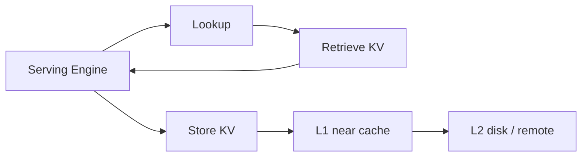

它多出来的是：

- 外部 lookup/store/retrieve。
- 多级存储。
- 跨 worker / 跨 pod / 跨节点共享。
- eviction / pinning / observability。
- 和 serving engine 的 connector 协议。

这也是为什么直接接 llama.cpp 难：llama.cpp 现在更容易给你 sequence state blob，不是 LMCache 期望的标准 KV tensor chunks。

### 4.2 LMCache Benchmarking

入口：

- <https://docs.lmcache.ai/getting_started/benchmarking.html>
- <https://docs.lmcache.ai/cli/bench.html>

值得借鉴的 workload：

| workload | 对应你的实验 |
|---|---|
| `long-doc-qa` | 同一长文档，多问题 |
| `multi-round-chat` | 多轮对话，历史不断增长 |
| `prefix-suffix-tuner` | 固定前缀，不同后缀 |
| `long-doc-permutator` | 更复杂的文档组合复用 |
| `random-prefill` | 负对照，基本不应命中 |

把这些 workload 改成 llama.cpp OpenAI-compatible replay，就能得到很实用的验证框架。

### 4.3 LMCache MP / P2P / Disaggregated Prefill

入口：

- LMCache MP Overview (`../LMCache/docs/source/mp/index.rst`)
- LMCache MP Configuration (`../LMCache/docs/source/mp/configuration.rst`)
- LMCache P2P (`../LMCache/docs/source/mp/p2p.rst`)
- LMCache Disaggregated Prefill (`../LMCache/docs/source/mp/disaggregated_prefill.rst`)

这些文档用于回答一个问题：

```text
外部框架到底比 llama.cpp 本地缓存多什么？
```

答案通常是：

```text
跨进程 + 跨实例 + 更大存储层 + 观测和控制
```

如果你的 llama.cpp 场景不需要这些，ROI 可能不成立。

### 4.4 LMCache benchmark 报告

入口：

- <https://blog.lmcache.ai/en/2026/05/12/benchmarking-lmcache-for-multi-turn-agentic-workloads-on-amd-mi300x/>
- <https://blog.lmcache.ai/en/2026/04/03/lmcaches-new-architecture-boosts-moe-inference-performance-by-10x/>

读这些报告时要谨慎：

```text
它们证明 LMCache 在特定 vLLM/硬件/负载下有效。
它们不证明 llama.cpp 接上 LMCache 后自动获得同等收益。
```

最值得记住的是反例：LMCache 自己的 AMD benchmark 提到，在低负载且 working set 能放进 HBM 时，vLLM 的 HBM prefix cache 反而赢。这个反例对 ROI 判断非常重要。

## 5. 用 SWE-bench 风格 trace 做真实验证

入口：

- <https://github.com/swe-bench/SWE-bench>
- <https://www.swebench.com/SWE-bench/>
- <https://www.swebench.com/SWE-bench/faq/>
- <https://arxiv.org/abs/2310.06770>

SWE-bench 的价值不是让你立刻跑官方分数。官方评测需要 Docker 和补丁验证。对 cache 研究来说，你更需要它的“真实任务形状”：

```text
同一个 repo
同一个系统提示词
同一批工具说明
重复出现的文件上下文
变化的是 issue、tool result、下一步指令
```

可构造这样的 trace：

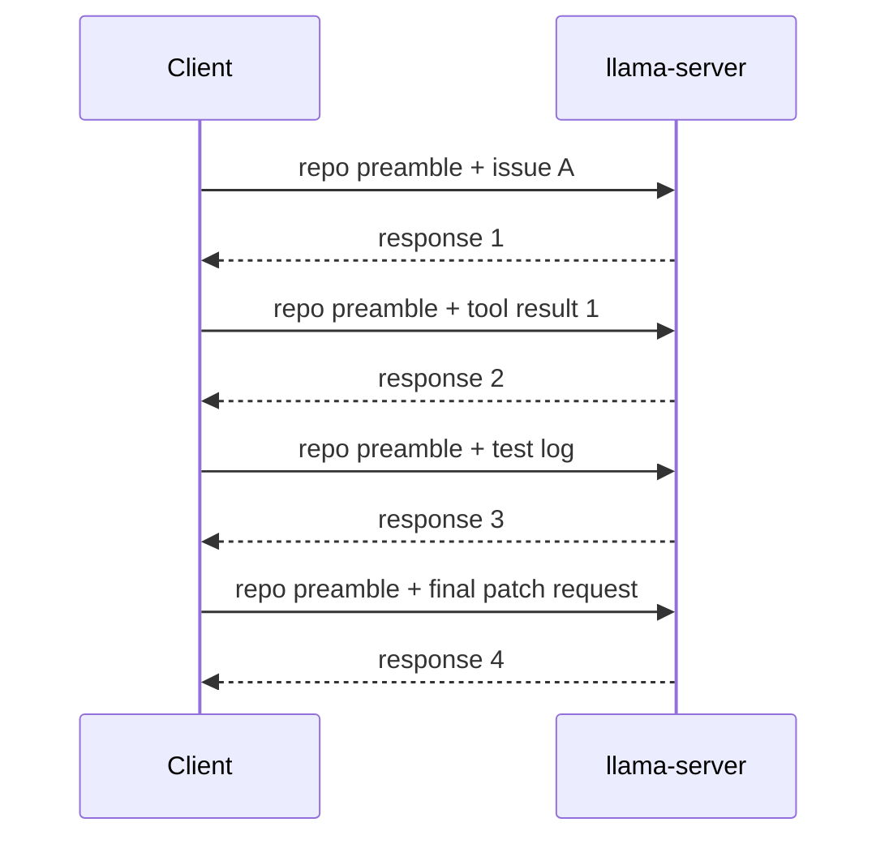

如果 repo preamble 很长，后续请求应该命中大量 prefix token。这里最关键的是保存“最终 formatted prompt”和 token ids。不要只保存原始 chat messages，因为 cache 命中发生在 token 层。

## 6. Benchmark 工具怎么选

### 6.1 llama.cpp SPEED-Bench

入口：

- llama.cpp/tools/server/bench/speed-bench/README.md (`../llama.cpp/tools/server/bench/speed-bench/README.md`)

它能测：

- latency。
- prompt throughput。
- decode throughput。
- coding/RAG/summarization 等类别。
- 固定 input length 的吞吐场景。

限制：它不是专门为 prompt cache 命中设计的。你需要控制请求顺序，让 prompt 有重复前缀。

### 6.2 GenAI-Perf

入口：

- <https://docs.nvidia.com/deeplearning/triton-inference-server/user-guide/docs/perf_analyzer/genai-perf/README.html>

它最值得借鉴的是指标语言：

| 指标 | 通俗解释 |
|---|---|
| TTFT | 从发请求到第一个 token 出来 |
| ITL | 生成过程中 token 和 token 之间的间隔 |
| request latency | 整个请求耗时 |
| output throughput | 输出 token 吞吐 |
| request throughput | 每秒完成请求数 |

即使不用 GenAI-Perf，也应该用这些定义设计自己的 llama.cpp replay 脚本。

## 7. 你应该记录哪些指标

### 7.1 请求级指标

| 指标 | 为什么重要 |
|---|---|
| `ttft_ms` | 用户最直接感受到的等待时间 |
| `e2e_latency_ms` | 整体体验 |
| `prompt_ms` | prefill 成本，cache 最直接影响它 |
| `prompt_n` | 实际重新计算了多少 prompt token |
| `cache_n` / `cached_tokens` | 命中了多少 token |
| `predicted_ms` | decode 耗时 |
| `predicted_n` | 输出 token 数 |
| `decode_tps` | 验证 cache 是否真的没有改变 decode |

来源：server-common.cpp (`../llama.cpp/tools/server/server-common.cpp`)、server-task.cpp (`../llama.cpp/tools/server/server-task.cpp`)、server README (`../llama.cpp/tools/server/README.md`)

### 7.2 cache 专用指标

```text
request_hit_rate = 有 cached_tokens 的请求 / 可命中请求

token_hit_ratio = cached_tokens / total_prompt_tokens

saved_prefill_ms = baseline_prompt_ms - cached_prompt_ms

net_gain_ms = saved_prefill_ms - lookup_ms - restore_ms - serialize_ms
```

如果做多级缓存，还要记录：

| 指标 | 意义 |
|---|---|
| `L0_hit_tokens` | llama.cpp 当前上下文/slot 内命中 |
| `L1_hit_tokens` | RAM cache 命中 |
| `L2_hit_tokens` | disk / remote 命中 |
| `evicted_bytes` | 被挤掉了多少缓存 |
| `cache_bytes` | 缓存占用 |
| `restore_ms` | 恢复状态是否比重算更便宜 |

## 8. 推荐验证设计

### 8.1 对照组

同一批 trace 至少跑这些组合：

| 组 | 配置 | 用途 |
|---|---|---|
| A | `cache_prompt=false`, `--cache-ram 0` | 无缓存基线 |
| B | `cache_prompt=true`, `--cache-ram 0` | 只看 slot 前缀复用 |
| C | `cache_prompt=true`, `--cache-ram 4096` | 看 RAM prompt cache |
| D | C + `--cache-reuse N` | 单独看 chunk reuse/KV shifting |
| E | `--slot-save-path` save/restore | 看状态 blob 入盘 |
| F | 未来 LMCache-like 方案 | 看外部缓存是否值得 |

### 8.2 trace 场景

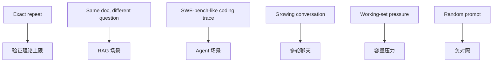

每个场景都要回答：

```text
有没有公共前缀？
公共前缀有多长？
它是否跨过 chunk/page 边界？
命中发生在 slot、RAM、disk，还是远程？
恢复成本是否小于重算？
```

### 8.3 通过门槛

我建议把 ROI 门槛定硬一点：

| 门槛 | 原因 |
|---|---|
| p95 TTFT 至少降低 30% | 否则用户体验不明显 |
| median `net_gain_ms` 为正 | 否则只是把 compute 换成 I/O |
| 解决 `--cache-ram` 解决不了的场景 | 否则不值得引入新框架 |
| decode TPS 不退化明显 | 不能为了 TTFT 牺牲生成吞吐 |
| 正确性抽样通过 | cache 错了可能静默污染输出 |

## 9. 本地已有结果给出的提示

已有 smoke 结果不是最终结论，但方向很清楚：

| 现象 | 数值 |
|---|---:|
| 非 control 场景 cache-hit | 8 / 13 |
| median prompt speedup | 2.91x |
| max prompt speedup | 7.09x |
| baseline median decode TPS | 57.68 |
| cache median decode TPS | 57.74 |

解释：

```text
prompt cache 确实降低了重复前缀的 prefill 成本。
decode TPS 基本不变，说明收益主要来自少算 prompt。
```

来源：[llamacpp_realistic_cache_smoke_summary.md](./llamacpp_realistic_cache_smoke_summary.md)

## 10. ROI：什么时候值得加 LMCache-like 框架

先看决策图：

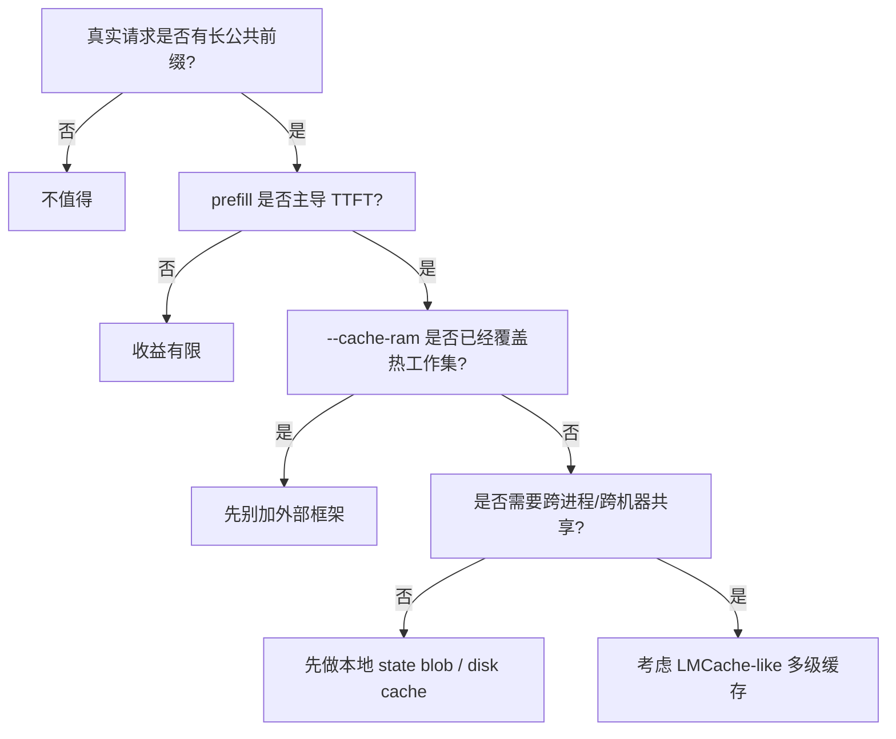

值得加的情况：

- coding agent / SWE-bench-like trace，有很长 repo/tool/system 前缀。
- RAG 场景，同一批长文档被反复问。
- 多 worker llama.cpp 服务，负载均衡导致本地 slot cache 经常错过。
- 热工作集超过 `--cache-ram` 可承受范围。
- 需要 disk/remote/P2P/pinning/observability。

不值得加的情况：

- 单用户短聊天。
- prompt 之间几乎没有公共前缀。
- 主要时间花在长输出 decode。
- 单进程 `--cache-ram` 已经覆盖绝大部分热前缀。
- 恢复 state/tensor 的成本接近或超过重算。

## 11. 最短学习路线

如果时间有限，只读这些：

1. llama.cpp server README (`../llama.cpp/tools/server/README.md`)：看 cache 参数和 metrics。
2. server-task.cpp (`../llama.cpp/tools/server/server-task.cpp`)：看 `server_prompt_cache::alloc` 和 `server_prompt_cache::load`。
3. llama.h (`../llama.cpp/include/llama.h`)：看 sequence state save/load。
4. [vLLM Automatic Prefix Caching](https://docs.vllm.ai/en/stable/features/automatic_prefix_caching/)：理解 prefix cache 改善什么、不改善什么。
5. [SGLang HiCache Design](https://docs.sglang.ai/advanced_features/hicache_design.html)：理解 L1/L2/L3。
6. [LMCache Benchmarking](https://docs.lmcache.ai/getting_started/benchmarking.html)：借 workload 设计。
7. [SWE-bench](https://www.swebench.com/SWE-bench/)：借真实 coding-agent trace 形状。

## 12. 来源清单

- llama.cpp server README: <https://github.com/ggml-org/llama.cpp/blob/master/tools/server/README.md>
- llama.cpp server development docs: README-dev.md (`../llama.cpp/tools/server/README-dev.md`)
- llama.cpp prompt-cache source: server-task.cpp (`../llama.cpp/tools/server/server-task.cpp`)
- llama.cpp public API: llama.h (`../llama.cpp/include/llama.h`)
- llama.cpp KV internals: llama-kv-cache.cpp (`../llama.cpp/src/llama-kv-cache.cpp`)
- vLLM Automatic Prefix Caching: <https://docs.vllm.ai/en/stable/features/automatic_prefix_caching/>
- vLLM Prefix Caching design: <https://docs.vllm.ai/en/latest/design/prefix_caching/>
- PagedAttention paper: <https://arxiv.org/abs/2309.06180>
- SGLang HiCache design: <https://docs.sglang.ai/advanced_features/hicache_design.html>
- SGLang HiCache best practices: <https://docs.sglang.ai/advanced_features/hicache_best_practices.html>
- SGLang attention backend docs: <https://docs.sglang.ai/advanced_features/attention_backend.html>
- LMCache docs: <https://docs.lmcache.ai/>
- LMCache integration docs: <https://docs.lmcache.ai/developer_guide/integration.html>
- LMCache benchmarking docs: <https://docs.lmcache.ai/getting_started/benchmarking.html>
- LMCache bench CLI: <https://docs.lmcache.ai/cli/bench.html>
- LMCache AMD MI300X benchmark: <https://blog.lmcache.ai/en/2026/05/12/benchmarking-lmcache-for-multi-turn-agentic-workloads-on-amd-mi300x/>
- SWE-bench repository: <https://github.com/swe-bench/SWE-bench>
- SWE-bench docs: <https://www.swebench.com/SWE-bench/>
- SWE-bench paper: <https://arxiv.org/abs/2310.06770>
- NVIDIA GenAI-Perf docs: <https://docs.nvidia.com/deeplearning/triton-inference-server/user-guide/docs/perf_analyzer/genai-perf/README.html>
