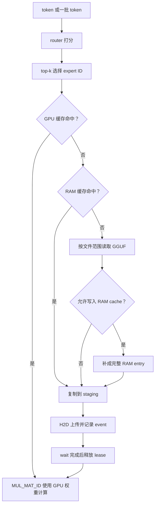
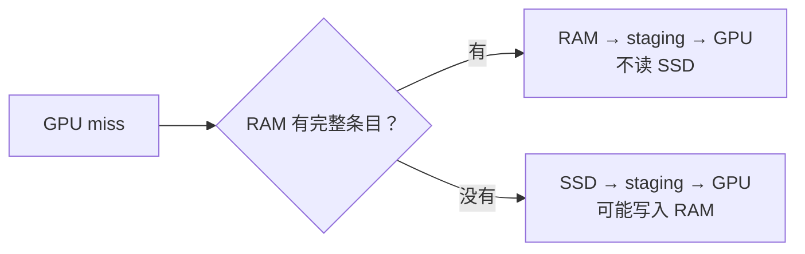
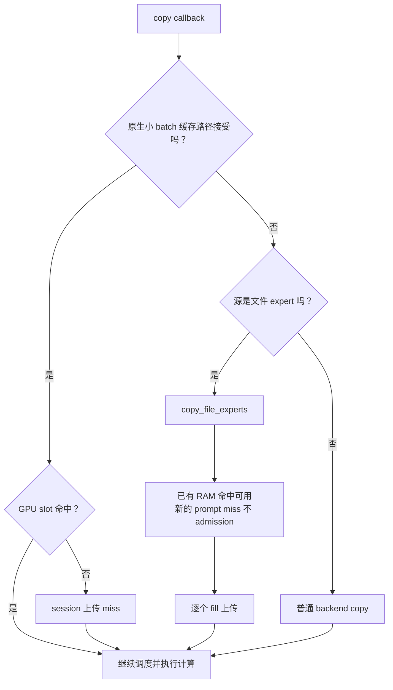
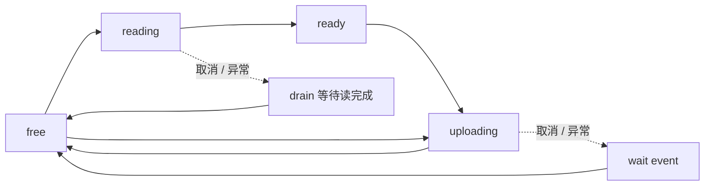
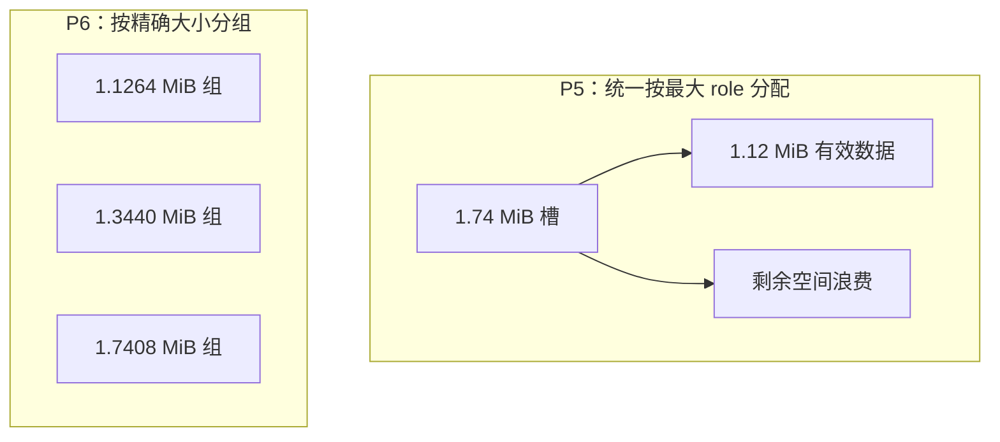
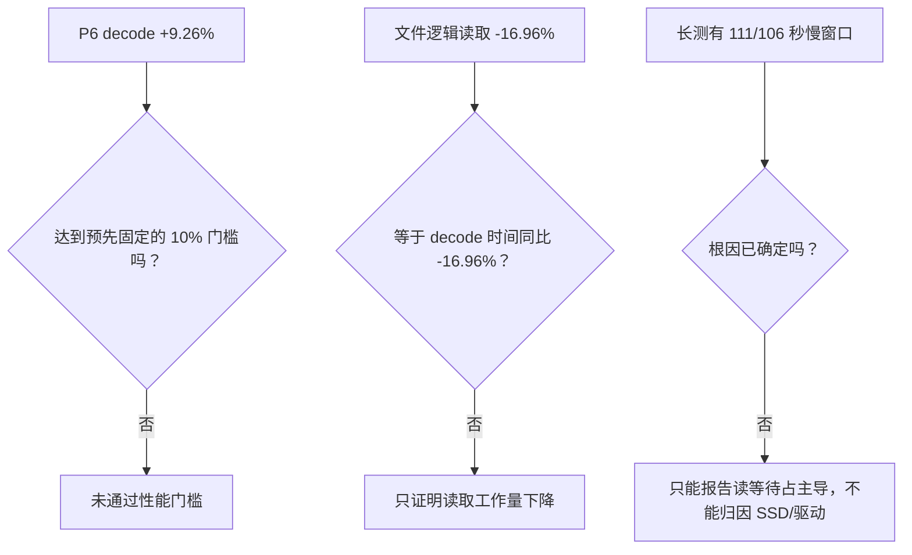

# 7 天读懂 llama.cpp 文件专家缓存

这是一份配合教程使用的动手学习计划，目标不是背 API，而是做到三件事：

1. 能从一次 decode 讲清楚 expert 权重怎样从 SSD 走到 GPU。
2. 能看懂缓存、异步 I/O、event、lease 和取消之间的安全关系。
3. 能用测试和实验数据判断“是否真的更快”，而不是只看一个百分比。

> 建议每天投入约 2 小时，第 6 天预留约 2.5 小时。  
> 不需要下载 147 GiB 模型，也不需要重跑整套性能矩阵。  
> 这是本地实验的学习材料，不代表该实现已经被上游接受。

配套教程：`llamacpp-file-expert-beginner.zh-CN.md`

## 怎么用这份计划

每天按同一个顺序执行：

1. **先回忆**：不翻资料，用 5 分钟写下昨天记住的内容。
2. **读教程**：只读当天指定章节，先建立概念，不急着钻每个函数。
3. **看源码**：围绕一个入口，顺着调用关系读，不要求一次看懂全文件。
4. **做练习**：必须留下图、表、计算过程或测试日志。
5. **过关自测**：能不看答案讲清楚，才算完成当天内容。

每天准备一张纸或一个 Markdown 文件，固定写三项：

- 今天画出的图。
- 今天算出的数字。
- 今天仍未解决的问题。

### 路径约定

- 教程和本计划位于 `research/`。
- `../llama.cpp/...` 表示同一工作区中的源码仓库。
- 行号以当前本地实验分支为准；源码变化后应重新用 `rg` 核对。

## 7 天全景


| 天数 | 主题 | 当天产出 | 核心练习 |
|---|---|---|---|
| Day 1 | 全景与 decode 路径 | 一页路径图 | 解释 GPU hit、RAM hit、双 miss |
| Day 2 | 命中、GGUF 与对齐 | 命中表 + 偏移计算 | 从张量范围算到文件范围 |
| Day 3 | ggml、调度器和上传分支 | 分支判断表 | 判断五种输入走哪条路径 |
| Day 4 | 异步、event、lease、取消 | 状态机 + 收尾时间线 | 解释为什么不能立即释放缓冲 |
| Day 5 | 缓存分组与预算 | 预算账本 | 手算 P6 的槽位与剩余空间 |
| Day 6 | 正确性、性能与测试 | 测试日志 + 实验审计表 | 运行 CTest，审查 +9.26% |
| Day 7 | 综合、复现和贡献演练 | 一页测试设计 | 设计一个失败在前的回归测试 |

## 先建立生活类比

不要一上来记所有结构体。先记住这张“搬家图”：

| 计算中的东西 | 生活类比 | 为什么重要 |
|---|---|---|
| GPU expert cache | 书桌 | 最快，但地方最小 |
| RAM expert cache | 书架 | 比 SSD 快，容量中等 |
| GGUF file source | 仓库 | 容量最大，但取货最慢 |
| pinned staging | 搬运托盘 | 从书架或仓库搬到书桌前的中转站 |
| lease / pin | “正在使用”牌子 | 有人还在读，不能把这一格清掉 |
| CUDA event | 签收单 | 卡车离开不等于货已经送到，签收后才算完成 |

最容易被误解的一点是：

> GPU 缓存未命中，不等于一定要去仓库取货。它可能只是没在书桌上，但书架上正好有。

这就是后文反复出现的 RAM hit。

## 一次 decode 的数据路径



先不要急着读代码。试着用自己的话解释：

1. 哪条路径不读盘？
2. 哪条路径虽然不读盘，但仍然要上传？
3. 哪条路径会读盘，但不一定进入缓存？

如果现在答不出来，没关系，Day 1 和 Day 2 会分别解决这三个问题。

## 第 1 天：先看懂一张图

**今天只搞懂一句话：GPU miss 只是“书桌上没有”，不代表“仓库里也没有”。**

### 人话解释

MoE 模型有很多 expert，但每个 token 只用其中少数几个。计算是稀疏的，权重却不是稀疏的：所有 expert 的字节仍然要放在某个地方。

文件专家源做的事情很简单：

1. GPU 上放一本“近期常用的小册子”。
2. RAM 上放一个“更大的书架”。
3. 书架没有，再到 SSD 的 GGUF 里按范围取。
4. 取出来的数据经过 staging，再上传到 GPU。

它没有改变 router 选谁，也没有改变 top-k 数量。

### 看图：两种 miss



把“读盘”和“上传”当成两个独立开关：

- RAM hit：读盘 `关`，上传 `开`。
- 双 miss：读盘 `开`，上传 `开`。
- GPU hit：读盘 `关`，上传 `关`。

### 阅读

- `这份教程要解决什么问题`
- `先建立正确的大图`
- `一次 decode 的完整路径`
- `一张路径图`

### 源码

- `../llama.cpp/docs/development/file-expert-store.md:52`
- `../llama.cpp/src/llama-context.cpp:3234`
- `../llama.cpp/src/llama-moe-cache.cpp:839`

源码只读主路，不要展开所有异常处理：

1. 看 `sched_copy_experts` 怎样先尝试原生 MoE cache。
2. 看 GPU miss 时怎样构造 `(source, dst, offset, bytes)`。
3. 暂时把 `transfer` 当成黑盒，知道它负责“把字节送到 staging”即可。

### 练习

1. 不看教程，重画一次 `router → top-k → GPU → RAM → SSD → staging → GPU`。
2. 用三句话区分 GPU expert cache、RAM expert cache 和 KV cache。
3. 做教程中的自查题 1，但先自己回答，再展开答案。
4. 把下面三行补完整：

```text
GPU hit：读盘 __，上传 __
GPU miss + RAM hit：读盘 __，上传 __
GPU miss + RAM miss：读盘 __，上传 __
```

### 当天产出

- 一张手绘路径图。
- 两条不同颜色的箭头：一条表示“读盘”，一条表示“H2D 上传”。
- 一句结论：`GPU miss` 和 `disk miss` 不是同义词。

### 过关自测

不看资料回答：

- 为什么 RAM 命中以后仍然需要 staging 和 H2D？
- 为什么 `--moe-cache-mib` 不是 KV cache 大小？
- `expert` 和 `expert role` 有什么区别？

## 第 2 天：把专家变成文件范围

**今天只搞懂一句话：缓存 key 不是单独的 expert ID，而是“张量 + expert ID”。**

### 人话解释

一个 expert 可能由多个张量组成：

- `ffn_gate_exps`
- `ffn_up_exps`
- `ffn_down_exps`

它们的大小可能不同。只记“expert 3”不够，因为 gate 里的 3 和 down 里的 3 指向完全不同的字节。

GGUF 张量可以先想成一排抽屉：

```text
tensor 起点
  |
  v
[ expert 0 ][ expert 1 ][ expert 2 ][ expert 3 ][ expert 4 ][ expert 5 ]
                                                            ^
                                                            |
                                      start = tensor_offset + 5 × nb[2]
```

第 `e` 个 expert 的逻辑范围是：

```text
start = tensor_offset + e * nb[2]
end   = start + nb[2]
```

### 人话解释对齐读取

direct I/O 不能从任意一个字节开始读，它更像“整托盘搬货”。所以代码会把起点向前对齐，把终点向后对齐。

```text
文件：       ... [ 前面不需要 ][ 需要的 expert ][ 后面不需要 ] ...
直接读取：       [======== 一个完整对齐区间 ========]
逻辑请求：                     [== expert ==]
```

因此日志里至少有两种字节数：

- 逻辑读取：应用真正想要多少字节。
- 对齐读取：操作系统实际完成多少字节。

### 阅读

- `三种命中：先预测，再看答案`
- `从 GGUF 张量到文件字节范围`
- 重点看 `view、非零偏移和 EOF`
- 重点看 `对齐读取与读放大`

### 源码

- `../llama.cpp/src/llama-expert-store.cpp:157`
- `../llama.cpp/tests/test-expert-store.cpp:91`
- `../llama.cpp/tests/test-expert-store.cpp:443`
- `../llama.cpp/tests/test-expert-store.cpp:456`

看源码时只回答三个问题：

1. `add` 记录了哪些偏移和长度？
2. view 的偏移为什么要叠回原张量？
3. 测试为什么要覆盖 EOF 和 UTF-8 路径？

### 练习

#### 练习 1：填玩具表

先遮住教程答案，填写 8-expert 例子的“命中、读盘、H2D”表。

填完后检查三个关键点：

- expert 3 在事件 A 是 RAM hit，不读盘，但要上传。
- expert 3 在事件 B 已经是 GPU hit，连 RAM 都不用查。
- prompt 中的 expert 8 会读盘，但 `cache_admit=false` 使它不进入 RAM cache。

#### 练习 2：算一次对齐范围

条件：

```text
tensor_offset = 5,000 B
expert ID     = 5
expert_bytes  = 1,126,400 B
alignment     = 4,096 B
```

自己计算，然后核对：

```text
logical_start = 5,637,000
logical_end   = 6,763,400
aligned_start = 5,636,096
aligned_end   = 6,766,592
direct_bytes  = 1,130,496
extra_bytes   = 4,096
```

#### 练习 3：改一个条件

把事件 A 的 expert 3 改成 RAM miss：

- 总读盘从 4 MiB 变成多少？
- 总 H2D 是否变化？

答案：读盘变成 6 MiB，H2D 仍是 6 MiB。

### 当天产出

- 完整的命中表。
- 一组带起止偏移的计算过程。
- 一句解释：为什么同一个 expert ID 在不同 role 中不能共用缓存 key。

### 过关自测

- 逻辑读取和 direct read 有什么区别？
- view 的非零偏移为什么不能忽略？
- 为什么从 GGUF 读取时不能先解压再送 GPU？

## 第 3 天：数据怎样进入计算图

**今天只搞懂一句话：调度器负责“把料送到”，`MUL_MAT_ID` 负责“按 ID 做乘法”。**

### 人话解释

ggml 计算图像一张菜谱：

- 节点是做菜步骤，例如矩阵乘、归一化。
- 边是食材，也就是张量。
- 调度器决定哪一步在 CPU、哪一步在 GPU。

`MUL_MAT_ID` 是“带号码的批量矩阵乘”：号码告诉它每个 token 该用哪些 expert。

文件专家源不改变这道菜，只是保证做菜前 expert 权重已经放到正确位置。

### 看图：上传分支



### 人话解释 mmap

mmap 像在通讯录里登记了仓库地址：

- 登记地址不等于货已经在家里。
- GPU 不能直接拿一个随时可能缺页的主机地址当权重。
- 所以文件模式保留映射来构造图和识别张量，但实际 expert 字节仍由 session 有界读取。

### 阅读

- `ggml 图、调度器和 copy callback` 全章
- 重点看 `prefill 的 admission 策略`
- 重点看 `安全 microbatch 和 graph workspace`

### 源码

- `../llama.cpp/docs/development/file-expert-store.md:46`
- `../llama.cpp/src/llama-context.cpp:3234`
- `../llama.cpp/src/llama-moe-cache.cpp:944`
- `../llama.cpp/src/llama-graph.cpp:1765`

### 练习：填分支表

自己填写“是否读盘、是否上传、是否可能进入 RAM cache”：

| 情况 | 读盘 | 上传 | 新 miss 可 admission |
|---|---|---|---|
| 小 batch + GPU slot hit | ? | ? | ? |
| 小 batch + GPU miss + RAM hit | ? | ? | ? |
| 小 batch + 双 miss + admission 开 | ? | ? | ? |
| prompt 文件路径 + RAM hit | ? | ? | ? |
| prompt 文件路径 + 新 miss | ? | ? | 否 |
| 非文件 expert 源 | ? | ? | 不适用 |

提示：

- `cache_admit=false` 只禁止新的 miss 进入 RAM。
- 已有 RAM 条目仍然可以命中。
- prompt 不是“完全不用 RAM”，而是“不要把一次扫描的新结果塞满缓存”。

### 当天产出

- 一张分支表。
- 一条从 callback 到 `MUL_MAT_ID` 的顺序链。
- 一段不超过 100 字的解释：为什么 mmap 地址空间不是常驻 RAM。

### 过关自测

- 大 batch 为什么会走 `copy_file_experts`？
- `cache_admit=false` 影响命中还是影响准入？
- graph workspace 预算为什么不是整卡显存上限？

## 第 4 天：异步不是“已经完成”

**今天只搞懂一句话：提交成功只代表“卡车出发了”，event 完成才代表“货到了”。**

### 人话解释

把 H2D 上传想成送货：

1. `read` 完成：货到了 staging 托盘。
2. `submit`：把货装上卡车。
3. event record：拿到一张运单。
4. event wait：确认卡车已经卸完货。
5. release lease：这时才能把托盘收走。

如果提前收走托盘，卡车可能还在从里面取货，GPU 拿到的就不是原来的 expert 字节。

### 看图：slot 状态机



`reading`、`ready`、`uploading` 期间，相关缓存条目和 staging 都可能被 pin 住。`free` 之前必须确保没有设备仍在使用它。

### 阅读

- `异步读、事件和租约` 全章
- 重点比较 `reap` 和 `drain`
- 重点理解“取消是请求，不是立即停止”

### 源码

- `../llama.cpp/src/llama-expert-store.h:86`
- `../llama.cpp/src/llama-expert-store.cpp:665`
- `../llama.cpp/src/llama-expert-store.cpp:516`
- `../llama.cpp/src/llama-expert-store.cpp:563`
- `../llama.cpp/tests/test-expert-store.cpp:199`

阅读顺序：

1. 先看 `consumer` 的 `submit` 和 `wait` 契约。
2. 看 `reap` 在哪里复制 RAM、提交上传、等待 event、释放 slot。
3. 看 `drain` 为什么先取消 read，再等待 upload。
4. 最后看取消测试的断言。

### 练习：写安全收尾时间线

#### 情况 A：磁盘读取仍在进行

按顺序写出：

```text
CancelIoEx
→ GetOverlappedResult(..., TRUE)
→ 标记未完成 entry 无效
→ 释放 lease / slot
```

#### 情况 B：H2D 已经提交

按顺序写出：

```text
sink.wait
→ 确认 GPU 不再读取 staging
→ 释放 lease / slot
```

然后回答教程自查题 2，并补充一句：

> 为什么这一步的代价是延迟，而不是可以省略的清理？

### 当天产出

- 一张带 pin/unpin 标注的状态机。
- 两张取消时间线：read 在途、upload 在途。
- 说明为什么发生文件上下文错误后常常要重建 context。

### 过关自测

- `set_async` 返回后，GPU 一定已经读完 staging 了吗？
- 为什么部分读取的 entry 不能成为下一次 hit？
- `session.cancel()` 和临时回调查询到的 abort 条件，语义有什么不同？

## 第 5 天：缓存预算与碎片

**今天只搞懂一句话：P6 不是“缓存更大”，而是“同样预算装得更满”。**

### 人话解释

P5 像给所有书都买同一种最大号格子：

- 书只有 1.12 MiB，格子却有 1.74 MiB。
- 剩下的空间不能借给另一本书。

P6 像按书的尺寸分书架：

- 小书一格、中号书一格、大书一格。
- 每组只放相同大小的 unit。
- 代价是冷组不能把空格借给热组。

### 看图：碎片与分组



注意两个边界：

- RAM cache 硬预算不等于整个进程的 RAM 上限。
- GPU expert bank 预算不等于整卡显存上限。

映射了 142 GiB 文件，也不代表进程常驻了 142 GiB RAM。映射是地址登记，working set 才是当前驻留页面。

### 阅读

- `缓存策略和预算` 全章
- 重点看 `为什么 P6 要按精确大小分组`
- 重点看三个“不等于”：进程内存、mmap、显存

### 源码

- `../llama.cpp/src/llama-expert-store.cpp:335`
- `../llama.cpp/src/llama-expert-store.cpp:597`
- `../llama.cpp/src/llama-moe-cache.cpp:770`
- `../llama.cpp/tests/test-expert-store.cpp:369`

源码关注点：

1. `init_groups` 怎样按 `expert_bytes` 分组。
2. `acquire` 在组内怎样找 victim、等待在途填充。
3. 测试怎样验证“超出预算的尺寸走 bypass”。
4. GPU 侧仍然使用原生 cache，而不是另一个文件缓存。

### 练习：手算 P6 账本

已知 Q5 的三组：

| role 字节 | 单元数 | 16 GiB 预算下槽数 |
|---:|---:|---:|
| 1,126,400 | 48,128 | 8,404 |
| 1,344,000 | 1,024 | 179 |
| 1,740,800 | 24,576 | 4,292 |

自己计算：

```text
payload + entry =
  8404 × 1126400
+ 179 × 1344000
+ 4292 × 1740800
+ 12875 × 40

total = payload + entry + 120 B 组描述符
```

核对：

```text
total  = 17,178,870,320 B
budget = 17,179,869,184 B
剩余   = 998,864 B
```

再回答：

1. 为什么有效 payload / allocation 能到 99.997%？
2. 为什么这不代表整个进程只用了 16 GiB RAM？
3. 为什么冷组不能借容量，仍然是这个设计的限制？

### 当天产出

- 一张预算账本，包含 payload、entry、描述符和剩余空间。
- 一张三层资源边界图：进程 RAM、mmap 虚拟地址、GPU bank。
- 一句话解释“减少内部碎片”和“提高端到端速度”不是同一件事。

### 过关自测

- P5 的 76.717% 和 P6 的 99.997% 分别是什么比例？
- 为什么 `LLAMA_EXPERT_RAM_MIB=8192` 不能保证进程只占 8 GiB？
- GPU expert bank 和整卡显存之间还隔着哪些分配？

## 第 6 天：用证据说话

**今天只搞懂一句话：读取量下降 16.96%，不等于速度会提高 16.96%。**

### 人话解释

一次 decode 不只花在读盘上，还要花在：

- router 和 top-k。
- GPU 计算。
- cache 查找和淘汰。
- RAM 到 staging 的复制。
- H2D 上传。
- event 同步和图调度。
- 偶尔出现的读完成等待。

文件读取只是账单中的一项。把这一项减少，不会自动让总账单同比减少。

### 看图：三个不能混用的结论



### 阅读

- `怎么读实验：正确性、性能、限制` 全章
- `练习 B：运行现有单元测试`
- `一张实验判读清单`

再读报告的这些部分：

- P5：`正式性能与数值结果`、`Q5 同 GPU 预算与同步控制`
- P6：开头摘要、缓存与资源、正确性/长时/物理 I/O
- P6 诊断：慢窗口表和 ETW 保留范围

### 报告

- `ooc-p5-20261110/RESULTS.zh-CN.md:165`
- `ooc-p6-20261110/RESULTS.zh-CN.md:5`
- `ooc-p6-20261110/DIAGNOSIS.md:9`

### 源码与测试

- `../llama.cpp/tests/test-expert-store.cpp:91`
- `../llama.cpp/tests/test-expert-store.cpp:199`
- `../llama.cpp/tests/test-expert-store.cpp:273`
- `../llama.cpp/tests/test-expert-store.cpp:369`
- `../llama.cpp/tests/test-backend-tensor.cpp:636`

测试不是在造一个假模型，而是用临时文件和合成张量检查：

- RAM 命中不读文件。
- 两个 buffer 不会无限扩张。
- 取消会排空。
- GPU event 完成前 lease 不会消失。
- 分组预算不会超账。

### 练习：运行测试

在当前 Windows 环境，CPU-only 是最稳的起点：

```powershell
cd C:\Users\Administrator\Documents\Code\my-code\lm-llama\llama.cpp
cmake -B build-cpu -DGGML_CUDA=OFF -DLLAMA_BUILD_TESTS=ON
cmake --build build-cpu --config Release --target test-expert-store test-backend-tensor --parallel 4
ctest --test-dir build-cpu -C Release -R '^test-(expert-store|backend-tensor)$' --output-on-failure
```

记录：

- CTest 是否显示 `2/2`。
- `in-flight` 是否为 0。
- `leases` 是否为 0。
- `peak in-flight` 是否不超过 2。
- 取消测试是否出现 `reads_drained > 0`。

如果配置 CUDA 时报 `No CUDA toolset found`，按教程使用 CPU-only 路径，不要把它误判成源码错误。

### 练习：实验审计表

把下面三项填写完整：

| 看到的说法 | 证据 | 能下的结论 | 不能下的结论 |
|---|---|---|---|
| P6 +9.26% | 2.242 → 2.449 token/s | ? | ? |
| 读取下降 16.96% | 464.107 → 385.392 MiB/decode | ? | ? |
| 长测慢读 | 两个窗口约 111/106 秒 | ? | ? |

核对：

1. 预声明门槛是 10%，所以 +9.26% **未通过**。
2. 读取工作量确实下降，但 H2D、计算和等待没有同比消失。
3. 慢读的读等待占主导，但 SSD、驱动或监控工具的根因**没有被证明**。
4. ETW 只保留了 182.04 秒捕获中的约 107.774–182.028 秒，不能据此说整个长测没有换页。

最后完成教程自查题 3。

### 当天产出

- 一份 `2/2` 测试日志或一段输出摘录。
- 一张三行实验审计表。
- 一句明确的结论：P6 有改善，但没有通过预定门槛，也不是普遍提速证明。

### 过关自测

- 为什么“读得更少”不能直接推出“token/s 提高多少”？
- 为什么位模式逐位相同只适用于匹配的执行路径？
- 为什么“保留窗口里没有 pagefile hard fault”不等于“整次运行没有换页”？

## 第 7 天：从看懂到能复现

**今天只搞懂一句话：第一次贡献从“可复现的问题 + 会失败的测试”开始，不是从一个大 PR 开始。**

### 人话解释

贡献不是把整包实验代码推上去：

1. 先找一个明确边界。
2. 用最小 fixture 复现。
3. 写一个修复前会失败的测试。
4. 做最小修复。
5. 保留失败日志和限制。

如果自己不能解释每一行、不能独立调试，就不要提交。

### 看图：贡献流程


### 阅读

- `三道自查题`
- `第一次贡献怎么开始`
- `练习 C：加一个回归测试`
- `附录 A：源码阅读路线`
- `附录 B：术语速查`
- `附录 C：建议的验证顺序`

### 源码与规则

- `../llama.cpp/CONTRIBUTING.md`
- `../llama.cpp/AGENTS.md`
- `../llama.cpp/tests/test-expert-store.cpp:199`
- `../llama.cpp/tests/test-expert-store.cpp:369`

重点确认：

- 新功能先讨论。
- bugfix 要有复现和回归测试。
- 一次只做一个变化。
- AI 实质参与需要披露。
- PR 描述、issue 回复、评审回复和 commit message 必须由贡献者自己写。

### 练习 1：闭卷复盘

用 20 分钟完成：

1. 画出完整路径图。
2. 写出 RAM hit、双 miss、admission 关闭三条分支。
3. 写出取消时 read 和 upload 的安全收尾顺序。
4. 回答三道自查题。
5. 写出 P6 的 `+9.26% < 10%` 结论。

做完后再翻教程核对，不要边看边抄。

### 练习 2：设计一个回归测试

从下面选一个：

1. 第二次 read 提交后取消，断言 `ram_live=0`、`in_flight=0`、`leases=0`。
2. 一个 expert 大于 staging 槽，断言走 bypass，而不是留下半个 entry。
3. 混合尺寸预算刚好只够一个小槽，断言不会从其他尺寸组偷容量。
4. 一个 view 从非对齐偏移跨越 staging 块，断言读取字节和源范围一致。

用这个模板写一页：

```text
问题：
最小 fixture：
初始状态：
触发动作：
预期计数：
修复前为什么失败：
修复后应看到什么：
没有覆盖哪些情况：
```

有余力再照着现有测试加一个骨架，但不要在没理解测试夹具前修改生产代码。

### 当天产出

- 一页闭卷路径图。
- 一页测试设计。
- 三到五条贡献规则摘要，用你自己的话写。
- 一份明确说明“我没有验证什么”的限制列表。

### 过关自测

- 为什么 147 GiB 模型不是学习这条路径的前置条件？
- 一个测试为什么必须先在修复前失败？
- 如果只看输出文本相同，为什么还不能证明路径完全一致？

## 完成检查表

七天结束时，逐项打勾：

- [ ] 能从 token 画到 SSD、staging、H2D 和 `MUL_MAT_ID`。
- [ ] 能区分 GPU hit、RAM hit、双 miss 和 admission bypass。
- [ ] 能解释 `(source tensor, expert ID)` 为什么是缓存 key。
- [ ] 能算一次逻辑偏移和对齐偏移。
- [ ] 能判断小 batch 与一般文件上传分支。
- [ ] 能解释 event、lease 和取消为什么必须一起工作。
- [ ] 能复述 P6 的 `+9.26%`、16.96% 读取下降和 10% 门槛。
- [ ] 能说明 mmap、RAM 预算、GPU 预算各自限制了什么。
- [ ] 能运行两个单元测试并检查计数。
- [ ] 能写出一个失败在前的回归测试设计。

## 时间不够时怎么压缩

如果某天只有 60–90 分钟：

1. **保留教程阅读和当天练习**，这是理解主线。
2. 源码只读计划中列出的入口函数，不在整个文件里漫游。
3. Day 6 可以只跑 CPU-only 测试，不重跑性能矩阵。
4. 不要为了赶进度跳过 Day 3 的分支判断和 Day 4 的取消时间线。
5. 不要把“读完”当作完成；没有图、没有数字、没有自测，就不算过关。

如果一定要进一步压缩，优先保 Day 1、Day 3、Day 4、Day 6。这四天分别对应路径、分支、安全性和实验判读。

## 七天后的目标能力

学完以后，再看到“文件专家缓存”这个题目，你应该能自然地追问：

1. 这次 miss 是 GPU miss、RAM miss，还是两者都是？
2. 请求的字节范围怎样映射到 GGUF？
3. 哪条路径允许进入 RAM cache？
4. staging 和 GPU bank 什么时候可以安全复用？
5. 读取量、H2D 字节和端到端 token/s 分别怎样测量？
6. 这个结论覆盖了哪个模型、哪条执行路径和哪些失败样本？

能稳定回答这六个问题，就已经具备继续阅读源码、复现问题和小步贡献的基础。
