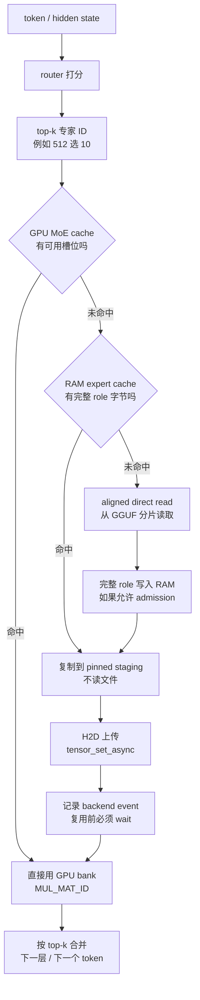

# 从一次 decode 到 SSD：llama.cpp 文件专家源入门

> 适用代码：llama.cpp b12211 / `7d7f02875` 上的本地实验分支  
> 适用平台：Windows、单张 CUDA 卡、受测的 Qwen3.8 / qwen4exp GGUF 布局  
> 路径约定：本文中的 `../llama.cpp/...` 相对于 `research/` 目录  
> 性质：本地学习材料，不是已经合入上游的设计文档

## 这份教程要解决什么问题

这不是一篇“让 llama.cpp 变得更快”的教程，而是一篇解释 **容量路径** 的教程。

当一个 MoE（Mixture of Experts，混合专家）模型的专家权重放不进显存，甚至整个模型放不进 RAM 时，我们仍然希望它能完成一次真实的 prompt 和后续生成。llama.cpp 的文件专家源做的事情是：

1. 保留 GGUF（llama.cpp 使用的模型文件格式）和其中的量化字节，不重新训练、不重新量化。
2. 在 GPU 上保留一个有限的专家缓存。
3. 在 RAM 中再保留一个有限的专家缓存。
4. GPU 缓存未命中时，从 RAM 取；RAM 也没有时，从 SSD 上的 GGUF 分片按范围读取。
5. 读取和 H2D（host to device，主机内存到显存）上传都在固定大小的缓冲区内完成，不无限排队。

它改变的是 **权重放在哪里、怎样被搬到 GPU**，不改变路由的 top-k（每 token 选几个 expert）、专家系数、量化格式和计算精度。

读完之后，你应该能够：

- 沿着一次 decode 的路径，说清楚 router、top-k、GPU 缓存、RAM 缓存和 GGUF 文件各自负责什么。
- 看到一个 `(layer, expert)` 命中或未命中时，判断会不会读盘、会不会上传、缓冲区什么时候能复用。
- 把逻辑张量范围换算成 GGUF 文件偏移，并理解对齐读取为什么会产生读放大。
- 解释 CUDA event、pinned staging 和 lease 为什么必须一起出现。
- 读懂这个分支的缓存日志和实验结论，不把“读得少”直接说成“更快”。
- 从一个小测试开始，做第一次可复现的贡献。

## 先建立正确的大图

### MoE 是稀疏计算，不是稀疏存储

稠密 Transformer 的 FFN 层通常会对每个 token 使用同一组权重。MoE 层则有一个 router：它给每个 token 选出少数几个 expert，只计算这些 expert，再按系数把结果加起来。

以本机实验的 Qwen3.8 Q5 模型为例：

| 属性 | 数值 |
|---|---:|
| 层数 | 48 |
| 每层专家数 | 512 |
| 每 token 选中的专家数 | 10（top-10） |
| 专家存储区间 | 91.614 GiB |
| PLE（逐层 token 嵌入表）存储区间 | 50.664 GiB |
| 完整 GGUF | 147.416 GiB |

一个 token 在每一层只走 10 个 expert，计算量远小于“512 个全算”。但 **所有 512 个 expert 的权重仍然要存在某个地方**。所以 MoE 的典型矛盾是：

- 计算是稀疏的，适合 GPU 并行。
- 权重是巨大的，显存放不下，RAM 也可能放不下。

文件专家源就是在这个矛盾上做取舍：不把全部专家常驻，只把当前路由需要的专家搬进来。

### 三个存储层，不是三个“缓存”

本文反复出现三个层：

| 层 | 典型介质 | 这里存什么 | 谁管理 |
|---|---|---|---|
| GPU expert cache | VRAM | 最近常用的 expert 权重槽位 | llama.cpp 原生 MoE cache |
| RAM expert cache | 主机内存 | 完整的 expert role 字节 | `llama_expert_session` |
| File source | SSD 上的 GGUF | 原始量化字节，只读 | `llama_expert_store` + Windows direct I/O（绕过系统文件缓存、要求对齐） |

这里的“GPU 缓存”是 **权重缓存**，不是 KV cache。

- KV cache 保存的是注意力计算需要的 key/value，随上下文增长。
- GPU expert cache 保存的是 expert 权重，按路由命中复用。
- 两者有不同的预算、生命周期和淘汰策略，不能把 `--moe-cache-mib` 当成 KV cache 大小。

### 一个 expert 不是一个字节块

一个 MoE 层通常有多个专家张量角色（role）：

- `ffn_gate_exps`
- `ffn_up_exps`
- `ffn_down_exps`
- 有些模型会把 gate 和 up 融合成 `ffn_gate_up_exps`

同一个 expert 在不同 role 里的字节数可能不同，量化类型也可能不同。读取时必须按 **张量 + expert ID** 定位，不能假设“一个 expert 就是固定大小的一块连续数据”。

后文会把“一个 expert 在某个 role 里的完整字节”称为一个 **expert role 单元**。RAM 缓存的有效条目以这个单元为最小完整单位。`pinned` 指页锁定主机内存，DMA 可以安全读取；`staging` 是 H2D 前暂时存放数据的缓冲。

## 一次 decode 的完整路径

### 从 token 到 top-k

先看 decode 的一步。假设当前只生成一个新 token：

1. 这个 token 的 hidden state 进入某一层。
2. router 计算每个 expert 的分数。
3. top-k 选出 10 个 expert ID。
4. 对这 10 个 ID 去重，得到本层真正要访问的 expert 集合。
5. 用这些 ID 去查 GPU expert cache。

如果是 prefill，一次会处理很多 token，路由数量会大得多。比如 8192 个 token、每层 top-10，就有最多 81,920 条路由；去重后仍然可能覆盖大量 expert。这就是 prefill 和 decode 在缓存行为上差别很大的原因。

### decode 与 prefill 不是两套数学

它们使用同一套模型计算，只是 batch 形状不同：

- **prefill**：一次处理 prompt 的很多 token，通常计算密集，目标是尽快产生第一个输出 token。
- **decode**：每次只处理一个新 token，复用已有 KV，通常更受内存和 I/O 延迟影响。

在代码里，二者最终都会构造 ggml（llama.cpp 使用的张量与计算图库）计算图，只是 `n_tokens` 不同。文件专家源要同时覆盖两条路径：

- 小 batch 的 decode 走原生 GPU 缓存。
- 大 batch 的 prefill 可能超过单个缓存组的容量，走一般专家上传路径。

### GPU 缓存命中

原生 MoE cache 为每个布局组维护一组 GPU 槽位，并用 `slot_map[layer][expert]` 记录某个 expert 当前在哪个槽。

在小 batch 路径中，如果查到了有效槽位：

- 不需要进入文件 session。
- 不需要读盘。
- 不需要 H2D 上传。
- 计算直接使用 GPU bank（GPU 上的一组槽位）里的权重视图。

这是最理想的路径。它的成本主要是路由、查表和一次 GPU 内拷贝或视图操作。

### GPU 缓存未命中

未命中时，原生缓存会决定这次要填充哪些槽位。这个决定仍然由 llama.cpp 的 MoE cache 完成，文件层不重新实现 top-k，也不改变路由。

在 `src/llama-moe-cache.cpp` 里，填充请求大致是：

```cpp
// 简化示意
req = {
    w,                                      // host expert tensor
    bank,                                   // GPU bank
    fill.expert * w->nb[2],                 // 源偏移：第几个 expert
    fill.slot   * w->nb[2],                 // 目标偏移：第几个 GPU 槽
    w->nb[2],                               // 一个 expert 的字节数
};
```

真正的代码在 `../llama.cpp/src/llama-moe-cache.cpp:839` 附近：

- `expert_session->upload(...)` 接收一个惰性请求源。
- 每个请求携带源张量、目标 bank、源偏移、目标偏移和字节数。
- 文件路径按每个 fill 形成请求；非文件路径才会把连续专家合并成更大的上传。不要把合并当成文件路径的保证。

注意这里用的是 `w->nb[2]`，不是硬编码的“每个 expert 多少 MiB”。不同 role、不同量化、不同层的 expert 大小可以不同。

### 进入 `llama_expert_session`

`llama_expert_session::upload` 最终会调用 `transfer`。`transfer` 是整条路径的核心，位于 `../llama.cpp/src/llama-expert-store.cpp:665`。

它做四件事：

1. 把请求解析成 `(source tensor, expert ID, within-expert offset, bytes)`。
2. 以 `(source tensor, expert ID)` 为键查 RAM cache。
3. 命中则从 RAM 复制到 staging（GPU consumer 使用 pinned staging，CPU consumer 可用 pageable staging）；未命中则发起 aligned direct read。
4. 把 staging 中的数据提交给 consumer，等 consumer 完成后释放 lease（租约，防止缓冲或缓存条目提前释放）和缓冲。

这里的 consumer 是一个抽象接口，定义在 `../llama.cpp/src/llama-expert-store.h:86`：

```cpp
struct consumer {
    virtual void submit(unsigned slot, const request &, const void * data,
                        size_t bytes, size_t offset) = 0;
    virtual void wait(unsigned slot) noexcept = 0;
};
```

GPU 路径的 consumer 会：

- 调用 `ggml_backend_tensor_set_async` 提交 H2D。
- 记录一个 backend event。
- 在 `wait` 时同步 event，确认 GPU 不再读取这块 host 缓冲。

CPU 路径的 consumer 可以直接同步复制，`wait` 是空操作。PLE 行读取就复用了这个 reader，只是 consumer 换成了 CPU 侧的 `ggml_backend_tensor_set`。

### 返回计算

在小批量缓存填充路径中，当一批 miss 的 expert 都上传完成后，slot map 会被复制到 GPU。随后 `MUL_MAT_ID` 用这些槽位完成专家计算，结果按 top-k 系数合并，再进入下一层或下一个 token。

关键顺序是：

1. 所有填充传输完成。
2. slot map 更新到 GPU。
3. 依赖这些槽位的计算才开始。

这也是为什么代码要求“整个 batch 传输完成后，slot-map callback 才返回”。否则 GPU 可能在数据还没到时就读 bank。

### 一张路径图



如果 Mermaid 没有渲染，按箭头读即可。最重要的分支是 `F`：GPU 未命中并不等于一定要读盘；RAM 命中可以完全跳过文件 I/O，但仍然要经过 staging 和 H2D。

## 三种命中：先预测，再看答案

这一节是一个不需要模型、不需要 GPU 的玩具例子。请先遮住答案，自己填表。

### 设定

- 只有一层 MoE，8 个 expert。
- 每 token top-k = 2。
- 每个 expert role 固定为 2 MiB（这是为了算术方便，真实模型不是固定值）。
- GPU cache 有 8 个槽位，开始时已有 expert 1、2、6、7。
- RAM cache 有 4 个槽位，开始时已有 expert 3、4；3 比 4 更早被使用。
- 忽略 GPU 内部的复制细节和 slot map 更新开销。
- RAM cache 足够大，本例不会触发淘汰。

### 事件

1. Token A 路由到 expert 1、3。
2. Token B 路由到 expert 3、5。
3. 一次 prompt 扫描路由到 expert 7、8，并设置 `cache_admit = false`。
4. Token C 路由到 expert 5、6。

### 先填这张表

| 事件 | GPU 命中 | GPU 未命中 | RAM 命中 | RAM 未命中 | 读盘 MiB | H2D MiB |
|---|---:|---:|---:|---:|---:|---:|
| A: 1, 3 | ? | ? | ? | ? | ? | ? |
| B: 3, 5 | ? | ? | ? | ? | ? | ? |
| prompt: 7, 8 | ? | ? | ? | ? | ? | ? |
| C: 5, 6 | ? | ? | ? | ? | ? | ? |
| 合计 | ? | ? | ? | ? | ? | ? |

同时问自己三个问题：

1. 哪些事件会读盘？
2. 哪些事件会上传，即使没有读盘？
3. 读盘完成、但 H2D 还没完成时，staging 缓冲能不能立刻复用？

### 核对答案

| 事件 | GPU 命中 | GPU 未命中 | RAM 命中 | RAM 未命中 | 读盘 MiB | H2D MiB |
|---|---:|---:|---:|---:|---:|---:|
| A: 1, 3 | 1 | 1（3） | 1（3） | 0 | 0 | 2 |
| B: 3, 5 | 1（3） | 1（5） | 0 | 1（5） | 2 | 2 |
| prompt: 7, 8 | 1（7） | 1（8） | 0 | 1（8，绕过） | 2 | 2 |
| C: 5, 6 | 2（5、6） | 0 | 0 | 0 | 0 | 0 |
| 合计 | 5 | 3 | 1 | 2 | 4 | 6 |

几个容易看错的点：

- **A 的 expert 3**：GPU 没有，但 RAM 有。所以不读盘，只把 2 MiB 从 RAM 复制到 staging，再 H2D 2 MiB。
- **B 的 expert 3**：A 已经把它上传到 GPU，所以这次是 GPU 命中；不查 RAM，也不读盘。
- **prompt 的 expert 8**：GPU 和 RAM 都没有，所以读盘 2 MiB；但 `cache_admit=false` 使它不进入 RAM，避免一次 prompt 扫描把 decode 热条目挤掉。
- **C 的 expert 5、6**：5 在 B 中已经进入 GPU，6 本来就在 GPU，所以两个都是命中，整个事件没有 I/O。
- **总 H2D 比总读盘多**：H2D 6 MiB，读盘 4 MiB。原因是 A 的 RAM 命中不需要读盘，但仍然需要上传。读盘字节和 PCIe 上传字节不是同一个计数器。

第三个问题的答案是：**不能复用**。读盘完成只说明数据已经进入 staging；H2D 可能仍在从这块 staging 读取。必须等 backend event 完成，或者走完明确的 drain 流程，才能释放或复用缓冲。

## 从 GGUF 张量到文件字节范围

### GGUF 里有什么

GGUF 可以粗略看成三部分：

1. 文件头。
2. 元数据：模型结构、超参数、tokenizer 信息等。
3. 张量信息表和数据区。

每个张量在信息表里有名字、维度、类型、文件偏移等字段。加载器把张量映射到进程地址空间后，`w->data` 指向映射中的位置，`w->nb[...]` 给出字节步长。

对 expert 张量，常见布局是：

```text
ne[0] = hidden / 输入维度
ne[1] = intermediate / 输出维度
ne[2] = expert 数量
nb[2] = 一个 expert 的字节数
```

于是第 `e` 个 expert 的文件范围可以写成：

```text
expert_offset = tensor_file_offset + e * nb[2]
expert_bytes  = nb[2]
```

`llama_expert_store::add` 在 `../llama.cpp/src/llama-expert-store.cpp:157` 做这件事：

- 记录分片路径。
- 记录绝对文件偏移。
- 记录整个张量的字节数。
- 记录一个 unit 的字节数。
- 检查张量是否连续、是否在文件范围内、是否有溢出。

对于 PLE 表，unit 不是 expert，而是一行；这时 `unit_axis = 1`，每个 unit 的字节数是 `nb[1]`。同一个 reader 通过 `unit_axis` 支持两种粒度。

### 为什么要记录 role，而不是只记录“专家”

假设某层的 gate、up、down 三个张量分别是：

- `gate`: 1,126,400 B / expert
- `up`: 1,126,400 B / expert
- `down`: 1,740,800 B / expert

这三个 role 的 expert 大小不同，不能共用一个“最大尺寸槽位”还不浪费空间。P5 的 RAM cache 按最大 role 大小分配槽位，结果有效 payload 只有约 76.7%；P6 改成按精确大小分组，才把它提高到约 99.997%。

这也解释了为什么 RAM 缓存的 key 必须是 `(source tensor, expert ID)`，而不是单独的 `expert ID`。同一个数字 ID 在不同层、不同 role 里指向完全不同的字节。

### view、非零偏移和 EOF

张量不一定是“从 0 开始的完整矩形”。测试里专门覆盖了 view：

```cpp
auto * view = ggml_view_1d(ctx, t, 4099, 19);
```

读取一个 view 时，真实文件偏移要在原张量偏移上再加 `view_offs`。`resolve` 会检查：

- view 的偏移是否超过源张量。
- 请求的 `offset + bytes` 是否超过源张量。
- 是否超过 view 自己的字节数。
- 是否有整数溢出。

这类检查看起来琐碎，但它们决定了“错误输入是明确失败，还是悄悄读到别的张量”。在文件 I/O 中，静默读错比崩溃更危险。

### 量化字节不要解压后再读

文件层复制的是 GGUF 里的原始量化字节，例如 Q5_K、Q8_0 的块数据。它不做反量化，也不改变数据类型。

原因有两个：

1. GPU 的 `MUL_MAT_ID` 需要原始量化格式来做对应的矩阵乘。
2. 解压再压缩会改变字节、增加 CPU 工作，还可能破坏数值一致性。

测试 `test_rows` 会把读出的 Q5_K 行与文件中的原始字节逐字节比较，确认重复行、末行和局部 ID 重映射没有改变数据。

### 对齐读取与读放大

Windows 的 `FILE_FLAG_NO_BUFFERING` 要求读偏移、读长度和读缓冲满足设备对齐要求。代码没有假设“一定是 4 KiB”，而是查询：

- `FileStorageInfo`
- `FileAlignmentInfo`

然后取逻辑扇区、物理性能扇区、原子性扇区和驱动对齐要求的最大值。

假设请求从文件偏移 100 开始读 1,000 字节，而对齐是 4,096：

- 起点向前对齐到 0。
- 长度向上对齐到 4,096。
- 实际读 4,096 字节。
- 只把其中需要的 1,000 字节交给上层。

所以日志里有两个字节数：

- `bytes`：逻辑请求字节。
- `bytes_aligned`：完成 direct read 返回的字节，包含对齐开销。

两者不是 SSD 的物理 NAND 流量。要证明物理读取，需要 ETW/DiskIO 这类设备侧证据。

对齐开销通常不大，但对很小的行读取可能非常明显。P4 的 PLE 长测里，逻辑读取约 1.167 MiB，对齐读取约 54.172 MiB，读放大约 46 倍；而 P5 的专家路径是 664.084 MiB 逻辑、666.121 MiB 对齐，约 1.0031 倍。**不要用一个路径的读放大去推断另一个路径。**

### 一个算术例子

Q5 的 73,728 个 expert role 单元总计约 91.614 GiB，平均约 1.30 MiB/单元。一个 decode token 在 48 层、每层 top-10、每层 3 个 role 的最坏情况下，会访问：

```text
48 * 10 * 3 = 1,440 个 role 单元
```

如果全部未命中，按平均大小估算约 1.9 GiB/ token。P5 在 8 GiB RAM cache、4 GiB GPU cache 下，实际统计约 664 MiB 文件逻辑读取/decode。这说明缓存确实吃掉了一部分重复访问，但每 token 仍有数百 MiB 的读盘量。

这也解释了为什么“文件路径能跑”与“文件路径很快”是两件事。

## ggml 图、调度器和 copy callback

copy callback 是调度器在跨 backend 拷贝张量时调用的回调。

### ggml 图是什么

ggml 把模型计算表示成一张有向无环图：

- 节点是算子，例如矩阵乘、归一化、`GET_ROWS`、`MUL_MAT_ID`。
- 边是张量。
- 输入、输出和中间结果都是张量。

llama.cpp 的 backend scheduler 会把图切成若干段，把适合 GPU 的段放到 GPU，把适合 CPU 的段放到 CPU。跨 backend 的输入需要拷贝。

### `MUL_MAT_ID` 在做什么

`MUL_MAT_ID` 可以理解为“带 ID 的批量矩阵乘”：

- 输入是一批 hidden state。
- `ids` 指定每个 token 使用哪些 expert。
- 权重例如是 `[hidden, intermediate, n_expert]` 的 expert 张量。
- 算子根据 ID 选择对应的 expert 矩阵，计算后再把结果组合起来。

文件专家源不改变这个算子的语义。它只改变“算子执行前，expert 权重从哪里来”。

### 为什么不能只靠 mmap 让 GPU 自己读

mmap 把文件映射到进程地址空间，但地址空间不是常驻 RAM：

- 没有访问过的页可以不在物理内存里。
- 访问时由操作系统按页调入。
- 具体何时调入、调入多少、是否被回收，不受缓存预算的细粒度控制。
- 本设计不让 GPU kernel 直接消费一个随时可能缺页的主机映射；它既不受缓存预算控制，也可能带来不可控的页调入和同步。

文件专家源保留映射主要用于图构造、元数据和原生缓存识别；实际专家字节通过有限 session 读取。代码在调度后会检查：任何计算节点都不能直接引用注册过的 expert 或 PLE 映射。这样就不会出现“以为在读缓存，实际在读整张映射”的隐蔽路径。

### 两条上传路径

在 `../llama.cpp/src/llama-context.cpp:3234` 的 `sched_copy_experts` 里，顺序是：

1. 先尝试原生 MoE cache 的小 batch 路径 `moe_cache->copy(...)`。
2. 如果不是小 batch，检查图第一个节点是否是 `MUL_MAT_ID`。
3. 读取并去重 `ids`。
4. 如果源张量属于文件专家源，调用 `copy_file_experts`。

小 batch 路径：

- 使用原生 slot map 和 bank。
- 命中不读文件。
- miss 通过 `expert_session->upload` 填充。

一般路径 `copy_file_experts`：

- 用于大 batch，或 cache group（同一布局、共享 GPU bank 的一组层）容不下最坏路由并集的情况。
- 先对 `ids` 去重。
- GPU 命中的 expert 用 D2D（device to device，显存内复制）从 bank 复制。
- 其他 expert 通过 session 读取并上传。
- 保留 CUDA MMQ（CUDA 的量化矩阵乘 kernel）需要的 padding 字节。

### prefill 的 admission 策略

这是最容易被误教的地方之一。

P4（本地实验的阶段编号）已经实现了：

- 一般 prompt 上传路径可以 **命中已有 RAM 条目**。
- 未命中的 expert 在 prompt 扫描中 **不写入 RAM cache**（`cache_admit = false`）。这里的 admission 指是否允许一个 miss 结果进入缓存。
- 这样一次长 prompt 不会把 decode 的热 expert 全部挤出去。

代码在 `../llama.cpp/src/llama-moe-cache.cpp:944` 附近，请求结构里明确带了 `cache_admit`。在 `acquire` 中，如果 `full == false`，miss 会走 bypass，而不是分配/淘汰。

因此不要把“prefill admission”说成 P4 之后才补的缺口。P4 已经有一个保守策略；后续候选是改进现有策略，例如更细的 admission 或热点预热，而不是从零开始。

### 安全 microbatch 和 graph workspace

文件模式在 context 创建时做两件事：

1. 计算原生 cache 能容纳的 safe ubatch。
2. 在分配图之前测量 GPU workspace。

如果请求的 microbatch（`ubatch`，调度器内部的一次微批）放不下：

- 先回退到 cache group 的安全 batch（最多 32）。
- 还放不下就逐步减半。
- 单 token 仍放不下就明确报错。

这个 workspace 预算只覆盖图分配的临时 tensor，不包括常驻权重、KV、GPU expert cache、驱动和其他进程。文档在 `../llama.cpp/docs/development/file-expert-store.md:46` 附近专门写了这一点。

## 异步读、事件和租约

### 为什么需要异步

如果每次 GPU miss 都同步执行：

```text
读盘 -> 等读完 -> 上传 -> 等上传完 -> 计算
```

那么 SSD 和 PCIe 的延迟会完全串行暴露在 decode 路径上。双缓冲想做的事是：

```text
slot 0: 读 A ........ 上传 A（等待完成）
slot 1:      读 B ................ 上传 B（等待完成）
```

在 A 上传时，B 的读请求可以已经提交。这样 I/O 和 H2D 有机会重叠。

但“异步”不等于“随便提前释放”。异步只表示提交函数可能先返回；设备可能仍在读你给它的内存。

### 一个读请求的生命周期

`llama_expert_session` 的 slot 状态可以简化成：

```text
free
  -> reading
  -> ready
  -> uploading
  -> free
```

命中 RAM 时，跳过 `reading`，直接从命中数据复制到 staging，然后进入 `uploading`。

`reap` 位于 `../llama.cpp/src/llama-expert-store.cpp:516`，它负责推进这个状态机：

1. 如果还在 `reading`，调用 `finish_read` 等读取完成。
2. 如果这是一个 miss 且 entry 还没填满，把 staging 中的数据复制到 RAM entry。
3. 只有完整填满 `expert_bytes`，才把 entry 标记为 `valid`。
4. 调用 consumer 的 `submit` 提交上传。
5. 调用 consumer 的 `wait` 等上传完成。
6. 释放 slot，减少 in-flight 计数。

这里第 3 步很关键：**部分读取不能成为缓存命中**。如果一次取消留下了半个 expert，下一次请求不能把这块半成品当成有效数据。

### 两个缓冲，不是无限队列

默认 `LLAMA_EXPERT_IO_DEPTH=2`，意思是流水线最多拥有两个请求槽。两个槽和所有对齐空隙都从同一个 staging 预算里切出来。

这意味着：

- 不是“每个请求一个新 buffer”。
- 不是“后台线程池越大越好”。
- 当两个槽都在用，新的请求会先 `reap` 一个，形成背压。

`in_flight` 的峰值有上界，`peak_in_flight` 可以用来检查有没有失控。测试里明确断言 `peak_in_flight <= 2`。

如果所有 RAM 槽都被租用，`acquire` 会等待（`cache_waits++`），先完成一个在途传输，再重试。这就是为什么缓存满时不是无界分配，而是等待消费者。

### lease：为什么缓存条目不能随便淘汰

RAM entry 有一个 `refs` 计数。读取命中或正在填充时，entry 会被 `pin`：

- 被 pin 的 entry 不能被 LRU 选为 victim。
- 传输完成后才 `unpin`。
- 所有结束时，`leases` 必须回到 0。

如果没有 lease，可能出现：

1. 请求 A 命中 entry E，准备从 E 复制。
2. 请求 B 触发淘汰，把 E 选为 victim。
3. 请求 C 写入 E 的存储。
4. A 读到的是 C 的数据。

lease 把“缓存条目的生命周期”与“消费者的生命周期”绑定起来。

### CUDA event：为什么 wait 不能省

GPU consumer 的 `submit` 大致做：

```cpp
ggml_backend_tensor_set_async(backend, req.dst, data, offset, bytes);
ggml_backend_event_record(event[slot], backend);
```

`set_async` 只保证“提交了”，不保证 DMA 已经完成。`wait` 再执行：

```cpp
ggml_backend_event_synchronize(event[slot]);
```

只有 event 完成后，才能确定 GPU 不再读取这块 host staging。此时才能：

- 复用 staging 槽。
- 释放对应 lease。
- 让 RAM entry 重新可被淘汰。

代码在 `reap` 里先 `sink.wait(head)` 再 `release(s)`，就是这条规则的实现。

### 取消时为什么还要等

这是一个必须理解的安全问题。

假设读取已经提交给操作系统，或者 H2D 已经提交给 GPU，然后用户取消了请求。此时：

- `CancelIoEx` 只是“请求取消”，不是“硬件已经停止使用缓冲”。
- 已提交的 H2D 可能仍在读 pinned staging。
- 如果立刻释放或复用 staging，DMA 读到的可能已不是原来的 expert 字节。
- 如果立刻复用 GPU bank 槽，后续计算可能读到旧数据或半成品。

所以 `drain` 会：

1. 对 reading 槽调用 `CancelIoEx`。
2. 用 `GetOverlappedResult(..., TRUE)` 等操作系统完成/确认取消。
3. 对 uploading 槽调用 `sink.wait`。
4. 释放所有 lease。
5. 清除未完整的 entry。

取消的语义是“尽快停止并安全收尾”，不是“立即返回”。这也是为什么测试会断言取消后 `in_flight == 0`、`leases == 0`、`reads_drained > 0`。

### 失败后为什么常常要重建 context

文件模式的错误不是“一个请求失败，重试一下”这么简单：

- slot map 可能已经部分更新。
- GPU bank 可能有一部分新数据、一部分旧数据。
- 某些 entry 可能处于半填充状态。
- 原生 cache 的替换状态可能已经改变。

因此代码把 `expert_store_failed` 设为 sticky：失败的 context 不再接受新的图计算，必须重建。独立的 `llama_expert_session` 可以在回调取消/异常后重试，但前提是调用方清除了 abort 条件；显式 `session.cancel()` 是永久的。

## 缓存策略和预算

### GPU cache：原生替换策略

GPU 侧继续使用 llama.cpp 原生的 MoE cache：

- 按布局分组，多个层共享一组 bank。
- 每个 expert 映射到一个槽。
- 使用带频率衰减的 LRU 类策略选择 victim（被淘汰的槽位）。
- 小 batch 命中直接用 bank；大 batch 走一般上传。

文件层没有替换这套策略，只是把 miss 的数据来源从 `w->data` 换成了 session。

这意味着：

- GPU cache 的命中率受原生策略、槽数和路由分布影响。
- GPU cache 大小不是“模型专家总大小”，而是你能接受的 VRAM 预算。
- GPU cache 命中不会读文件，也不会走 RAM cache。

### RAM cache：固定槽位 + LRU

RAM 侧的设计更简单。这里的 LRU 指 least recently used（最近最少使用）：

- 以 `(source tensor, expert ID)` 为 key。
- 每个 entry 保存一个完整的 expert role 字节。
- 每个 size group 有固定数量的槽位和独立 LRU。
- 被 lease 的 entry 不能淘汰。
- 只有完整条目才能成为 hit。

### 为什么 P6 要按精确大小分组

P5 的做法是：所有槽位按最大 expert role 分配。假设最大 role 是 1.74 MiB，而某个 role 只有 1.12 MiB：

- 槽位仍然占 1.74 MiB。
- 有效 payload 只有 1.12 MiB。
- 剩余空间是内部碎片，不能给别的尺寸使用。

P6 改成：

- 按精确的 `expert_bytes` 分组。
- 每个组只放同样大小的 unit。
- 启动时按“已缓存比例最低”的组逐个加槽。
- 组描述符、entry 元数据和 payload 都算进 RAM 预算。

Q5 的三组大小是：

| expert role 字节 | 注册单元数 | 16 GiB 预算下槽数 |
|---:|---:|---:|
| 1,126,400 | 48,128 | 8,404 |
| 1,344,000 | 1,024 | 179 |
| 1,740,800 | 24,576 | 4,292 |
| 合计 | 73,728 | 12,875 |

总分配 17,178,870,320 B，低于 17,179,869,184 B 预算；有效 payload/allocation 从 76.717% 提高到 99.997%。

但这不是没有代价：

- 每组容量固定，冷组不能把空槽借给热组。
- 负载偏斜时仍可能浪费 RAM。
- 组越多，元数据和启动分配逻辑越复杂。

所以 P6 是“减少内部碎片”的改进，不是“所有工作负载都更快”的保证。

### 预算到底限制了什么

文件模式的几个环境变量：

| 变量 | 默认 | 限制对象 |
|---|---:|---|
| `LLAMA_EXPERT_STORE` | `off` | `file` 才启用文件专家源 |
| `LLAMA_EXPERT_RAM_MIB` | 256 | RAM expert payload + entry + 组元数据 |
| `LLAMA_EXPERT_STAGING_MIB` | 32 | 两个 staging 槽及对齐空隙 |
| `LLAMA_EXPERT_IO_DEPTH` | 2 | 1 同步控制，2 双缓冲 |
| `LLAMA_EXPERT_GRAPH_MIB` | 4096 | GPU graph workspace 上限 |
| `LLAMA_PLE_RAM_MIB` | 64 | PLE 行 cache 的 payload + 元数据 |
| `LLAMA_MMAP_PREFETCH` | `on` | 原生 mmap 路径的整段加载建议 |

这些是本地实验的环境控制，不是已经加入 `llama.h` 的公共命令行选项。

最重要的边界：

**缓存硬预算不是整个进程的内存上限。**

一个进程还包含：

- 非 expert 的常驻权重。
- KV / recurrent state。
- graph workspace。
- CUDA context、驱动和 allocator 开销。
- pinned staging。
- 文件映射的虚拟地址空间。
- 操作系统文件缓存和其他进程。

所以 `LLAMA_EXPERT_RAM_MIB=8192` 不等于“整个进程只用 8 GiB”。P5 长测的专家 RAM 分配约 8,191 MiB，但进程 working set 峰值约 13.46 GiB，private commit 峰值约 21.44 GiB。

### mmap 地址空间不是常驻 RAM

文件模式仍然保留映射，因为图构造、张量元数据和原生缓存识别需要地址。P5 的 `CPU_Mapped model` 约 142.91 GiB，但进程 working set 峰值只有约 13.46 GiB。

这两个数字不矛盾：

- `CPU_Mapped` 是虚拟地址范围。
- working set 是当前驻留的物理页集合。
- 没被访问的映射页可以不在 RAM。

因此看到“映射了 142 GiB”不能得出“进程用了 142 GiB RAM”。

### GPU 预算也不是整卡显存上限

`--moe-cache-mib 4096` 只限制 GPU expert bank。整卡显存还包括：

- 非 expert 权重。
- KV / recurrent state。
- compute workspace。
- CUDA context 和驱动。
- 其他进程。

P6 的 4096 MiB expert bank 实际最大分配约 4,094.48 MiB，但整卡采样峰值约 12,514 MiB。两个数字的统计对象不同。

### 重复驻留是刻意保留的简化

GPU cache 和 RAM cache 不互斥。一个 expert 可以同时在 RAM 和 GPU 中。P6 的 Q5 重复 role 字节约 3.687 GB。

这看起来浪费，但换来的是简单性：

- 不需要实现“GPU 淘汰时写回 RAM”的交换协议。
- 不需要维护两份缓存的强一致性。
- 原始 GGUF 始终是唯一权威来源。

代价是预算要分别计算，不能假设“GPU 有一份，RAM 就不会有”。

## 怎么读实验：正确性、性能、限制

### 先看门槛是不是预先固定的

P5/P6 是本地实验的阶段编号；P6 比较的是同一文件路径下的 P5 和 P6 二进制。

P6 的预声明性能门槛是：

```text
decode 吞吐至少改善 10%，且关键指标没有显著退化
```

六组 Q5 交替配对的 decode 中位数：

- P5：2.242 token/s
- P6：2.449 token/s
- 变化：+9.26%

所以结论是：**没有通过 10% 门槛**。

不能因为“+9.26% 很接近”就写成通过。预声明门槛的意义就是防止看到结果后再改目标。

### 正确性：逐位比较，但要匹配执行路径

在相同的 GPU 执行路径上，文件路径和原生参考的 logits（模型输出的未归一化分数）做了 float32 位模式比较：

- 长测 1,907,097,600 个 float 逐位相同。
- 固定文本 PPL（perplexity，困惑度）完全相同。
- 路由 trace 的 top-10 和去重工作集一致。

这比“文本看起来一样”强得多，但它有适用范围：

- 只对相同的量化、相同的 top-k、相同的 GPU 路径成立。
- CPU fallback 在 batch 3 和 16 上出现了超出预定容差的差异。
- 因此不能把“GPU 路径逐位一致”推广成“所有后端/所有 fallback 都逐位一致”。

如果切换了 kernel、数据类型或执行设备，浮点结果可能有合理的小差异。实验应该预先声明路径和容差，而不是看到差异后再放宽。

### 性能：读得少不等于快多少

以下“每 decode 读取量”按报告口径，排除 prefill 和每请求前 32 个输出。P6 的逻辑文件读取从 464.107 MiB/decode 降到 385.392 MiB/decode，下降约 16.96%。但 decode 只提高 9.26%，没有达到 10%。

原因可以从路径上拆：

1. 文件读取只是总时间的一部分。
2. RAM 命中不读盘，但仍然要 H2D。
3. H2D payload 在 P6 仍约 983.3 MiB/decode，比文件读取量大。
4. GPU 计算、同步、slot map 更新、cache 查表也占时间。
5. 长测中还有间歇性读完成等待，不能归因于读取字节数。

一个简单的分解：

```text
decode 墙钟
  = 路由/图调度
  + GPU 计算
  + cache 查表/替换
  + 文件读等待
  + staging 复制
  + H2D 等待
  + 同步/其他开销
```

如果只优化“文件读字节”，你优化的是其中一项。其他项没有等比例下降，端到端就不会等比例变快。

### 文件路径不是“比原生快”的方案

P5 的 Q5 主对照中：

| 路径 | GPU / RAM 专家缓存 | decode token/s | 进程 working set 峰值 |
|---|---:|---:|---:|
| 原生参考（预取 off、48 GiB 工作集上限） | 8 GiB / OS mmap | 5.122 | 48.00 GiB |
| 文件路径 | 4 GiB / 16 GiB | 2.254 | 20.79 GiB |

文件路径的卖点是 **更可控的驻留和显式读取**，不是在这台机器上更快。它用更小的 working set（进程工作集）换来了更低的吞吐。

### 同预算的 depth 消融

上表两边同时改变了 GPU、RAM 和预取配置，不能用来单独评价双缓冲。P5 另外做了一组六轮同步控制：GPU 都限制为 4 GiB，文件组 RAM 均为 16 GiB，轨迹和 ubatch 相同，只改变 I/O depth。

| 路径 | GPU / RAM 专家缓存 | decode token/s | 进程 working set 峰值 |
|---|---:|---:|---:|
| 原生参考（同 GPU 预算） | 4 GiB / OS mmap | 4.442 | 48.00 GiB |
| 文件 depth=2 | 4 GiB / 16 GiB | 2.259 | 20.78 GiB |
| 文件 depth=1（同步控制） | 4 GiB / 16 GiB | 2.001 | 20.78 GiB |

这组同预算控制里，双缓冲 depth=2 相对 depth=1 的 decode 中位数约 +12.9%。注意 depth=2 在这里是 2.259 token/s；它和主对照的 2.254 来自不同轮次，不能把 2.001 与 2.254 拼成同一组的差值。

这仍是一次固定工作负载的端到端测量，不是 GPU/SSD 时间线剖析。`overlap` 计数也不能替代 profiler。

### 长测：慢读没有被隐藏

P6 长测使用 8 GiB RAM / 4 GiB GPU；六组短测使用 16 GiB RAM，两者不要混用。长测完成了：

- 实际 8,192-token prompt。
- 15 个请求、7,680 个输出。
- 130.72 分钟推理。
- 1,907,097,600 个 logits 与原生 GPU 参考逐位相同。

但长测中出现了间歇性慢读：

- 首个请求输出 448-512 附近，两个 32-token 窗口约 111/106 秒。
- 对应读完成等待约 98/93 秒。
- 同一进程随后自行恢复。
- 根因没有确定，不能归因于 SSD、驱动或监控工具。

所有慢段都保留在统计里，没有为了“好看”删除。报告中的 decode 1.082 token/s、TTFT（time to first token）559.90 秒等描述性数据都包含这些慢段。

### ETW 只保留了一个窗口

ETW 是 Windows 的 Event Tracing for Windows，用来记录系统和进程事件。

P6 的稳态 ETW 捕获持续 182.04 秒，但 1 GiB 环形日志只保留了约 107.774-182.028 秒的 DiskIO 事件。保留记录里：

- 目标进程专家读取约 18.692 GiB。
- 目标进程 pagefile hard-fault 字节为 0。
- 丢事件/缓冲计数为 0。

这不等于“整个 182 秒都没有换页”，因为环形容器会覆盖早期记录。零丢失计数不能排除这种主动覆盖。

因此正确的说法是：

> 在保留的这段稳态窗口内，看到了持续的专家物理读取，且目标进程没有 pagefile hard-fault 字节。

不正确的说法是：

> 整个长测、整台机器从未发生换页。

### 一张实验判读清单

看到任何“文件专家源更快/更省内存”的结论，先问：

| 问题 | 为什么要问 |
|---|---|
| 模型和量化是否完全相同？ | Q5 和 IQ2 的绝对速度不能直接比较 |
| top-k、KV、context、ubatch 是否相同？ | 这些会改变路由和缓存压力 |
| CPU/GPU 执行路径是否相同？ | 不同 kernel 的浮点结果和速度都不同 |
| 比较的是中位数还是最好一轮？ | 共享机器噪声很大，最好一轮不代表稳定收益 |
| 有没有配对/交替运行？ | 顺序运行会被 OS 缓存和温度影响 |
| 读字节、H2D 字节、物理 I/O 是否分开？ | 它们是不同的计数器 |
| 缓存预算是硬预算还是进程总内存？ | 两者差很多 |
| 失败和慢样本是否保留？ | 删除失败样本会制造虚假稳定性 |
| 性能门槛是否预先声明？ | 防止事后改目标 |

## 动手练习

### 练习 A：玩具缓存追踪（不需要模型）

用前面的 8-expert 例子，回答下面的问题，并把答案写成一张表：

1. 如果 Token A 的 expert 3 改成 RAM miss，总读盘和总 H2D 各是多少？
2. 如果 prompt 的 `cache_admit=true`，读盘和 H2D 会立刻变化吗？对后续 decode 有什么潜在影响？
3. 如果 B 的 expert 5 读取完成但 H2D 被延迟，C 能不能立刻使用 expert 5？为什么？

参考预期：

1. A 多读 2 MiB，总读盘从 4 MiB 变成 6 MiB；H2D 仍为 6 MiB（因为本来就要上传）。
2. 当前事件的读盘/H2D 不变，仍是 2/2 MiB；但 expert 8 会占用 RAM 的一个槽。本例有 4 个槽，所以还不会淘汰；如果缓存更小或已有更多条目，就可能挤掉 decode 热条目。
3. 不能。B 的上传还没完成，GPU bank 里的 5 还不能安全使用；必须等 event/传输完成。

这个练习的重点不是算术，而是把“读盘”“上传”“缓存准入”“缓冲复用”拆成四个独立问题。

### 练习 B：运行现有单元测试（推荐）

这个分支的 `test-expert-store` 是 Windows 测试，使用合成的临时文件，不需要下载 147 GiB 的模型。它覆盖：

- 文件范围、view、EOF、UTF-8 路径、多个分片。
- 量化 expert 切片和原始字节比较。
- RAM 命中不读文件。
- 单槽缓存的反复淘汰和背压。
- 延迟 I/O、延迟消费和双缓冲。
- 读/上传阶段的取消、异常、部分条目失效和重试。
- 混合尺寸分组、预算、超额 bypass。
- PLE 行缓存、重复 ID 重映射、400+ 次淘汰。

在仓库根目录执行（Windows，已安装 CMake 和 MSVC）：

```powershell
cmake -B build -DGGML_CUDA=ON
cmake --build build --config Release --target test-expert-store test-backend-tensor
ctest --test-dir build -C Release -R '^test-(expert-store|backend-tensor)$' --output-on-failure
```

如果没有 CUDA，也可以先不配置 `-DGGML_CUDA=ON`；测试中的 GPU 部分会打印 `SKIPPED (no GPU backend)`，CPU 文件读取和取消测试仍应通过。若 CUDA Toolkit 已安装但 CMake 报 `No CUDA toolset found`，说明 Visual Studio generator 与 CUDA 工具链尚未配套。这时不要把它误判为源码失败，可先用独立的 CPU-only 构建验证文件路径：

```powershell
cmake -B build-cpu -DGGML_CUDA=OFF -DLLAMA_BUILD_TESTS=ON
cmake --build build-cpu --config Release --target test-expert-store test-backend-tensor
ctest --test-dir build-cpu -C Release -R '^test-(expert-store|backend-tensor)$' --output-on-failure
```

预期结果：

```text
RAM hits, 100+ evictions, leases and cache backpressure PASSED
two pending reads, delayed consumption and chunked RAM fill PASSED
delayed I/O completion with two owned buffers PASSED
read/upload cancellation, failure drain, invalidation and retry PASSED
quantized rows, duplicate remapping, hits, 400+ evictions and cancellation PASSED
mixed size capacity, budgets, bypass, leases, cancellation and retry PASSED
file expert reader PASSED
```

有可用 CUDA backend 时，中间还会出现：

```text
GPU events, H2D failure drain, RAM hits and repeated teardown PASSED
```

CPU-only 构建则用这一行代替：

```text
GPU event lease checks SKIPPED (no GPU backend)
```

两种情况下，`ctest` 都应显示 `2/2` 测试通过；CPU-only 只是跳过了 GPU event/H2D 专项断言。

运行后不要只看最后一行，至少检查：

- `in-flight` 和 `leases` 是否为 0。
- `peak_in_flight` 是否不超过 2。
- `ram_bytes` 是否不超过预算。
- 取消测试是否出现 `reads_drained > 0`。
- 混合尺寸测试是否出现 `bypasses == 2`（在该 fixture 下）。

### 练习 C：加一个回归测试（进阶）

选择一个你真正理解的边界，写一个失败在前、修复后通过的测试。建议从这些里挑一个：

1. 一个 view 从非对齐偏移开始，跨越两个 staging 块。
2. 一个请求在第二次 read 提交后取消，断言 `ram_live == 0`、`in_flight == 0`、`leases == 0`。
3. 一个 expert 大于单个 staging 槽，验证它走 bypass 而不是被错误地完整 admission。
4. 一个混合尺寸 budget，刚好只能放下一个小组槽，验证不会从其他组偷容量。

好的测试应该：

- 不依赖 147 GiB 大模型。
- 有明确的 fixture 和预期计数。
- 在修复前失败，修复后通过。
- 不改变生产代码的默认路径。
- 不把测试故障钩子暴露到非测试 target。

## 三道自查题

先自己回答，再展开参考答案。

### 1. GPU miss 但 RAM hit 会发生什么？

<details>
<summary>参考答案</summary>

不会读文件。session 以 `(source tensor, expert ID)` 找到完整的 RAM entry，命中计数增加，entry 被 pin 住，然后把对应字节复制到 pinned staging，再通过 `ggml_backend_tensor_set_async` 上传到 GPU bank。之后记录 backend event，`wait` 完成才能复用 staging 和释放 lease。

所以这条路径仍然有 RAM 到 staging 的复制、H2D 和同步成本，只是没有 SSD 读。它也不等于“GPU 缓存命中”；GPU bank 仍然是 miss，仍然需要填充。

如果该 entry 正在被另一个请求填充，`acquire` 可能等待（cache wait），而不是读到半成品。

</details>

### 2. 取消时为什么仍须等已提交操作结束？

<details>
<summary>参考答案</summary>

因为取消是请求，不是保证。`CancelIoEx` 之后，操作系统可能仍在完成一次 read；已经提交的 H2D 也可能仍在读取 pinned staging。若此时释放或复用 staging，仍在进行的 H2D 可能把已被改写的数据传到 GPU；若马上复用 GPU 目标槽，后续计算也可能读到半成品或旧数据。

所以 `drain` 必须先取消并等待 read 完成，再等待已提交的 upload 完成，然后释放 lease、清理未完整 entry。这样退出时 `in_flight` 和 `leases` 才能为 0，下一次创建 session 或重建 context 才是安全的。

取消的代价是延迟；它换来的是确定的内存生命周期。

</details>

### 3. 同一预算下读取量下降，为什么不等于等幅提速？

<details>
<summary>参考答案</summary>

因为 decode 墙钟不是“读盘字节 / 带宽”这一项。它还包含 GPU 计算、路由、cache 查表/替换、staging 复制、H2D、event 同步、图调度和等待。

而且读盘只统计文件 miss；RAM 命中虽然不读盘，但仍然要 H2D。P6 的读盘下降约 16.96%，但 H2D payload 仍约 983.3 MiB/decode，decode 只提高 9.26%。这说明瓶颈没有完全跟随读盘字节移动。

长测还出现了间歇性读完成等待，根因未确定；这类尾延迟会进一步削弱“读得少就快多少”的推断。

正确做法是分解延迟、做配对实验、看中位数和区间，而不是用字节数直接推算 token/s。

</details>

## 第一次贡献怎么开始

### 先读规则，不要先写 PR

llama.cpp 的贡献规则很明确，入口是 `../llama.cpp/CONTRIBUTING.md` 和 `../llama.cpp/AGENTS.md`：

- 新功能先开 issue 讨论，不要直接提交一个大 PR。
- bugfix 要有可复现问题和回归测试；没有测试的修复可能不被审查。
- 每个 PR 只做一件事，避免把无关改动混在一起。
- 第一次贡献限制同时打开的 PR 数量为 1。
- AI 可以用于学习、解释、机械性工作和已理解设计的文档草稿。
- AI 实质性参与必须披露。
- 不允许用 AI 代写 PR 描述、commit message、issue 回复或评审回复。
-  contributor 必须能独立解释和调试每一行代码。

这个分支是本地实验，不应把整包改动当作“已被上游认可”的方案。若想把它推向 upstream，先讨论范围、接口和长期维护成本，再拆成可独立审查的小块。

本文的性能数字主要来自 P5 验收报告 (`ooc-p5-20261110/RESULTS.zh-CN.md`) 和 P6 报告 (`ooc-p6-20261110/RESULTS.zh-CN.md`)，慢读诊断来自 P6 DIAGNOSIS (`ooc-p6-20261110/DIAGNOSIS.md`)。教程只提炼与理解路径有关的结论，不替代这些报告的完整协议、配置和失败记录。

### 建议的第一个任务

从“可复现”开始，而不是从“加功能”开始：

1. **复现一个已有问题**：在 issue 或本地记录中找到可重复的失败，写最小命令和失败日志。
2. **写失败测试**：先让测试在没有修复时失败，确认它测的是正确的东西。
3. **做最小修复**：只改根因，不顺手重构无关代码。
4. **验证**：运行相关 CTest，保留失败和成功日志，检查预算和资源退出。
5. **写清楚限制**：说明平台、模型布局、执行路径和未覆盖的情况。

### 具体练习清单

| 练习 | 交付物 | 通过标准 |
|---|---|---|
| 复现一个 read/cancel 边界 | 最小 fixture + 失败日志 | 修复前失败，修复后通过 |
| 给 view + 非零偏移加范围测试 | 新测试用例 | 越界明确失败，正确范围字节一致 |
| 给混合尺寸 budget 加 ledger 断言 | 测试 + 预算和 | payload + metadata + staging 不超预算 |
| 给 PLE 重复行加顺序断言 | 测试 | 重复行、局部 ID、原始量化字节都保持 |
| 做一次 staging 大小消融 | 预声明指标 + 多轮结果 | 报告中位数、区间、失败样本和限制 |

### 不要做的事

- 不要用 AI 写 PR 描述、issue 回复、评审回复或 commit message。
- 不要在没有理解的情况下提交整包实验代码。
- 不要把 P6 的 +9.26% 说成“达到 10% 门槛”。
- 不要用历史 P5 长测耗时和当前 P6 长测耗时直接做因果比较；它们不是同一轮配对实验。
- 不要用 `CPU_Mapped` 或 `LLAMA_EXPERT_RAM_MIB` 宣称整个进程的内存上限。
- 不要删除慢样本、失败运行或不支持的配置来让结论好看。

## 附录 A：源码阅读路线

按这个顺序读，不要一上来钻进所有细节：

1. `../llama.cpp/docs/development/file-expert-store.md:52`
   - 先看数据路径的 7 个步骤。
2. `../llama.cpp/src/llama-model-loader.cpp:1360`
   - 哪些张量被标记为 file expert / file rows。
3. `../llama.cpp/src/llama-model.cpp:2010`
   - 注册 expert store 和 PLE row store。
4. `../llama.cpp/src/llama-context.cpp:3234`
   - `sched_copy_experts`：小 batch 与一般路径的分流。
5. `../llama.cpp/src/llama-moe-cache.cpp:839`
   - GPU cache miss 如何构造上传请求。
6. `../llama.cpp/src/llama-moe-cache.cpp:944`
   - 一般路径、去重、padding 和 `cache_admit=false`。
7. `../llama.cpp/src/llama-expert-store.cpp:665`
   - `transfer`：RAM 查找、分块、读盘、上传。
8. `../llama.cpp/src/llama-expert-store.cpp:516`
   - `reap`：完成读、填 RAM、提交上传、等待、释放。
9. `../llama.cpp/src/llama-expert-store.cpp:563`
   - `drain`：取消和排空。
10. `../llama.cpp/src/llama-expert-store.cpp:335`
    - `init_groups`：按尺寸分组。
11. `../llama.cpp/src/llama-weight-rows.cpp:18`
    - PLE 行读取、去重和局部 ID 重映射。
12. `../llama.cpp/tests/test-expert-store.cpp:91`
    - 从 RAM 命中、淘汰、背压、延迟消费、取消、GPU event 到混合尺寸的完整测试。
13. `../llama.cpp/tests/test-backend-tensor.cpp:636`
    - copy callback 的 SUCCESS/FAILED/ABORTED 语义。

## 附录 B：术语速查

| 术语 | 本文含义 |
|---|---|
| MoE | Mixture of Experts，按 token 路由到少数 expert 的 FFN |
| expert | 一个可被路由选中的 FFN 子网络 |
| role | gate/up/down/gate_up 等不同专家张量 |
| top-k | 每 token 每层选中的 expert 数 |
| prefill | 一次处理 prompt 的多个 token |
| decode | 每次生成一个新 token |
| ubatch | 调度器内部的一次微批 |
| H2D | host to device，主机内存到显存的上传 |
| pinned staging | 页锁定主机缓冲，用于 H2D |
| direct I/O | 绕过系统文件缓存、要求对齐的读取 |
| lease / pin | 防止缓存条目在消费者完成前被淘汰 |
| admission | 是否允许一个 miss 结果进入 RAM cache |
| eviction | 缓存满时选择 victim 并替换 |
| read amplification | 对齐后读取字节 / 逻辑请求字节 |
| bitwise | 逐位比较 float32 的 uint32 位模式 |

## 附录 C：建议的验证顺序

如果你修改了这条路径，按下面顺序验证，成本从低到高：

1. 只跑 `test-expert-store`，确认文件范围、取消、租约和混合尺寸。
2. 跑 `test-backend-tensor`，确认 copy callback 的失败/取消状态没有 fallback。
3. 用一个小模型跑短 decode，比较原生和文件的 logits。
4. 用固定 prompt 跑 1/32/33/512 等 batch 边界。
5. 跑长 prompt、上下文边界和重复请求。
6. 最后才做性能矩阵；每次只改变一个变量，保留失败样本。

如果中途出现“文件路径能跑但数值不同”，先检查执行路径是否一致，再检查 top-k、量化类型、padding 和读取范围。不要在确认原因前放宽阈值。

---

这份教程的主线可以压缩成一句话：

> router 选出 expert，GPU cache 决定是否已经在显存，RAM cache 决定是否还要读盘，staging/event/lease 决定数据在搬运过程中是否安全，实验则决定这些机制是否真的值得。

