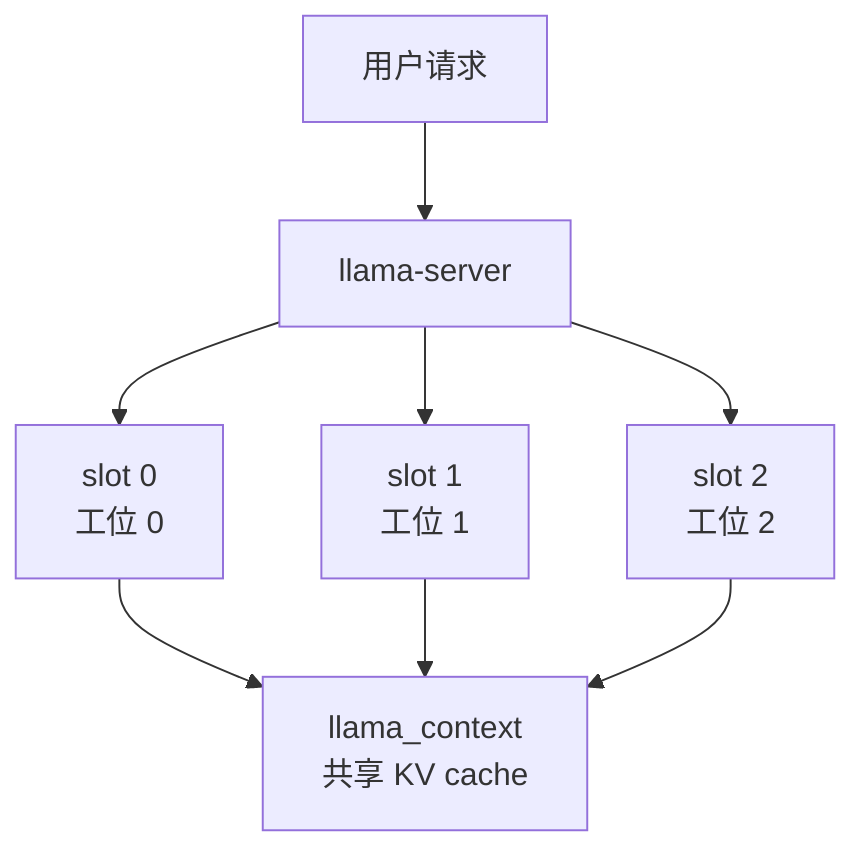
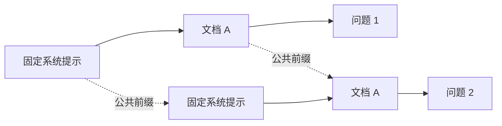
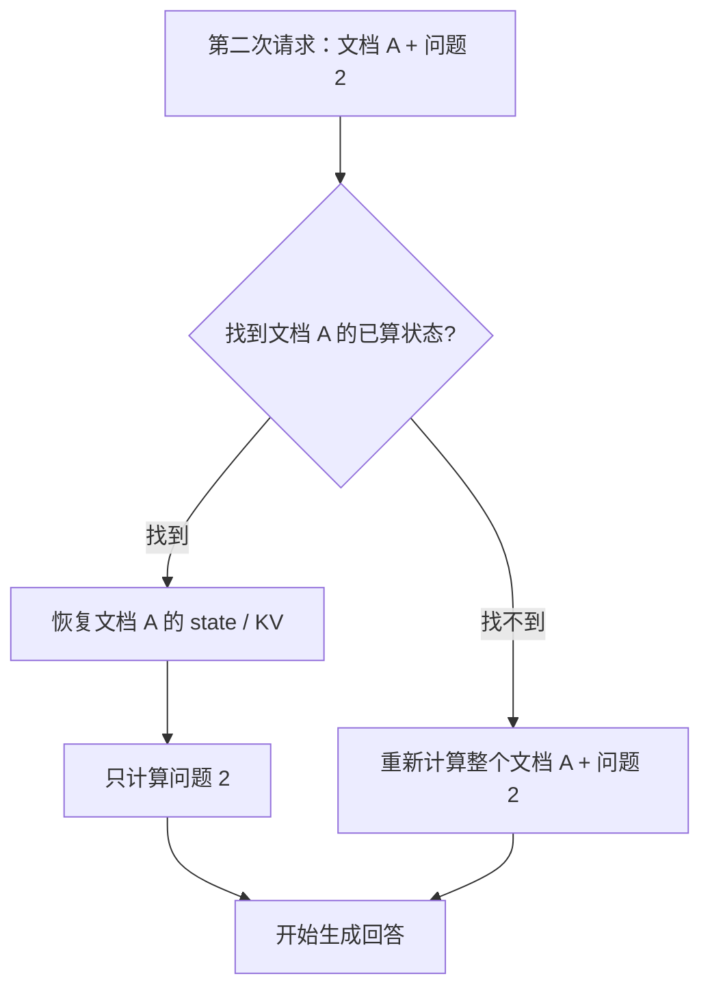
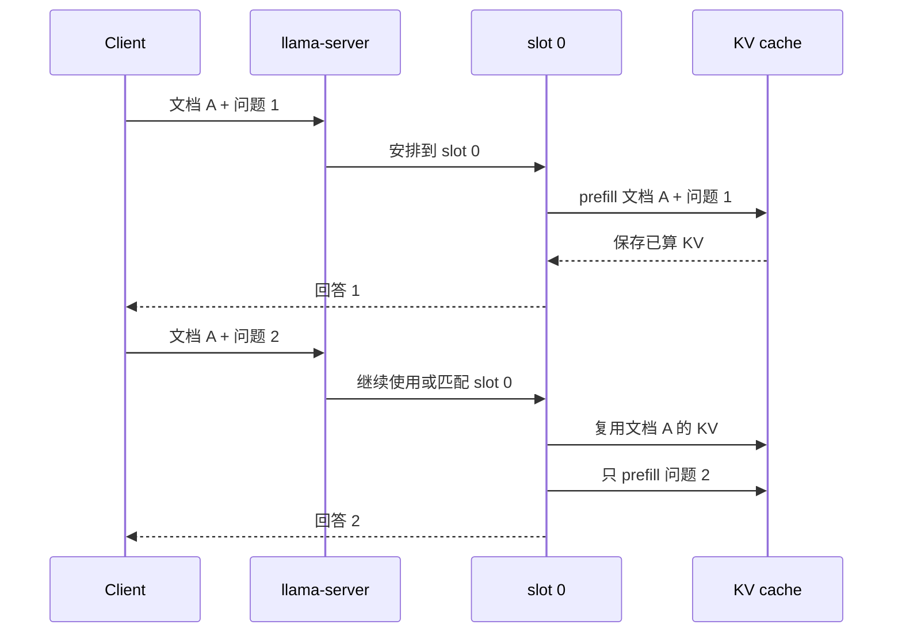
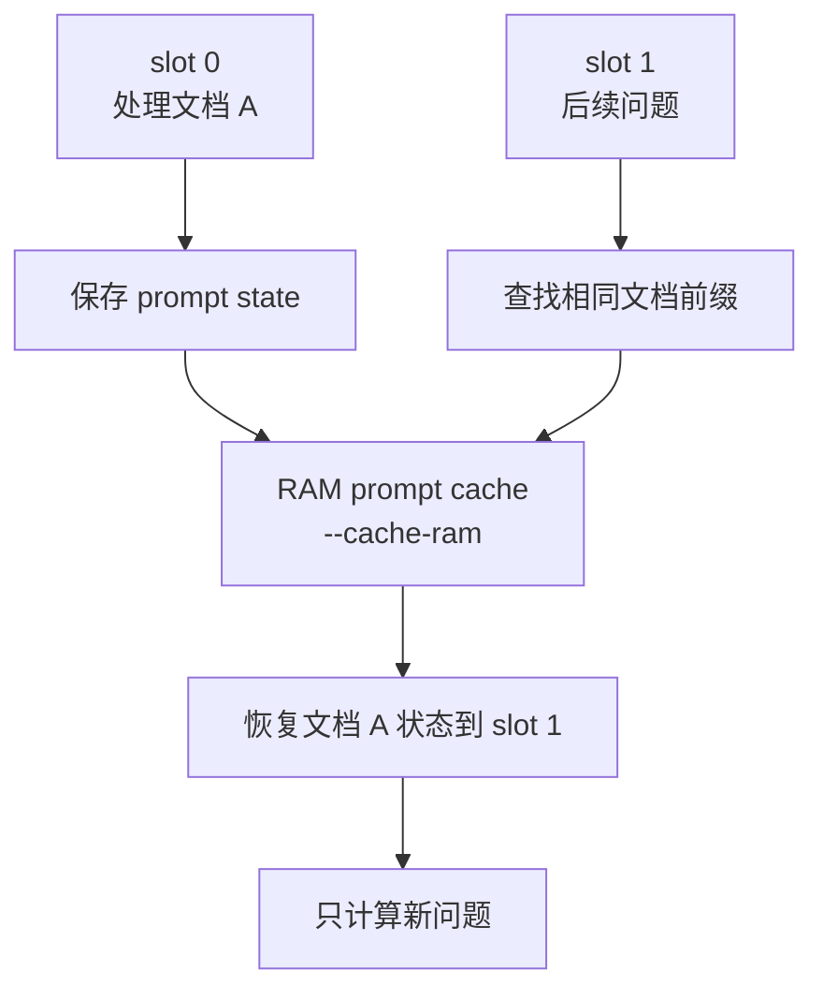
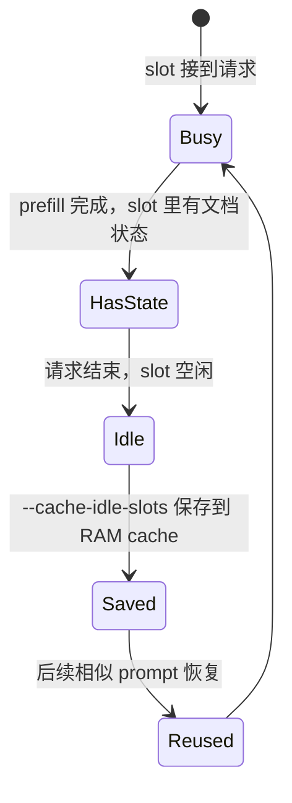
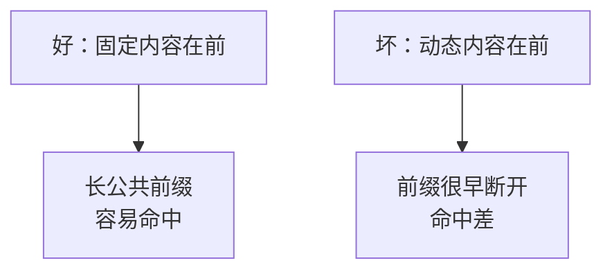

# llama.cpp Slot、Prompt Cache 与同文档反复提问图解

日期：2026-09-02

## 这篇文档讲什么

这篇文档用图解释 llama.cpp server 里的 `slot` 到底是什么，以及 `--cache-prompt`、`--cache-ram`、`--cache-idle-slots`、`--metrics` 在“同一个长文档，后续反复提问”场景里怎么工作。

目标场景：

```text
第一次：文档 A + 问题 1
第二次：文档 A + 问题 2
第三次：文档 A + 问题 3

文档 A 很长，问题很短。
理想情况：文档 A 的 KV cache 只算一次，后面主要只算问题部分。
```

## 1. 先用一个生活类比理解 slot

`slot` 可以理解成 llama-server 里的“工位”。

一个请求来了，server 会把它安排到某个工位上。这个工位会记录：

- 这个请求已经处理到哪个 token。
- 这个请求的 token 历史。
- 这个请求在 KV cache 里占用了哪些位置。
- 采样和生成过程的状态。



通俗说：

```text
slot 不是 KV tensor 本身。
slot 是管理请求状态的座位。
KV cache 是座位背后真正存计算结果的仓库。
```

## 2. 同一个长文档反复提问时发生什么

假设 prompt 长这样：

```text
固定系统提示

文档 A：很长很长...

问题：请总结第一章
```

第二次变成：

```text
固定系统提示

文档 A：很长很长...

问题：请找出关键数字
```

前面大部分 token 完全一样，只有最后的问题不同。



如果 cache 命中，llama.cpp 不需要重新 prefill 整个文档，只需要从问题附近继续算。



## 3. `--cache-prompt`：让同 slot 前缀复用生效

`--cache-prompt` 的作用是：如果新请求和已有请求有公共前缀，就尽量复用已经算过的前缀。



最理想的返回指标应该是：

```text
cache_n 很大
prompt_n 很小
prompt_ms 明显下降
```

## 4. `--cache-ram`：slot 换了也尽量能复用

只有 slot 本身保存状态还不够。因为 server 可能把 slot 分给别的请求，或者多 slot 轮转后原来的热前缀不在当前 slot 里。

`--cache-ram N` 会启用进程内 RAM prompt cache，把 prompt state 放到一个更通用的内存缓存里。



通俗说：

```text
没有 --cache-ram：
    缓存更依赖当前 slot 是否还保留着旧上下文。

有 --cache-ram：
    旧 slot 的上下文可以搬到进程内缓存里，
    后面别的 slot 也有机会恢复。
```

## 5. `--cache-idle-slots`：空闲 slot 不要白白丢掉

`--cache-idle-slots` 的作用是：当某个 slot 空闲时，把它的 prompt state 保存到 RAM prompt cache。

它依赖 `--cache-ram`。没有 `--cache-ram`，它没有地方保存。



形象理解：

```text
slot 像会议室。

不开 --cache-idle-slots：
会议结束后，白板可能直接擦掉。

开 --cache-idle-slots：
会议结束前，先给白板拍照存档。
下次讨论同一个文档，可以把白板恢复出来。
```

## 6. `--metrics`：不加速，但帮你证明是否真的命中

`--metrics` 打开 `/metrics` 指标接口。它不负责加速，但做 benchmark 时很重要。

```mermaid
flowchart LR
    Server[llama-server] --> Resp[单次请求返回 timings]
    Server --> Metrics[/metrics<br/>Prometheus 指标]

    Resp --> A[cache_n / prompt_n / prompt_ms]
    Metrics --> B[prompt_tokens_total]
    Metrics --> C[prompt_tokens_cached_total]
    Metrics --> D[prompt_seconds_total]
```

你应该同时看单次请求返回和 `/metrics`：

| 位置 | 指标 | 用途 |
|---|---|---|
| 请求返回 | `cache_n` | 本次复用了多少 prompt token |
| 请求返回 | `prompt_n` | 本次实际重新算了多少 token |
| 请求返回 | `prompt_ms` | 本次 prefill 花了多久 |
| 请求返回 | `predicted_ms` | decode 花了多久 |
| `/metrics` | `prompt_tokens_total` | 累计处理 prompt token |
| `/metrics` | `prompt_tokens_cached_total` | 累计缓存命中 token |
| `/metrics` | `prompt_seconds_total` | 累计 prompt processing 时间 |

## 7. 同文档 QA 的推荐参数组合

基础推荐：

```bash
llama-server \
  -m model.gguf \
  -c 8192 \
  -ngl 99 \
  --flash-attn on \
  -b 2048 \
  -ub 512 \
  --cache-prompt \
  --cache-ram 4096 \
  --cache-idle-slots \
  --metrics
```

如果文档很长，`-c` 要按这个公式估：

```text
ctx size >= 文档 tokens + 问题 tokens + 预期回答 tokens + 安全余量
```

如果文档是 12k tokens，回答最多 2k tokens，`-c` 至少应高于 14k，实际建议 16k 或 20k 以上。

## 8. 请求格式也会影响命中率

推荐把稳定内容放前面，变化内容放后面：

```text
系统提示：固定

文档：固定

问题：变化
```

不要这样：

```text
请求时间：2026-09-02 10:31:12
随机 request id：abc123

系统提示：固定

文档：固定

问题：变化
```

因为 cache 是 token 前缀命中。前面插入动态内容，会让公共前缀从一开始就断掉。



## 9. 参数带来的负面影响

这些参数不是永远正收益。

| 参数 | 正收益场景 | 可能负面影响 |
|---|---|---|
| `--cache-prompt` | prompt 有长公共前缀 | 无公共前缀时收益低，仍有少量管理开销 |
| `--cache-ram` | 多次复用长 prompt，或多 slot 轮转 | 占用 RAM，太小会频繁淘汰，太大可能挤压系统 |
| `--cache-idle-slots` | 空闲 slot 的上下文后面还会复用 | 空闲时保存 state 有开销，需要 RAM cache |
| `--metrics` | benchmark、线上观测 | 极小观测开销，主要是暴露指标端点 |
| `--cache-reuse` | 非严格前缀、chunk 可复用 | 更复杂，可能带来额外调度/查找成本，应单独测 |
| `--slot-save-path` | 需要显式入盘/恢复 | 文件 I/O 和手动 save/restore 流程成本 |

负提升最常见于：

```text
第一次冷请求
prompt 没有公共前缀
长输出 decode 占主导
cache-ram 太小导致频繁淘汰
动态内容放在 prompt 前面导致命中失败
```

## 10. 怎么判断是否真的提升了 TTFT

看单次请求：

```text
cache_n ↑
prompt_n ↓
prompt_ms ↓
TTFT ↓
predicted_ms 基本不变
```

看整体实验：

```text
request_hit_rate = 命中请求数 / 可命中请求数

token_hit_ratio = cached_tokens / total_prompt_tokens

saved_prefill_ms = baseline_prompt_ms - cached_prompt_ms

net_gain_ms = saved_prefill_ms - restore_or_cache_overhead_ms
```

最终判断不要只看“第二次请求变快了”。至少要看：

| 判断项 | 合格标准 |
|---|---|
| p50 TTFT | 应明显下降 |
| p95 TTFT | 最好下降 30% 以上 |
| token hit ratio | 同文档 QA 应该很高 |
| prompt_ms | 应显著下降 |
| decode TPS | 不应明显下降 |
| 冷请求 | 不应有严重负提升 |

## 11. 对这个场景的最终建议

如果你的主要场景是“同一个长文档，反复提问”，第一版建议这样做：

```text
1. 文档固定放在 prompt 前部。
2. 问题放在 prompt 尾部。
3. 开 --cache-prompt。
4. 开 --cache-ram，先从 4096 或 8192 MiB 测。
5. 开 --cache-idle-slots，避免空闲 slot 状态丢失。
6. 开 --metrics，用数据确认命中。
7. 暂时不要混入 --cache-reuse，后面单独 A/B。
8. 如果需要跨进程或重启后复用，再测 --slot-save-path。
```

最短命令：

```bash
llama-server -m model.gguf -c 16384 -ngl 99 --flash-attn on \
  -b 2048 -ub 512 \
  --cache-prompt --cache-ram 8192 --cache-idle-slots --metrics
```

## 12. 参考来源

- llama.cpp server README: llama.cpp/tools/server/README.md (`../llama.cpp/tools/server/README.md`)
- llama.cpp server development docs: llama.cpp/tools/server/README-dev.md (`../llama.cpp/tools/server/README-dev.md`)
- llama.cpp prompt cache implementation: llama.cpp/tools/server/server-task.cpp (`../llama.cpp/tools/server/server-task.cpp`)
- llama.cpp server context implementation: llama.cpp/tools/server/server-context.cpp (`../llama.cpp/tools/server/server-context.cpp`)
- llama.cpp public state APIs: llama.cpp/include/llama.h (`../llama.cpp/include/llama.h`)
- 本地 realistic cache smoke 结果：[llamacpp_realistic_cache_smoke_summary.md](./llamacpp_realistic_cache_smoke_summary.md)
