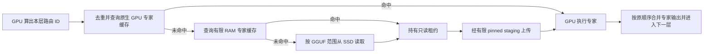

# 借鉴 Strata 的 llama.cpp 超内存模型推理实现计划

日期：2026-11-09。状态：源码调研与实现计划，尚未修改引擎、更新 checkout 或运行新 benchmark。

目标目录：`C:/Users/Administrator/Documents/Code/my-code/lm-llama/llama.cpp`。参考目录：同级 `strata`。本次用户明确指定了目标目录，后续按此执行，不沿用工作区旧文档中把全部实验写入 `try-out/llama.cpp` 的约定；现有 KV/prompt cache 实验与本项目分开。

## 1. 建议采用的路线

以 **llama.cpp b12211 的原生 GPU 专家缓存为基础，增加文件专家源、有限 RAM 专家缓存及受控的读盘缓冲**。保留 llama.cpp 的 GGUF、计算图、量化算子和服务接口。首先完成 Windows + CUDA + 单 GPU 的 MoE 模型，再扩展稠密模型逐层流式加载及其他后端。

第一阶段的交付是：同一份、同一量化、完整路由的 MoE 模型，即使完整权重超过物理 RAM 与显存之和，仍能在明确的 RAM/VRAM 预算内完成 prompt 和持续生成。性能另设验收，不预先承诺达到 Strata 的吞吐。

llama.cpp 已有 mmap，文件映射本身不要求全部权重驻留物理 RAM；在合适配置下，原生也可能靠操作系统分页运行超内存模型。本次要补的是可控制的驻留集、按专家读取、可测量的 SSD 路径和稳定延迟，不能把“首次支持超过内存”作为未经实测的宣传结论。

本项目处理**模型权重**。既有 LMCache / Prefix State Blob / L0-L2 文档处理 KV 或 prompt 状态，不直接解决权重容量；本文用 GPU 专家缓存、RAM 专家缓存、文件源命名，避免复用 L0-L2 造成混淆。

## 2. 已核实的起点

### 2.1 版本与已有能力

| 对象 | 本轮核实结果 | 对计划的影响 |
|---|---|---|
| 目标 `llama.cpp` | `f5e85d43a048f3d5adefb4c5e29867d8077fba62`，提交日期 2026-08-28，工作树干净 | 没有 `src/llama-moe-cache.cpp`，不宜直接在此重写缓存 |
| 参考 `strata` | `f33c8c30588ff00e24b6b63bad0bf6a14da19081`，提交日期 2026-11-09，工作树干净 | 本轮读取的是此版本，不与旧实验二进制混用 |
| 交接报告 llama.cpp | b12211，`7d7f0287530bc8981690f361d8c1627dbae1c99a` | 本地有完整匹配源码，建议作为第一实施基线 |
| 交接报告 Strata | engine 0.1.58，`8a42a9457db62568d1663c8c1bcc01cfffae5355` | 历史测量只归属于此版本 |

上游 GPU 专家缓存已于 2026-10-07 合并，见 [PR #29887](https://github.com/ggml-org/llama.cpp/pull/29887)；[官方缓存说明](https://github.com/ggml-org/llama.cpp/blob/7d7f0287530bc8981690f361d8c1627dbae1c99a/docs/moe-cache.md)列出 `--moe-cache-mib`、`--moe-cache-cpu-share`。已查看 [相关 RFC #24528](https://github.com/ggml-org/llama.cpp/discussions/24528)，不能把其他分支的设计当作当前上游实现。

建议实施时在目标仓库建立独立开发分支，从固定 b12211 提交开始；保留原提交及原分支，不用 reset 覆盖历史。不在计划阶段自动更新或混入旧 `try-out` 改动。未来若改用更新上游，先重新核对本文接入点，再固定一个新基线。

### 2.2 本机与模型

本轮只读查询：操作系统可见 RAM **87.351 GiB**；GPU 0 为 RTX 5080，驱动报告 **16,303 MiB**；GPU 1 为 RTX 5060 Ti，**16,311 MiB**。两卡与 RAM 合计约 **119.201 GiB**。这与交接报告的“单卡实验条件”不同，正式实验必须记录实际选用的设备 UUID，首版只选 5080。

现有模型路径：`C:/Users/Administrator/Documents/Code/tasks/strata-lab/data/models/unsloth-UD-Q5_K_XL/`。

| Qwen3.8-Flash-Next UD-Q5_K_XL 项目 | 本轮 GGUF 头部与文件大小检查 |
|---|---:|
| 六片完整 GGUF | 147.416 GiB |
| 路由专家存储区间 | 91.614 GiB |
| PLE 表存储区间 | 50.664 GiB |
| 其他张量存储区间 | 5.127 GiB |
| 主模型结构 | 48 层、每层 512 专家、每 token 选 10 个 |

各张量组按 GGUF offset 相邻区间统计，含区间对齐；不是实测进程内存。第一层 gate/up 是 Q5_K，down 是 Q8_0，因此不能用模型包名推断所有张量格式，也不能把每个专家大小设成统一常量。

该模型总文件大小确实超过本机 RAM 与两卡显存之和，但 PLE 每次只取少量行；这不意味着每个 token 都需要读取 147 GiB。专家单独约 91.61 GiB，也不能声称它单独超过 RAM 与单卡显存之和。验收需另外证明路由工作集超出配置的两级专家缓存，且稳态有真实专家文件读取。

交接报告的 IQ2_XS 对照为 63.354 GiB，全专家约 33.02 GiB 驻留 RAM；它适合做正确性和原生速度基线，**不能作为超过 RAM 的能力证明**。本轮未重新验证那些历史测速。

## 3. 具体借鉴什么

| Strata 中的机制 | llama.cpp 中的采用方式 |
|---|---|
| `ExpertSource` 隐藏权重来源 | 引入小型权重读取接口，把文件偏移、RAM 命中、缓冲寿命集中管理 |
| `FileExpertSource::blob()` 先找 RAM，再读文件 | 在原生 GPU cache miss 后增加 RAM cache，再落到按需文件读取 |
| `pin_cache_complement()` 只保留部分专家 | RAM 按字节预算分配，初版允许 GPU/RAM 重复，后续再研究互补驻留 |
| `read_direct()` 合并相邻区间、对齐读 | 从原 GGUF 分片按 tensor role 的范围读取，不强制转换完整模型 |
| staging 与 `note_async_read()` | 每份暂存数据持有到 H2D 完成；每个 GPU 槽保留到计算完成 |
| 有限队列与预取 | 先做真实路由的并发读取，再根据测量增加预测预取 |
| 低 RAM 模式及内存余量 | 启动前输出预算明细，达不到最小工作集就给出准确错误 |

保留 llama.cpp 的原生缓存替换策略作为首版 GPU 策略；RAM 初版用按字节计费的 LRU/分段 LRU。不要同时移植 Strata 的 CPU 专家线程池、GPU doorbell、融合内核、MTP、采样和专用模型执行器。它们涉及另一套算术与调度，并非容量功能的前置条件。

直接移植少量代码时逐文件核对许可证，保留原有版权及许可通知；默认借鉴接口和算法，按 llama.cpp 的结构重写适配部分。

## 4. 模块与运行流程

### 4.1 权重读取接口

拟新增内部模块 `llama-expert-store.{h,cpp}`，公开行为尽量保持为：注册张量来源、获取一组专家的可读租约、在异步使用完成后释放租约、查询统计。以下是设计契约，不是已存在的函数：

- `register_tensor`：记录模型身份、GGUF 分片、64 位文件偏移、tensor type、shape、stride、expert axis、各 role 的字节范围及合法 padding。
- `acquire`：输入层及去重专家 ID，输出各 role 的只读地址与租约；命中 RAM 时复用，否则从文件读入有限缓冲。等待、错误和排队上限归模块管理。
- `release_after`：把租约释放绑定到实际消费完成事件；同步实现可直接在完成后释放。
- `stats`：返回 RAM 命中、文件逻辑字节、对齐后读取字节、等待时间、缓存峰值等。

两个 Adapter：现有内存来源与 GGUF 文件来源。不开启功能时仍走原代码，避免把新增抽象强加到默认热路径。GGUF 文件句柄和索引由模型持有，不能借用短命的 model loader 对象；缓存与在途租约由 context 持有。首版只支持一个 context，后续共享只读数据时另做同步设计。

索引必须支持同一专家的 gate/up/down 位于不同张量乃至不同分片；支持 fused gate-up 的描述，但第一验收只开放验证过的布局。不能把三块权重假定为文件上的连续 blob，也不能把 Strata pack 的布局直接套到 GGUF。

### 4.2 一个 token 的路径



初版 `--moe-cache-cpu-share 0`，所有所选专家仍在 GPU 上计算。缓存策略只改变权重位置，不改变 top-k、路由系数或计算精度。未来开启 CPU miss 时必须让 CPU 也通过租约访问有效数据；在此之前拒绝该组合，防止退回直接访问整份映射。

### 4.3 loader 与 ggml 的接入方式

先采用侵入较小的方式：保留只读文件 mapping 作为张量地址与调度元数据的兼容层，专家数据的实际读取全部经过 store。**虚拟映射大小不等于 RAM 驻留量**，无需为了避免完整物理分配而立即重写全部 ggml buffer 体系。

必须同时完成：

1. loader 为受控专家收集文件区间，不预触页、不对整个专家区 mlock/CUDA register、不复制到完整 CPU/CUDA_Host buffer、不做全模型 CPU repack。
2. 原生 GPU cache fill 的 `w->data + offset` 改为从租约取数据。
3. `sched_copy_experts()` 的一般上传路径同样接 store；受控专家不能在回调未识别时悄悄退回通用整张量 copy 或 CPU 算子。
4. 对 source、view、alias 做统一查找，保留 mapping 生命周期；启动 dry-run、graph reserve、tensor validation 也不能触发全量读取。全量校验若显式开启，要采用有界流式校验并单独报告耗时。
5. 对不支持的 tensor layout、后端或图分支，在执行前报错。禁止把未分配的地址伪装成普通 CPU 权重指针。

这是第一版的明确取舍。Windows 中 mapping 与非缓冲读取的组合可能降低 I/O 并行度；需实测后再决定是否引入无 mapping 的外部存储 buffer，或生成可选的专家索引/pack。后者不是首版必须的全量转换步骤，也不能用一份额外模型副本掩盖磁盘成本。

### 4.4 I/O 与失败处理

Windows 使用单独只读句柄，`FILE_FLAG_NO_BUFFERING | FILE_FLAG_OVERLAPPED`，配合有界请求队列。按实际设备/卷的要求处理 offset、长度和缓冲对齐，不能照搬固定 4 KiB 作为通用保证；文件尾短读只接受明确落在 padding 的部分。依据 [Microsoft 文件缓冲文档](https://learn.microsoft.com/en-us/windows/win32/fileio/file-buffering)。

b12211 Windows 的 `llama_file` 通过普通文件句柄和同步 `ReadFile` 读取。其 `use_direct_io` 参数未在该构造分支打开 NO_BUFFERING 句柄；不能凭 `--load-mode dio` 或 `has_direct_io()` 的名字认定已有运行期非缓冲专家读取。新增读取使用位置参数，不共享可变 seek 指针。

缓冲状态至少区分：空闲、读盘中、可上传、上传中、可复用。缓存条目还需计数正在被计算使用的租约。所有在途 RAM buffer、对齐 scratch、请求描述符和 GPU 槽均计入预算；缓存满时施加背压，不无限增加队列。

初版同步读取并等待上传，确认正确后再双缓冲。异步阶段必须验证：读取完成后才上传，上传完成后才复用 host buffer，消费完成后才覆盖 GPU 槽。CUDA Graph 使用固定地址的缓冲；不能在 capture 内执行文件 I/O，也不能让捕获的地址指向已回收数据。

现有 copy callback 的 bool 只表示是否处理，不能自然表达 I/O 失败。接入时增加明确的错误状态传递，必要时提供兼容旧 callback 的带状态版本。错误不能解释成“未处理，走旧路径”，也不能把异常穿过 C 回调。短读、取消或设备失败后停止当前 graph，撤销未完成缓存映射，排空在途操作；部分更新的会话状态要失效或明确重置后才能复用。

## 5. 内存预算与 prompt 路径

### 5.1 分开计算 RAM 与 VRAM

不能仅用“RAM + VRAM 大于某个数”决定是否能跑。建议先要求显式预算，稳定后再自动估算。

```text
RAM_required = host 常驻权重与运行时
             + RAM 专家缓存
             + pinned staging + 对齐读取 scratch + 有界在途数据
             + PLE 行缓存与输入暂存
             + CPU 上的 KV/循环状态/工作区（如果有）

VRAM_required = GPU 常驻非专家权重
              + KV + GDN/其他循环状态 + graph/计算工作区
              + GPU 专家缓存
              + prompt 临时专家区（若走一般上传路径）
              + backend/driver 余量
```

已有 RAM 和 GPU 缓存中的重复权重分别计费。首版不追求完全互斥驻留，避免提前引入“GPU 淘汰后必须回写 RAM”的复杂交换协议；原始 GGUF 始终是只读事实来源。

根据当时可用 RAM、Windows commit 余量、pin 能力及选中卡的可用显存取最紧约束。提供实际分配台账与进程/系统测量；驱动和系统文件缓存的开销单列，不能承诺只靠引擎参数限制整台共享电脑的所有物理内存。

建议新增参数名称，均为草案而非当前可运行选项：

| 草案参数 | 含义 |
|---|---|
| `--expert-store off\|file` | 显式选择受控文件专家源，默认 off |
| `--expert-ram-mib N` | RAM 专家缓存硬预算 |
| `--expert-staging-mib N` | pinned 与读取 scratch 的合计预算，打印内部拆分 |
| `--expert-io-mode direct\|buffered` | direct 用于受控容量验收；buffered 明示由 OS 缓存，不宣称同等内存约束 |
| `--expert-io-depth N` | 在途读取数量上限 |
| `--weight-row-cache-mib N` | PLE/其他已支持表的有限行缓存 |

GPU 继续用现有 `--moe-cache-mib`，不另造同义预算。首版遇到 pin 不足或 direct 不支持时明确失败并输出可用参数建议；用户显式选择 buffered 才进入该模式，不能静默降级后仍报告 direct 验收通过。

### 5.2 prompt 不能遗漏

b12211 的 `get_slot_map()` 在超过 32 行，或某个 cache group 容纳不了最坏情况的路由并集时，返回空，走另一条路径。该路径虽只上传所选专家，但目标 tensor/工作区仍可能按整层专家规模预留；“少复制”不自动等于“少分配”。

分两步实现：

1. **正确性阶段：** 根据每个布局组的实际槽数、top-k 与零槽余量计算安全 microbatch 上限。必要时从 ubatch=1 起步。长 prompt 仍可完整处理，只是分成小块；不得丢 token，也不能降低 expert_used_count。这一步不作为高效 prefill 完成的标志。
2. **可用版本：** 接通一般 `sched_copy_experts()` 的文件读取，同时把最大一层暂存与 graph reserve 计入预算。若放不下就回到安全的小块策略；需要更高吞吐时再用紧凑专家暂存和局部 ID 重映射，保持每个 token 的专家及求和语义不变。

prefill 读取先对本 microbatch 的专家去重并尽量复用，同一层的连续区间可以合并。设定合并字节上限并统计读放大。RAM 缓存采用低优先级 admission 或绕过策略，避免一次长 prompt 扫描挤掉全部 decode 热专家。

prefetch 只在已知路由时保证正确；下一层真实路由依赖当前层输出，不能当作已经知道。预测只能增加读取，不能改变计算的专家集合，且必须有队列、字节和无效预取上限。

## 6. PLE 与稠密模型的范围

### 6.1 Qwen3.8 PLE

现有模型代码用 `TENSOR_READ_LAZY` 加 `ggml_get_rows` 读取 PLE；这能按需缺页，但不是可控的行缓存。首个端到端原型可暂时保留 lazy PLE 并如实报告映射页占用；**完成 Qwen3.8 的受控内存验收前，必须接入有限 PLE 行缓存或给出其不可控占用的明确限制，不能把 mmap 地址规模当成固定的内存成本。** 本计划选择前者作为交付要求。

复用 `llm_graph_input_qwen4exp_ple` 生成的行 ID，不重新实现 n-gram/hash 和序列历史逻辑。按 ID 读取原始量化行，填入有界的紧凑输入 tensor，并用局部行 ID 交给原有 gather/dequant 路径。保留原 dtype、head 顺序、重复行、EOS/多序列历史处理。PLE 行缓存与专家缓存分开计费。

KV、GDN 与 PLE 历史状态首版保持原生驻留方式；它们计入预算。首版关闭 MTP、并发、LoRA、视觉及多 GPU。后续每个功能独立验证后开放，不能假定“权重是只读”就没有 graph/state 交互。

### 6.2 稠密模型

MoE 首版不等于所有 llama.cpp 模型都可受控运行。稠密模型另需逐层或逐算子预取、双 GPU 缓冲，以及当单层大于预算时的分块矩阵计算。优先复用文件范围读取、租约和预算模块，另设计层执行接口。

稠密 decode 每 token 基本访问所有层权重，缺少 MoE 的专家稀疏性。若每 token 必须从 SSD 读取 D 字节、实测有效读取带宽为 B，则仅 I/O 就给出 `token/s <= B / D` 的乐观上界。例如 D=80 GiB、B=4 GiB/s 时上界为 0.05 token/s，尚未计入传输与计算；这是算例，不是本机测速。

MoE 同样报告每 token 的真实文件 miss 字节。先用该量与有效带宽判断是否值得继续优化，不能用 SSD 顺序带宽或某个 RAM 命中率直接预测最终吞吐。

## 7. 分阶段实施与出口条件

各阶段按可独立评审的修改集推进；表中的检查是未来待执行内容。阶段完成后记录源码 SHA、构建参数、运行参数、结果与失败日志。

| 阶段 | 实施内容 | 退出条件 |
|---|---|---|
| P0 固定基线 | 在目标仓库建立 b12211 开发分支；同源码构建原生；导出模型张量索引和内存计划；记录机器、磁盘、commit、设备 UUID | IQ2_XS 原生可复现；Q5 mmap 基线完成或留下明确失败证据；不引用旧二进制代替新基线 |
| P1 文件读取基础 | 文件索引、positioned read、Windows 对齐 direct reader、有限 staging、同步租约；复用现有 ggml 量化信息 | 选定及随机专家的各 role 与 GGUF 原字节一致；分片/EOF/损坏/取消测试通过；缓冲总量受控 |
| P2 loader 与 decode | 禁止专家全量加载/预取/repack；接原生 MoE cache miss；接错误传递与受控 source 检查；单卡、CPU share=0 | 小批推理正确；GPU cache 命中不读文件；RAM 命中不读文件；强制双 miss 能继续生成；无整专家 RAM 分配 |
| P3 RAM cache 与寿命 | 加有限 RAM 缓存、事件绑定的 lease、双缓冲和队列背压；同步路径保留为对照 | 小预算下反复淘汰无错；人为延迟 I/O/H2D 仍正确；取消与退出可回收全部资源 |
| P4 完整 prompt 与 PLE | 一般专家上传路径接 store；安全 microbatch 计划及显存预留；PLE 有限行缓存；验证加载/预热也遵循预算 | 1/32/33/512 行入口与长 prompt 均能处理；跨阈值无旧路径泄漏；32K 配置下实际 8K prompt + 512 token 完成，内存台账闭合 |
| P5 容量与速度验收 | Q5 实际超物理容量试验；缓存预算扫描；稳态 SSD miss 证据；正确性和原生回归 | 满足第 8 节；形成可用单卡 MoE 版本，未通过就不能宣称目标已实现 |
| P6 受测量指导的优化 | 读区间合并、prefill cache admission、热点预热、预测预取、可选互补驻留/CPU miss；逐项消融 | 端到端 TTFT 或 decode 延迟确实改善，且容量与正确性无退化 |
| P7 扩展 | 先双卡与多 context，再 MTP/LoRA/其他模型布局及后端；另立稠密逐层流式里程碑 | 每个组合独立验证；稠密路径在同权重下通过容量及数值检查，并报告 I/O 上界 |

第一轮开始实现时只执行 P0-P2，尽早验证两个最大技术风险：加载过程是否仍偷偷驻留全部专家，以及原生 cache 图能否安全消费文件读取结果。P3-P5 是可用版本必需工作，不能用短句 decode 演示代替。

## 8. 验收方法

### 8.1 对照矩阵

| 组别 | 用途 |
|---|---|
| 同提交原生，mmap + 调优后的 GPU cache | 主要公平基线；验证原生是否已经能跑、慢在哪里 |
| 改造版功能关闭 | 默认路径与性能回归检查 |
| 改造版 file store，同步读取 | 验证机制和数值，剥离并发影响 |
| 改造版 file store，RAM cache + 异步读取 | 完整方案 |
| 固定版本 Strata，匹配其低 RAM 模式 | 外部系统参考，质量/内核不同，不作为数值等价 oracle |

IQ2_XS 用于能完整驻留时的回归和强制小缓存；Q5 用于真实容量验证。每次对照使用同一份量化与模型 hash；不拿 IQ2 的速度对比 Q5 宣称优化。保留完整 top-k，关闭 MTP、prompt KV 复用和多请求并发，使用独立调参提示及固定正式提示。

### 8.2 正确性

- 每种实际出现的量化/role/布局验证文件偏移及读取字节；覆盖重复 ID、最末专家、fused gate-up、跨分片索引、不同层尺寸。暂不支持的布局应明确拒绝。
- 用 teacher forcing 对比同一 token 序列下的 logits，缓存状态覆盖全命中、RAM miss、SSD miss、淘汰再读和强制慢 I/O。源字节要求完全一致；数值阈值按现有 backend 测试的 dtype/op 容差提前固定，若切换 kernel 则另外解释，不能事后放宽。
- 记录 greedy 输出、最大/均方 logits 差异及固定评测文本 perplexity。单纯“回答可读”不算数值通过，也不因浮点近似默认要求所有后端逐位一致。
- 长 prompt、context 边界、PLE 历史、取消后新请求与 clean shutdown 均验证。MTP 在首版明确关闭。

尽量扩展既有 backend/模型测试；重型模型试验脚本放工作区 `research`，不为每个内部函数新造一个测试程序。

### 8.3 容量与稳定性

1. 完整 Q5 模型 147.416 GiB 大于 RAM 与两卡总显存；正式第一组只使用 5080。记录运行时可用资源，不能只引用机器标称值。
2. 将专家缓存预算压到专家工作集以下，记录路由去重工作集、RAM/GPU 驻留集合及重复份额。保证稳态在启动之后仍出现专家文件 miss；只统计 PLE 读盘不算专家溢出证明。
3. RAM cache、staging、行缓存、队列等计费对象任何时刻不得超出各自预算；同时报告进程 working set、private/commit、系统 available RAM、文件缓存、锁页与 VRAM 峰值。若匿名内存持续换页，单独标记，不能作为可控权重 I/O 的成功案例。
4. 至少完成一次实际 8K 输入 + 512 输出；多主题请求累积至少 4096 输出 tokens；再持续运行至少 30 分钟并跨请求淘汰，检查内存曲线是否稳定。若因速度未完成，报告未通过，不用更短测试替代。
5. 启动、校验、预热、推理、关闭全程观察，不能只截取稳定 decode 的低内存窗口。预算不足时在加载前尽量失败，并列出最小固定成本与缺口。

### 8.4 性能与物理 I/O

分别记录启动耗时、TTFT、prefill token/s、decode token/s、逐 token 延迟 p50/p95/p99，以及 GPU 命中、RAM 命中、文件逻辑字节、对齐读取字节、实际磁盘读量、I/O wait、H2D 字节/等待和读放大。

软件提交的字节不是 SSD 物理读取字节。优先使用可关联进程与文件的 ETW/DiskIO；整盘性能计数要同时记录空闲噪声，不冒充进程专属 I/O。file direct 与 buffered 的结果分别报告。Windows 的 page faults 总数包括软缺页，不能直接当 SSD 读取次数。

建议按可用资源扫描 RAM cache 8/16/32 GiB 与 GPU cache 2/4/8 GiB，只运行预算检查通过的组合；staging 和 I/O depth 另做小范围扫描。保留原生最优候选作为基线。相同 workload 至少三轮，轮换顺序，记录并报告离群和失败，不只选最快一轮。

功能关闭的目标是吞吐中位数退化不超过 3%；有显著噪声时先改善测量再判断。OOC 先要求可靠完成和预算通过，速度不设未经测量的 tok/s 承诺。P6 的优化至少应让一个预先选定的用户指标改善 10%，且没有关键指标显著退化；这是计划门槛，不是已测收益。

不全局清理用户机器页缓存，不更改系统页文件或停止其他任务。若没有可控冷启动条件，就报告为“新进程/热 OS 缓存”，使用 direct 专家读取和物理 I/O 证据证明容量路径。

## 9. 代码落点与源码依据

以下 llama.cpp 行号以本地 b12211 源码为准，不是目标旧 checkout 的行号。参考源码根目录为 `C:/Users/Administrator/Documents/Code/tasks/strata-lab/llama.cpp-7d7f0287530bc8981690f361d8c1627dbae1c99a`。

| 文件与位置 | 已读到的行为 | 计划修改 |
|---|---|---|
| `src/llama-model-loader.cpp:1423`，`init_mappings` 与 `load_all_data` | mmap/lazy 和张量数据加载 | 导出分片区间，受控专家跳过预取/整张量加载 |
| `src/llama-model.cpp:2011` 附近 | host pointer buffer 与实际分配选择 | 保留只读映射兼容，不把文件专家分配成整块 CUDA_Host；纳入预算/拒绝不支持的 repack |
| `src/llama-moe-cache.cpp:312,424` | 只接受整组 host 权重，按布局分 bank | 受控来源注册与布局检查 |
| `src/llama-moe-cache.cpp:687,794,829` | batch 限制、路由回读、从 `w->data` 上传 miss | 安全 ubatch 与 store 租约、事件、错误处理 |
| `src/llama-context.cpp:2987,3045` | 一般专家复制回调，先利用 GPU cache 再从 host 上传 | 大批读取也走 store，处理 padding、拒绝隐式 fallback |
| `ggml/src/ggml-backend.cpp:2125`，`ggml/include/ggml-backend.h:342` | host-weight copy callback，bool 表示处理与否 | 最小必要的失败传递及受控 source 防护，不重写调度器 |
| `src/models/qwen4exp.cpp:217,1406` 附近 | PLE lazy tensor、`build_inp_ple` gather | 有限行读取和紧凑输入，保留原始 ID 生成逻辑 |
| `src/llama-mmap.cpp:86,129` | Windows 普通句柄和同步读取 | 使用独立 positioned/direct reader，避免给旧 loader seek 接口强加并发 |
| `include/llama.h`、`common/common.h`、`common/arg.cpp`、`common/fit.cpp` | 参数与自动预算入口 | 增加 opt-in 参数、校验和预算解释；最终字段按固定基线核对 |
| `src/CMakeLists.txt`、`tests`、工具文档 | 构建与现有验证设施 | 注册最少的新源文件，复用测试入口，补参数和限制说明 |

Strata 的行号以本轮 `f33c8c...` 为准：

- `include/strata/core/expert_source.hpp:189`：`ExpertSource`、blob/批量读取及异步使用契约。
- `src/core/expert_source.cpp:1716`：GGUF 来源；`:1864,2090`：staging 与异步使用；`:2466,2753`：direct 文件句柄及对齐/合并读取；`:3525`：有限驻留补集；`:4664`：RAM/文件读取选择。
- `include/strata/platform/direct_file.hpp`、`src/platform/direct_file.cpp:167`：PLE 使用的异步 direct file 模块。
- `docs/DETAILS.md:242`：low-RAM 模式、resident budget、mapped 与文件读取政策。

交接资料入口：`C:/Users/Administrator/AppData/Local/Temp/mcode-handoff-strata-qwen38-tutorials-07619f70.md`。历史性能与源码对照：`C:/Users/Administrator/Documents/Code/tasks/strata-lab/fair-compare-20261109/report.md`、`source-review.md`。本计划中的缓存、loader 与调度机制来自本轮源码阅读；收益、稳定性和改造后的峰值内存仍待实施后测量。

## 10. 实施状态（2026-11-10）

- P0–P2 已完成，记录见 P0–P2 实施报告 (`ooc-p0-p2-20261110/RESULTS.zh-CN.md`)。
- P3 已完成：有限 RAM 专家缓存、事件租约、异步双缓冲、背压、同步对照；验证了 RAM 命中不读文件、小缓存反复淘汰、延迟 I/O/消费、取消和异常排空。IQ2/Q5 的全部对比 logits 与原生基线逐项相同。记录见 P3 实施报告 (`ooc-p3-20261110/RESULTS.zh-CN.md`)。
- P4 已完成：一般专家上传接文件 session，测量 GPU graph workspace 并按预算回退 microbatch；PLE 接有限行缓存和紧凑量化输入。1/32/33/512 行入口、32K context 下实际 8K prompt + 512 token、行缓存淘汰/取消恢复和原始 b12211 全量 logits 对比均通过。记录见 P4 实施报告 (`ooc-p4-20261110/RESULTS.zh-CN.md`)。
- P5 实施与验收执行已完成，结论为**受测单卡 GPU 路径限定条件通过**：Q5 147.416 GiB 模型连续约 74.74 分钟、实际 8K prompt、7680 输出，完整 1,907,097,600 个 logits 与原生 GPU 参考逐位一致；RAM/commit 余量、稳态专家物理读取、预算扫描、PPL、context 边界及六轮性能对照均有证据。文件路径更省驻留 RAM，但本机吞吐低于使用更多 mmap 驻留的原生参考。Q5 默认关闭回归通过；IQ2 原带 GPU 监测的短测未通过 3% 门槛，另行六组配对复核通过。CPU fallback 跨路径数值容差也未通过，均明确保留，不宣称全部配置无条件通过。原生 Q5 参考禁用加载预取并限制测试进程工作集 48 GiB。完整条件、失败及复现入口见 P5 验收报告 (`ooc-p5-20261110/RESULTS.zh-CN.md`)。
- P6 RAM 尺寸分组的实现与本轮验证已完成，但 **+10% 性能出口未通过**：六组交替配对 Q5 decode 中位数从 2.242 增至 2.449 token/s（+9.26%），每次 decode 逻辑读取从 464.107 降至 385.392 MiB（-16.96%），末尾有效载荷/分配从 76.717% 增至 99.997%。RAM 16 GiB 下按三种精确尺寸分配 12875 槽，payload、entry 和组元数据共 17178870320 B，未超预算；PLE 原策略保持。31 次模型运行、相关 CTest 2/2、固定文本 PPL、实际 context 边界和逐位 logits 审计通过。长测完成 8K 提示与 7680 输出，持续 130.72 分钟，首 4096 输出后继续 70.18 分钟；稳态 ETW 保留记录证实专家读取持续，记录内目标进程无 pagefile hard-fault 字节，但循环日志未保留完整捕获前段。长测间歇慢读全部保留，根因未确定，不用历史耗时做因果提速比较。IQ2 +1.07% 的描述性配对区间包含无变化，不能宣称明确收益。静态组间不能借用冷容量；prefill admission、读取合并与 RAM/GPU 互斥驻留仍留待独立消融。完整结果和原有限制见 P6 对比报告 (`ooc-p6-20261110/RESULTS.zh-CN.md`)。未提交或推送。
