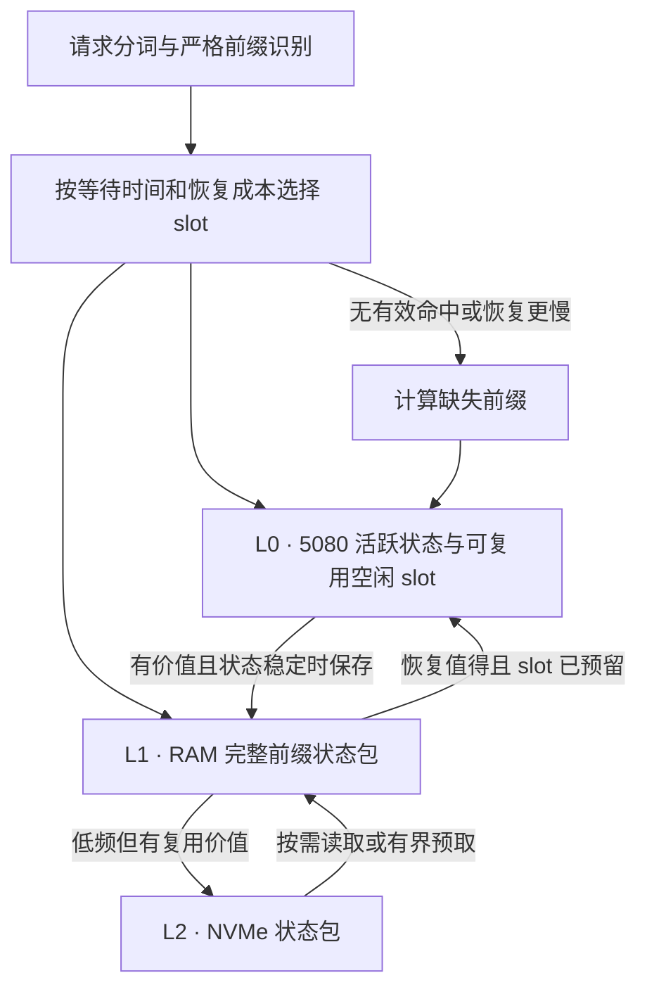

# 面向本机 llama.cpp 的工作集驱动多级缓存设计

日期：2026-09-11。范围：本机 Qwen3.8-27B GGUF、coding-agent / 多会话长前缀复用。本文是设计与容量推导；本轮读取了硬件、GGUF 元数据、历史实测和源码，没有运行新的推理性能测试。

建议先实现和验证 **L0 活跃 GPU 状态 + L1 有预算的 RAM 前缀状态缓存**，在真实工作集超过 L1 后引入 **L2 NVMe 完整状态包**。核心目标是降低重算与缓存搬运占用的服务时间，进而改善 TTFT 和请求吞吐。缓存设计必须把混合模型的循环状态检查点算进去。

## 1. 硬件与版本边界

| 项目 | 本次核对结果 | 对设计的影响 |
|---|---|---|
| 主 GPU | RTX 5080，约 16 GiB 显存 | 承担主推理；模型权重、活跃 KV、循环状态、计算缓冲和显示占用共同竞争容量 |
| 第二 GPU | RTX 5060 Ti，约 16 GiB 显存 | 优先评估独立服务副本；跨卡状态仓库只是备选实验 |
| 主机内存 | DIMM 合计 88 GiB；系统可见约 87.35 GiB；初次读取可用约 38.3 GiB | L1 从 8 GiB 起步，评估 16 GiB；不能把总内存当可用预算 |
| CPU | Core Ultra 7 270K Plus，24 核/24 线程；系统报告 L3 36 MiB | CPU 负责分词、索引、序列化与 I/O；CPU L3 不足以容纳模型或单个循环状态快照 |
| 内存配置 | 4 条 DIMM，配置速率均报告 4000 MT/s | RAM 带宽需实测，不能用高频双条 DDR5 标称值估算 |
| 磁盘 | 4 块 NVMe | 可选独立于系统/模型盘的缓存目录 |
| 候选 L2 盘 | G: 所在 BIWIN X570，初次读取空闲约 341 GiB | 先用 64 GiB 磁盘配额；容量有余地，速度尚未测量 |
| GPU 链路 | 5080 最大报告 Gen5 x16；5060 Ti 最大 Gen4 x8，本次空闲状态当前 x4 | 最大规格和当前空闲状态都不是有效传输带宽；需负载下验证 |
| 运行程序 | `llama-server.exe` b9209 / `0caf2a1d4` | 参数建议以这个实际程序的 `--help` 为准 |
| 源码工作树 | `f5e85d43a048f3d5adefb4c5e29867d8077fba62` | 与实际程序不同，不能把新源码特性当作已部署能力 |

硬件采样见 hardware.json (`llamacpp-tiered-cache-hardware.json`)。本次 5080 已有约 5.8–6.1 GiB 显存占用；下文的全 GPU 驻留方案以服务获得足够显存预算为前提。没有停止现有程序，也没有调整设备配置。

模型文件为 `C:/Users/Administrator/Documents/models/Qwen3.8-27B-UD-IQ3_XXS.gguf`，文件大小 10,934,860,704 bytes，约 10.184 GiB。文件大小不是精确的 GPU 权重缓冲大小；最终预算使用启动日志中的实际分配。

`nvidia-smi topo -m` 在本机失败，P2P 支持和实际拓扑尚未确认。不能把两张 16 GiB 显卡视作一个同速的 32 GiB 显存池。

## 2. 从什么工作集开始计算

至少分别统计四类工作集：

1. **权重工作集**：每个推理步反复使用，优先常驻 GPU。将权重逐步从 CPU/NVMe 搬入，通常会直接伤害 decode。
2. **活跃状态工作集**：当前正在 prefill/decode 的序列所需 KV、循环状态及必要执行缓冲。命中历史缓存并不免除这些状态在执行时的驻留需求。
3. **近期可复用工作集**：会话暂停、工具执行、项目切换后还会回来的前缀状态，适合放 RAM。
4. **长期回访工作集**：超过 RAM 保留窗口，但恢复仍能显著节省 prefill 的项目/会话状态，才考虑 NVMe。

令 `W(Δ)` 为窗口 Δ 内仍有复用价值的不同状态对象的总驻留字节数。缓存对象带共享依赖时，物理容量按对象并集去重；当前原生完整快照没有块级前缀去重，必须按实际条目求和。再记录“复用距离”：两次访问某状态之间经过了多少不同状态字节。请求数或总输入 token 数本身都不足以预测命中率。

从真实 trace 生成按字节计的命中率曲线：L1 分别给 4/8/16 GiB，观察命中率拐点。理想字节 LRU 曲线仅作参照，最终仍要回放实际准入、固定检查点、原生匹配和淘汰行为。

| 工作集位置 | 主要行动 |
|---|---|
| 活跃计算状态能放进 L0，近期会话也可在空闲 slot 保留 | 优先 slot 亲和性和原位复用，避免不必要的保存/恢复 |
| 活跃状态能放进 L0，暂停会话需要 RAM 才放得下 | L1 最有价值：在会话切换时恢复，随后在 GPU 上持续执行 |
| 近期复用集合超过 L0+L1 的有效容量 | 评估 L2；先判断那些额外 miss 是容量、匹配还是检查点问题 |
| 单个活跃请求的状态都放不进 L0 | 历史缓存分层解决不了这个容量问题；需另行调整上下文、并发、量化或模型切分 |

L0/L1/L2 是本项目的逻辑层级，沿用 CONTEXT.md (`../CONTEXT.md`)，不是 CPU 的硬件 L1/L2/L3。

## 3. 当前模型的实际状态大小

本次直接读取 GGUF 元数据得到：

- `general.architecture=qwen35`；`block_count=65`；`nextn_predict_layers=1`。
- 关闭 MTP 时，主模型为 64 层；`full_attention_interval=4`，即 16 层 full attention、48 层 recurrent。
- `attention.head_count_kv=4`，K/V head dimension 均为 256。
- 当前历史测试使用 `-ctk q4_0 -ctv q4_0`。Q4_0 每 32 个值占 18 bytes，含 scale，不能按纯 0.5 bytes/value 计算。
- recurrent 参数：`conv_kernel=4`、`state_size=128`、`group_count=16`、`time_step_rank=48`、`inner_size=6144`。

因此 full-attention KV 的主要线性部分为：

```text
b_KV = 16 layers × 2(K,V) × 4 KV heads × 256 × (18/32)
     = 18,432 bytes/token = 18 KiB/token
```

循环状态浮点数组的主体为：

```text
S_rec = 48 × 4 bytes × [(4-1) × (6144 + 2×16×128) + 128×6144]
      = 156,893,184 bytes = 149.625 MiB
```

源码依据：[模型层分类](https://github.com/ggml-org/llama.cpp/blob/f5e85d43a048f3d5adefb4c5e29867d8077fba62/src/models/qwen35.cpp)、[循环状态形状](https://github.com/ggml-org/llama.cpp/blob/f5e85d43a048f3d5adefb4c5e29867d8077fba62/src/llama-hparams.cpp)、[Q4_0 结构](https://github.com/ggml-org/llama.cpp/blob/f5e85d43a048f3d5adefb4c5e29867d8077fba62/ggml/src/ggml-common.h)。这里使用新源码解释尺寸，并以 b9209 日志交叉验证：日志每个 partial checkpoint 实际为 **149.626 MiB**。

一个 RAM 条目含完整末尾状态和 C 个额外回退检查点时：

```text
S_entry(N,C) ≈ N × 18 KiB + (C+1) × 149.626 MiB + token/位置/布局元数据
```

`C+1` 中的 1 是完整末尾状态自带的循环状态，不能漏算。C 是实际保留的检查点数，不一定等于 `--ctx-checkpoints` 上限。下表忽略少量元数据，K 指 1024 tokens。

| 前缀长度 | 仅 KV | 完整状态 + 2 个检查点 | 完整状态 + 4 个检查点 |
|---:|---:|---:|---:|
| 4K | 72 MiB | 521 MiB | 820 MiB |
| 8K | 144 MiB | 593 MiB | 892 MiB |
| 16K | 288 MiB | 737 MiB | 1,036 MiB |
| 32K | 576 MiB | 1,025 MiB | 1,324 MiB |
| 64K | 1,152 MiB | 1,601 MiB | 1,900 MiB |
| 128K | 2,304 MiB | 2,753 MiB | 3,052 MiB |

历史日志还给出了完整校验点：4,661 tokens，末尾状态 231.647 MiB，带 4 个检查点的缓存条目 **830.152 MiB**，与上述模型吻合。见 原始日志 (`llamacpp-realistic-cache-logs/cache_ram_4096.log`)。

假设为容量误差和条目管理保留 20%，16 GiB RAM 缓存大约可放 22 个“8K、2 检查点”条目，或 14 个“8K、4 检查点”条目，或 9 个“32K、4 检查点”条目。这是尺寸估算，不是命中率预测，也不包含仍在活跃 slot 上的检查点和整个服务的其他内存。

**设计含义：先减少无用检查点与重复完整状态，再扩容；对这个模型，检查点策略就是缓存容量策略。** KV 改量化格式也不会等比例缩小固定的 recurrent 状态。

## 4. 已有收益与尚未证明的部分

| 证据 | 能说明什么 | 不能说明什么 |
|---|---|---|
| 真实源码前缀冒烟：复用约 4,088 tokens，prompt 处理加速约 6.8 倍，请求 wall 加速约 3.9 倍 | 当前模型和请求形态确实能够利用前缀状态 | 不是多级系统相对原生缓存的增益；不是持续并发吞吐或 p95 TTFT |
| 官方 bench：2048-token prefill 约 2045 tok/s；decode 约 58 tok/s | 可作示例成本模型的量级基线 | 不可直接外推满 128K 上下文的 prefill/decode 速度 |
| batched bench：两条序列 aggregate decode 约 99–100 tok/s | 同卡批处理存在吞吐潜力 | 单用户不会因此变成 100 tok/s；也不是新缓存层的收益 |
| 原生 RAM 缓存切换：保存/选择路径约 128–273 ms | 同步保存足以伤害冷请求 TTFT，准入和时机很关键 | 不能把其中一次总耗时当作 PCIe 或 NVMe 的纯传输速度 |
| 手动 slot save/restore：文件读写成功，后续 cached_tokens=0 | 当前磁盘 API 路径尚不能证明该 hybrid 场景可跳过 prefill | “restore 成功”不等于“有效缓存命中” |

来源：[真实冒烟结果](llamacpp_realistic_cache_smoke_summary.md)、[缓存基准结果](llamacpp-cache-benchmark-results.md)、[官方基准结果](llamacpp-official-bench-results.md)。

两项容易误读的历史结果需要明确：

- `llamacpp_131k_tps_sweep_results.json` 设置的是 `ctx=131072`，实际 `prompt_n=78`、输出 200 tokens。它验证了大容量配置下的短输入表现，**没有测满 131K 工作集**。
- 原有 `working_set_pressure` 阶段 RAM 缓存约 2.28 GiB，低于 4 GiB 配額。它体现会话/slot 切换收益，尚未定位 RAM 容量拐点。
- 原冒烟脚本使用非流式请求，记录 `prompt_ms` 和总 wall time；本轮不能把它重命名为客户端实测 TTFT。首个内容 token 时间必须另测。

## 5. 建议的层级与预算



| 层 | 内容和初始预算 | 关键策略 | 当前可用性 |
|---|---|---|---|
| L0：5080 | 权重常驻；活跃 KV/recurrent；按实测分配上下文和计算缓冲 | 优先原位续写；按总 token 容量与序列数分配，不按“有多少会话”预留大上下文 | 原生已有 |
| L1：RAM | 8 GiB 起步，16 GiB 候选；独立预留活跃 slot 检查点、序列化峰值 | 精确前缀、容量有界、成本准入、保护高价值公共前缀 | 原生可作基线；成本准入和严格全局预算需扩展 |
| 搬运缓冲 | 自定义异步路径先试总量 256–512 MiB 的小型 pinned buffer 池 | 复用缓冲；有界 in-flight；及时取消无用预取 | 设计项；原生 cache-ram 不是全量 pinned pool |
| L2：NVMe | G: 候选目录，64 GiB 起步，按收益再扩至 128 GiB | 持久化完整状态包；限制写入和读取并发；支持旁路重算 | 当前 slot 文件接口不能直接视作完整可用方案 |
| 5060 Ti | 另行评估同模型独立服务副本 | 会话固定路由，结合预计排队时间；共享 RAM 层须先验证格式兼容 | 第二副本可用现有运行时部署；共享缓存仍需适配 |

RAM 配额应在模型完成加载和 warmup 后决定。建议自定义控制器以可用内存至少保留约 12 GiB 为初始目标，并扣除并发 checkpoint、在途 I/O 和序列化峰值；不能仅设置 `--cache-ram 16384` 就认为整个服务最多占 16 GiB RAM。对多副本还要分别计入权重宿主副本与执行缓冲。

GPU 预算使用：

```text
M_weights + M_KV_allocated + M_recurrent_allocated
  + M_compute_peak + M_backend + M_other_processes + margin <= M_VRAM
```

例如 32K 总 KV token 容量主要 KV 约 576 MiB；一个逻辑 recurrent 状态约 150 MiB，但实际引擎可能为多序列、回滚、执行临时状态分配更多。必须读取启动分配日志，不能用这两个数替代完整 VRAM 预算。服务压力实验可从总 `-c 32768`、`-np 1` 开始，再比较 `-np 2`；确认 `/slots` 和日志中的实际 `n_ctx` / `n_ctx_seq`，不要假设每个 slot 都独占完整 32K。

Pinned memory 有利于 host/device 异步传输，但可锁页内存有限；是否真正与计算重叠还依赖 stream、硬件和引擎同步点。不要把整个 16 GiB L1 锁页，也不要让 attention 在每个 decode token 都跨 PCIe 访问冷状态。[NVIDIA CUDA 指南](https://docs.nvidia.com/cuda/cuda-c-best-practices-guide/index.html#pinned-memory)

## 6. 访问、准入与淘汰决策

### 6.1 用净节省时间决定是否恢复

```text
TTFT = 排队 + 分词/匹配 + 同步保存旧状态 + 读取/传输/恢复
       + 未命中后缀 prefill + 首 token 生成/交付

Benefit_load = 被省掉的实际 prefill 时间
               - 查找、I/O、传输、恢复及对其他请求造成的额外等待

Expected_value = 预计回访次数 × Benefit_load
                 - 首次保存/序列化/写入成本 - 淘汰其他条目的机会成本
```

加载必须与“原生 L0 当前已能复用多少”比较，不能总与完全冷算比较。长前缀在 SSD 命中，仍可能输给忙碌 I/O 下的重算。恢复失败或超过预算时走正常 prefill，并释放预留对象。

准入从“两次访问再进入长期保留区”与一小段新会话试用区开始；对已知稳定的项目系统前缀可直接准入。为新条目保存状态本身也有成本，因此应在请求开始前结合历史频率/任务类型决定是否值得生成快照，避免先同步保存再丢弃。

淘汰以 `预计净节省毫秒 / 驻留字节` 为基本比较，配合最近访问时间、TTL 和按项目限额。更精细时可计入预计保留时长，使用 byte-seconds 成本。先淘汰一次性长 prompt 和昂贵却极少使用的检查点；不要机械按长度或最近一次访问排序。

### 6.2 slot 路由同时看命中与等待

为可运行的 slot / 服务副本估计：

```text
预计首 token 时间 = 该队列等待 + 对应层恢复 + 剩余 prefill + 首步 decode
```

同一 coding-agent 会话优先回原 slot；存在更短的排队路径时允许迁移。不同 slot 的活跃序列不能被未完成的后台恢复覆盖。对于低负载、单会话，同 slot 热状态通常胜过每轮 RAM round trip。

不要无条件释放全部空闲 L0；也不要永久保留空闲 slot 挤掉活跃请求需要的容量。原生 `--cache-idle-slots` 开/关应作为独立对照，基于负载选择。

### 6.3 按稳定前缀边界保留检查点

该 hybrid 模型的 recurrent 状态代表“到某个位置为止”的计算结果，不能像普通 Transformer KV 那样任意切去后缀并得到过去状态。文本有最长公共前缀，还必须存在足够早、位置合法的恢复点。

优先保留稳定仓库上下文末尾、工具结果分支前、近期分支点等高价值边界。选择 checkpoint 的价值可按“预计被回退命中次数 × 减少的尾部重算时间 / 149.626 MiB”比较。

在 2048 tok/s 的示例量级下，检查点间距 2048 tokens，均匀随机分歧的平均尾部重算约 1024 tokens，即约 0.5 秒；但真实分歧位置常集中在消息边界，均匀假设仅解释取舍。更密检查点减少重算，同时增加容量和保存停顿，应测量而非直接拉满。

本机 b9209 原生配置先保留已验证的 `--ctx-checkpoints 8 --checkpoint-every-n-tokens 2048` 作为对照，再扫 2/4/8 个检查点和 2048/4096/8192 间距。按前缀边界挑选和价值淘汰检查点属于后续代码扩展，不能仅靠现有 CLI 获得。

## 7. llama.cpp 适配层如何做

### 第一阶段：完整前缀状态包

引擎适配层先封装可恢复、版本受控的 opaque state，复用原生序列状态 API 与 server checkpoint 逻辑。RAM 和 NVMe 存储层负责字节、预算、I/O 和索引，不解析 GPU 指针。

状态包至少包含：

- 模型内容指纹、tokenizer / 模板结果标识、adapter、RoPE 参数、K/V dtype、后端/布局版本和引擎构建兼容标识。
- 精确 token IDs、有效前缀长度、序列位置与其他输入依赖；多模态输入如支持，也必须进入缓存键。
- 完整序列状态 blob，以及可用的 partial checkpoint blobs 与 `pos_min/pos_max/n_tokens` 等元数据。
- 内容校验和、版本、依赖关系；临时文件完成后原子发布 manifest。

只对严格相同的有效 token 前缀复用；按项目/用户权限命名空间隔离。文本看起来相同、文件名相同或语义相似，都不足以判定 K/V 可复用。内容在不同前文后的相同文档也不能当作同一 KV chunk。

引擎 API 调用仍在引擎允许的串行安全点完成。先冻结/取得一致的 CPU snapshot 后，磁盘写入可以移到后台；从同步 `get_state` 改为真异步 GPU 导出，需要新增缓冲生命周期、事件和同步契约。仅在旁路进程加异步 I/O，不能消除引擎内部同步导出停顿。

恢复顺序为：锁定兼容缓存对象、预留 idle slot → 读取与校验 → 完整状态恢复 → 注册匹配的 checkpoint/token 元数据 → 选择合法前缀边界 → prefill 后缀。恢复完成事件之前不能进入 decode；取消请求必须释放资源。共同依赖同一状态的请求可合并读取，已加载的数据不要重复占两份永久预算。

本地 slot save/restore 负面结果说明，**只把原生 `.bin` 文件塞入多级缓存还不够**。需要复现 RAM 路径所依赖的 token 和 checkpoint 状态。详见 [源码审计](llamacpp-tiered-cache-source-audit.md)。

### 第二阶段：KV 块去重 + 独立 recurrent 检查点

完整状态包稳定获益后，再考虑按 256/512 tokens 切分 full-attention KV；本模型对应约 4.5/9 MiB 的 KV 主体。链式 prefix hash 必须包含父前缀和命名空间，按真实位置校验。

循环检查点独立按有价值的位置存储，不能每个 256-token 块都附带约 150 MiB 的状态。这里 `PARTIAL_ONLY` 在 hybrid 路径表示只保存 recurrent 组件、跳过 attention 组件，不是任意 token 区间；已有公开 partial API 不等于任意块的导入/导出协议。这个阶段需要扩展引擎、管理布局与依赖，并测试原生 hybrid 语义。

若一个 8K/4-checkpoint 条目约 892 MiB，其中只有 144 MiB 是 full-attention KV，那么只给 KV 做完美去重的理想节省也仅约 16%，还没计元数据。应优先共享相同前缀位置的合法 recurrent 检查点并减少不必要副本；不能默认套上块缓存就能大幅提高容量。

LMCache 可以作为后续存储/管理后端候选，但需先完成这个 llama.cpp 适配契约。当前设计无需先引入分布式服务或远程存储。

## 8. 原生版本的明确边界

对 b9209 已核对的几点：

- `--cache-prompt` 控制 prompt 复用；`--cache-ram 0` 不代表所有 slot 复用/检查点内存都不存在。
- `--cache-ram` 管理主机缓存条目；活跃 slot 的 CPU checkpoint 可额外占内存。
- 保存先分配、后清理，清理至少保留一个条目，因此正值不是严格硬上限。自定义层需按实际 RSS / 内存承诺量限制临时副本与准入。
- `--cache-ram -1` 也不等于无限保留：仍有与 `n_ctx` 相关的 token 限制。正值配置有按平均 bytes/token 推导的动态 token 限制，不能把日志中的 `8192 tokens` 解读为固定只缓存 8192 tokens。
- L1 命中为完整状态恢复，并把该条目移出 RAM 容器；不是有引用计数的共享块池。匹配规则也不是成本模型。
- b9209 `--cache-idle-slots` 依赖 unified KV 和 RAM cache。
- b9209 使用 `--checkpoint-every-n-tokens`；当前工作树已改成 `--checkpoint-min-step` 等新的边界逻辑。不同版本参数不可混用。

可先比较这些已有参数组合，逐个变量实验：

```text
已有已验证基线：
--cache-prompt --cache-ram 4096 --kv-unified --cache-idle-slots
--ctx-checkpoints 8 --checkpoint-every-n-tokens 2048

第一轮容量候选：仅将 --cache-ram 改为 8192 或 16384
第二轮：检查点 2/4/8，间距 2048/4096/8192
第三轮：单独比较 --cache-idle-slots 与 --no-cache-idle-slots
```

这是一组实验起点，不是已证明最优的生产配置。模型、K/V 类型、上下文、并发等变量必须在同组对照中保持一致。源码和原生能力的详细引文见 [源码审计](llamacpp-tiered-cache-source-audit.md)。

## 9. 第二张显卡怎样使用

优先测试 5060 Ti 作为同模型独立推理副本：它能利用自己的显存带宽执行请求，可能改善并发排队与总体吞吐。是否优于 5080 的连续批处理、实际每卡速度、额外权重内存占用，都需独立测量。

跨卡缓存仓库的候选必须满足：

1. 同进程/跨进程的状态格式和设备布局可恢复。
2. 本机实际支持的 P2P 或 host-staging 路径已测量。
3. 完整搬运加恢复的时间，优于 RAM → 5080 或直接重算。
4. 为了保存缓存牺牲的第二副本吞吐收益更小。

如果需要先 GPU1 → RAM → GPU0，多一次链路和同步可能令其失去意义。单请求跨两张异构卡切模型也属于另一条优化路径，不能视为缓存系统自然获得的加速。

## 10. 指标收益应怎样表述

缓存主要减少 prefill。单请求 decode 仍需读权重并执行模型，通常不会因 L1/L2 命中而明显提速；总体吞吐可以因 GPU 用于重算的时间下降、排队缩短而提高。

仅作数值示例，假设前缀 8192 tokens、问题后缀 512 tokens、输出 128 tokens，prefill 为 2000 tok/s、decode 为 58 tok/s，完整缓存访问开销合计 150 ms，忽略排队与其他开销：

| 项目 | 冷算 | 8K 前缀有效命中 |
|---|---:|---:|
| TTFT 近似 | `(8192+512)/2000 + 1/58` ≈ 4.37 s | `0.15 + 512/2000 + 1/58` ≈ 0.42 s |
| 完成时间近似 | `4.352 + 128/58` ≈ 6.56 s | `0.406 + 128/58` ≈ 2.61 s |
| 串行短输出请求吞吐倍率 | 1 | 约 2.51 倍 |

这里 150 ms 是示例假设，不是新系统实测；首次保存成本还需单独计入回放。输出改为 1024 tokens，同样缓存收益下完成时间约从 22.01 秒变为 18.06 秒，倍率降至约 1.22。由此可见，长输出负载中的 TTFT 改善可以明显，而总吞吐改善有限。

并发负载的吞吐不能直接沿用上述串行倍数，因为批处理、排队、数据搬运争用会改变各阶段耗时。需要同时报告请求/s、实际生成 token/s、SLO 内成功完成的请求/s，避免把“从缓存跳过的输入 token”算作 GPU 实际算出的吞吐。

## 11. 最小可证伪实验

分阶段推进，先找容量拐点，再评估新增层级；无需一次跑全笛卡尔积。

1. **成本微基准**：测真实 snapshot/checkpoint 字节数；RAM↔5080 保存/恢复；NVMe 冷读和 OS page-cache 热读；候选 pinned/pageable 路径；并发 decode 下的干扰。报告 p50/p95，有效 GB/s 和同步时间。不能把页缓存命中当 NVMe 冷读。
2. **工作集扫描**：使用实际 4K/8K/32K 前缀；会话数 1/4/8/16/32/64；先固定 8K 和检查点策略。16 GiB 缓存的 8K/4-checkpoint 拐点估计在十几个条目，扫描要越过这一范围。
3. **访问形状**：固定热前缀、真实 agent 续写、工具返回间隙、会话交错、不同前缀负对照、70/20/10 热温冷示例混合、循环扫描、进程重启回访。真实 trace 优先，合成比例必须标注。
4. **对照组**：冷算机制对照；L0-only（保留原生 prompt 复用但关 RAM 扩展）；原生 L0+RAM（4/8/16 GiB，检查点策略调优）；自定义 L0+RAM；自定义 L0+RAM+NVMe。新增系统的 ROI 必须与调优后的原生缓存比较。
5. **指标**：流式从客户端发送到首个非空内容 token 的 TTFT；队列时间、prefill、真实恢复点 token 数、逻辑/有效命中率、保存/恢复/I/O 时间；p50/p95/p99；输出128/512/1024 tokens；并发1/2/4；RSS/commit、显存、page faults、磁盘读写量。
6. **正确性**：与无缓存路径比较相同 token 前缀及位置、受控采样结果或 logits 容差；覆盖分支回退、插入/删除历史、取消、淘汰、重启、版本失配。不能只验证 API 返回成功或文本看起来合理。

建议用重复真实回放作为验收，并给不确定区间；p99 需要足够样本，几十次请求不足以稳定估计。

第一阶段可使用以下**设计验收目标**，并非承诺收益：

- 在工作集确实超出原生小缓存的回访场景，相对调优原生基线，p95 TTFT 降低至少 20%，或 SLO 内请求吞吐提高至少 10%。
- 在无复用控制组，同步保存与查找造成的 p95 TTFT / 吞吐退化不超过约 5%；若达不到，降低准入或旁路。
- 已在生成中的请求，其 inter-token latency 不因后台缓存 I/O 明显恶化；初始容忍目标约 5%。
- 总内存和在途字节有界；恢复有效且结果正确；无有效复用时能回落到原生计算。

若 16 GiB RAM 已覆盖绝大多数有价值工作集，NVMe 可以仅用于重启恢复或暂不引入；若 miss 来自 hybrid 检查点失配，优先修正恢复边界，扩容磁盘不会解决它。

## 推荐落地顺序

**先测工作集与原生缓存拐点 → 建立全局字节预算和成本准入 → 改进检查点边界/数量 → 完整状态包 RAM 路径 → 超出 RAM 后接 NVMe → 有明确收益后做块去重和第二 GPU 路由。**

本机最值得优先解决的三个问题是：昂贵的 recurrent 检查点、会话切换时同步保存停顿、以及逻辑前缀命中后仍需回退重算的差距。它们直接决定多级缓存能否提供净收益。
