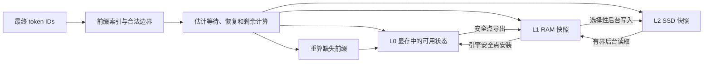

# llama.cpp 类三级缓存：收益验证与调度实现

日期：2026-09-13。本文基于本目录历史实测、本地源码和官方资料制定方案。初稿之后已完成固定前缀状态基准，执行进展见文末；尚未修改推理引擎。

核心判断：先证明可恢复状态的搬运成本小于省下的计算，再证明工作集超过 RAM 后，SSD 带来的额外复用能覆盖整个系统新增的成本。第一版用固定前缀边界的完整状态快照，后续逐步扩展到会话回退、成本调度和块级共享。

## 1. 已有证据及缺口

- 真实源码前缀实验中，复用 4,088 tokens 的两个请求，prompt 处理加速约 6.8 倍，整请求耗时加速约 3.9 倍。这证明前缀复用有收益。[历史结果](llamacpp_realistic_cache_smoke_summary.md)
- 上述对照关闭了缓存；尚未测出三级缓存相对调优后原生 L0+RAM 的增量收益。
- 原冒烟脚本是非流式请求，记录 prompt_ms 和整个请求 wall time，没有直接测客户端 TTFT；16-token 输出也不足以形成稳定 decode 吞吐结论。脚本 (`run_llamacpp_realistic_cache_smoke.py`)
- 原 working_set_pressure 的 RAM 条目约 2.28 GiB，未超过 4 GiB 配额，不能证明 SSD 的容量收益。[已有设计与审计](llamacpp-tiered-cache-design.md)
- 手动 slot save/restore 曾成功读写 175,221,576 bytes，但随后的测试请求 cached_tokens=0；必须验证引擎实际少算了哪些 token。[历史磁盘结果](llamacpp-cache-benchmark-results.md)

本轮核对的 llama.cpp 源码为 `f5e85d43a048f3d5adefb4c5e29867d8077fba62`，LMCache 为 `a0e4a4c227f33a0ece99aad207b3ab1fae2e2bb4`。历史运行程序是 b9209 / `0caf2a1d4`。正式对比必须使用同一个引擎提交构建各变体，避免版本升级、检查点策略变化混入缓存收益。

## 2. 用什么定义收益

沿用本目录术语：L0 为引擎直接使用的显存状态，L1 为 RAM，L2 为 SSD。首先解决历史前缀、暂停会话的复用；活跃请求执行时所需状态仍要满足引擎的驻留要求。不能把 SSD 分层当成单个请求任意扩大上下文的解决方案。

### 2.1 单次请求：比较恢复与原生最佳路径

对候选 slot、缓存对象和合法恢复位置 k，估计：

```text
E(candidate) = 等待时间 + 查找与必要的旧状态保存
             + 候选层读取、传输、校验、状态安装
             + 从位置 k 继续 prefill 的时间 + 首 token 交付

Benefit(candidate) = E(原生可用的最佳路径) - E(candidate)
```

第一版串行路径可用上式逐段计时相加。引入重叠后，应计算依赖关系上的关键路径，不能把并行 I/O 与计算时间直接相加。

原生路径可能已有 L0 前缀命中，不能每次都与完全从零计算比较。恢复位置 k 必须是实际合法的状态边界；对于 hybrid 模型，最长相同 token 前缀不一定是可恢复位置。

用 `P(N | k)` 表示已具备位置 k 的状态、继续处理至输入长度 N 的实测 prefill 成本。它同时受 N、k、batch 和并发影响，不能恒定套用一个 token/s，更不能按输入命中比例推算时间收益。

### 2.2 一个缓存对象的生命周期：计算保存回本次数

```text
生命周期净收益 ≈ 各次回访省下的服务成本之和
                 - 首次导出/复制/落盘的额外成本
                 - 对其他请求的干扰与挤掉有价值对象的机会成本
```

若每次净省 Δ 毫秒、首次保存多花 C 毫秒，则回访 r 次需满足 `r × Δ > C`。这些成本采用统一计量口径；不要将已经体现在请求耗时中的同步停顿重复扣除。

除了时间，还记录占用的 RAM/SSD 字节、写入量和资源上限。没有硬件成本或能耗实测时，不声称已经证明节电或财务回报。

### 2.3 服务整体：主指标和限制条件

主指标是客户端 p50/p95 TTFT，以及固定服务目标内成功完成的请求/s。TTFT 从客户端发出请求计至首个非空输出内容事件；空的 SSE、角色事件不能算首 token。固定关闭 reasoning，或将首个推理内容和首个用户可见答案分别计时。

同时报告完成时延、输出 token/s、正在 decode 的请求的 token 间隔、失败/超时比例、RAM/显存高水位和磁盘读写量。缓存跳过的输入 token 可以作为逻辑输入处理量单列，不能计作 GPU 新计算出的 token。

## 3. 最小实验：先证明存在一个有收益的点

### 3.1 固定边界快照，降低原型复杂度

准备真实仓库文档/源码形成的稳定前缀 P，以及不同问题 Q1、Q2。所有请求先完成 chat 模板展开与整体分词，再从最终 token IDs 中确定边界，避免独立分词后拼接造成前缀不一致。

先开发一个小型 C++ 基准程序，直接调用 llama.cpp 序列状态 API，暂不依赖 server 的自动 slot 匹配：

1. 模型和计算内核完成预热；固定一个模型、backend、K/V 类型和 batch 配置。
2. 清空测试序列，计算 P；在 P 的全部 token 已进入状态、尚未计算 Q 的安全点保存完整序列状态，flags=NONE。
3. 保存精确 token IDs、已处理 token 数、位置和兼容标识。完整状态包含该边界的 attention 与 recurrent 状态。
4. 导出到 RAM，再写入 SSD。保存、校验、写入各自计时。
5. 清空该测试序列，分别从 RAM 和 SSD 恢复 P，接着输入非空 Q2 并生成固定数量 token。
6. 对照从头计算相同的 P+Q2，核对实际 prefill token 数、位置、logits 和生成结果，并比较完整耗时。

直接恢复 P 并继续输入 Q2 不需要回到 P 内部的历史位置，因此这个最小实验可以不保存一串历史 recurrent 检查点。它并未证明任意历史分叉可恢复，也未证明现有 slot 文件接口已经兼容该流程。

如果请求没有新后缀，仍需按引擎协议取得末尾 logits，通常需要重算最后一个 token；不能假设序列 KV 快照包含完整 logits 或采样器状态。第一版保持非空 Q，关闭 speculative/MTP，重建请求采样器。

正确性对照使用相同 prefill 切分，避免数值差异来自分批。性能额外比较正常原生 prefill，防止故意拆小 batch 把冷算基线拖慢。

### 3.2 初始扫描及通过条件

先测 P=4K/8K/16K tokens，Q 固定为实际分词后的 128 tokens 左右，输出 128 tokens；上下文容量必须容纳真实输入和输出。不是只把 context 参数设为 16K。

每个点先预热，再至少执行 30 次机制测量，保留逐次原始数据。报告：

| 路径 | 应包含的成本 | 验证目标 |
|---|---|---|
| 原生重算 | 同一 P+Q 的 prefill 和首 token | 冷计算基线 |
| RAM 恢复 | 查找、校验、H2D/状态安装、Q 的 prefill、首 token | RAM 搬运是否更便宜 |
| SSD 恢复 | 实际文件读取、RAM staging、校验、H2D/安装、Q、首 token | SSD 路径是否存在盈利点 |
| 首次填充 | 快照、D2H、复制、校验、文件写入 | 需要几次回访回本 |

同步 API 的保存/恢复测量往往包含等待引擎完成已有工作。单独记录同步等待和可分离的传输时间；不要用整个 API 时间声称测出了纯 PCIe 带宽。

SSD 分两组：操作系统页缓存热读，以及经验证的设备读。重新启动进程不会清除系统文件缓存。设备读可在隔离实验中使用正确对齐的无缓冲 I/O，并结合设备读取字节验证。只观察到热读时，应明确标成文件/页缓存收益。

通过条件：至少一个前缀长度上，恢复后的计算与输出正确、实际少算了前缀、完整恢复路径快于重算，且有限回访次数能覆盖首次保存成本。此时可以声称“存在收益”，尚不能声称“真实业务整体收益已验证”。

## 4. 第二个实验：证明新增 SSD 层的增量价值

### 4.1 对照组

| 组别 | 保留能力 | 用途 |
|---|---|---|
| A | 关闭前缀复用 | 仅作计算机制对照 |
| B | 原生 L0 复用，关闭 RAM 扩展 | 测 RAM 的边际价值 |
| C | 调优后的原生 L0+RAM | 工程方案必须面对的基线 |
| D | 自定义 L0+RAM，关闭 SSD | 隔离新准入、检查点、路由策略的贡献 |
| E | 与 D 完全相同，再启用 SSD | E-D 隔离 SSD，E-C 验证整个方案 |

固定模型、引擎提交、GPU 权重放置、context/batch/并发、采样和相同请求轨迹。C/D/E 使用相同主机内存总预算，计入 live checkpoints、临时副本、staging 和文件页缓存的额外占用；比较时记录 RSS/commit、系统可用内存等，不能只比较 cache_ram 参数。

第一轮 D/E 使用相同固定边界、相同准入策略和字节 LRU，关闭预取。之后逐项开启成本准入、检查点选择、预取，才能区分容量收益与调度收益。

### 4.2 让工作集真正越过 RAM

构造独立的 P1…Pn，每个带多个不同的 Q，按如下方式回访：

```text
P1+Q1, P2+Q1, ... Pn+Q1,
P1+Q2, P2+Q2, ... Pn+Q2, ...
```

每个 P 的稳定内容从早期就不同，避免所有请求实际只复用同一个公共前缀。完整快照按实际物理条目字节统计，含所有必要检查点；采用去重后应按共享对象并集计费。

扫描有效复用工作集 W 与 L0/L1 实际可覆盖状态集合的比例，例如 0.5、1、1.5、2、4 倍；L2 保证能容纳该实验工作集。不能简单相加重复驻留的 L0 和 L1 字节当独立容量。对每次关键回访明确记录：L0 miss、L1 miss、L2 hit、合法恢复位置和实际避免重算的 token。

机制实验可以显式驱逐一个测试对象来验证链路；服务收益实验必须通过请求造成自然容量淘汰。人为把 RAM 清空后展示 SSD 命中，只能证明该路径可工作。

循环扫描适合暴露容量拐点，但不代表所有流量。追加热冷混合、多会话交错、没有复用的负对照，以及真实 coding-agent 请求轨迹；保留到达间隔、工具等待和分叉位置。SSD 额外命中来自容量 miss；如果问题是 token 不匹配或缺少合法恢复点，加 SSD 无法解决。

主图画“工作集字节/缓存预算 → p95 TTFT”，另画各层有效命中与实际 prefill 时间。理想结果是 W 小时 D/E 接近，W 超过 RAM 时 E 的恶化幅度较小；是否发生由数据决定。

### 4.3 避免只看第二次请求

同时报告从空缓存开始的整段回放，以及单列的稳定运行阶段。第一遍缓存填充和后台写入全部纳入资源、时间统计；回放结束记录未完成任务并测排空时间，不能无限积压写队列制造低时延。

先用单 slot、并发 1 定位机制，再测 2/4 并发或多 slot。服务负载按固定到达时间回放，并记录客户端实际调度延迟；只用“上一个完成再发下一个”会隐藏饱和时排队。容量实验和真实会话的工具依赖关系另行保留，避免改变业务轨迹。

每个点用多个种子/多个完整轨迹重复，变体运行顺序交错。p95 用足够多的请求和按会话/回放分组的不确定区间；p99 需更大样本，几十次机制实验不足以证明尾延迟。不要将同一会话内相关请求全部视为独立样本。

建议事先约定验收目标，例如：目标负载下 E 相对 C 的 p95 TTFT 至少降低 20%，或固定 SLO 内请求吞吐提高 10%；无复用负载及已在 decode 的请求退化不超过约 5%。这些是待确认的工程门槛，不是已获得的结果。任何正确性失败都不以速度收益抵消。

## 5. 调度方案：拆为四个模块

| 模块 | 职责 | 不应承担的职责 |
|---|---|---|
| EngineAdapter | 在安全点导出、安装状态；校验恢复边界；管理 seq/slot | 不由后台 I/O 线程随意修改 context |
| PrefixDirectory | token 前缀索引、兼容域、合法快照边界、对象位置与引用 | 不能把字符串或文件名相同视为有效命中 |
| TierStore | 有预算的 RAM 对象与 SSD 文件、校验、发布、删除 | 不解析或持久化裸 GPU 指针 |
| CacheScheduler | 比较恢复/重算、准入、淘汰、slot 选择、预取和背压 | 不重新实现 attention 运算 |

逻辑路径：



### 5.1 对象协议与索引

第一版对象是“可在边界 k 继续计算的不可变完整序列状态”：

```text
Snapshot = 兼容标识 + token IDs/前缀哈希 + 已计算长度与位置
         + 完整 attention/recurrent blob + 大小与校验
```

兼容标识包括模型内容指纹、adapter、tokenizer/模板配置、K/V 类型、RoPE/位置配置、序列化版本及后端布局兼容域。初期只允许同构建、同配置恢复，逐项验证后再放宽。多租户时加入允许共享的命名空间；多模态和特殊 mask 需要将额外输入依赖纳入协议后才支持。

后续支持任意会话分叉时，扩展为完整 server prompt 包：target state、必要的 draft state、tokens、历史 partial checkpoints 及其 n_tokens/pos_min/pos_max、相应 speculative 元数据。只复制当前序列文件不等价于完整 RAM prompt-cache 条目。

索引为每个对象保存 resident_locations、size、last_access、访问次数/估计收益、ref_count、每个副本的 ready/in-flight 状态。驻留位置是集合，允许 RAM/SSD 同时存在；不能用单个“当前层级”字段假定对象只有一份。

只选择 `k <= 实际相同前缀长度` 且全部状态依赖可恢复的快照。第一版按模型命名空间扫描几十个条目即可，规模增大再换 radix tree/链式前缀哈希。

### 5.2 请求到达时如何提升

1. 分词完成后列出本地 L0、RAM、SSD 的兼容候选和合法 k，同时保留原生重算方案。
2. 比较预计首 token 时间。近层短命中不一定优于远层长命中；也不能无条件选最长 SSD 前缀。
3. 选 RAM/SSD 时 pin 对象并预留暂存字节；SSD 读取在后台执行，相同对象的读取可合并。
4. 读完后校验对象，在引擎线程预留可用 slot，并再次核对请求是否取消、slot generation 是否变化。
5. 在安全点安装完整状态、token/位置及必要检查点。成功后发布可执行状态，只计算 k 后的输入，随后 decode。
6. 失败时清理可能部分安装的目标序列和对应 metadata，释放引用/配额并正常重算。不能拿半恢复的序列继续运行；无法可靠清理时重建受影响 context。

磁盘预取可在等待 slot 时进行，但不能无界占住 slot 或 RAM。若候选成本失去优势，允许放弃；已经开始的 I/O/DMA 即便逻辑取消，也必须等待其完成再复用缓冲。

### 5.3 什么时候下降、什么时候直接丢弃

L0：活跃计算期间保护状态；请求完成后优先保留可能原位续写的 slot。需要让位时，结合历史回访和保存成本决定是否导出。

L1：从有界字节 LRU 开始。后续加入小型试用区、二次访问后的长期准入和“预计净省毫秒/驻留字节”评分。已知稳定项目上下文可直接准入；不要等昂贵快照已经导出后才决定它毫无价值。

L2：只接纳预计回访能覆盖写读成本的对象。RAM 淘汰时，若 SSD 已有完整副本，直接释放 RAM；否则按价值后台写入或直接丢弃。不能强制每个 RAM 淘汰都同步落盘，也不必每次 SSD 命中都长期占一份 RAM。

GPU→RAM 的导出期间保护源状态；得到独立主机快照后才允许复用源 slot。RAM→SSD 写入期间保护源主机对象；临时文件写完并校验后原子发布索引。普通缓存允许崩溃丢失未提交对象；如需承诺重启持久化，再明确持久化刷写与恢复协议，并测试断电/进程故障语义。

淘汰只能回收没有读写引用且可安全释放的对象。新对象超预算时先拒绝/旁路，不能先无界分配后再淘汰。RAM 对象、live checkpoints、暂存、在途字节和序列化副本分别计费，设置统一上限。

### 5.4 I/O 与计算争用

先采用“少量高优先级按需读取 + 低优先级后台写入 + 有界预取”。限制在途字节和任务数；有正在 decode 的请求时，根据 token 间隔和传输负载降低后台速率。没有实测前不宣称这种优先级能保证尾延迟。

只有稳定观察到未来将使用的前缀，且预取有足够提前量和资源时才预取。统计读取后从未使用的字节，并允许关闭预取做对照。

## 6. llama.cpp 的具体改造位置与边界

| 本地入口 | 可复用能力 | 需要新增的部分 |
|---|---|---|
| `include/llama.h` 的 seq state API | 完整序列 host blob 导出/导入 | 上层快照 manifest、显式边界、错误恢复契约 |
| `tools/server/server-context.cpp` 的 prompt_save/load 与请求准备 | slot、token 状态、原生复用调用点 | 稳定边界快照、安全点恢复、候选选择和请求耗时埋点 |
| `tools/server/server-task.h/.cpp` 的 server_prompt/cache | tokens、完整状态、检查点以及原生 RAM 基线 | 抽象存储句柄、外部索引、全局预算、SSD 后端 |
| `src/llama-context.cpp` | 序列状态实际安装与同步 | 仅在后期优化时扩展异步传输接口 |
| `src/llama-memory-hybrid.cpp`、KV/recurrent 内存实现 | 混合状态序列化 | 真正 token-range 块接口与边界依赖，属于后续工作 |

第一版自定义 TierStore 应接替或清晰封装原生 RAM 条目管理，避免另叠一个同样大小的隐藏缓存，导致对照不公平和峰值失控。

本地 `llama_state_seq_get_data_ext/set_data_ext` 都先 `ctx->synchronize()`。因此只把它们放进后台线程不能获得安全的 GPU/计算重叠。第一版在引擎线程导出稳定 CPU blob，只有文件读写、校验等主机工作异步化。实际入口 (`../llama.cpp/src/llama-context.cpp`)

进一步优化需要：小型 pinned staging 池、可保护的源/目标状态、复制流、完成事件，以及执行器在使用状态前的依赖等待；按实际能力减少全 context 同步。Pinned memory 是异步 host/device 复制的重要条件，但并不单独保证计算重叠。[NVIDIA 官方异步执行说明](https://docs.nvidia.com/cuda/cuda-programming-guide/02-basics/asynchronous-execution.html)

暂存池可先评估 256–512 MiB 总量；如果沿用一次要求完整连续 buffer 的 API，单对象大于此池时不能假装已经支持分块 DMA。应在总 RAM 预算内使用完整主机 blob，或拒绝该路径；真正的分块 staging 要伴随序列化/传输接口改造。

`PARTIAL_ONLY` 在当前 hybrid 路径中跳过 attention、只处理 recurrent 组件，不是任意 token 段导入导出。`ON_DEVICE` 的同 seq_id 后续保存会使先前保存的设备状态失效，也不能直接当成多版本 GPU 快照仓库。公开协议 (`../llama.cpp/include/llama.h`)、hybrid 实现 (`../llama.cpp/src/llama-memory-hybrid.cpp`)

## 7. 当前模型必须单独处理的 recurrent 成本

按已有 GGUF/日志核对，在本机模型和 q4_0 K/V 配置下，attention KV 约 18 KiB/token，一个 recurrent 边界状态约 149.626 MiB。

```text
固定前缀边界的完整快照 ≈ N × 18 KiB + 149.626 MiB + metadata
完整快照加 C 个历史检查点 ≈ N × 18 KiB + (C+1) × 149.626 MiB + metadata
```

例如 8K tokens 的固定边界快照主体约 294 MiB；再带 4 个历史检查点约 892 MiB。这是特定模型配置的尺寸推导，实际配额按导出字节计，不能外推到所有 Transformer。[尺寸依据与日志](llamacpp-tiered-cache-design.md)

固定边界原型的容量拐点会和原生完整会话包不同，应分别计量、通过 D/E 对照隔离 SSD 贡献。后续做 256/512-token attention 块共享时，把 recurrent 快照按合法的有价值边界独立管理，避免每个小块都附带约 150 MiB 的状态。

## 8. 与 LMCache 的关系及交付顺序

可以借鉴 LMCache 的引擎连接器、存储层、引用保护、异步任务和预算分离。其官方集成描述也是先查找与安装缓存，再计算缺失部分；该页面目前归在 legacy in-process 文档下，不作为最新全部引擎支持清单。[LMCache 官方集成说明](https://docs.lmcache.ai/developer_guide/integration.html)

本地 LMCache 的 GPUConnectorInterface 以 MemoryObj、token 范围及引擎提供的布局/mapping 为契约。llama.cpp 的 opaque seq blob 不能无适配地替代 KV tensor chunk。要直接接入 LMCache，仍需新的引擎适配和 blob 存储协议，或先让 llama.cpp 暴露兼容的块接口。本地连接器 (`../LMCache/lmcache/v1/gpu_connector/gpu_connectors.py`)

建议按以下可验收交付推进：

1. **直接 seq API 的固定边界基准**：正确恢复 P、续算 Q，得到重算/RAM/SSD 成本曲线与回本次数。
2. **server 上的 RAM 原型**：接入流式 TTFT、显式预算、原生基线和固定边界复用；验证完整用户请求路径。
3. **同一原型增加 SSD**：字节 LRU、有界后台读写、自然容量压力；完成 C/D/E 对照，给出是否存在增量收益的结果。
4. **调度优化**：一次只加入一种成本准入、检查点策略或预取，测收益和 decode 干扰。
5. **必要时才做深改造**：异步 GPU 复制、块去重、LMCache 存储集成、多实例共享。

正确性矩阵至少覆盖：精确续写、前缀早/晚分叉、插入/删除历史、模型/adapter/格式不兼容、文件损坏/截断、并发读取与淘汰、取消、磁盘满、重启。第一阶段暂不支持的情况应拒绝命中并正常重算。比较 logits 时先测相同冷算路径的数值波动，再制定容差，不能只以“生成文本看起来正常”为通过。

每个阶段保留 trace、构建/模型配置、请求原始时序、对象字节和各层事件。第 1 项的恢复成本与正确性测量用于在实现复杂调度之前给出继续投入或停止扩展的依据。

## 9. 执行进展：固定前缀恢复已验证

2026-09-13 已实现独立 C++ 基准，使用 b9209 对应头文件调用本机 DLL，未改动 llama.cpp 工作树。Qwen3.8-27B / RTX 5080 / q4_0 K/V，4K、8K、16K 前缀，每个长度四条路径各 30 次，合计 360 条正式计时。15 个正确性探针中，全词表 logits 的最大差均为零，连续 128 个 greedy token 完全一致。

无缓冲 SSD 恢复后到首 token 的中位数分别为 187.6、219.2、295.6 ms，重算分别为 2200.1、4296.2、8718.1 ms。首次导出、落盘与发布分别约 337.3、422.5、602.2 ms；以本轮成本估算，三种长度均在一次后续复用后回本。

这是固定 token 边界的原始序列续算实验，不包含 chat 模板、服务排队或自然 RAM 淘汰；下一步是 server 集成与相同预算下的容量回放。详见实测报告 (`prefix-state-bench/runs/20260913-122835-full/report.md`)和原型运行说明 (`prefix-state-bench/README.md`)。

## 10. 执行进展：真实 Pi 任务与服务请求回放

2026-09-14 已连接 Pi 0.85.1 与本机 llama-server b9209，两个独立 Pi 实际处理 SWE-bench Lite dev 中的两个 marshmallow issue，累计 21 次模型请求。独立评分分别为 25/25、76/77，失败任务如实保留。先验证原代码预期失败、gold patch 全通过；评分使用 Windows/Python 3.9.25，不是官方 Docker 榜单评测。

同一批真实请求完成 9 组缓存回放：单槽位、1/2 个客户端，无缓存 / 槽位与检查点 / 原生 RAM prompt cache，双客户端反向顺序复测。双客户端整批时间均值为 111.20 / 87.52 / 80.84 秒；RAM 相对槽位缓存少 7.6%，实际 prefill 总时间少 29.6%。单客户端 RAM 没有额外会话恢复，79.77 秒与槽位缓存 79.47 秒接近。

额外原生调优校准把服务槽位改为 2，两个客户端、关闭额外 RAM prompt cache，同一批请求仅需 58.45 秒。**这说明当前两个 Agent 应先评估原生双槽位；上述 RAM 增量只适用于槽位受限场景，尚未证明优于调优后的原生配置。** 回放只固定输入历史、保留工具间隙，不重新执行工具；生成内容仍有部分差异，总时间不是严格固定输出工作量下的纯缓存耗时。

10 组完整回放共 210 个成功请求，另有两次服务启动在预热时内部断言、未接收请求，相同配置重试成功，故障日志保留。RAM prompt cache 日志峰值约 1.47 GiB，低于 4 GiB 配额，尚未发生 SSD 容量收益实验。下一阶段应扩大真实暂停会话与回访的工作集，并比较调优原生、同一调度器 RAM-only、同 RAM 预算的 RAM+SSD。详见完整真实任务报告 (`pi-cache-bench/results/report.md`)和可复现实验说明 (`pi-cache-bench/README.md`)。
