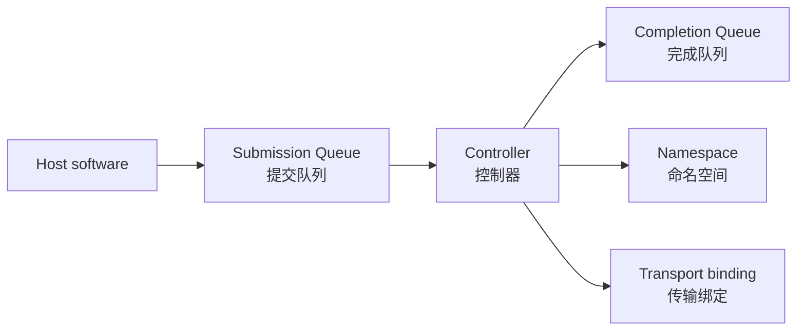

# NVMe [命名空间](/concepts/命名空间.md) (Namespace)

## 概述

NVMe 命名空间（Namespace，简称 NS）是 NVMe 协议中用于组织和管理存储逻辑块地址（LBA）空间的抽象概念。每个命名空间代表主机可以访问的一片独立存储区域，类似于传统存储协议中的"逻辑单元号（LUN）"或"卷"。一个 NVMe 控制器可以管理一个或多个命名空间，这为存储资源的灵活划分提供了基础架构。

## NVMe 架构中的命名空间

在 NVMe 系统中，命名空间位于[NVMe 控制器](/concepts/nvme-控制器.md)（Controller）的下层，与提交队列（Submission Queue）和完成队列（Completion Queue）共同构成主机软件与存储设备交互的核心要素。

> **解释性重绘**：此图依据 NVMe 架构关系绘制，仅表达主机软件、队列、控制器、命名空间与传输层之间的逻辑连接，不代表规范原文图例。

根据架构图可见，命名空间受控制器管理，主机通过提交命令至提交队列、接收响应自完成队列来实现对命名空间中数据的读写操作。^[visualization-guidelines.md:8-14]

## 命名空间与控制器的从属关系

一个 NVMe 控制器可以创建和管理多个命名空间，这种一对多的关系使得单一物理设备能够向主机呈现多个独立的存储逻辑卷。每个命名空间拥有独立的标识符（Namespace ID，NSID）和容量属性，主机软件可以通过 NVMe 命令选择特定命名空间进行操作。

控制器负责协调主机与命名空间之间的 I/O 事务，包括命令路由、数据传输和错误处理等核心功能。^[visualization-guidelines.md:8-14]

## 命名空间与传输层

命名空间通过控制器的传输绑定（Transport binding）实现与主机的通信。NVMe 支持多种传输层协议，其中 PCIe 是最常见的实现方式之一。传输层负责将命名空间暴露的逻辑块地址空间映射到物理存储介质上。^[visualization-guidelines.md:8-14]

## 命名空间在 NVMe 命令生命周期中的角色

在 NVMe 命令的标准生命周期中，主机软件构造包含特定命名空间标识的命令，并将其提交至提交队列。控制器接收命令后，识别目标命名空间，执行相应的读写或其他操作，最终通过完成队列向主机返回执行结果。命名空间标识在命令结构中作为关键参数，决定了数据操作的逻辑目标。^[visualization-guidelines.md:8-14]

## 命名空间的资源层级

从资源组织的角度看，命名空间位于 NVMe 存储资源层级的下层，向上对接控制器，向下对应物理存储介质。这种层级结构使得 NVMe 能够支持灵活的存储虚拟化与分区功能，同时保持简洁的命令接口设计。适合用图表达的内容包括 [Controller](/concepts/controller.md) 初始化、命名空间资源层级、传输边界等场景。^[visualization-guidelines.md:18]

## 相关概念

- [NVMe 控制器](/concepts/nvme-控制器.md)（Controller）
- 提交队列（Submission Queue）
- 完成队列（Completion Queue）
- 传输绑定（Transport binding）
- NVMe 命令

---

## Sources

- [visualization-guidelines.md](visualization-guidelines.md)

# Citations

1. [visualization-guidelines.md:8-14](/references/visualization-guidelines-0dacfb19.md)
2. [visualization-guidelines.md:18-18](/references/visualization-guidelines-0dacfb19.md)
