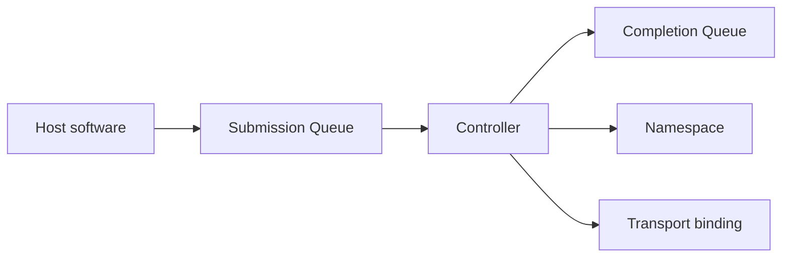

# NVMe 图文并茂页面规范

这是 llmwiki 编译 NVMe 页面时必须遵守的视觉与证据规则。

## 页面图表模板

上图是解释性重绘：它只表达 Host、Controller、Queue、Namespace 与 Transport 的关系，不代表规范原图，也不提供未被来源确认的时序。

适合用图表达的内容包括：Controller 初始化、SQ/CQ 命令生命周期、namespace 资源层级、transport 边界、reset/shutdown 状态转换和错误恢复路径。适合用表格表达的内容包括字段、状态码、命令分类、能力位和版本差异。

## 质量要求

- 图前先定义概念，图后解释读者应观察的边界。
- 每张图都注明“解释性重绘”或来源文件与规范页码。
- 引用只能指向 `sources/` 中存在的文件；页码不确定时引用文件级来源，并明确“不确定页码”。
- 不把 PCIe transport 的实现细节写成 NVMe Base 的通用行为。
