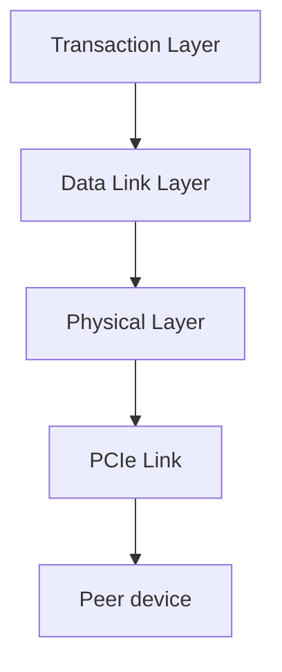

# PCIe 图文并茂页面规范

这是 llmwiki 编译 PCIe 页面时必须遵守的视觉与证据规则。

## 页面图表模板

上图是解释性重绘：它只表达 PCIe 三层模型和链路方向，不代表规范原图，也不提供未被来源确认的编码或时序细节。

适合用图表达的内容包括：Root Complex/Switch/Endpoint 拓扑、三层协议栈、TLP/DLLP 流转、设备枚举、LTSSM、电源状态、错误恢复、MSI-X 路径和 SR-IOV PF/VF 关系。适合用位域图或表格表达的内容包括 TLP/DLLP header、配置空间、BAR、能力结构和 MSI-X 表。

## 质量要求

- 图前先定义概念，图后解释读者应观察的协议层边界。
- 每张图都注明“解释性重绘”或 PCIe Base Specification 章节/图号。
- 引用只能指向 `sources/` 中存在的文件；页码不确定时引用文件级来源，并明确“不确定页码”。
- 不把某个设备或驱动实现的行为写成 PCIe Base 的通用规范要求。
