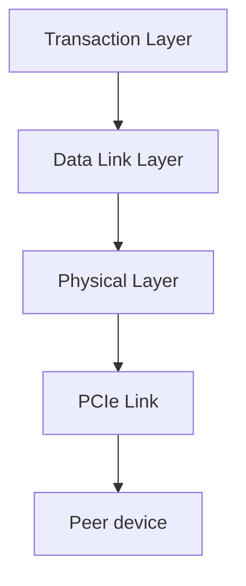

# Mermaid 解释性重绘规范

Mermaid 解释性重绘规范是 llmwiki 在编译技术文档页面时必须遵守的图表制作与证据引用规则。该规范旨在确保图表既清晰表达技术概念，又不引入未被来源确认的细节，同时保持严格的引用纪律。

## 定义

**解释性重绘**（Interpretive Redrawing）是指基于规范文档或权威来源，对原图进行简化或重新表达的一种图表制作方式。解释性重绘只表达核心概念和已被来源确认的关系，不代表原始图形的完整细节，也不提供未被来源确认的编码或时序细节。

例如，以下 Mermaid 流程图是 PCIe 三层模型的解释性重绘：

它仅表达事务层、数据链路层、物理层之间的层级关系和链路方向，不包含编码方案、时序参数或物理层实现细节。 ^[visualization-guidelines.md:7-15]

## 适用场景

### 适合用解释性重绘表达的内容

以下技术概念适合使用 Mermaid 等图表工具进行解释性重绘：

- **拓扑结构**：Root Complex、Switch、Endpoint 等设备的连接关系
- **协议栈**：PCIe 三层模型（事务层、数据链路层、物理层）
- **数据流转**：TLP（事务层数据包）和 DLLP（数据链路层数据包）的流转路径
- **枚举过程**：设备发现和配置流程
- **状态机**：LTSSM（链路训练状态机）
- **电源状态**：链路和设备的电源管理状态
- **错误恢复**：错误检测与恢复机制
- **中断与虚拟化**：MSI-X 中断路径、SR-IOV 中 PF/VF 关系

这些内容具有明确的流程或层级关系，适合用流程图或拓扑图直观表达。 ^[visualization-guidelines.md:17]

### 适合用位域图或表格表达的内容

以下内容结构化程度高，适合使用位域图或表格而非流程图：

- **数据包结构**：TLP Header、DLLP Header
- **配置空间**：PCIe 配置寄存器布局
- **地址空间**：BAR（基址寄存器）映射
- **能力结构**：Capability Structure 各字段定义
- **中断表**：MSI-X 表结构

这些内容需要精确展示字段位置和宽度，表格或位域图更为合适。 ^[visualization-guidelines.md:17]

## 质量要求

### 概念前置原则

图表制作应遵循**概念前置**原则：在图前先定义相关概念，解释读者应观察的要点（如协议层边界、数据流向）。图表是概念的视觉化辅助，而非独立的信息来源。

### 标注规范

每张解释性重绘图都应注明以下信息之一：
- 标注为“解释性重绘”
- 或注明对应的 PCIe Base Specification 章节号和图号

例如：`▲ PCIe Base Spec Fig. 4-1 解释性重绘`

### 引用规范

- 引用只能指向 `sources/` 目录下存在的文件
- 当页码不确定时，引用文件级来源，并在引用中明确说明“不确定页码”
- 不得将特定设备或驱动实现的行为描述为 PCIe Base 规范的通用要求

### 事实边界

图表内容必须严格限定在来源已确认的范围内。解释性重绘不是创作，而是对已有信息的重新组织；未在来源中出现的编码细节、时序参数、实现特定行为等不应出现在图表或其说明文字中。 ^[visualization-guidelines.md:19-24]

## 工具与语法

llmwiki 推荐使用 **Mermaid** 作为解释性重绘的主要图表工具。Mermaid 支持声明式语法，便于版本控制和协作编辑。

常用 Mermaid 图表类型包括：
- `flowchart` / `graph`：流程图和拓扑图
- `sequenceDiagram`：序列图
- `stateDiagram`：状态图

---

## Sources

- [visualization-guidelines.md](../../sources/visualization-guidelines.md)

---

## 相关概念

- PCIe 三层模型
- TLP
- DLLP
- LTSSM
- MSI-X
- SR-IOV

