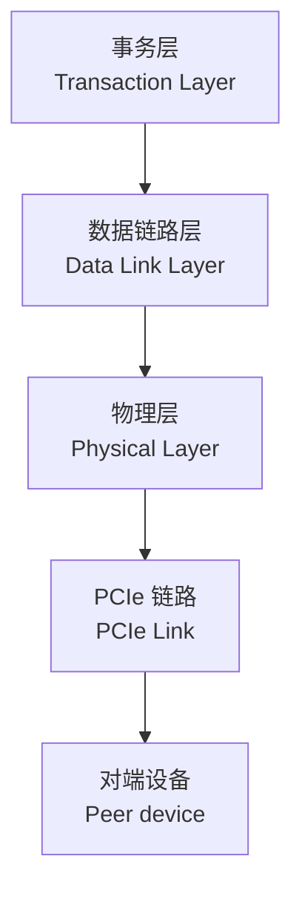

# PCIe 三层协议栈模型

PCI Express（PCIe）采用分层架构设计，将协议功能划分为三个主要层级，从上至下依次为**事务层（Transaction Layer）**、**数据链路层（Data Link Layer）** 和 **物理层（Physical Layer）**。这种分层设计使得不同组件之间的通信职责清晰，便于标准化实现和故障排查。^[visualization-guidelines.md:7-10]

## 三层架构概述

### 事务层（Transaction Layer）

事务层位于协议栈的最上层，负责处理来自软件层或设备驱动层的请求。事务层生成并解析**事务层数据包（TLP, Transaction Layer Packet）**，这些数据包携带读、写、配置和消息等事务类型的相关信息。事务层还负责流量控制和服务质量（QoS）管理。^[visualization-guidelines.md:9]

### 数据链路层（Data Link Layer）

数据链路层位于中间层，主要职责是确保事务层数据在相邻设备之间的可靠传输。数据链路层在发送端为 TLP 添加序列号和链路层校验码（LCRC），生成**数据链路层数据包（DLLP, Data Link Layer Packet）**；在接收端验证数据完整性并进行错误检测和重传请求。^[visualization-guidelines.md:9]

### 物理层（Physical Layer）

物理层位于协议栈最底层，负责将数据链路层的数据包转换为差分信号并在物理链路上发送。物理层包括电气子层和逻辑子层，负责串行/解串（SerDes）、8b/10b 或 128b/130b 编码、时钟恢复等物理信号处理功能。^[visualization-guidelines.md:9]

## 协议栈示意图

以下流程图展示了三层协议栈之间的数据流向：

> **说明**：上图是解释性重绘，仅用于表达 PCIe 三层模型和数据在相邻设备间的传输方向，不包含规范原图的编码或时序细节。^[visualization-guidelines.md:15]

## 数据包在层间的流转

在 PCIe 通信中，数据包沿协议栈向下传递时，每一层都会为其添加本层的封装信息：

1. **事务层**生成 TLP，包含事务类型、地址、数据负载等核心信息。
2. **数据链路层**在 TLP 基础上附加序列号和 LCRC，形成 DLLP（实际传输格式）。
3. **物理层**对 DLLP 进行编码和信号转换，通过差分信号对在链路上传输。

对端设备接收后，数据包沿协议栈向上逐层剥离封装，最终还原为原始事务请求。^[visualization-guidelines.md:17]

## 相关概念

- PCIe TLP（事务层数据包）
- PCIe DLLP（数据链路层数据包）
- PCIe 设备拓扑（Root Complex、Switch、Endpoint）
- PCIe 链路训练（LTSSM）
- PCIe 错误检测与恢复

## 参考文献

^[visualization-guidelines.md]

