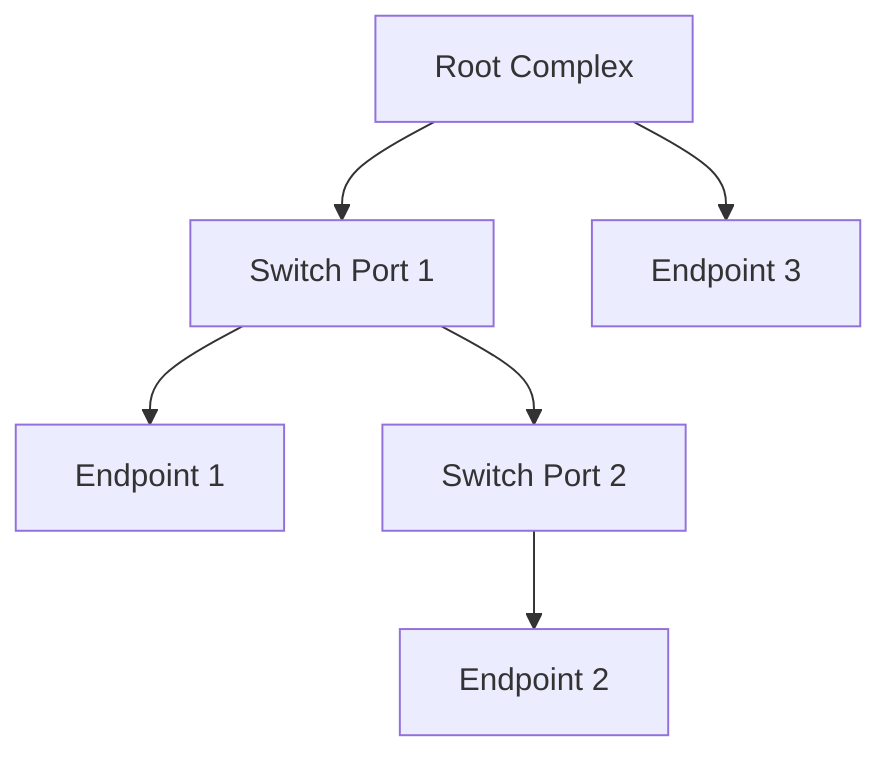

# 设备枚举与链路训练

设备枚举（Device Enumeration）与链路训练（Link Training）是 PCI Express（以下简称 PCIe）系统启动过程中两个紧密配合的阶段，分别由软件层和硬件层完成。它们共同确保系统中所有 PCIe 设备被正确发现、配置并建立起可靠的通信链路。

## 概述

当系统上电或复位后，主机（Root Complex）需要依次完成两项关键任务：链路训练负责在物理层建立设备间的点到点连接；设备枚举则由系统软件（BIOS/操作系统）主导，逐层扫描拓扑结构并将配置参数写入各设备的配置空间。两者的协作使得 PCIe 总线能够从物理连接到逻辑寻址完整可用。^[visualization-guidelines.md:17]

## 链路训练

### 链路训练状态机（LTSSM）

链路训练由物理层的链路训练与状态机（Link Training and Status State Machine，LTSSM）控制。该状态机定义了Detect、Polling、Configuration、Recovery 等状态转换序列，硬件自动完成比特锁定、符号锁定、通道宽度协商和信号极性检测等工作。^[visualization-guidelines.md:17]

### 训练过程

1. **Detect 状态**：检测链路远端是否存在设备。
2. **Polling 状态**：发送训练序列（Training Sequences），完成比特/符号同步。
3. **Configuration 状态**：协商通道宽度（x1/x2/x4/x8/x16）、信道顺序（Lane reversal）、极性反转（Polarity inversion）等物理参数。
4. **L0 状态**：链路完全建立，进入正常工作模式。

若训练失败或链路退化，LTSSM 会进入 Recovery 状态尝试重新训练。

## 设备枚举

### 枚举流程

设备枚举遵循深度优先遍历原则：

1. 软件读取 配置空间（Configuration Space）中的 Vendor ID、Device ID，确认设备存在。
2. 读取并解析能力结构（Capability Structure），识别设备支持的功能（如 MSI-X、电源管理、PCIe 能力等）。
3. 读取基址地址寄存器（BAR），分配 MMIO 地址空间。
4. 如设备为桥接设备（Switch/Bridge），递归枚举其下游端口。

### 配置空间写入

枚举过程中，软件会将链路协商结果（协商速率、宽度）、分配的地址、中断向量等信息写入设备配置空间，使设备进入可用状态。

## 二者的协作关系

链路训练先于设备枚举完成——只有当物理链路建立到 L0 状态后，软件才能通过链路访问设备的配置空间。两者顺序依赖关系如下：

| 阶段 | 执行者 | 目标 |
|------|--------|------|
| 链路训练 | 硬件（PHY） | 建立物理连接（L0） |
| 设备枚举 | 软件（BIOS/OS） | 配置逻辑参数 |

## 典型故障与排查

- **链路训练失败**：表现为设备在操作系统中显示为"未知设备"，需检查信号完整性、连接器接触问题或协商速率不匹配。
- **枚举不完整**：可能是 BAR 空间分配冲突或 Switch 上游端口配置错误导致下游设备无法访问。
- **协商速率回退**：高温或信号衰减可能导致链路从高速率（如 Gen 4）回退至 Gen 3/Gen 2，属于 LTSSM 的正常降级行为。

---

## Sources

- [visualization-guidelines.md](../../sources/visualization-guidelines.md)

---

## 相关概念

- PCIe
- 配置空间
- MSI-X
- LTSSM
- TLP
- DLLP
- SR-IOV

