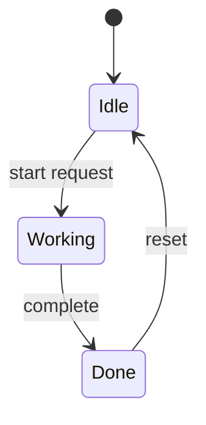

# SSD 子系统设计文档模板

本文档定义 SSD 固件子系统设计文档的标准结构与内容要求。每个子系统（例如 FTL 前端、Flash Scheduler、ECC/LDPC 引擎、DRAM/SRAM 管理、掉电保护等）均应使用此模板编写设计文档，以保证团队内部的文档一致性和可追溯性。

---

## 文档元信息

每个设计文档必须包含以下元信息字段：

| 字段 | 说明 |
|---|---|
| 子系统名称 | 例如 "Flash Scheduler"、"LDPC Pipeline"、"PLP Emergency Path" |
| 模块边界 | 该子系统与其他子系统的输入/输出接口 |
| 负责人 | 主要设计与维护者 |
| 版本 | 当前版本号与更新日期 |
| 状态 | Draft / Review / Approved / Obsolete |
| 依赖子系统 | 列出前置依赖的子系统 |
| 被依赖 | 列出依赖本子系统的其他模块 |

---

## 1. 设计目标

本节阐述该子系统要解决的核心问题及其在整体 SSD 架构中的定位。

### 1.1 功能目标

- 列出该子系统必须实现的核心功能。
- 区分 **必须实现**（must-have）与 **可选实现**（should-have）功能。

### 1.2 非功能目标

| 目标类别 | 典型量化指标 |
|---|---|
| 延迟 | 例如：mapping lookup p999 ≤ 10 μs |
| 吞吐 | 例如：channel 利用率 ≥ 90% |
| 可靠性 | 例如：UBER ≤ 10⁻¹⁵ |
| 功耗 | 例如：idle power ≤ X mW |
| 内存占用 | 例如：SRAM footprint ≤ Y KB |

### 1.3 设计约束

- 硬件限制（例如 ECC engine 吞吐、DMA channel 数量、SRAM 大小）。
- 接口约束（例如 NVMe 命令集限制、ONFI 时序约束）。
- 与其他子系统的边界约束。

---

## 2. 系统架构

本节用文字与图示描述子系统的内部结构与外部接口。

### 2.1 模块划分

提供该子系统的内部子模块列表，说明每个子模块的职责：

| 子模块 | 职责 | 关键状态 |
|---|---|---|
| | | |

### 2.2 数据流

描述数据在子系统内部的流动路径，包括入口、转换节点和出口。可以用文字流程图或伪代码表示关键路径。

### 2.3 与外部模块的接口

| 接口方向 | 对方模块 | 接口内容 | 协议/格式 |
|---|---|---|---|
| 输入 | | | |
| 输出 | | | |

---

## 3. 状态机设计

每个关键子系统必须定义显式的状态机。对于有多种执行路径的子系统（例如 ECC decode pipeline、掉电恢复路径），应分别给出独立的状态表。

### 3.1 主状态机

| 状态 | 入口条件 | 主要动作 | 退出条件 | 关键风险 |
|---|---|---|---|---|
| | | | | |

### 3.2 子状态机（可选）

如有必要，为子模块单独定义状态机。

### 3.3 状态转换图

在纯文字描述不足时，提供 Mermaid 格式的状态图：

---

## 4. 关键数据结构

本节定义子系统内部和跨子系统接口的核心数据结构。

### 4.1 内存布局

描述关键数据结构在 SRAM/DRAM/HMB 中的放置：

- 结构体定义（伪代码或结构图）。
- 字节序、对齐、校验字段要求。
- 持久化要求（例如是否需要写入 NAND）。

### 4.2 映射关系

如适用，说明该子系统维护的映射表结构（例如 L2P、P2L、channel/die/plane 映射）。

### 4.3 元数据保护

| 元数据类型 | 保护方式 | 校验频率 |
|---|---|---|
| | | |

---

## 5. 错误处理与恢复

### 5.1 错误分类

| 错误类别 | 典型触发条件 | 处理策略 |
|---|---|---|
| 瞬态错误 | 介质干扰、时序毛刺 | 自动重试、记录 telemetry |
| 持久错误 | 坏块、ECC 解码失败 | 隔离、替换、通知上层 |
| 协议错误 | PRP/SGL 越界、非法命令 | 返回 NVMe 错误状态 |
| 超时错误 | NAND 操作卡住、DMA 无响应 | 看门狗、fallback 路径 |

### 5.2 重试策略

定义各错误类别的重试次数、重试间隔和退避策略。

### 5.3 降级路径

描述子系统在部分硬件失效时的降级运行能力（例如单 channel 失效、单 ECC 引擎失效）。

---

## 6. 掉电保护（Power-Loss Protection）

如该子系统涉及持久化状态，必须定义掉电保护策略。

### 6.1 持久化状态清单

| 状态字段 | 持久化位置 | 掉电恢复策略 |
|---|---|---|
| | | |

### 6.2 写入时序

描述数据与元数据的写入顺序保证（例如 journal commit before data write）。

### 6.3 恢复流程

描述上电后该子系统的恢复步骤，以及与其他子系统恢复的协同顺序。

---

## 7. 性能与 QoS

### 7.1 性能计数器

| 计数器 | 描述 | 采集位置 |
|---|---|---|
| | | |

建议覆盖的维度包括吞吐、延迟、队列深度、超时率、错误率。

### 7.2 QoS 约束

描述该子系统对延迟 jitter、带宽保障、优先级调度的处理方式。

### 7.3 与其他子系统的资源竞争

描述该子系统与其他子系统争抢共享资源（DMA channel、NAND channel、ECC engine）时的仲裁策略。

---

## 8. 可观测性与诊断

### 8.1 日志事件

| 事件 | 触发条件 | 记录字段 |
|---|---|---|
| | | |

### 8.2 健康指标

定义该子系统的关键健康指标，用于现场诊断和产品支持。

### 8.3 调试接口

描述固件调试接口（例如JTAG、UART、内部日志转储）和测试模式。

---

## 9. 验证与测试

### 9.1 验证矩阵

| 验证点 | 验证方法 | 通过标准 | 对应测试用例 |
|---|---|---|---|
| | | | |

### 9.2 故障注入

描述该子系统的关键故障注入点与对应的测试场景：

- 硬件故障注入（ECC 失败、NAND 超时、DMA 错误）。
- 软件故障注入（状态机异常、CRC 错误、队列满）。
- 掉电故障注入（见 [掉电恢复状态表](../../tests/faults/power-loss-state-table.yml)）。

### 9.3 边界条件测试

列出需要验证的边界条件，包括最大值、最小值、零值、非法值和时序边界。

---

## 10. 变更历史

| 版本 | 日期 | 作者 | 变更说明 |
|---|---|---|---|
| | | | |

---

## 相关概念

控制器硬件模块边界 — 了解 SSD 控制器前后端各模块的职责边界，有助于在设计阶段就划分子系统。

控制器 RTL / IP 参考 — 硬件模块边界映射到 RTL/IP 层面的接口细节，可作为子系统硬件接口设计的参照。

ECC、LDPC 与可靠性管理 — 与闪存后端纠错子系统强相关，设计文档中错误处理与重试策略部分应与此页对照。

DRAM-less SSD 与 Host Memory Buffer — 如果子系统涉及 DRAM/内存管理，应参考 HMB 设计约束与安全隔离要求。

掉电保护与恢复 — 涉及持久化状态的所有子系统均需与此页对齐掉电窗口和恢复流程。

Flash Scheduler、Channel/Die/Plane Arbitration 与 Read Priority — Flash Scheduler 子系统的设计与验证应与此页联动。

NVMe 寄存器、队列与状态机 — NVMe 前端子系统的设计文档应引用此页作为协议层规范。

FTL 元数据格式与恢复约定 — FTL 相关子系统的数据结构与恢复策略应与此页对照。

遥测、日志与现场调试 — 子系统可观测性设计应符合知识库的遥测和日志规范。

量产需求与合规 — 设计文档中的可靠性指标与验证矩阵应可追溯到量产合规要求。

---

## Sources

^[seed-2f87dbcb.md:1-23] — SSD firmware and hardware design seed notes，涵盖前端、后端、FTL、掉电处理、开放实现与仿真工具等设计领域的全景。

# Citations

1. [seed-2f87dbcb.md:1-23](/references/seed-2f87dbcb-c40cb2a0.md)
