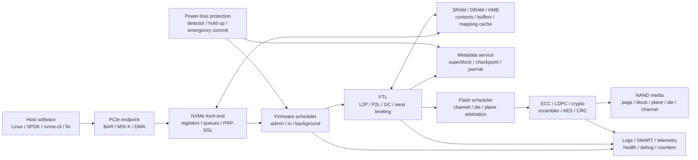

# SSD 控制器架构总览

## 阅读入口

- [SSD 系统架构](../wiki/concepts/ssd-system-architecture.md)
- [控制器硬件模块边界](../wiki/concepts/controller-hardware-module-boundaries.md)
- [FTL 与固件职责](../wiki/concepts/firmware-ftl.md)
- [FTL 元数据格式与恢复约定](../wiki/concepts/ftl-metadata-format-and-recovery-conventions.md)
