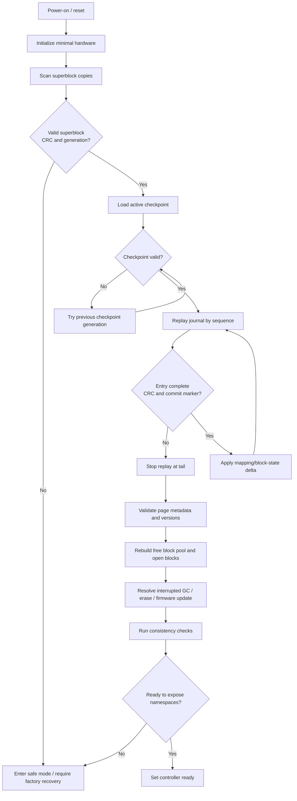

# 掉电恢复流程图

## 阅读入口

- [掉电保护与恢复](../wiki/concepts/power-loss-recovery.md)
- [FTL 元数据格式与恢复约定](../wiki/concepts/ftl-metadata-format-and-recovery-conventions.md)
- [故障注入目录](../wiki/concepts/fault-injection-catalog.md)
- [Power-loss State Table](../tests/faults/power-loss-state-table.yml)
