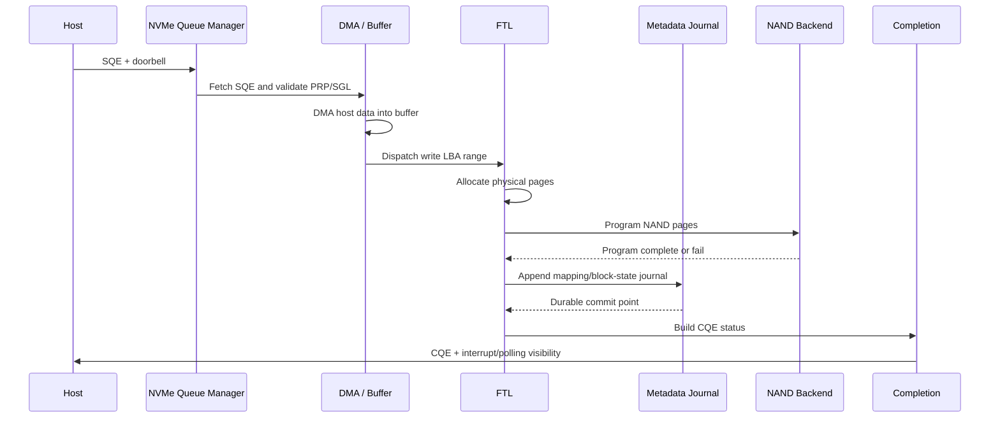
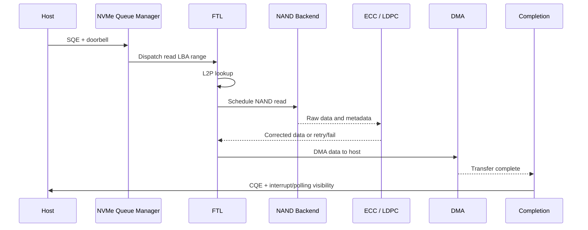

# 读写路径图

## Write Path

## Read Path

## 阅读入口

- [SSD 内部的 NVMe 命令生命周期](../wiki/concepts/nvme-command-lifecycle-in-ssd.md)
- [FTL 设计深水区](../wiki/concepts/ftl-design-deep-dive.md)
- [ECC、LDPC 与可靠性管理](../wiki/concepts/ecc-ldpc-reliability.md)
- [掉电保护与恢复](../wiki/concepts/power-loss-recovery.md)
