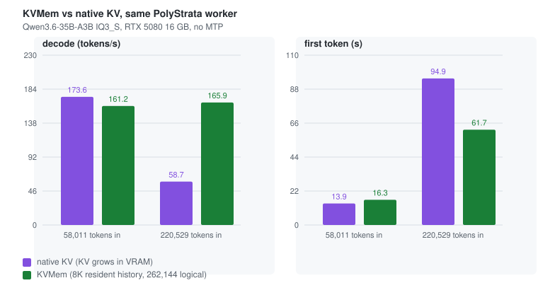

# KVMem 实测：提升在哪里（本机，2026-11-11）

安装对象：[kvmem/kvmem](https://github.com/kvmem/kvmem) v0.19.1，Windows x64 / RTX 50 统一包。
机器：RTX 5080 16GB（GPU0，单卡）、24 核、87.35GiB RAM。所有测试只监听 127.0.0.1，未改驱动、页面文件或锁页权限。

## 1. 安装与兼容边界（先决条件）

发布包 `kvmem-v0.19.1-windows-x64-nvidia-50-unified.zip` 1,069,379,363 bytes，SHA-256 与发布清单一致
（`822b18bd904e3b04a015c56cc0ca4aaef04499e3e801548dd9cd9e2656528854`）；解压后 4,639 个清单文件逐一校验通过。
包内是**两个** worker：`workers/polystrata/strata-poly.exe`（PolyStrata 0.1.45，KVMem 覆盖 qwen35moe）与
`workers/ninfer/ninfer-kvmem-server.exe`（只收 `.ninfer`）。**没有 llama.cpp worker**，那要另下单独包或自行编译。

本项目原来的主模型（Qwen3.8-Flash-Next **qwen4exp**，IQ2_XS）被两个 worker 明确拒绝：

```text
strata-poly: ...Qwen3.8-Flash-Next-GSQ-RCO-IQ2_XS-00001-of-00002.gguf is a 'qwen4exp' model,
             which this engine does not run
NInfer:      FATAL server failed during startup | NInfer accepts only .ninfer artifacts
```

即：**KVMem 目前无法给本项目的 qwen4exp MoE 模型用**。要测它的提升，只能换受支持的模型族。
本次选 PolyStrata 支持的 `Qwen3.6-35B-A3B-UD-IQ3_S.gguf`（13,676,723,168 bytes，SHA-256
`66a3ca88…97 03ec66` 与 ModelScope 一致），KVMem 才算真正启用。结论只适用于这套组合。

## 2. 主对照：同一个 worker，只切 KVMem

两边是同一个 `strata-poly.exe`、同 16 线程与同一 CPU affinity、无 MTP、全专家路由、Q8 KV、
prompt batch 512、独立空专家 profile 且 swaps=0；context 均为 262144。差别只有 KV 管理方式：
原生动态 KV，对比 KVMem `B=8192 / R=512 / H=12GiB`。每轮先做一次不计入统计的预热。

| 输入长度 | 指标 | 原生 KV | KVMem | 比值 |
|---:|---|---:|---:|---:|
| 58,011 | 首 token | 13.924 s | 16.329 s | 1.17×（更慢） |
| 58,011 | decode | 173.6 tok/s | 161.2 tok/s | 0.93× |
| 58,011 | 端到端输出 | 8.73 tok/s | 7.47 tok/s | 0.86× |
| 220,529 | 首 token | 94.935 s | 61.740 s | **0.65×** |
| 220,529 | decode | 58.7 tok/s | 165.9 tok/s | **2.83×** |
| 220,529 | 端到端输出 | 4.94 tok/s | 7.90 tok/s | **1.60×** |
| 55（短，3 次中位） | decode | 191.1 tok/s | 173.4 tok/s | 0.91× |



资源（220K 输入、整卡与进程树采样）：GPU0 峰值 **14,934 → 14,174 MiB**（少 5%），
进程树 RSS 峰值 **14.64 → 16.94 GiB**（多 16%），可用 RAM 最低约 40 GiB 以上，未触顶。

**提升随输入变长才出现。** 58K 时 KVMem 反而略慢（多一层归档/选页开销）；220K 时 decode 快 2.83 倍、
首 token 快 1.35 倍，端到端快 1.6 倍。原因在日志里可查：

- 原生跑 220K 时专家缓存命中率掉到 **89.8%**，KVMem 保持 **100%**——KV 历史放进 RAM 后，
  GPU 显存留给专家，专家 miss 减少；
- KVMem 只让**选中的 8K 历史**参与注意力，而不是 220,529 个 token 全部参与，decode 的注意力成本随之下降；
- 首 token 的改善来自 Host 归档后的选页/重放路径，而不是把整段历史重新算一遍。

## 3. 检索：能保留长历史，不等于全注意力等价

一份 800 条随机台账（59,656 token），问早/中/晚三条记录的 12 位审计码，要求只返回代码，严格相等才算对。

| 配置 | 正确 | 三题首 token | 复用情况 |
|---|---:|---|---|
| 原生 KV（默认 6 个检查点） | 3/3 | 0.157 / 2.084 / 2.077 s | 题1 复用 59,649；题2、3 只命中 53,248 检查点，各重读 6,449 |
| KVMem（RAM，H=12GiB） | 3/3 | 0.607 / 0.347 / 0.371 s | 每题复用 59,660 检查点，37-token 有界重放；Host 归档 619.6 MiB |
| KVMem（SSD，H=128MiB，D=2GiB） | 3/3 | 0.614 / 0.363 / 0.378 s | Host 127.2 MiB + 文件层 492.4 MiB，逻辑读 189.6 MiB，写 492.7 MiB，errors=0 |

三点必须一起说：

1. KVMem 三题都复用了文档检查点，且每题只做 37 token 的有界重放（≤2048 上限），不是全文重读；
2. 所以后两题比原生快约 5.6 倍——原生的检查点边界不巧落在 53,248，每题要重算 6,449 token；
3. 但 KVMem 只让**选中的历史**参与注意力。它能答对这三题，**不能据此说它等价于完整 59K 全注意力**；
   质量层面只验证了这三条可精确核对的问题。

## 4. llama.cpp 作参考（同一模型，原生 KV）

| 上下文配置 | 58,011 输入首 token | decode |
|---|---:|---:|
| `-c 65536` | 12.735 s | 108.36 tok/s |
| `-c 262144` | 633.067 s | 10.05 tok/s |

llama.cpp 也能开 256K，但 KV 预分配 2,720 MiB 后显存被挤满，同一条 58K 输入的首 token 从 12.7 秒变成
633 秒、decode 从 108 掉到 10。这是"能开"和"能用"的差别，也是 KVMem 想解决的问题；不过它和上面的
PolyStrata 对照不是同一引擎，**不要把这个差距记到 KVMem 头上**。

## 5. 提升在哪里，代价是什么

**提升：**
1. **长上下文 decode**：输入越长收益越大（58K 无收益、220K 约 2.8 倍 decode）。
2. **显存换容量**：220K 时整卡峰值还低 5%，专家缓存命中率从 89.8% 回到 100%。
3. **跨对话续接**：59,656 token 的台账在 128 MiB RAM 配额下仍能落盘保留并答对，文件层读写无错误。
4. **逻辑上下文与驻留解耦**：262,144 的配置只需 8K 驻留预算。

**代价与边界：**
1. **短请求更慢**（约 -9%），小输入下多出的归档/选页是净开销。
2. **RSS 更高**（+16%），历史在 RAM；机器 RAM 不够时不成立。
3. **模型族很窄**：只有 qwen35moe（PolyStrata）和稠密 `.ninfer`（NInfer）能用 KVMem；**本项目的 qwen4exp 直接被拒**。
4. **不是全注意力等价**：只有被选中的历史参与注意力。
5. **SSD 只是功能验证**：逻辑计数 189.6 MiB 读、492.7 MiB 写、0 错误，但没有隔离系统文件缓存，
   **不能当作 SSD 物理带宽成绩**；也没有冷启动、长稳和恢复测试。
6. **样本有限**：长输入每条件各一次，输入是高度重复的合成文本；短请求用三个不同前缀的变体取中位，
   不是同一 prompt 的置信区间。没有 MTP、多卡、通用质量评测。

## 6. 复现

```powershell
$py  = 'C:\Users\Administrator\Documents\Code\tasks\strata-lab\Strata\.venv\Scripts\python.exe'
$lab = 'C:\Users\Administrator\Documents\Code\tasks\strata-lab'
$model = 'E:\kvmem-lab\models\Qwen3.6-35B-A3B-UD-IQ3_S.gguf'

# 原生 KV 基线（同 worker、同线程、同输入）
& $py "$lab\scripts\poly_experiment.py" --output "$lab\runs\poly35-plain-long200k-01" `
  --model $model --mode plain --context 262144 `
  --requests "$lab\configs\kvmem-35b-long200k.json" --port 18200

# KVMem：8K 驻留历史，262,144 逻辑上下文
& $py "$lab\scripts\poly_experiment.py" --output "$lab\runs\poly35-kvmem-long200k-01" `
  --model $model --mode kvmem --context 262144 `
  --requests "$lab\configs\kvmem-35b-long200k.json" --port 18200

& $py "$lab\scripts\analyze_kvmem.py"   # 汇总、断言并重打证据包
```

每次运行都落在新目录，脚本拒绝覆盖；原始 SSE、引擎日志、采样、配置、模型哈希与证据包一并保留。
首个 KVMem 检索尝试（`poly35-kvmem-recall-01`）因父脚本的复用阈值假设错误而断言失败，原始记录与原因均保留，
未删除或改写。

## 7. 一句话结论

KVMem 的提升不在短请求，而在**长上下文**：同一 worker、同一模型下，220K 实际输入时 decode 约 2.8 倍、
端到端约 1.6 倍、首 token 快 35%，代价是短请求约 -9%、RSS +16%，而且**当前发布包不支持本项目的
qwen4exp 模型**——要让这套收益落到本项目，得等上游把 qwen4_exp 接进 KVMem。
