# Strata 与 llama.cpp 图片索引

同步日期：2026-11-14。共 42 张图：图解文档 35 张、源码分析 4 张、既有 Q5 内存曲线 3 张。
文档图从原有 Mermaid / 文本图导出为 PNG 和 SVG；保留原图代码与结论。
Q5 曲线保留已有 SVG，不增加新的性能测量。

- [源码区别图解](llama-vs-strata-visual-guide.md)
- [综合源码分析](llama-vs-strata-source-analysis.md)
- [Q5 队列深度实验](q5-io-depth-report.md)
- [Q5 三方对照](q5-strata-compare-report.md)
- [图片来源与校验清单](assets/llama-vs-strata/manifest.json)

## 源码区别图解

### 图 1：四层对照，P 接入专家供给

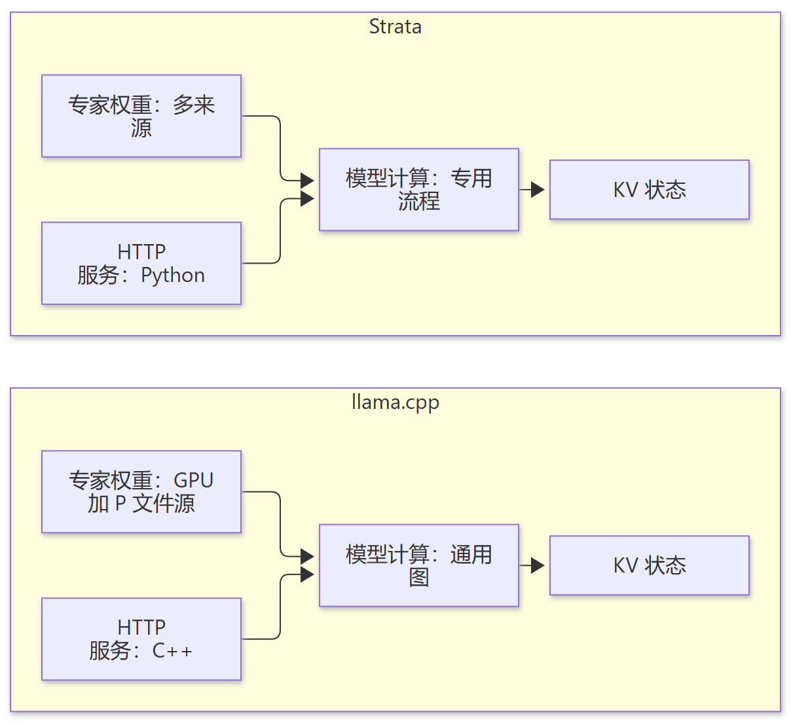

[PNG](assets/llama-vs-strata/visual-guide/figure-01.png) · [SVG](assets/llama-vs-strata/visual-guide/figure-01.svg)

### 图 2：预填充后进入解码

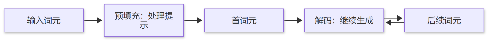

[PNG](assets/llama-vs-strata/visual-guide/figure-02.png) · [SVG](assets/llama-vs-strata/visual-guide/figure-02.svg)

### 图 3：请求时间轴

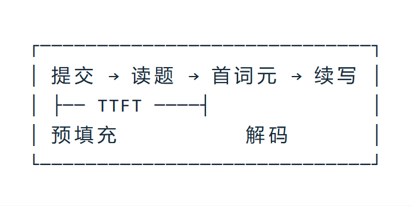

[PNG](assets/llama-vs-strata/visual-guide/figure-03.png) · [SVG](assets/llama-vs-strata/visual-guide/figure-03.svg)

### 图 4：保留注意力状态

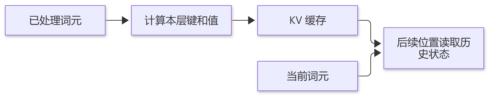

[PNG](assets/llama-vs-strata/visual-guide/figure-04.png) · [SVG](assets/llama-vs-strata/visual-guide/figure-04.svg)

### 图 5：实测规模与存储阶梯

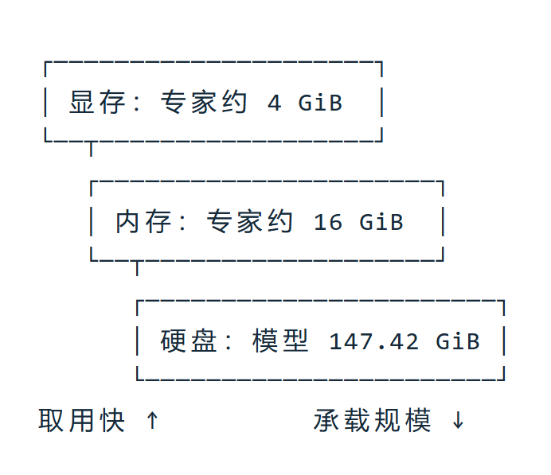

[PNG](assets/llama-vs-strata/visual-guide/figure-05.png) · [SVG](assets/llama-vs-strata/visual-guide/figure-05.svg)

### 图 6：路由选专家并合并

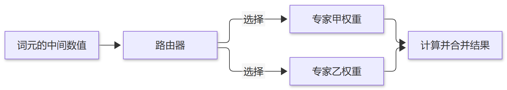

[PNG](assets/llama-vs-strata/visual-guide/figure-06.png) · [SVG](assets/llama-vs-strata/visual-guide/figure-06.svg)

### 图 7：底层复制与引擎分支

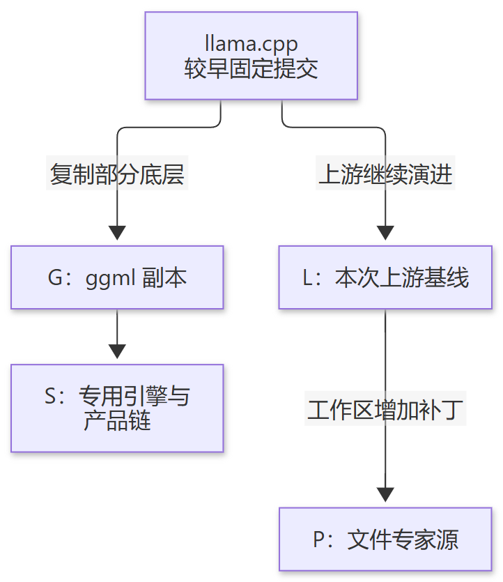

[PNG](assets/llama-vs-strata/visual-guide/figure-07.png) · [SVG](assets/llama-vs-strata/visual-guide/figure-07.svg)

### 图 8：菜谱式计算依赖

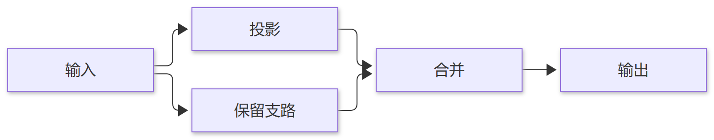

[PNG](assets/llama-vs-strata/visual-guide/figure-08.png) · [SVG](assets/llama-vs-strata/visual-guide/figure-08.svg)

### 图 9：专用流程录图与重放

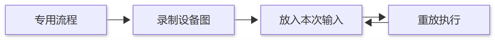

[PNG](assets/llama-vs-strata/visual-guide/figure-09.png) · [SVG](assets/llama-vs-strata/visual-guide/figure-09.svg)

### 图 10：功能修改落点

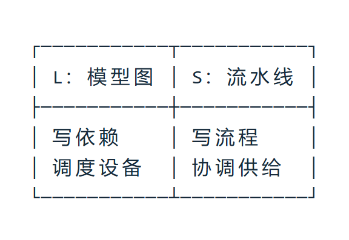

[PNG](assets/llama-vs-strata/visual-guide/figure-10.png) · [SVG](assets/llama-vs-strata/visual-guide/figure-10.svg)

### 图 11：上游 decode 调用链

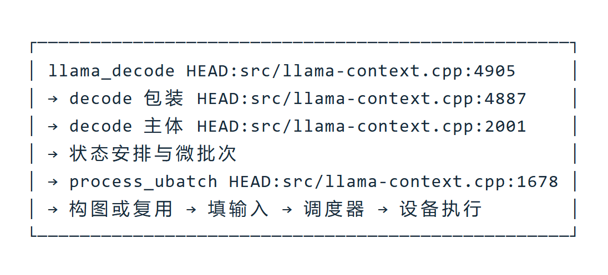

[PNG](assets/llama-vs-strata/visual-guide/figure-11.png) · [SVG](assets/llama-vs-strata/visual-guide/figure-11.svg)

### 图 12：窗口录图与状态提交

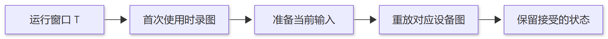

[PNG](assets/llama-vs-strata/visual-guide/figure-12.png) · [SVG](assets/llama-vs-strata/visual-guide/figure-12.svg)

### 图 13：图复用与前缀复用

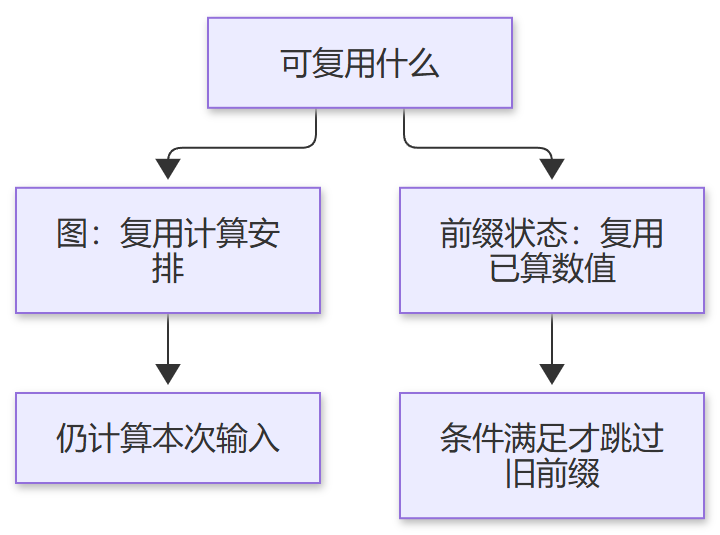

[PNG](assets/llama-vs-strata/visual-guide/figure-13.png) · [SVG](assets/llama-vs-strata/visual-guide/figure-13.svg)

### 图 14：GPU 专家命中与补入

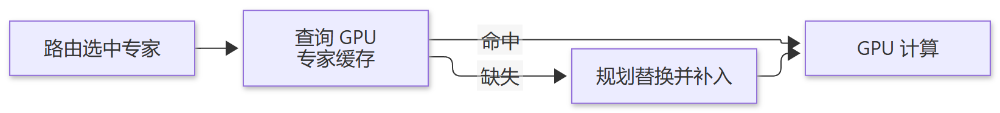

[PNG](assets/llama-vs-strata/visual-guide/figure-14.png) · [SVG](assets/llama-vs-strata/visual-guide/figure-14.svg)

### 图 15：S 的存放与计算分工

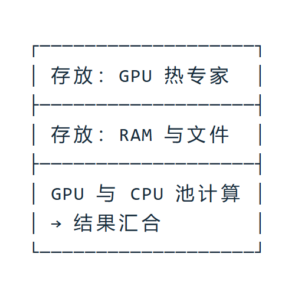

[PNG](assets/llama-vs-strata/visual-guide/figure-15.png) · [SVG](assets/llama-vs-strata/visual-guide/figure-15.svg)

### 图 16：P 主线与 RAM 旁路

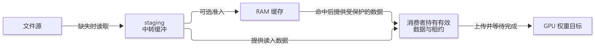

[PNG](assets/llama-vs-strata/visual-guide/figure-16.png) · [SVG](assets/llama-vs-strata/visual-guide/figure-16.svg)

### 图 17：两槽的读与上传

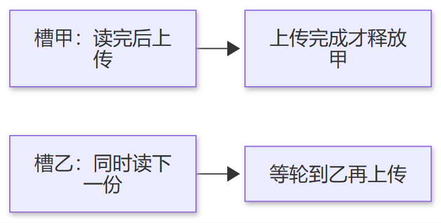

[PNG](assets/llama-vs-strata/visual-guide/figure-17.png) · [SVG](assets/llama-vs-strata/visual-guide/figure-17.svg)

### 图 18：读量相同，请求等待不同

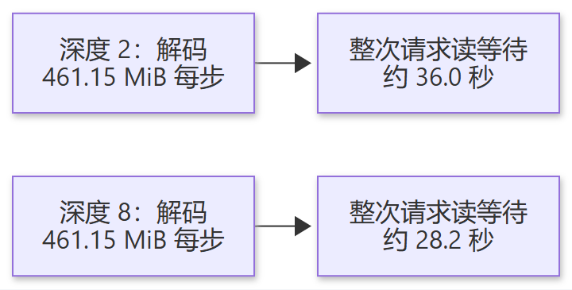

[PNG](assets/llama-vs-strata/visual-guide/figure-18.png) · [SVG](assets/llama-vs-strata/visual-guide/figure-18.svg)

### 图 19：S 预填充供给流

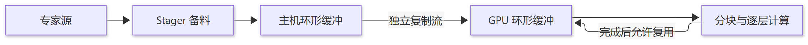

[PNG](assets/llama-vs-strata/visual-guide/figure-19.png) · [SVG](assets/llama-vs-strata/visual-guide/figure-19.svg)

### 图 20：同一请求可能同时命中五种不同对象

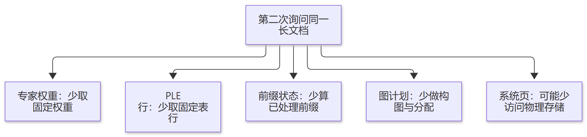

[PNG](assets/llama-vs-strata/visual-guide/figure-20.png) · [SVG](assets/llama-vs-strata/visual-guide/figure-20.svg)

### 图 21：词元相同长度与可恢复长度不是一回事

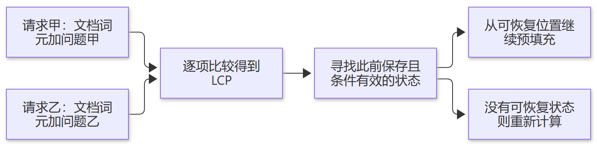

[PNG](assets/llama-vs-strata/visual-guide/figure-21.png) · [SVG](assets/llama-vs-strata/visual-guide/figure-21.svg)

### 图 22：状态位置、完整镜像和准入管理的职责关系

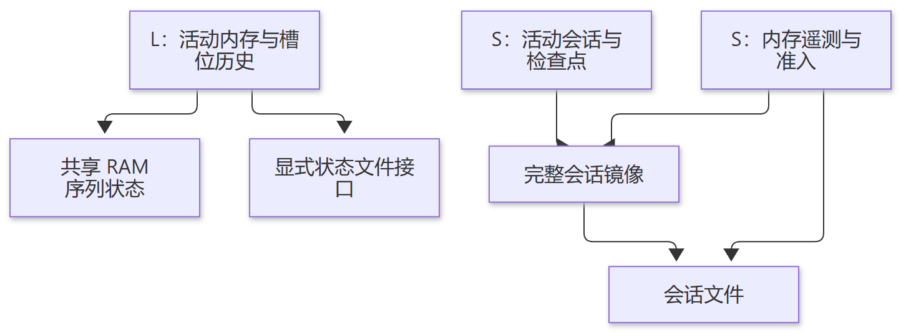

[PNG](assets/llama-vs-strata/visual-guide/figure-22.png) · [SVG](assets/llama-vs-strata/visual-guide/figure-22.svg)

### 图 23：候选接受与状态回滚提交必须配套

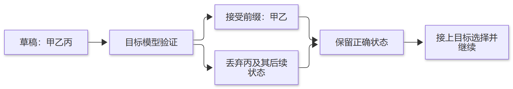

[PNG](assets/llama-vs-strata/visual-guide/figure-23.png) · [SVG](assets/llama-vs-strata/visual-guide/figure-23.svg)

### 图 24：草稿验证与改变主模型计算的边界

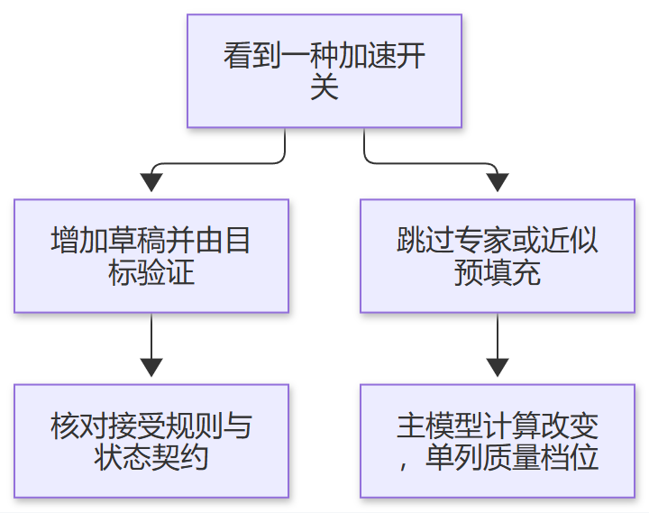

[PNG](assets/llama-vs-strata/visual-guide/figure-24.png) · [SVG](assets/llama-vs-strata/visual-guide/figure-24.svg)

### 图 25：单模型服务中的进程与协议边界

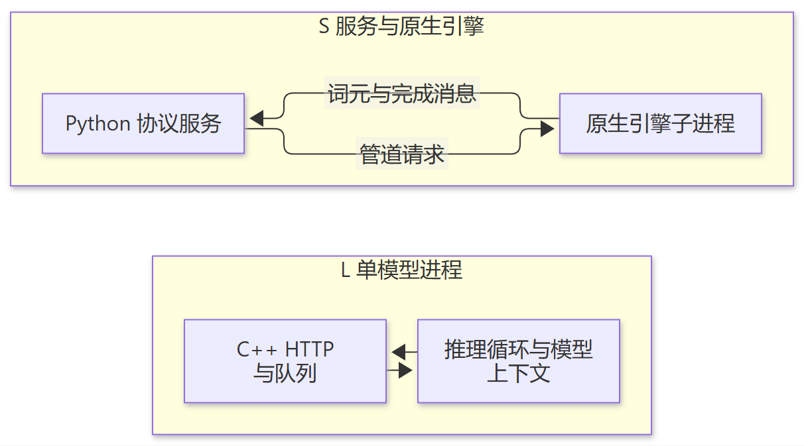

[PNG](assets/llama-vs-strata/visual-guide/figure-25.png) · [SVG](assets/llama-vs-strata/visual-guide/figure-25.svg)

### 图 26：建议分别记录的等待与内容交付边界

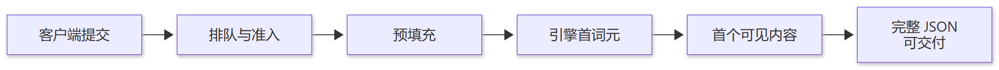

[PNG](assets/llama-vs-strata/visual-guide/figure-26.png) · [SVG](assets/llama-vs-strata/visual-guide/figure-26.svg)

### 图 27：多设备方案按拆分对象分类

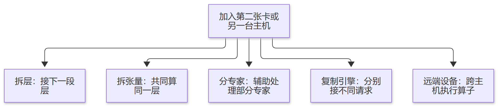

[PNG](assets/llama-vs-strata/visual-guide/figure-27.png) · [SVG](assets/llama-vs-strata/visual-guide/figure-27.svg)

### 图 28：从文件名走到实际可执行与已验证的组合

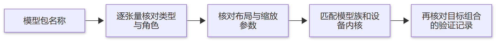

[PNG](assets/llama-vs-strata/visual-guide/figure-28.png) · [SVG](assets/llama-vs-strata/visual-guide/figure-28.svg)

### 图 29：P 文件缺失路径的数据与寿命顺序

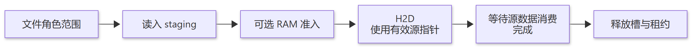

[PNG](assets/llama-vs-strata/visual-guide/figure-29.png) · [SVG](assets/llama-vs-strata/visual-guide/figure-29.svg)

### 图 30：未处理与失败必须成为不同结果

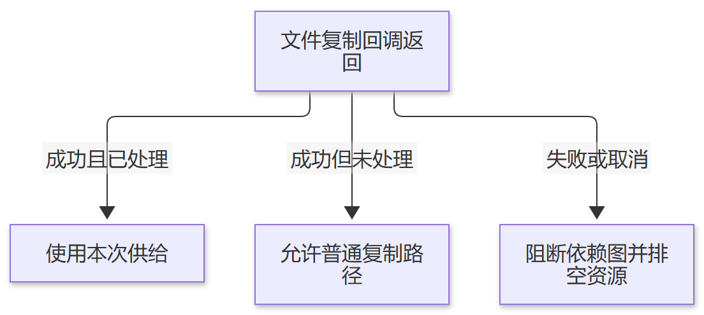

[PNG](assets/llama-vs-strata/visual-guide/figure-30.png) · [SVG](assets/llama-vs-strata/visual-guide/figure-30.svg)

### 图 31：逻辑工作、应用等待、设备读与端到端时间分开

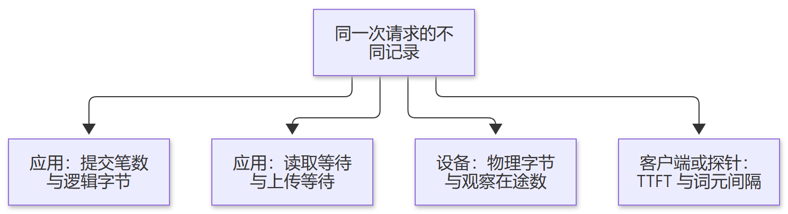

[PNG](assets/llama-vs-strata/visual-guide/figure-31.png) · [SVG](assets/llama-vs-strata/visual-guide/figure-31.svg)

### 图 32：读取规划、批量提交、深度与消费约束分层

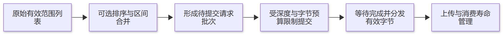

[PNG](assets/llama-vs-strata/visual-guide/figure-32.png) · [SVG](assets/llama-vs-strata/visual-guide/figure-32.svg)

### 图 33：合并覆盖全部有效字节，同时增加间隙读取的教学算例

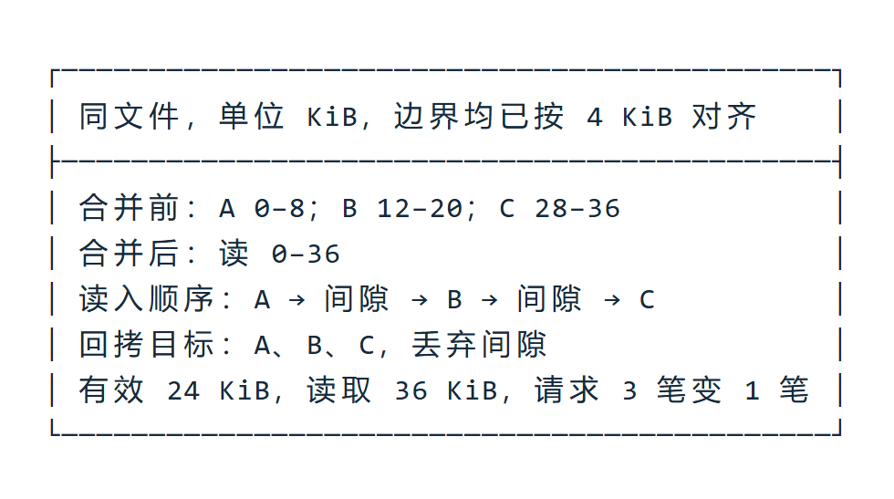

[PNG](assets/llama-vs-strata/visual-guide/figure-33.png) · [SVG](assets/llama-vs-strata/visual-guide/figure-33.svg)

### 图 34：四种目标对应不同证据与改造入口

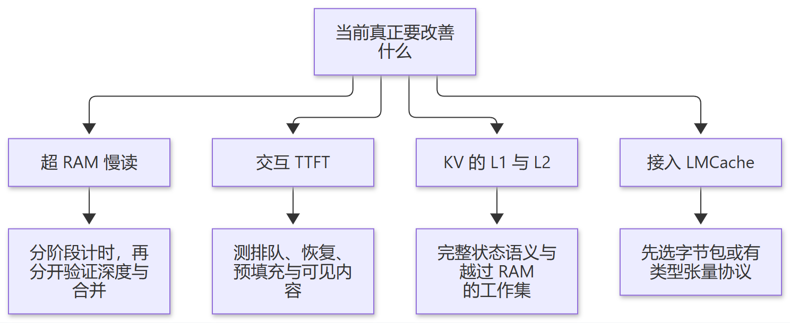

[PNG](assets/llama-vs-strata/visual-guide/figure-34.png) · [SVG](assets/llama-vs-strata/visual-guide/figure-34.svg)

### 图 35：按完整阶段追踪两边执行，专家供给是其中一条支路

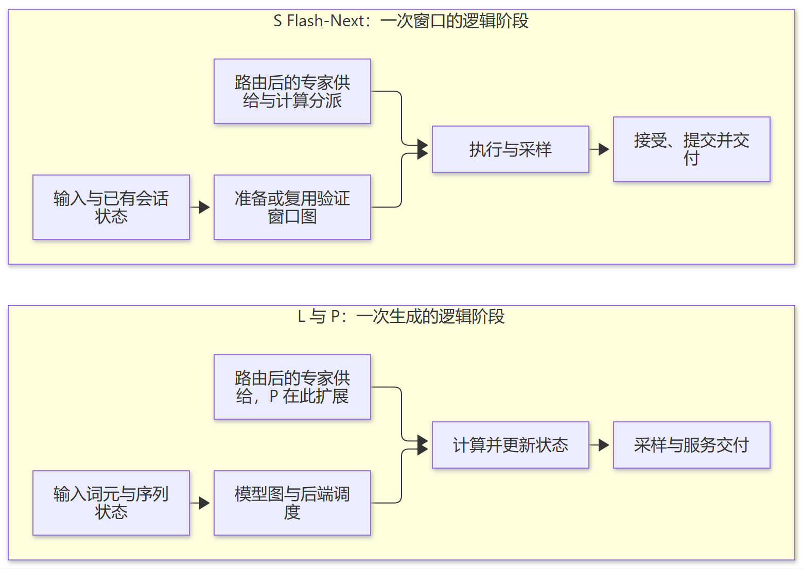

[PNG](assets/llama-vs-strata/visual-guide/figure-35.png) · [SVG](assets/llama-vs-strata/visual-guide/figure-35.svg)

## 综合源码分析

### 图 1：3.1 不是以 llama.cpp 引擎主体为底的普通功能分支

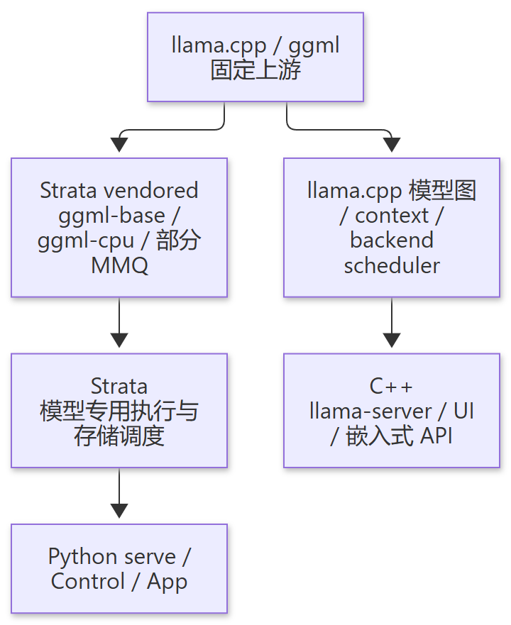

[PNG](assets/llama-vs-strata/source-analysis/figure-01.png) · [SVG](assets/llama-vs-strata/source-analysis/figure-01.svg)

### 图 2：5.1 llama.cpp：用通用 DAG 表达模型

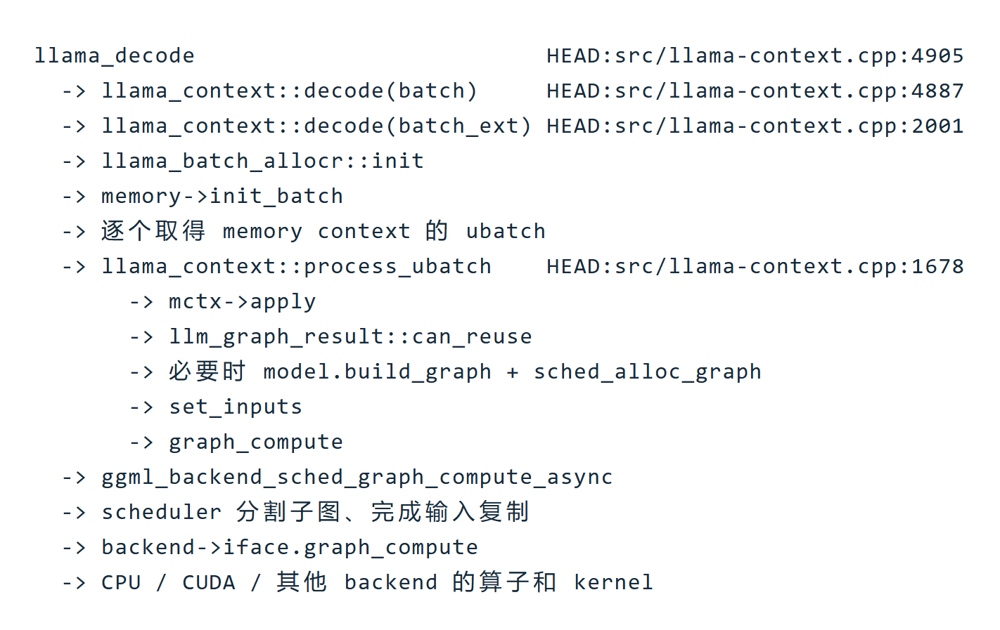

[PNG](assets/llama-vs-strata/source-analysis/figure-02.png) · [SVG](assets/llama-vs-strata/source-analysis/figure-02.svg)

### 图 3：5.2 Strata Flash-Next：显式模型流水线捕获为设备图

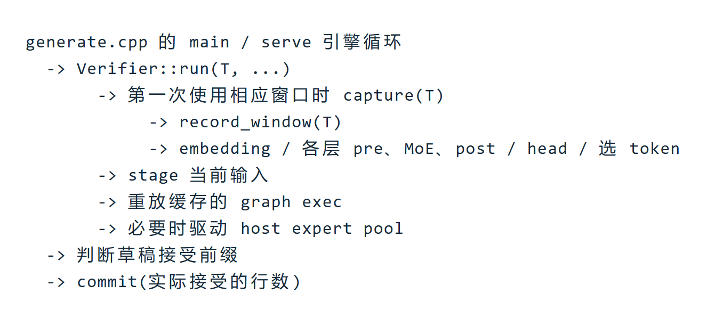

[PNG](assets/llama-vs-strata/source-analysis/figure-03.png) · [SVG](assets/llama-vs-strata/source-analysis/figure-03.svg)

### 图 4：5.2 Strata Flash-Next：显式模型流水线捕获为设备图

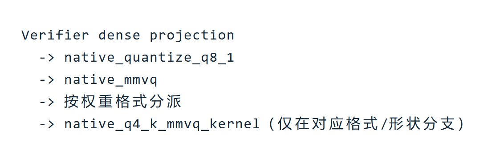

[PNG](assets/llama-vs-strata/source-analysis/figure-04.png) · [SVG](assets/llama-vs-strata/source-analysis/figure-04.svg)

## Q5 内存曲线

### Q5 文件供给路径：内存曲线

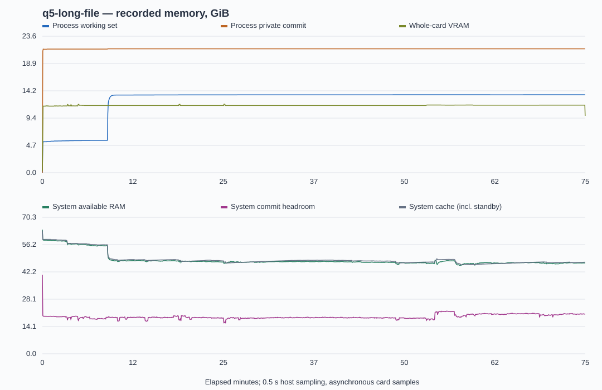

### Q5 原生路径：内存曲线

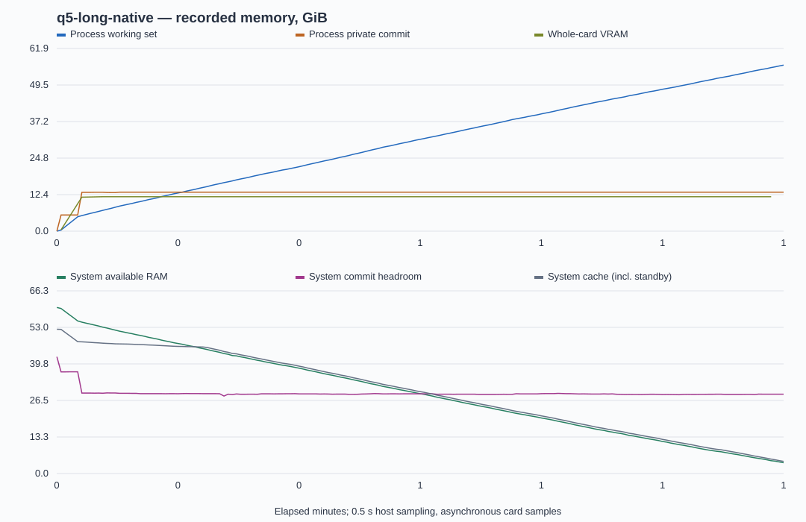

### Q5 原生路径（48 GiB 工作集上限）：内存曲线

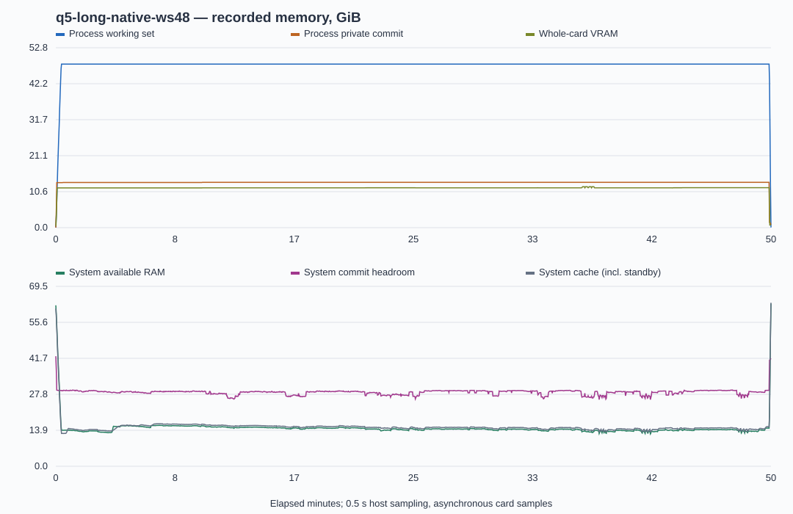

对应[P5 验收报告](ooc-p5-20261110/RESULTS.zh-CN.md)。
