# Strata 与 llama.cpp 源码区别图解（新手向）

> 图片已随文档同步；每张图下方保留原始图代码和 SVG。见[完整图片索引](llama-vs-strata-image-gallery.md)。

日期：2026-11-13。定位：从问答看懂计算、权重与状态。

## 与证据底座的关系

本文是 `research/strata-vs-llamacpp-source-analysis-20261112.zh-CN.md` 的[易读伴随文档][R-BASE]，结论与底座一致；冲突时以底座为准。本文只核查源码与已有报告，没有新增性能测量。

## 怎么用

新手顺读第 0–12 章；要改代码可先看第 13–16 章；只看本工作区改动看第 13 章。附录 A 可查术语，附录 B 可从结论追到证据。图号包含 Mermaid 与 ASCII 框图。

## 证据边界

五张身份牌：

| 标记 | 新手读法 |
| --- | --- |
| L | 上游 llama.cpp，提交 `7d7f0287530b` |
| P | 本工作区打了文件专家源与查表行缓存补丁的 llama.cpp |
| S | Strata，提交 `f33c8c30588f`，引擎 0.1.59 |
| G | Strata 自带的张量计算库 ggml 副本，来自 `3cf03257f219` |
| B | 历史实测数据；跨引擎报告用 Strata 0.1.58、llama.cpp b12211 与 P6 |

身份见底座第 1 节、[AGENTS.md:1][S-AGENTS]、[UPSTREAM.md:8][S-UPSTREAM]。`HEAD:` 行号属上游，普通链接指当前文件。

**源码事实**附文件与行号；**实测**附报告、数字与条件；**推断**标明“这是推断”。图与类比均简化；架构不同不能排名，同一文件不保证计算或质量等价。

## 第 0 章 先给答案（3 分钟速览）

**一句话结论** 两者组织中心不同，P 主要改 llama.cpp 权重供给。

### 用大白话讲

- L 像通用厨房，S 的主要 Flash-Next 路径像专用流水线，见 [ggml.h:690][L-TENSOR]、[verify.cpp:3229][S-VERIFY-RUN]。
- P 给已有专家缓存接上文件供货，见 [file-expert-store.md:3][P-DOC]。
- 架构差异不能推出速度排名，实测边界见第 5.6 节。

第 1 张图像厨房：网络服务（HTTP）接单，模型做菜，权重是学好的数值配方，键值（Key Value，KV）状态是账本。图形处理器（GPU）做计算，主机内存（RAM）存数据。

| 章节 | 解决什么问题 |
| --- | --- |
| 0 | 速览 |
| 1 | 问答阶段 |
| 2 | 项目关系 |
| 3–4 | 计算组织与执行 |
| 5–6 | 权重供给与阶段分工 |
| 7–8 | 缓存对象、前缀与会话状态 |
| 9–10 | 投机解码、服务与并发 |
| 11–12 | 多设备、量化与后端 |
| 13–14 | 本地补丁与实测证据 |
| 15–16 | 候选机制、决策与源码导航 |
| 附录 A–B | 术语与结论证据索引 |

### 看图

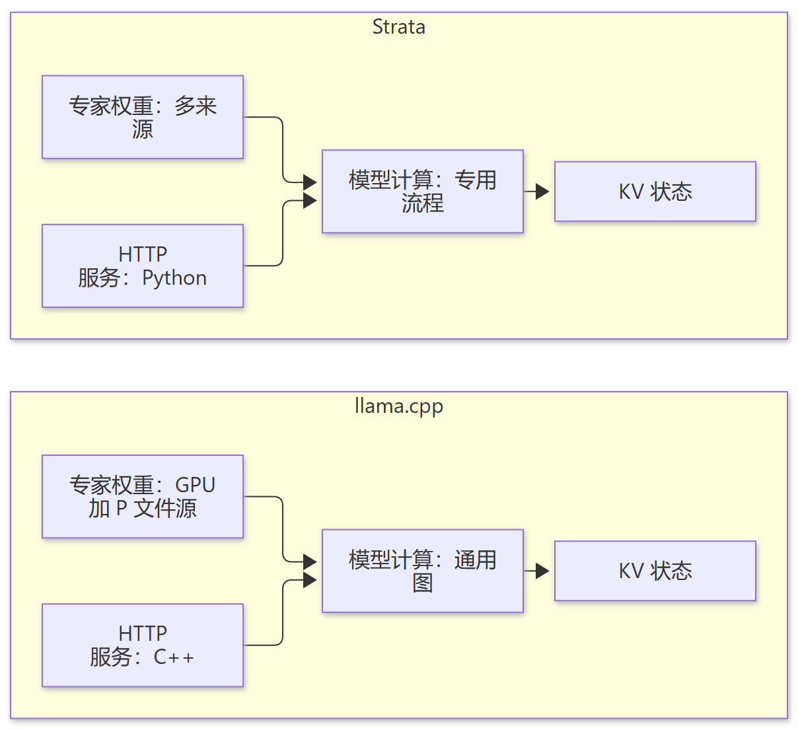

图 1：四层对照，P 接入专家供给 · [SVG 原图](assets/llama-vs-strata/visual-guide/figure-01.svg)

<details>
<summary>查看原始图代码</summary>

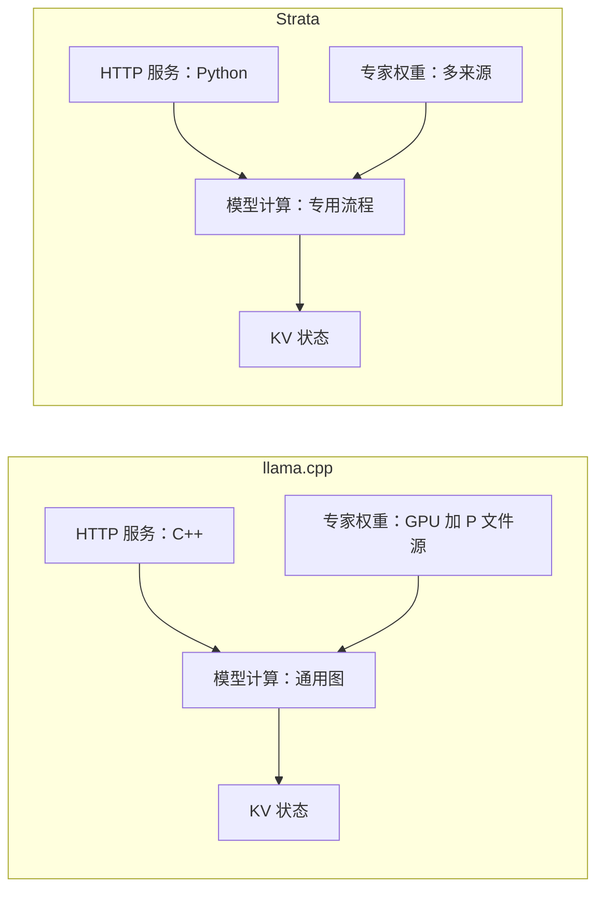

</details>
<!-- 图 1：四层对照，P 接入专家供给 -->

### 想深挖

底座第 2、5、6、8、10.1、13 节；服务入口：[server-http.cpp:150][L-HTTP]、[server.py:1101][S-PIPE]。

## 第 1 章 预备知识：一次问答在引擎内部经历了什么

**一句话结论** 引擎读题、续写，并保留计算状态。

### 用大白话讲

先分清一次问答里的两种数据。**模型权重**是训练得到的固定参数，像模型学会的一套计算规则；**运行状态**是处理这次输入时产生的中间数值。普通推理会不断读取权重、更新运行状态，并不把你的每个问题重新训练进模型文件。后面讨论的“专家权重缓存”和“KV 缓存”，分别保留这两种不同的数据。

下面沿着同一个例子理解：你提交一份说明书，问“有哪些使用限制”，模型读完输入后开始回答。

**1.1 token 与分词器。** 模型处理的直接输入是编号序列。分词器（tokenizer）负责把文字转换成这些编号，其中每个编号对应的单位叫词元（token）；一个词元不固定等于一个字或一个词，因此不能用字符数直接代替词元数。输出时，编号还要转换回可见文字。输入与续写共同占用上下文容量，所以“能接收多长文档”和“还能生成多长答案”有关联。

**1.2 prefill 与 decode。** 预填充（prefill）读题建状态；解码（decode）逐步选词续写。比如给模型一份说明书并问“有哪些限制”，引擎先处理文档与问题，再接着生成答案。它不是把整段答案一次查出来：新选出的词元又会成为后续计算的输入。见第 2、3 张图；首词元延迟（TTFT）从提交计到首词元。

**1.3 KV cache。** 注意力（attention）负责查阅历史；键值缓存（KV cache）像账本，留存所需的键和值。续写答案时，模型仍要利用已经读过的说明书；保留这些数值，就不必仅为取得同一份历史键值而从头重算。L 可按配置放在设备或主机缓冲中，见 [llama-kv-cache.cpp:214][L-KV-BUFFERS]。第 4 张图省略循环状态；完整会话还需要哪些状态见第 8 章。

**1.4 三层存储。** 显存（VRAM）是 GPU 使用的存储，RAM 是主机内存，固态硬盘（SSD）保存模型等文件。可以把它们想成台面、货架与仓库：数据放在哪里，会影响取用与搬运的成本，但仅靠这个比喻不能算出性能。第 5 张图使用[Q5 报告][R-Q5-REPORT]里的实际配置规模，不估速度倍率。

图中的约 4 GiB 显存、16 GiB RAM，是这组实验分给**专家缓存**的预算，不是整张显卡或整台机器的容量；147.42 GiB 是完整模型分片的总量。模型的其他权重、KV、图工作区等还要另占空间，不能把这三个数字直接相加当作整机内存账单。

L0 是活动 KV，L1 是近引擎状态缓存，L2 是后备存储，不能机械套给专家权重层，见[术语表][R-CONTEXT]。

**1.5 MoE。** 混合专家模型（MoE）在相关层里有多组可选的计算权重；“专家”不是独立回答问题的人，而是参与数值计算的模块。路由器根据当前输入的中间数值，选择其中一部分专家，分别计算后合并结果，见第 6 张图。下一步或下一层可能选到别的专家，因此“每次只用一部分”不等于“把同一小部分永远放进显存就够了”。

这正是专家缓存要解决的问题：尽量让再次被选中的权重已经在合适的位置；缺失时仍要取得原权重再计算。L 按层与专家组织 GPU 缓存，源码入口见 [llama-moe-cache.cpp:291][L-MOE-BANK]。

### 看图


图 2：预填充后进入解码 · [SVG 原图](assets/llama-vs-strata/visual-guide/figure-02.svg)

<details>
<summary>查看原始图代码</summary>


</details>
<!-- 图 2：预填充后进入解码 -->

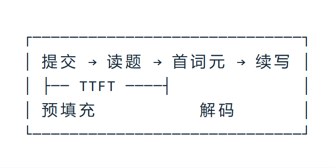

图 3：请求时间轴 · [SVG 原图](assets/llama-vs-strata/visual-guide/figure-03.svg)

<details>
<summary>查看原始图代码</summary>

```text
┌─────────────────────────────┐
│ 提交 → 读题 → 首词元 → 续写 │
│ ├── TTFT ────┤              │
│ 预填充           解码       │
└─────────────────────────────┘
```

</details>
<!-- 图 3：请求时间轴 -->

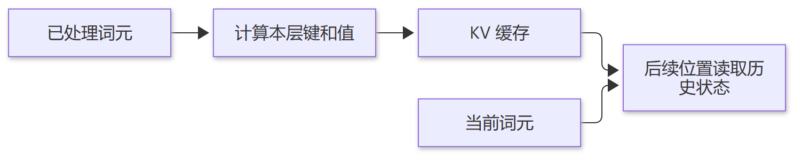

图 4：保留注意力状态 · [SVG 原图](assets/llama-vs-strata/visual-guide/figure-04.svg)

<details>
<summary>查看原始图代码</summary>

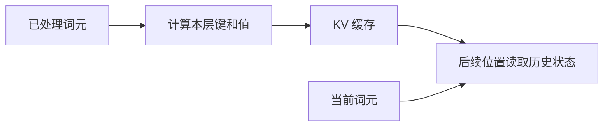

</details>
<!-- 图 4：保留注意力状态 -->

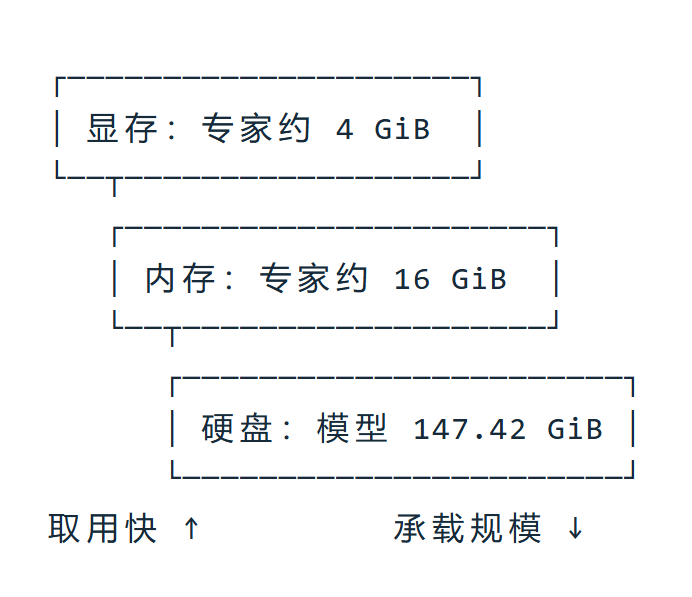

图 5：实测规模与存储阶梯 · [SVG 原图](assets/llama-vs-strata/visual-guide/figure-05.svg)

<details>
<summary>查看原始图代码</summary>

```text
┌─────────────────────┐
│ 显存：专家约 4 GiB  │
└──┬──────────────────┘
   ┌──────────────────────┐
   │ 内存：专家约 16 GiB  │
   └──┬───────────────────┘
      ┌───────────────────────┐
      │ 硬盘：模型 147.42 GiB │
      └───────────────────────┘
取用快 ↑          承载规模 ↓
```

</details>
<!-- 图 5：实测规模与存储阶梯 -->

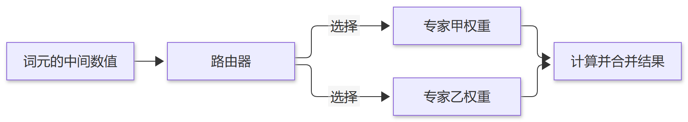

图 6：路由选专家并合并 · [SVG 原图](assets/llama-vs-strata/visual-guide/figure-06.svg)

<details>
<summary>查看原始图代码</summary>

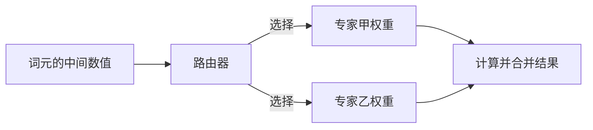

</details>
<!-- 图 6：路由选专家并合并 -->

### 想深挖

底座第 5.1、6.1、8.2、10.6 节；[术语表][R-CONTEXT]。

## 第 2 章 两边分别是什么，为什么要比

**一句话结论** L 通用，S 为模型族专用引擎加产品链，共用部分底层。

### 用大白话讲

**2.1 llama.cpp。** 通用厨房可换菜单，是本工作区基线；模型适配见 [models/llama.cpp:94][L-MODEL-EXAMPLE]。

**2.2 Strata。** 专用厨房加桌面应用、终端和服务管理，见 [AGENTS.md:1][S-AGENTS]。下文执行细节主要指 Flash-Next。

**2.3 血缘。** 随附副本（vendored copy）像随货零件。G 复制 ggml 基础、中央处理器（CPU）和部分量化矩阵组件，未带整套执行器，见 [UPSTREAM.md:18][S-UPSTREAM]、第 7 张图。

**2.4 P 的动机。** 保留执行链、增加可控文件供给，见 [file-expert-store.md:3][P-DOC]；第 13 章逐项解释改动与边界。

### 看图

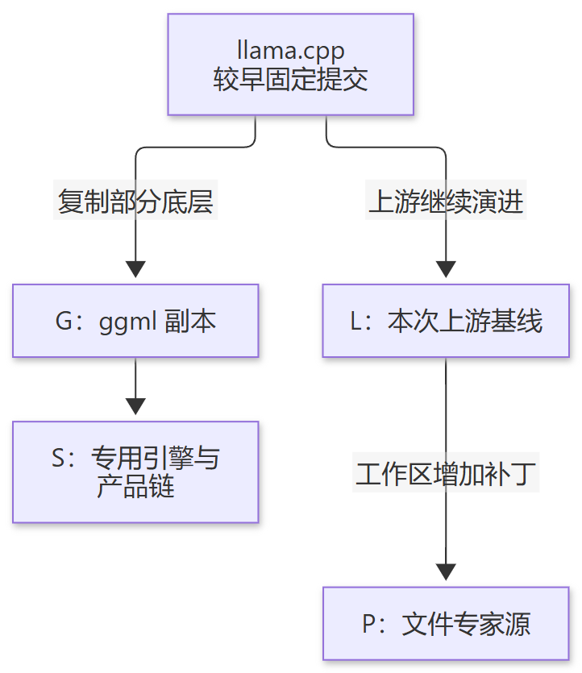

图 7：底层复制与引擎分支 · [SVG 原图](assets/llama-vs-strata/visual-guide/figure-07.svg)

<details>
<summary>查看原始图代码</summary>

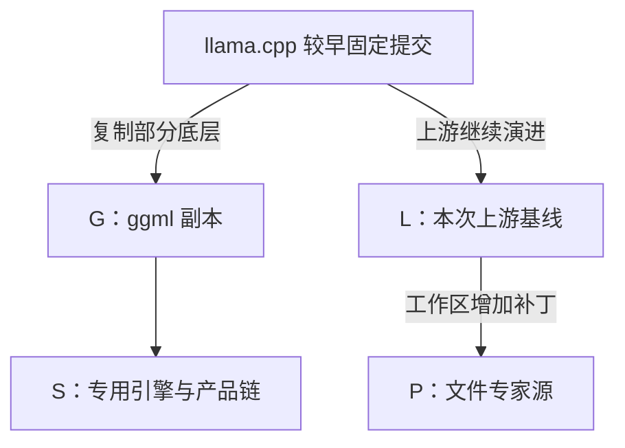

</details>
<!-- 图 7：底层复制与引擎分支 -->

### 想深挖

底座第 3.1–3.2、5.3、13.2 节；[复制清单][S-UPSTREAM]，G 与 L 版本不同。

## 第 3 章 根本差异：组织中心不一样

**一句话结论** L 描述计算依赖，S 的 Flash-Next 显式安排执行流程。

### 用大白话讲

**3.1 通用张量图。** 张量（tensor）是带形状的数组；有向无环图（DAG）像菜谱的“切好才能炒”。节点描述操作与输入，调度器安排设备，见 [ggml.h:690][L-TENSOR]、[ggml-backend.cpp:1305][L-SCHEDULER]、第 8 张图。

**3.2 专用流水线。** S 录下专用流程，换输入再执行，也有设备图，见 [verify.cpp:3229][S-VERIFY-RUN]、第 9 张图。

这里要分清两种“图”：通用张量图描述计算操作及其依赖；CUDA Graph 则记录一串 GPU 操作，供之后重放。**L 的 CUDA 后端也有捕获与重放**，源码可见 [ggml-cuda.cu:5101][L-CUDA-GRAPH]。因此两边的区别在模型怎样表达、供给与执行怎样组织；不能把第 8、9 张图读成“L 没有设备图，S 才有”。

**3.3–3.4 后果。** 第 10 张图对照入口。这是推断：同一功能的修改落点不同，不能推出速度或维护成本高低。

### 看图

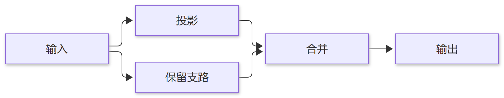

图 8：菜谱式计算依赖 · [SVG 原图](assets/llama-vs-strata/visual-guide/figure-08.svg)

<details>
<summary>查看原始图代码</summary>

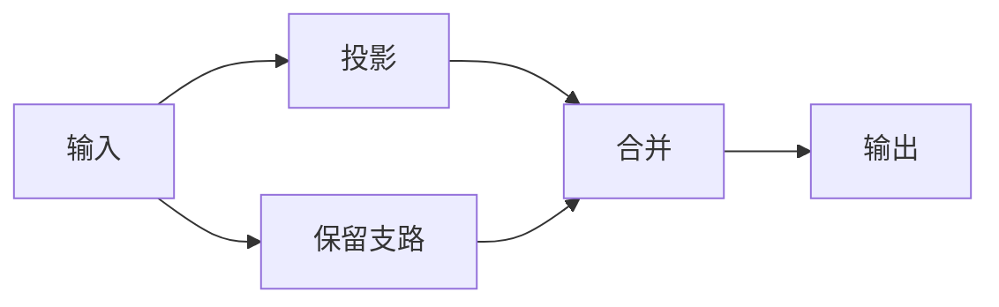

</details>
<!-- 图 8：菜谱式计算依赖 -->


图 9：专用流程录图与重放 · [SVG 原图](assets/llama-vs-strata/visual-guide/figure-09.svg)

<details>
<summary>查看原始图代码</summary>


</details>
<!-- 图 9：专用流程录图与重放 -->

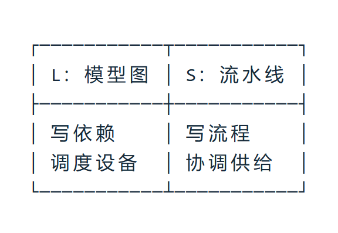

图 10：功能修改落点 · [SVG 原图](assets/llama-vs-strata/visual-guide/figure-10.svg)

<details>
<summary>查看原始图代码</summary>

```text
┌───────────┬───────────┐
│ L：模型图 │ S：流水线 │
├───────────┼───────────┤
│ 写依赖    │ 写流程    │
│ 调度设备  │ 协调供给  │
└───────────┴───────────┘
```

</details>
<!-- 图 10：功能修改落点 -->

### 想深挖

底座第 5、12.2 节；[模型图][L-MODEL-EXAMPLE] 与[窗口执行][S-VERIFY-RUN]。

## 第 4 章 模型怎么变成可执行的东西

**一句话结论** 图复用仍计算新输入，前缀状态命中才可能少算旧前缀。

### 用大白话讲

**4.1 `ggml_tensor`。** 它既描述数据，也是计算节点，见 [ggml.h:690][L-TENSOR]；写下乘法不立即执行。

**4.2 模型适配。** 参数、权重与构图在 `src/models/*.cpp`，见 [models/llama.cpp:94][L-MODEL-EXAMPLE]。

**4.3 decode 主链。** 微批次（ubatch）是一小批执行输入；见第 11 张图。

**4.4 capture 与 replay。** 捕获（capture）录操作，重放（replay）再执行。S 验证器（Verifier）按行数 T 管窗口，无草稿也可单词元运行，见 [verify.cpp:3229][S-VERIFY-RUN]、第 12 张图。

**4.5 图复用≠结果复用。** 重用菜谱仍做菜，前缀命中才像已有备料。L 仍填输入，见 `HEAD:src/llama-context.cpp:1736`；前缀另核验，见 [server-common.cpp:821][L-LCP]、第 13 张图。

### 看图

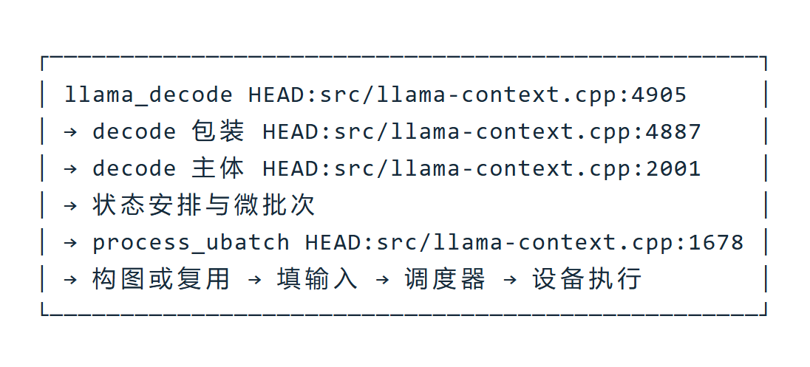

图 11：上游 decode 调用链 · [SVG 原图](assets/llama-vs-strata/visual-guide/figure-11.svg)

<details>
<summary>查看原始图代码</summary>

```text
┌──────────────────────────────────────────────────┐
│ llama_decode HEAD:src/llama-context.cpp:4905     │
│ → decode 包装 HEAD:src/llama-context.cpp:4887    │
│ → decode 主体 HEAD:src/llama-context.cpp:2001    │
│ → 状态安排与微批次                               │
│ → process_ubatch HEAD:src/llama-context.cpp:1678 │
│ → 构图或复用 → 填输入 → 调度器 → 设备执行        │
└──────────────────────────────────────────────────┘
```

</details>
<!-- 图 11：上游 decode 调用链 -->


图 12：窗口录图与状态提交 · [SVG 原图](assets/llama-vs-strata/visual-guide/figure-12.svg)

<details>
<summary>查看原始图代码</summary>


</details>
<!-- 图 12：窗口录图与状态提交 -->

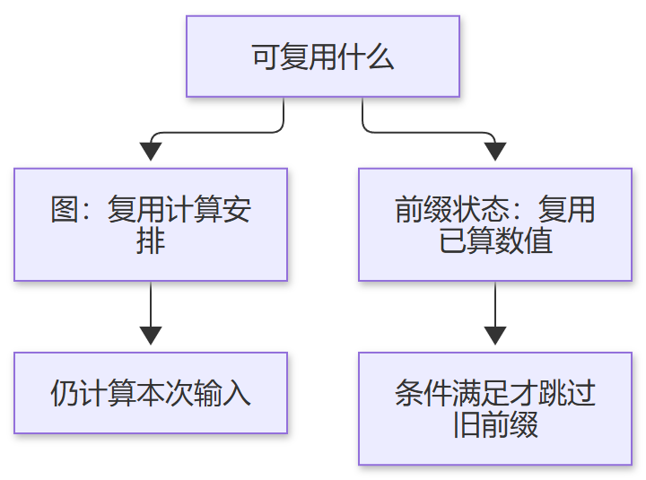

图 13：图复用与前缀复用 · [SVG 原图](assets/llama-vs-strata/visual-guide/figure-13.svg)

<details>
<summary>查看原始图代码</summary>

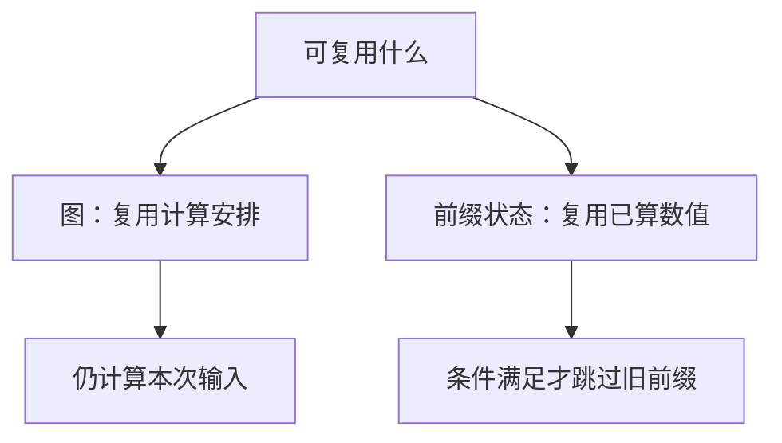

</details>
<!-- 图 13：图复用与前缀复用 -->

### 想深挖

底座第 5.1–5.2、8.1 节；[图兼容条件][L-GRAPH-REUSE]。上游用 `git show HEAD:src/llama-context.cpp` 查。

## 第 5 章 MoE 权重：数据从哪里来（本工作区的主战场）

**一句话结论** P 给已有 GPU 专家缓存接上有预算的文件与 RAM 供给。

### 用大白话讲

**5.1 为什么装不下。** 第 5 张图的 147.42 GiB 是模型总量，4 GiB 是专家 GPU 预算，实测来源：[q5-strata-compare-20261111/REPORT.zh-CN.md][R-Q5-REPORT]。

**5.2 L 已有 GPU 缓存。** 像找台面配方；分级替换器（ClassLRU）结合近期性与衰减频次，见 [llama-moe-cache.cpp:21][L-MOE-POLICY]；缓存键见 [:291][L-MOE-BANK]、第 14 张图。

**5.3 S 的组合。** GPU、RAM 与文件供给，CPU 池参与计算后汇合，见第 15 张图、[expert_source.cpp:3525][S-COMPLEMENT]、[expert_source.cpp:5042][S-EXPERT-DISPATCH]；RAM 补集优先装 GPU 没有的专家。

**5.4 P 插在哪。** 中转缓冲（staging）暂存读到的字节。`transfer` 查 RAM、占槽，`start_read` 读入，`reap` 等读完、可选填 RAM、上传并等消费完成再回收，见 [llama-expert-store.cpp:665][P-TRANSFER]、[同文件:446][P-START-READ]、[同文件:516][P-REAP]。租约（lease）表示消费者用完前不能逐出或覆盖这份数据；它约束指针寿命，不等于复制一份数据。

第 16 张图把 RAM 命中画成“提供受保护的数据”，不规定它必须复制回 staging。本快照的 `transfer` 在 [llama-expert-store.cpp:705–706][P-RAM-HIT] 确实做了这次复制，再把 staging 指针交给消费者；这是该路径的实现细节。文件缺失的主线与指针寿命在第 13 章展开。

**5.5 io_depth。** 在途深度（io_depth）像同时撑伞：一槽上传，另一槽读；RAM 命中也占槽，上传完才释放，不等于磁盘队列。默认 2，实验另试 4、8，见 [file-expert-store.md:12][P-DOC]、深度报告、第 17 张图。

**5.6 等待与读量。** 实测 [q5-io-depth-20261111/REPORT.zh-CN.md][R-Q5-DEPTH]：128 提示词元、128 强制输出词元，两轮深度 2→8 短测，解码每步物理读均为 461.15 MiB；含预填充的整次请求读取等待中位总时长约 36.0→28.2 秒，解码中位吞吐 2.29→2.60 词元每秒，见第 18 张图。

非独占 GPU 下的两轮初步结果不能证明慢读解决或长期稳定；应用等待不等于磁盘服务时间，读量结论只限本次轨迹。

### 看图


图 14：GPU 专家命中与补入 · [SVG 原图](assets/llama-vs-strata/visual-guide/figure-14.svg)

<details>
<summary>查看原始图代码</summary>

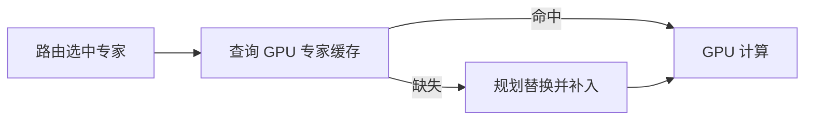

</details>
<!-- 图 14：GPU 专家命中与补入 -->

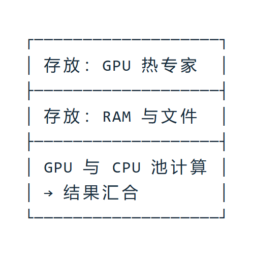

图 15：S 的存放与计算分工 · [SVG 原图](assets/llama-vs-strata/visual-guide/figure-15.svg)

<details>
<summary>查看原始图代码</summary>

```text
┌───────────────────┐
│ 存放：GPU 热专家  │
├───────────────────┤
│ 存放：RAM 与文件  │
├───────────────────┤
│ GPU 与 CPU 池计算 │
│ → 结果汇合        │
└───────────────────┘
```

</details>
<!-- 图 15：S 的存放与计算分工 -->

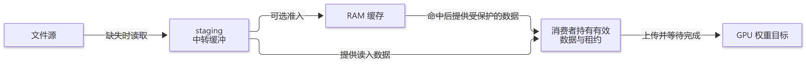

图 16：P 主线与 RAM 旁路 · [SVG 原图](assets/llama-vs-strata/visual-guide/figure-16.svg)

<details>
<summary>查看原始图代码</summary>

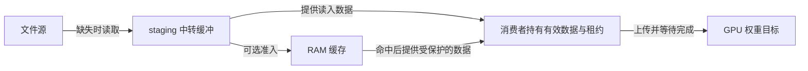

</details>
<!-- 图 16：P 主线与 RAM 旁路 -->

沿文件支路看，RAM 准入是可选的；沿命中支路看，可以省去文件读。两条支路都必须保护消费者仍在使用的数据，不能把“取得地址”当成“已经用完”。

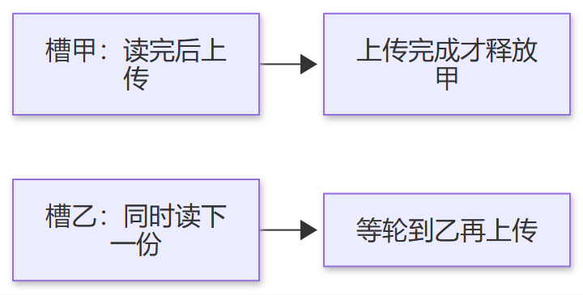

图 17：两槽的读与上传 · [SVG 原图](assets/llama-vs-strata/visual-guide/figure-17.svg)

<details>
<summary>查看原始图代码</summary>

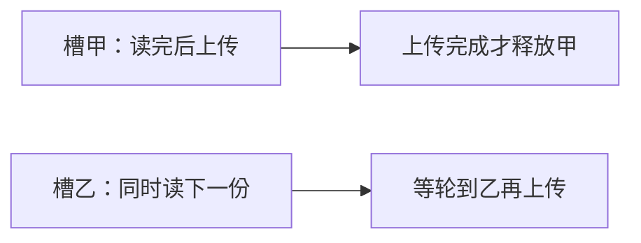

</details>
<!-- 图 17：两槽的读与上传 -->

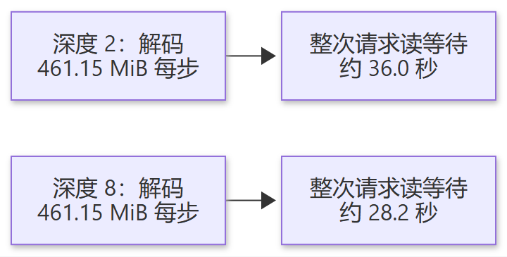

图 18：读量相同，请求等待不同 · [SVG 原图](assets/llama-vs-strata/visual-guide/figure-18.svg)

<details>
<summary>查看原始图代码</summary>

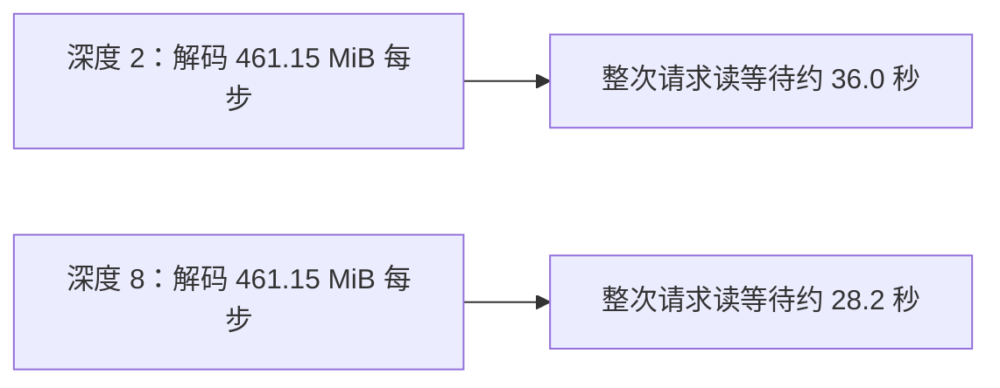

</details>
<!-- 图 18：读量相同，请求等待不同 -->

### 想深挖

底座第 6、13、14 节及深度报告。P 限 Windows 单 CUDA、单因果文本序列，需 GPU 专家缓存且禁用 CPU 缺失计算，见 [file-expert-store.md:42][P-DOC]。

## 第 6 章 Prefill 与 decode 的组织差异

**一句话结论** L 共用图体系，S 独立供给预填充，KVA 改变计算档位。

### 用大白话讲

**6.1 L 共用图体系。** 同一厨房接整桌菜和单份加菜，不保证同一张图。`llama_decode` 也处理提示，不能凭行数判阶段，见第 4 章、[llama-graph.cpp:1491][L-GRAPH-REUSE]。

**6.2 S 独立 Prefill 流。** 像备料带：搬运工（Stager）备权重，主机环形缓冲（host ring）经主机到设备传输（H2D）送往 GPU 环形缓冲（GPU ring），事件约束槽复用。见 [prefill.cpp:711][S-PREFILL-STAGER]、第 19 张图。

**6.3 KVA 要单列。** KVA 是默认关闭的近似预填充选项，改变部分位置后段层计算，见 [kva.hpp:1][S-KVA]；它改变计算与质量档位，不能当普通缓存命中优化，或与原样计算混列性能。

### 看图


图 19：S 预填充供给流 · [SVG 原图](assets/llama-vs-strata/visual-guide/figure-19.svg)

<details>
<summary>查看原始图代码</summary>


</details>
<!-- 图 19：S 预填充供给流 -->

### 想深挖

底座第 7 节；[备料与环形缓冲][S-PREFILL-STAGER]、[近似边界][S-KVA]。

## 第 7 章 缓存的五种对象：先问存了什么

**一句话结论** 专家、PLE 行、前缀状态、图计划和系统文件页，解决的是五种不同的重复工作。

### 用大白话讲

拿同一份长说明书连续问“有哪些限制”和“怎样配置”，可能同时发生五种复用：模型仍用同一批专家权重，输入又查到相同的嵌入行，说明书前缀的计算状态仍有效，计算形状适合旧图，文件页也可能还留在系统内存。它们可以一起命中，也可以分别失效。“缓存命中率高”若不说明是哪一种，无法解释究竟省了读盘、上传、构图，还是预填充。

逐层嵌入查表（PLE）是模型根据词元等输入选取固定权重行的过程。这里缓存的是行字节，不是模型读完说明书后的记忆；它也不是投机解码从历史词元里找下一段草稿。源码事实：P 的行缓存适配见 [llama-weight-rows.cpp:5][P-WEIGHT-ROWS]，S 的查表读取与组相联缓存见 [ple_reader.cpp:32][S-PLE-READER]，细节对应底座第 6.5 节。

下面“键”是识别对象所需的信息，不表示每个实现都把这些字段放进一个哈希表；模型身份有时由缓存所属的模型实例隐含保证。

| 对象 | 存什么，靠什么识别 | 何时可复用 | 应观察什么 |
| --- | --- | --- | --- |
| 专家权重 | 固定权重字节；模型、层、专家，P 还按张量角色定位 | 后续路由再次选中，且驻留副本有效 | 命中分母、独立驻留字节、文件读量、上传量 |
| PLE 行 | 固定查表行；表身份与原行编号 | 输入再次索引同一行 | 行命中、去重后读行数、行读取字节 |
| 前缀运行状态 | 已处理词元的 KV 与必要循环状态；词元前缀及模型、执行条件 | 找到匹配且可恢复的前缀 | 实际复用词元数、恢复成本、少做的预填充、TTFT |
| 图执行计划 | 计算拓扑、执行安排与缓冲绑定；形状、序列布局等兼容条件 | 新输入仍符合该计划 | 构图、分配、图启动成本；不能当作少算了前缀 |
| 操作系统页缓存 | 文件物理页；文件与页位置 | 读取路径允许，且所需页仍驻留 | 缺页、系统缓存、设备侧物理读取 |

源码定位：专家键与角色组织见 [llama-moe-cache.cpp:291][L-MOE-BANK]；前缀匹配见 [server-common.cpp:821][L-LCP]；图兼容条件见 [llama-graph.cpp:1491][L-GRAPH-REUSE]；S 的系统页清理入口见 [cache_drop.py:36][S-CACHE-DROP]。页缓存归操作系统管理，不能因为应用的 RAM 专家缓存未命中，就断言一定从 SSD 读到了物理字节。

操作系统（OS）页缓存把文件的小块数据留在内存；文件映射（mmap）让程序通过映射地址访问文件，由系统处理相应文件页的驻留。它与程序自己分配的专家 RAM 缓存不是一个容器，也不保证无缓冲读取仍走这份页缓存。原生参考利用系统页与 P 显式读取的差异，见 [q5-strata-compare-20261111/REPORT.zh-CN.md][R-Q5-REPORT] 的“三条路径分别做了什么”。

缓存净收益（Cache ROI）还要扣掉查询、保存、恢复、搬运与维护成本。比如“前缀恢复成功”只证明机制工作，不能单凭这一点认定比重新预填充划算；工作区口径见 [CONTEXT.md:41][R-CONTEXT]。这是推断：应按省掉的工作选择指标，而不是拿五种缓存的百分比横向排队。

### 看图

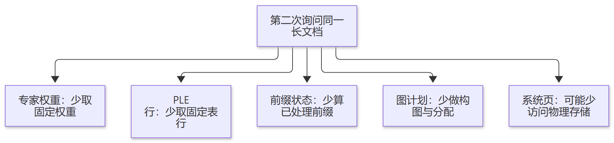

图 20：同一请求可能同时命中五种不同对象 · [SVG 原图](assets/llama-vs-strata/visual-guide/figure-20.svg)

<details>
<summary>查看原始图代码</summary>

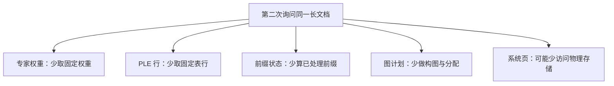

</details>
<!-- 图 20：同一请求可能同时命中五种不同对象 -->

第 20 张图从请求分叉，不是五层串行缓存。沿任一支路追问“没有它会重做什么”，就能分辨本次节省的是计算、搬运还是准备工作；其他支路命中不能代替这一支路。

### 想深挖

底座第 6.5、8.5、14.2 节；[行缓存适配][P-WEIGHT-ROWS]、[图兼容检查][L-GRAPH-REUSE]、[系统页缓存清理][S-CACHE-DROP]。第 14 章会把应用逻辑读与设备物理读放在不同统计栏中。

## 第 8 章 KV 与前缀复用：同一长文档能省掉什么

**一句话结论** 可复用的是匹配前缀对应的数值状态，文本相同只是必要核验的一部分。

### 用大白话讲

**8.1 同一文档，两次问题。** 设两次实际送入模型的内容都是“固定系统提示＋同一说明书＋本次问题”，只有末尾问题不同。分词后，从开头逐个比较编号，到第一个不同处停止，得到最长公共前缀（LCP）。源码事实：L 的比较在 [server-common.cpp:821][L-LCP]，服务复用分支在 [server-context.cpp:4121][L-PREFIX-REUSE]；多模态输入还要比较媒体身份，不能只看可见文字。

教学示例把文档编号写成 `11 22 33`，问题甲以 `71` 开头，问题乙以 `82` 开头，那么 LCP 是前三个位置；这些是示意编号，不是真实分词结果。若第二次请求把第一次答案也插入历史，或修改了前面的系统提示，实际前缀可能不同。引擎比较的是最终词元序列，不是“用户感觉还是那份文档”。

**8.2 为什么还需要检查点。** 循环状态模型（recurrent model）会把历史持续压进一份更新中的状态；混合模型（hybrid model）同时使用注意力与这类状态。只有当前状态，好比只剩累计值，不能任意退回此前某个位置。检查点（checkpoint）保存某个可恢复位置的必要运行状态；即使词元相同，也只能从实际拥有完整条件的位置继续。

源码事实：S 的 `ConversationCheckpoint` 保存词元、图像标识、循环状态、PLE 历史等，但不独立包含完整历史 KV 页，见 [conversation_cache.hpp:24][S-CONV-TYPES]；恢复还依赖对应 KV 有效。S 的前缀核验见 [conversation_cache.hpp:226][S-CONV-CACHE]。因此第 21 张图特意把“词元相同到这里”和“状态能恢复到哪里”分开。

**8.3 L 的四个位置。** 活动内存（live memory）是正在推理的 KV 或循环状态，可位于不同后端；槽位（Slot）是一条请求或会话的执行通道，记录词元历史、采样状态及 KV 位置引用，不能把一个 Slot 想成一份完整独立模型。共享 RAM 缓存保存序列状态字节，可以恢复到另一个目标槽位；状态文件接口则把全上下文或某序列状态显式写盘。相关入口分别为 [llama-memory.h:82][L-MEMORY]、[server-context.cpp:4121][L-PREFIX-REUSE]、[server-task.cpp:1756][L-RAM-CACHE]、[server-context.cpp:3254][L-SLOT-SAVE]。

共享 RAM 缓存超预算时删除条目，不会因此自动把它搬到 SSD。存在保存文件的接口，也不等于已经有自动 L0→L1→L2 淘汰系统。这里遵循底座第 8.2 节的边界，不把“可手动保存”写成“已自动分层”。

**8.4 S 的四组职责。** 名字里都有会话，不表示存了四份同样的数据。

| 文件组 | 作用 | 源码入口 |
| --- | --- | --- |
| `conversation_state.cpp` 与 checkpoint 类型 | 捕获、恢复运行状态；检查点依赖相应历史 KV | [conversation_cache.hpp:24][S-CONV-TYPES] |
| `conversation_snapshot.*` 与完整镜像操作 | 用完整会话镜像关联运行状态、KV 与缩放等数值 | [conversation_state.cpp:696][S-CONV-CAPTURE] |
| `conversation_file.*` | 编码、校验和读写会话文件，也有流式读取 KV 的接口 | [conversation_file.hpp:166][S-SESSION-FILE] |
| `conversation_memory.*` | 读取内存余量，决定保存、恢复能否准入 | [conversation_memory.hpp:70][S-CONV-MEMORY] |

S 的某些活动 KV 配置以主机池为权威副本，显存只放当前驻留页，见 [layer.hpp:233][S-KV-HOST]。所以第 22 张图按职责连接，没有把所有配置强画成“显存→RAM 快照→SSD”一条线。

**8.5 文件不是通用交换协议。** L 与 S 都能保存真实数值，不只是聊天文本；但格式、模型身份、布局与执行条件各有约束。S 的模型指纹只抽查文件大小及首尾部分，不能发现任意中段修改，见 [conversation_file.hpp:94][S-SESSION-IDENTITY]；L 的 KV 状态有自身元数据，见 [llama-kv-cache.cpp:2359][L-KV-STATE]。两边没有定义可互读的通用 KV 协议，也不能承诺形状相同而权重不同的模型安全互用。

### 看图

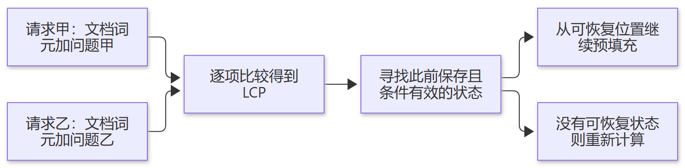

图 21：词元相同长度与可恢复长度不是一回事 · [SVG 原图](assets/llama-vs-strata/visual-guide/figure-21.svg)

<details>
<summary>查看原始图代码</summary>

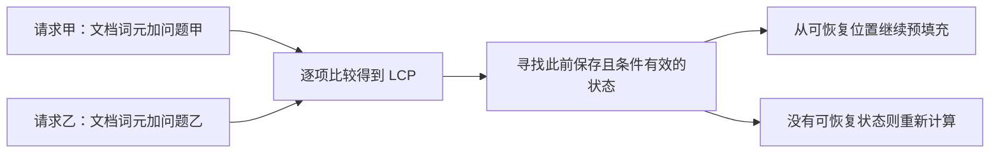

</details>
<!-- 图 21：词元相同长度与可恢复长度不是一回事 -->

第 21 张图中，LCP 只回答“内容从哪开始不同”。后半段还要核对检查点、KV、循环状态与执行条件；匹配长度不能直接当作本次实际少算的长度。

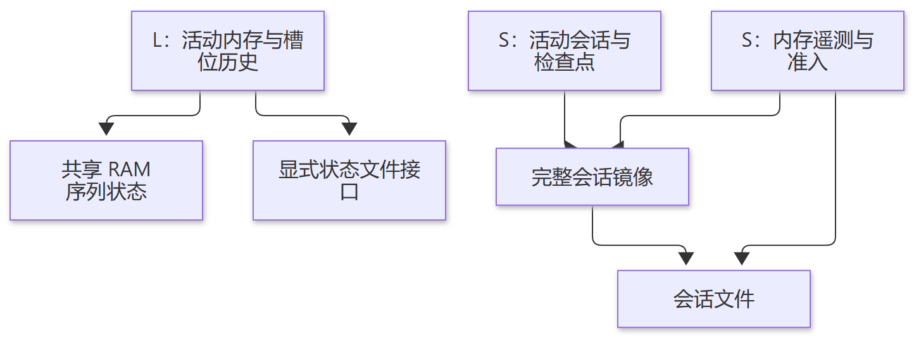

图 22：状态位置、完整镜像和准入管理的职责关系 · [SVG 原图](assets/llama-vs-strata/visual-guide/figure-22.svg)

<details>
<summary>查看原始图代码</summary>

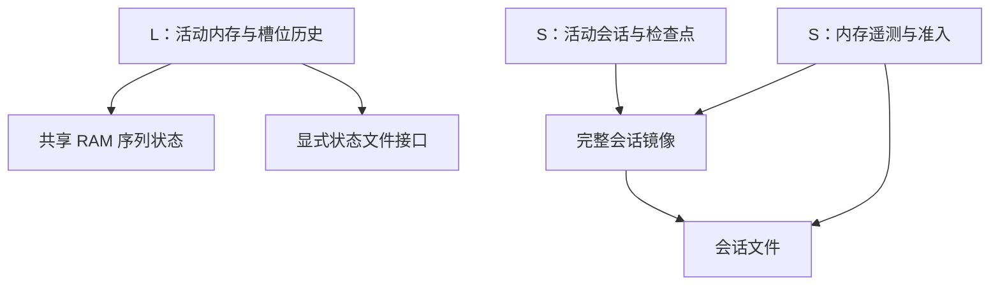

</details>
<!-- 图 22：状态位置、完整镜像和准入管理的职责关系 -->

第 22 张图的箭头表示可用的保存或管理关系，不宣称每次请求都走完它们。尤其注意：S 的内存管理模块决定“能不能存”，本身不是另一个会话容器。

### 想深挖

底座第 8.1–8.4 节；[L 前缀复用循环][L-PREFIX-REUSE]、[L 共享 RAM 缓存][L-RAM-CACHE]、[S 完整镜像恢复][S-CONV-CAPTURE]、[S 文件身份约束][S-SESSION-IDENTITY]。需要接外部缓存时，再看第 15 章的接口选择。

## 第 9 章 投机解码：先猜几步，再让目标模型验收

**一句话结论** 草稿只负责提出候选，接受规则与状态提交决定哪些候选真正成为输出。

### 用大白话讲

**9.1 一次猜错怎样处理。** 投机解码（speculative decoding）先让草稿器（drafter）提出若干候选，再让目标模型（target model，也就是本来负责回答的模型）验证。假设候选用“甲、乙、丙”三个占位词元表示，目标模型按匹配规则认可甲、乙，却在第三处选了丁，那么只接受前两项；丙及依赖丙的后续草稿不能留下。引擎还须丢弃或恢复未接受部分的状态，再从正确位置继续。这个例子只解释流程，不表示真实分词或任意采样模式的输出。

源码事实：L 的候选接受循环见 [common/sampling.cpp:690][L-SPEC-SAMPLING]；S 用验证窗口计算，再按接受长度提交状态，见 [verify.cpp:3229][S-VERIFY-RUN]、[verify.cpp:3876][S-VERIFY-COMMIT]。回滚（rollback）指清掉或恢复不应保留的状态，提交（commit）指确认接受前缀；二者要覆盖相应的 KV、循环状态与查表历史，不能只截短输出字符串。

**9.2 两边都有 MTP。** 多词元预测（Multi-Token Prediction，MTP）是草稿来源之一，不是“缓存里已经有正确答案”。L 有 MTP 草稿驱动，见 [common/speculative.cpp:1542][L-SPEC-MTP]；S 也有训练得到的预测层，见 [mtp.hpp:3][S-MTP]。是否启用、候选实际给出多少、接受多少，都要看运行配置与日志；机制存在不等于本次实验用了它。

**9.3 三种规则分别在做什么。** 概率分布就是“各候选词元会被选中的机会”。下面只解释读代码所需的区别，不要求先学完整推导。

| 规则 | 可理解的解释 | 容易误读的地方 |
| --- | --- | --- |
| 匹配接受 | 目标模型在每个位置自己选择或采样，与草稿相同就继续，遇到首个不同处停止 | 不是看句子意思差不多；全接受时还可能得到额外词元 |
| 概率拒绝 | 草稿同时提供自己的概率分布，验证器按目标与草稿的概率关系决定接受；拒绝时再按修正后的分布选词 | 需要真实草稿分布与相应分支，不能用一个猜出的词元冒充完整概率信息 |
| 共享随机数 | 两边使用对应的同一次随机抽签，使相近分布更容易选中相同候选，随后仍由目标规则验证 | 不等于概率拒绝，也没有省掉验证 |

源码定位：L 的匹配与概率拒绝分别在 [sampling.cpp:690][L-SPEC-SAMPLING]、[sampling.cpp:736][L-SPEC-REJECTION]；S 的共享随机数说明在 [coupled_draft.hpp:3][S-COUPLED]，概率接受分支在 [sampler.cu:1048][S-SAMPLER]。S 的部分置信门组合还有分布偏差约束，见 [generate.cpp:3152][S-GATED]。不能因为存在一条正确的接受算法，就替所有开关组合承诺相同分布。

**9.4 哪些属于质量档位。** 专家尾跳（route tail skip）是在条件满足时跳过部分低排名、未命中的专家，并改变主模型贡献，见 [expert_source.cpp:4872][S-TAIL-SKIP]；第 6 章的 KVA 也改变主模型预填充计算。它们与“多猜一些，再按目标规则验证”不同。比较时应单列完整路由、尾跳、KVA、量化与 KV 表示等条件，再列草稿器和接受率；只对齐输出词元数不够。

### 看图

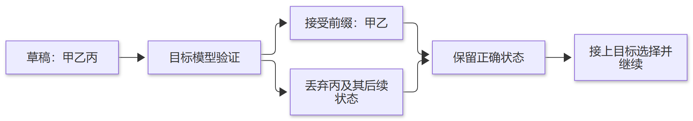

图 23：候选接受与状态回滚提交必须配套 · [SVG 原图](assets/llama-vs-strata/visual-guide/figure-23.svg)

<details>
<summary>查看原始图代码</summary>

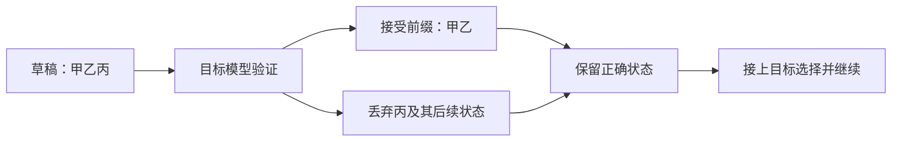

</details>
<!-- 图 23：候选接受与状态回滚提交必须配套 -->

第 23 张图中，接受的是从开头连续成立的前缀，不能绕过中间错误只保留后面的某个词元。两条支路汇合，表示输出与内部状态必须重新一致，才能进入下一轮。

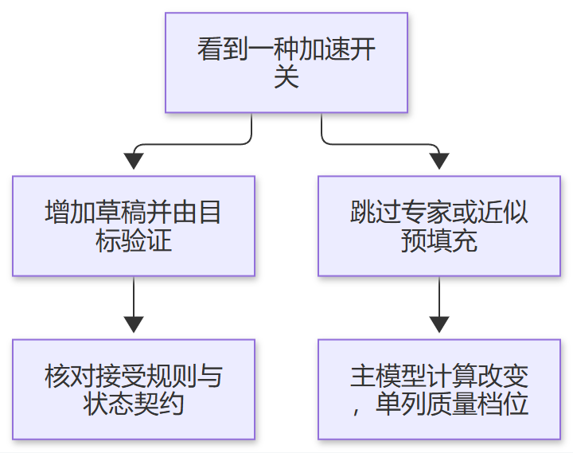

图 24：草稿验证与改变主模型计算的边界 · [SVG 原图](assets/llama-vs-strata/visual-guide/figure-24.svg)

<details>
<summary>查看原始图代码</summary>

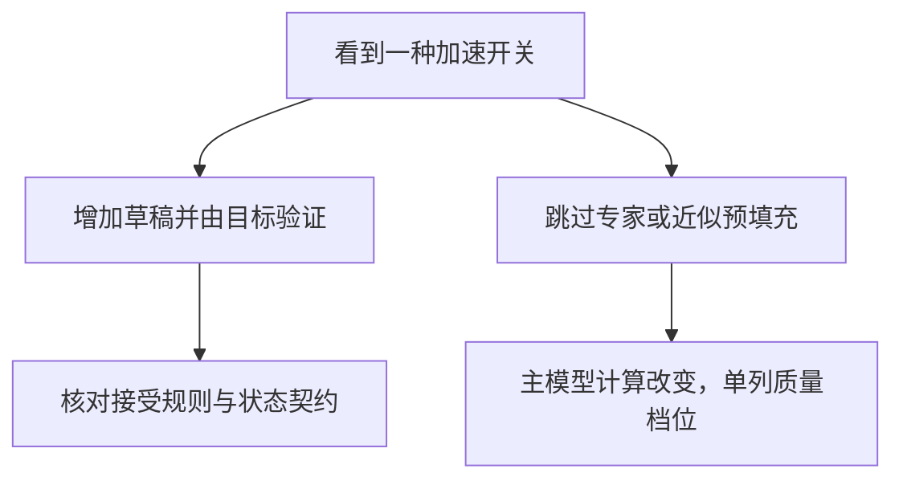

</details>
<!-- 图 24：草稿验证与改变主模型计算的边界 -->

第 24 张图教你先分类，再谈数字。左支也需要验证具体算法与配置，右支则必须同时说明计算改了什么、质量如何评估，不能把两者混成同一条“无损加速”。

### 想深挖

底座第 9.1–9.3 节；[L 接受循环][L-SPEC-SAMPLING]、[S 验证窗口][S-VERIFY-RUN]、[S 接受状态提交][S-VERIFY-COMMIT]。第 14 章的跨引擎对照关闭了草稿与专家尾跳，不能用其他配置的旧速度解释它。

## 第 10 章 服务调度与并发：用户等的时间不只在模型里

**一句话结论** 请求排队、模型执行和内容交付是不同阶段，同名并发参数或首词元时间不能直接互换。

### 用大白话讲

**10.1 两个请求同时到达。** 假设甲正在生成，乙带着一份长文档到达。服务层要决定乙先排队、先读一部分提示，还是能与甲放进同一次批处理。批处理（batching）是把多份计算工作一起交给引擎；它不等于每个请求拥有独立模型，也不保证所有工作同时完成。

源码事实：L 的单模型服务由 C++ HTTP 层、进程内队列与推理循环协作，见 [server-http.cpp:150][L-HTTP]、[server-context.cpp:3983][L-CONT-BATCH]。S 的 Python 服务通过进程间通信（IPC）管理原生引擎子进程，词元输出经管道返回再封装给客户端，见 [server.py:1101][S-PIPE]、[server.py:2229][S-BATCH-IPC]。Python 在这里管理协议与生命周期，不负责逐个张量运算。L 的路由器模式也可启动模型子进程，见 [server-models.cpp:1215][L-ROUTER]；因此第 25 张图只对照单模型主路径。

**10.2 三个参数的对象不同。** L 的 `parallel` 是执行槽位数量，`n_batch` 是逻辑词元批次上限，`n_ubatch` 是物理微批上限。比如两条会话可以在同一逻辑批次里各贡献待生成词元，长提示又会占更多位置；实际执行还会拆成受微批上限约束的小批。增加槽位不是直接增加每批词元上限，增加微批也不是增加用户数。参数字段见 [llama.h:369–371][L-BATCH-PARAMS]，批处理循环见 [server-context.cpp:3983 起][L-CONT-BATCH]，口径见底座第 10.3 节。

S 也有原生批量解码，多个槽位可以共同贡献验证窗口的行，不能概括成 Python 逐请求串行调用。它的请求准入与预填充控制又有独立约束，见 [server.py:2229][S-BATCH-IPC]、[BATCHING.md:1][S-BATCHING]。两边同叫 `parallel`，仍要检查到底创建了槽位、分组还是独立引擎副本。

**10.3 先约定“第一次看见什么”。** 引擎产出首词元时，客户端可能仍收不到答案：管道要解析，文字要拼接，协议要封装，结构化输出还可能等到完整校验。反过来，客户端早早收到一个角色字段或空事件，也不表示答案已经开始。第 26 张图是建议记录的测量边界，不宣称现有日志已经提供每个时间戳。

| 时刻或区间 | 回答的问题 |
| --- | --- |
| 客户端提交 | 从何时开始计算用户等待 |
| 排队与获准执行 | 有多少时间在等引擎接单 |
| 预填充开始与结束 | 当前提示实际算了多久，复用了多少前缀 |
| 引擎首词元 | 模型端何时开始给出输出 |
| 首个可见内容 | 客户端何时真正看见所关心的内容；推理文字与答案文字也要约定 |
| 完整 JSON | 结构化结果何时完整且可交付，不应冒充流式首词元 |

源码事实：S 的结构化流缓冲在 [server.py:7306][S-STRUCTURED-STREAM]，会先收集、验证再交付内容。本文两份 Q5 报告的 TTFT 是从提交输入到首词元，具体数字只按报告自身口径引用；它们不是对任意 HTTP 客户端首可见答案时间的保证。

**10.4 生成时约束与生成后验收。** 以需要 JSON 配置为例，语法约束生成（grammar constrained decoding）会在选词过程中排除不符合所选语法的候选；生成后验证则先得到结果，再判断它是否为合法 JSON、是否满足模式。L 有语法采样与模式到语法的转换路径，见 [sampling.cpp:647][L-GRAMMAR]、[json-schema-to-grammar.cpp:1025][L-JSON-GRAMMAR]，不表示任意模式特性均可转换，也不保证业务语义正确。

S 已核查的主服务路径使用提示引导与生成后验证，原生引擎没有同等语法解码器；缺少可选 `jsonschema` 依赖时，只检查 JSON 对象这一层，见 [structured.py:1–8][S-STRUCTURED]。所以两个接口都接受结构化输出参数，并不意味着约束、错误返回或交付延迟相同。

### 看图

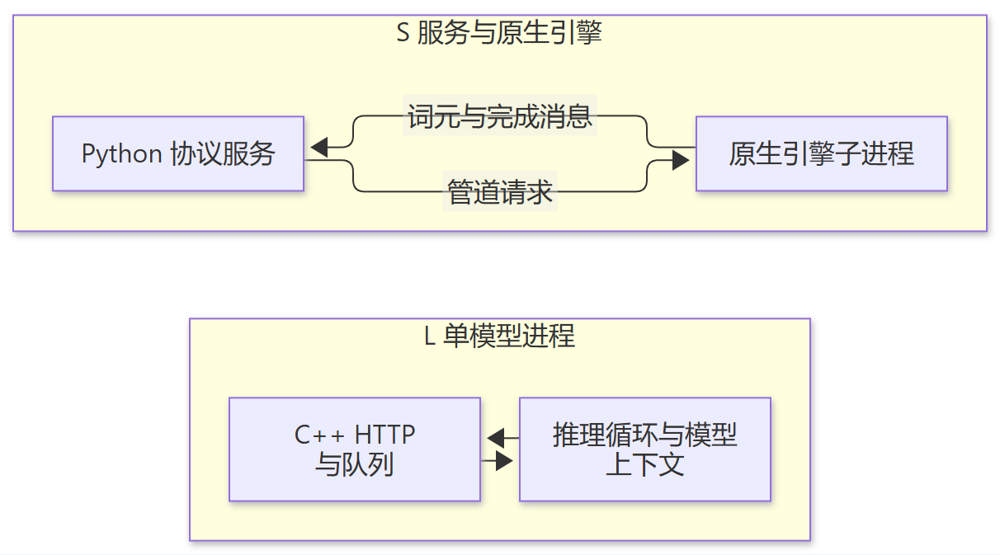

图 25：单模型服务中的进程与协议边界 · [SVG 原图](assets/llama-vs-strata/visual-guide/figure-25.svg)

<details>
<summary>查看原始图代码</summary>

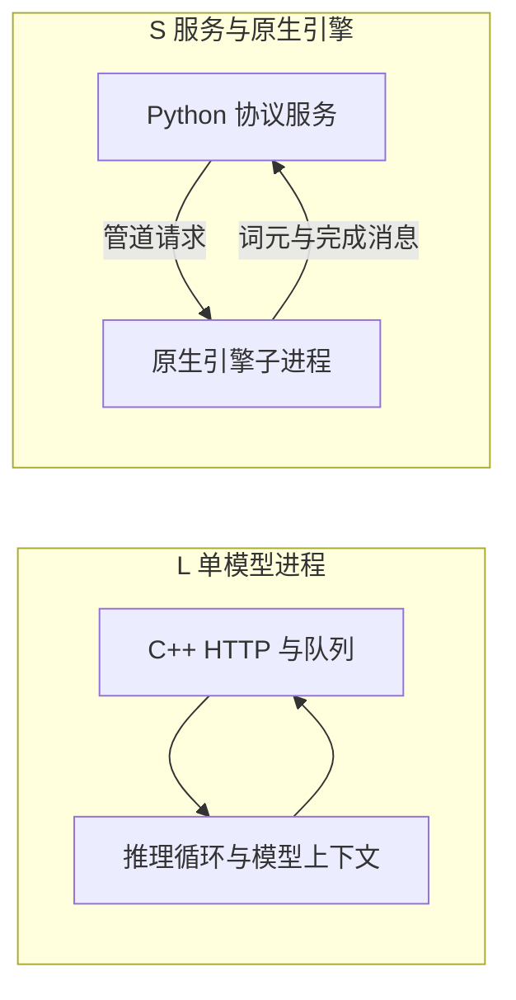

</details>
<!-- 图 25：单模型服务中的进程与协议边界 -->

第 25 张图看的是控制与交付边界，不能从多一条管道推算慢多少。两边的排队、预填充、状态复用与缓冲行为，仍须在同样的客户端口径下测量。


图 26：建议分别记录的等待与内容交付边界 · [SVG 原图](assets/llama-vs-strata/visual-guide/figure-26.svg)

<details>
<summary>查看原始图代码</summary>

```mermaid
flowchart LR
A["客户端提交"] --> B["排队与准入"] --> C["预填充"]
C --> D["引擎首词元"] --> E["首个可见内容"] --> F["完整 JSON 可交付"]
```

</details>
<!-- 图 26：建议分别记录的等待与内容交付边界 -->

第 26 张图中，普通流式回答与结构化回答的间隔可能很不同；某些缓冲模式下后两个时刻接近重合。这是测量设计示意，不是把所有区间都归因于模型计算。

### 想深挖

底座第 10.1–10.3、10.5–10.6 节；[L 连续批处理循环][L-CONT-BATCH]、[S 批量请求入口][S-BATCH-IPC]、[S 结构化流缓冲][S-STRUCTURED-STREAM]。源码能说明边界存在，不能替代端到端延迟实测。

## 第 11 章 多卡多机：先看拆分的对象

**一句话结论** 拆层、拆张量、分专家、复制引擎和远端设备，分担的不是同一种工作。

### 用大白话讲

设模型或请求量已经超出一张卡方便处理的范围。增加第二张卡，可能是让它接后半段层，可能让它共同算每一层，可能只让它算部分专家，也可能启动另一个完整引擎专门接乙用户。四种方案的数据流、重复占用与并发能力都不同，不能只用“支持多卡”概括。

| 拆分对象 | 实际分担什么 | 本地快照的边界与定位 |
| --- | --- | --- |
| 层 | 前面层在甲卡，后面层在乙卡，传递中间结果 | L 有层切分；S 按连续层范围分配，提示可按块流水，部分常驻数据仍可能每卡复制：[arg.cpp:2799][L-SPLIT]、[MULTI_GPU.md:95][S-MULTI-GPU] |
| 层内张量与计算 | 同一层由多卡各做一部分，再交换结果 | L 的 `split-mode` 有 row 与实验性 tensor 等选择；S 的独立 `strata-split` 让每卡参与每层，当前选择规则有 Linux、模型和设备条件：[arg.cpp:2799][L-SPLIT]、[SPLIT_ENGINE.md:3][S-SPLIT-ENGINE] |
| 专家集合或专家计算 | 主卡照常执行主体，辅助卡容纳或计算部分专家 | S 的 helper、peer、`RemoteExperts` 是同机辅助 GPU 路径，后者并非网络调用：[peer_experts.hpp:3][S-PEER]、[remote_experts.hpp:18][S-REMOTE] |
| 请求 | 独立完整引擎各接一部分请求 | S 的引擎副本（replica）各有自己的资源，路由还考虑前缀匹配与在途工作：[replicas.py:513][S-REPLICAS] |
| 设备位置 | 把 ggml 设备执行放到远端主机 | L 的远程过程调用（RPC）后端提供远端设备协议，含网络与执行边界：[tools/rpc/README.md:76][L-RPC] |

`--tensor-split` 在 L 中是设备分配比例，不等于选择了 `split-mode=tensor`，应连同模式一起读，依据见底座第 10.4 节与 [arg.cpp:2799 起][L-SPLIT]。同样，S 的辅助专家卡不是完整模型副本；它不能独立承担一个请求的全部层与状态。

**预填充与解码拆开又是什么。** S 的分离服务（split serve）让本地预填充引擎先读提示，再保存会话文件，由解码引擎恢复；当前路径是单请求且不重叠，见 [serve/split.py:378][S-SPLIT-SERVE]。它证明存在会话交接，不证明已经有通用的网络 KV 分发。LMCache 是缓存中间件，远程直接内存访问（RDMA）是一类数据传输机制；本地文件交接不能被称为现成的 LMCache 或 RDMA 连接器。

这是推断：多设备设计应先写明每份权重、状态和中间结果归谁，再决定怎么传。卡数增加并不能独立证明延迟下降；重复权重、同步与结果汇合都可能改变代价。

### 看图

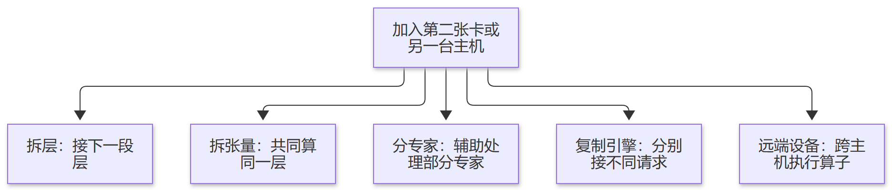

图 27：多设备方案按拆分对象分类 · [SVG 原图](assets/llama-vs-strata/visual-guide/figure-27.svg)

<details>
<summary>查看原始图代码</summary>

```mermaid
flowchart TD
A["加入第二张卡或另一台主机"] --> L["拆层：接下一段层"]
A --> T["拆张量：共同算同一层"]
A --> E["分专家：辅助处理部分专家"]
A --> R["复制引擎：分别接不同请求"]
A --> D["远端设备：跨主机执行算子"]
```

</details>
<!-- 图 27：多设备方案按拆分对象分类 -->

第 27 张图不是五种可互换开关。先选中与你的需求相符的那条支路，再追踪状态归属和传输对象，就能避免把“扩专家容量”误解为“复制整个服务”。

### 想深挖

底座第 6.4、10.4 节；[L 切分参数][L-SPLIT]、[L 远端设备说明][L-RPC]、[S 层切分][S-MULTI-GPU]、[S 本地会话交接][S-SPLIT-SERVE]。各机制的模型族、平台与设备条件不能互相借用。

## 第 12 章 量化、模型文件与后端：名字一样仍要核对接口

**一句话结论** 文件能读、张量能解释、内核能执行与目标平台验证通过，是四件事。

### 用大白话讲

**12.1 文件名不能代替张量清单。** GGUF 是承载模型权重与元数据的文件格式，还可能拆成多个分片。量化（quantization）用较紧凑的表示保存权重，执行时再按相应规则参与计算。数据类型（dtype）说明单个张量的数值编码；模型包（pack）则可能为不同角色选择不同类型。比如模型包叫 UD-Q5_K_XL，并不表示每个张量都是 Q5：S 的格式文档列出专家 gate 与 up 主要用 Q5_K，特定层用 Q6_K，down 用 Q8_0，见 [QUANTS.md:14–20][S-QUANTS]。这里 gate、up、down 是同一专家内部不同计算角色的权重，不是三位不同专家。

**12.2 36 与 44 为什么不矛盾。** 源码事实：L 的 `ggml_type` 有 36 个当前有效枚举项，包含浮点、整数、中间表示与量化类型；`GGML_TYPE_COUNT = 44` 是保留历史空洞后的编号上界。注释掉的旧类型不算有效项，36 也不等于 36 种可选模型量化档，见 [ggml.h:391–436][L-GGML-TYPES]。

S 的 trellis 是另一组编码与内核扩展，不能因为都带 TQ 字样，就当作 L 的 TQ1_0、TQ2_0。它的隔离编号位于 144–149，见 [扩展 ggml.h:433][S-TQ-TYPES]；不能直接拿这些编号索引普通上游类型表。G 又是较早副本，比较底层行为仍要保留版本身份。

**12.3 真正的兼容性要查什么。** 布局（layout）决定字节怎样排列，缩放参数（scale）参与解释量化数值，计算内核（kernel）是设备实际执行的程序。同叫 NVFP4，也还要核对模型包的量化方法、块与张量的缩放、角色布局及对应内核；S 的说明见 [NVFP4.md:6 起][S-NVFP4]。文件后缀一致不足以保证数值、加载和执行兼容，具体边界沿用底座第 11 节。

**12.4 后端组织怎样影响改代码。** 后端（backend）承接通用操作到设备实现的工作。L 的注册层把后端与设备纳入统一接口，见 [ggml-backend-reg.cpp:186][L-BACKEND-REG]；模型图再由调度器安排执行。S 的 Flash-Next 则有专用执行与平台适配，部分计算复用 ggml；Metal 与 SYCL 还分别有自己的工程，见 [metal/CMakeLists.txt:1][S-METAL-CMAKE]、[sycl/CMakeLists.txt:3][S-SYCL-CMAKE]。不能把平台目录数量当成相同的插件体系。

| 修改需求 | L 的主要维护边界 | S 的主要维护边界 |
| --- | --- | --- |
| 新增模型结构 | 参数、权重和模型图；已有操作可复用后端 | 具体模型族执行器、几何形状与权重契约 |
| 新增计算操作 | 通用操作接口，以及各后端实现或明确回退 | 专用执行流程、相应内核与平台分支 |
| 新增设备平台 | 接入后端与设备注册，验证所需操作覆盖 | 适配专用运行时、内核、构建与对应模型路径 |

上表是基于底座第 12 节的维护边界推断，不是开发速度排名。S 的编译几何形状契约见 [geometry.hpp:1][S-GEOMETRY]；“能编译某个后端”也不等于目标模型与硬件组合已有数值或性能验证，其能力表明确区分这些层次，见 [CAPABILITIES.md:1][S-CAPABILITIES]。有 CPU 专家池同样不能推出所有模型均可纯 CPU 服务。

### 看图


图 28：从文件名走到实际可执行与已验证的组合 · [SVG 原图](assets/llama-vs-strata/visual-guide/figure-28.svg)

<details>
<summary>查看原始图代码</summary>

```mermaid
flowchart LR
A["模型包名称"] --> B["逐张量核对类型与角色"]
B --> C["核对布局与缩放参数"]
C --> D["匹配模型族和设备内核"]
D --> E["再核对目标组合的验证记录"]
```

</details>
<!-- 图 28：从文件名走到实际可执行与已验证的组合 -->

第 28 张图是一条核对路线，不是加载器必定按此顺序执行的调用链。只通过前两格，仍不足以承诺后面的设备能正确执行，更不足以引用其他设备上的性能。

### 想深挖

底座第 11.1–11.2、12.1–12.3 节；[L 类型表][L-GGML-TYPES]、[S 各角色格式][S-QUANTS]、[L 后端注册][L-BACKEND-REG]、[S 平台与模型能力][S-CAPABILITIES]。新增模型与新增操作，所需验证范围并不相同。

## 第 13 章 P 补丁：把文件供给接进已有执行链

**一句话结论** P 改的是受控供给与失败契约，保留模型图、路由和原有 GPU 专家缓存。

### 用大白话讲

**13.1 跟一份缺失的专家权重走完。** 假设路由已经选中某层某专家，而 GPU 与 RAM 都没有可用副本。加载阶段登记的分片、偏移与步长告诉文件源“这份角色权重在哪”；运行时按所需字节范围读取，绝不是把整个模型文件读进 staging。文件读取完成后，程序可把完整角色字节准入 RAM，再从有效上传源执行 H2D；直到上传消费者不再读取源数据，才允许复用中转槽、归还租约。

源码事实：登记与文件模式说明在 [file-expert-store.md:54–60][P-DOC]，传输主链在 [llama-expert-store.cpp:665][P-TRANSFER]，发起读取在 [同文件:446][P-START-READ]，回收与等待在 [同文件:516][P-REAP]。这里“等待消费完成”主要保护上传源的寿命，不是要求整次模型计算全部结束；GPU 权重槽何时能覆盖，还由原有 MoE 缓存与计算依赖管理。

| 查询结果 | 后续动作 | 不能据此宣称什么 |
| --- | --- | --- |
| GPU 专家已驻留 | 使用原有驻留数据；一般大批量路径也可从已有 GPU bank 复制 | 所有命中都还要先读 RAM 或文件 |
| GPU 缺失，RAM 命中 | 取得有效缓存条目并保护其寿命，再交上传消费者 | RAM 命中等于免上传、免计算，或接口天然零复制 |
| 两处均缺失 | 文件读到 staging，可选准入 RAM，再上传 | 所有读取一定进入 RAM，或必须上传整层 |

上表的 GPU 复用与提示扫描准入行为见 [llama-moe-cache.cpp:944–969][P-GENERAL-UPLOAD]。RAM 命中时，本快照在 [llama-expert-store.cpp:705–706][P-RAM-HIT] 复制条目字节到 staging；消费者接口本身接收的是有效指针，并允许持有到 `wait` 完成，见 [llama-expert-store.h:86][P-CONSUMER]。第 16 张图抽象了这个契约，第 29 张图展开文件缺失的实际主线。

**13.2 读取与上传怎么交错。** `transfer` 的主填槽循环在槽满时 `reap`，请求取完后再排空余下槽，见 [llama-expert-store.cpp:686–719][P-TRANSFER]；缓存条目仍被占用等条件也可能触发提前回收，见 [同文件:597–645][P-ACQUIRE]。所以默认深度 2 已可先持有两份在途工作，但不保证每个时刻都占满；它不是每提交一次就立刻等待一次。`reap` 按队首等读、填 RAM、提交上传、等上传、释放；上传端用完成事件确认源缓冲可复用，见 [llama-expert-store.cpp:759–783][P-UPLOAD]。应用槽既承载读，也承载上传等待，不能据槽数反推磁盘队列。

**13.3 预算不是一笔总内存。** 下表是当前生产原型的默认值，不是第 14 章历史实验所用的手动配置；来源为 [file-expert-store.md:7–15、46、64][P-DOC]。

| 控制项 | 默认 | 约束对象 |
| --- | ---: | --- |
| 专家 RAM | 256 MiB | 专家角色缓存及相关记账；按精确大小分组，不自动与 GPU 互补 |
| 专家 staging | 32 MiB | 专家流水线共享中转空间及对齐余量，不是每槽各有一份该预算 |
| `io_depth` | 2 | 专家读到上传完成的在途槽；当前生产支持 1、2 |
| 图工作区 | 4096 MiB | GPU 图执行的临时工作区，不含常驻权重、KV、专家 GPU 缓存、驱动或其他进程 |
| PLE RAM | 64 MiB | 独立的查表行缓存；其固定中转空间另行记账 |

缓存分配字节也不等于有效独立覆盖字节：P 的 GPU 与 RAM 可以重复保存同一角色，固定分组还可能有闲置容量。这是源码边界，不是已证明的某条轨迹损失比例；对应底座第 13.2、13.4 节。

**13.4 为什么还要改 ggml 边界。** 复制回调（copy callback）让文件源接管某次张量复制。若读盘失败，却只返回“没有处理”，调度器可能继续走普通复制，既掩盖失败，又可能碰到不应整张量读取的映射。P 因此让状态与“是否已处理”分开：成功且已处理就结束；成功但未处理才允许原路径；失败或取消则阻断依赖计算，见 [ggml-backend.h:346][P-COPY-API]、[ggml-backend.cpp:2126][P-COPY-FAILURE]。

预留测量（reserve）估算图需要多少缓冲。文件专家操作先被明确指派给支持设备，再测量工作区；若测量清掉了这个指派，算出的计划就不再对应准备执行的计划。P 增加保留显式设备的测量接口，见 [ggml-backend.cpp:2421][P-RESERVE-API]，指派与预算回退分别见 [llama-context.cpp:3160][P-FILE-GRAPH]、[同文件:883][P-WORKSPACE]。测量会影响图状态，后续须按实际路径重建，不能把一次测量当成永久不变的图。

**13.5 关闭、拒绝和失败各是什么意思。** `LLAMA_EXPERT_STORE=file` 才启用文件模式；当前范围是 Windows、单 CUDA、单条因果文本序列、非零 GPU 专家缓存、CPU 缺失计算比例为零，并拒绝 MTP、LoRA 和多设备切分等组合，见 [file-expert-store.md:9、42][P-DOC]、[llama-context.cpp:201][P-SCOPE]。关闭文件模式也不能自动承诺与上游逐字节相同：P 还增加普通模式预取控制和部分预留失败传播，底座第 13.4 节单列了这些改动。

失败后要取消并排空已提交读取、等待已提交上传、作废不完整条目、释放租约；文件模式上下文失效时需重建，见 [file-expert-store.md:70][P-DOC]。本文未重跑已有测试，不能把源码中的这些路径写成本次数值或故障验证通过。

### 看图


图 29：P 文件缺失路径的数据与寿命顺序 · [SVG 原图](assets/llama-vs-strata/visual-guide/figure-29.svg)

<details>
<summary>查看原始图代码</summary>

```mermaid
flowchart LR
A["文件角色范围"] --> B["读入 staging"] --> C["可选 RAM 准入"]
C --> D["H2D 使用有效源指针"] --> E["等待源数据消费完成"]
E --> F["释放槽与租约"]
```

</details>
<!-- 图 29：P 文件缺失路径的数据与寿命顺序 -->

第 29 张图的“可选 RAM 准入”允许直接跳过缓存保存；上传仍要拿到有效数据。沿主线看，能够提交 H2D 并不等于源缓冲可立即覆盖，事件等待正是这条寿命界线。

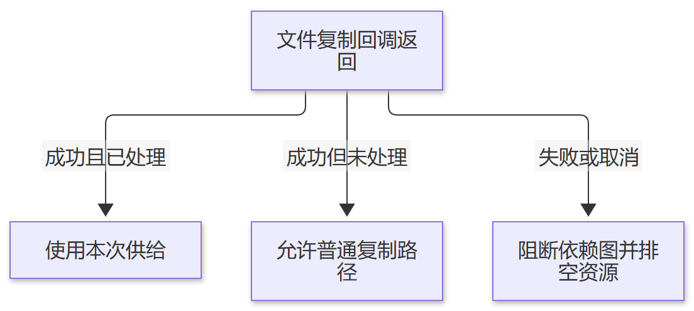

图 30：未处理与失败必须成为不同结果 · [SVG 原图](assets/llama-vs-strata/visual-guide/figure-30.svg)

<details>
<summary>查看原始图代码</summary>

```mermaid
flowchart TD
A["文件复制回调返回"] -->|"成功且已处理"| B["使用本次供给"]
A -->|"成功但未处理"| C["允许普通复制路径"]
A -->|"失败或取消"| D["阻断依赖图并排空资源"]
```

</details>
<!-- 图 30：未处理与失败必须成为不同结果 -->

第 30 张图把“我不负责”与“我负责但失败了”分成两条边。错误若流向中间那条边，后续计算可能继续使用错误的数据来源；这是接口语义问题，不是换一种读取容器就能解决的。

### 想深挖

底座第 13.1–13.4 节；[传输流水][P-TRANSFER]、[消费者指针寿命][P-CONSUMER]、[GPU 上传事件][P-UPLOAD]、[失败传播][P-COPY-FAILURE]、[保留设备的测量][P-RESERVE-API]。P 与 S 是设计语义上的借鉴关系，现有证据不足以称为整段同实现移植。

## 第 14 章 性能证据：数字能说明什么，不能说明什么

**一句话结论** 现有报告支持特定条件下的路径观察，不能把三次对照或两轮筛选升级成普遍排名。

### 用大白话讲

**14.1 先认测量对象。** 本章只转述两份既有实测：[q5-strata-compare-20261111/REPORT.zh-CN.md][R-Q5-REPORT] 与 [q5-io-depth-20261111/REPORT.zh-CN.md][R-Q5-DEPTH]。它们都是共享机器、非独占 RTX 5080 下的初步结果；本文没有重新运行模型。B 中的 Strata 是引擎 0.1.58，不是源码快照 S 的 0.1.59。

三方报告使用 Windows、同一 Qwen3.8-Flash-Next UD-Q5_K_XL、128 个提示词元与 128 个强制输出词元，各臂 3 个有效样本；进程工作集上限 24 GiB，GPU 专家缓存约 4 GiB，P6 与 Strata 的专家 RAM 约 16 GiB。原生参考关闭加载预取，仍可利用系统文件页缓存；相同进程工作集上限不是相同全系统 RAM 上限。Strata 关闭 MTP、lookup 与专家尾跳，且没有提示复用；这些条件均来自上述三方报告。

**14.2 启动与 READY 后响应要放在一起看。** 就绪信号（READY）表示引擎已完成相应初始化、可以接后续请求。启动时先预装专家，与收到请求后再准备，会把成本放在不同位置。

| B 中的路径 | 解码中位数与三次范围，词元每秒 | READY 后请求 TTFT，秒 | 首个子进程内存样本到 READY，秒 |
| --- | ---: | ---: | ---: |
| 原生 mmap 参考，关闭加载预取 | 1.75，范围 1.72–1.79 | 76.96 | 5.86 |
| P6 | 2.36，范围 2.32–2.44 | 28.97 | 2.63 |
| Strata 0.1.58 | 2.21，范围 0.76–2.54 | 11.28 | 22.32 |

实测来源：`research/q5-strata-compare-20261111/REPORT.zh-CN.md` 的“同条件数据”。各数值为报告规定窗口的中位数；解码从首词元到末词元，共 127 个间隔。Strata 的较短 READY 后 TTFT 不能隐藏其初始化时间；报告把每轮两个阶段相加后再取中位数，P6 与 Strata 分别为 32.00、33.58 秒。这是阶段和估计，不是另行测得的冷启动服务延迟，也不能直接相加表中两列中位数代替。

同一报告中，原生参考、P6、Strata 的 Q5 物理读取分别约为每解码步 129.9、461.2、574.4 MiB；设备观察在途数（QD/I）的 p50 与 p95 分别为 0/0、0/0、5/18。p50 表示中位数，p95 是第 95 百分位。少读物理字节没有自动对应更短时间；文件页命中、读请求大小、同步与计算分工可能一起影响结果。把差异具体归给某一个机制仍属推断，尚未逐项消融。

**14.3 深度筛选只改了什么。** 第二份报告在隔离副本中改变 P6 在途槽上限，保持权重、路由、缓存、总 staging 等条件；生产默认仍是 2。下表完整保留两轮数据。逐词元间隔的第 99 百分位（p99）描述该轮较慢的间隔，不是请求级 p99。

| 实验深度 | 两轮解码，词元每秒 | 解码中位数 | 两轮词元间隔 p99，秒 | Q5 物理 MiB 每解码步 | 设备 QD/I 的 p50 与 p95 |
| ---: | ---: | ---: | ---: | ---: | ---: |
| 1 | 2.01 / 0.67，后者为补采 | 1.34 | 2.074 / 11.374 | 461.15 | 0 / 0 |
| 2 | 2.28 / 2.30 | 2.29 | 1.320 / 1.259 | 461.15 | 0 / 0 |
| 4 | 2.44 / 2.53 | 2.48 | 1.128 / 1.455 | 461.15 | 0 / 0 |
| 8 | 2.51 / 2.69 | 2.60 | 1.314 / 1.070 | 461.15 | 0 / 1 |

实测来源：`research/q5-io-depth-20261111/REPORT.zh-CN.md`。深度 4 的第二轮 p99 增加 15.6%，没有通过预设门槛；深度 8 只是下一轮长测候选，不是新生产默认，也没有证明慢读治愈。

**14.4 慢段记录不能抹掉。** 原第二轮深度 1 完成输出轨迹，但只有 0.72 词元每秒、最长间隔 31.9 秒；事件跟踪（ETW）文件达到上限，未留下完整跟踪和写出的候选词元数值分数（logits），因此保留原日志并补采，而不是把它改成成功样本。补采为表中的 0.67 词元每秒，也出现慢段。报告在补采中观察到大量变慢的串行读取累积，但不能据此区分 SSD、驱动、文件系统或共享主机干扰；原 31.9 秒慢步缺少完整证据，不能套用补采解释。来源仍是同一深度报告。

**14.5 三个不同的计量层。** 深度 2、4、8 每请求均有 86,217 笔应用专家读，87.63 GiB 逻辑字节、87.96 GiB 对齐字节，包含预填充；解码物理区间与次数相同，每步约 461.15 MiB。深度 2→8 的整请求读取等待中位总时长约 36.0→28.2 秒，上传等待约 20.0→17.9 秒。这些是应用等待，不能当成纯磁盘服务时间或纯 CUDA 复制时间；它们的端点与设备执行窗口不同。

应用在途槽确实用到了 8，设备 `QD/I` 却仍浅。`QD/I` 是盘上观测到的在途数统计，不等于应用槽深，更不是 SSD 内部队列。第 31 张图把几层记录分开，避免用一个计数解释全部延迟。

完整深度运行还核对了逐位一致的 logits 与相同解码专家物理区间多重集合，证据来自报告，非本文新跑。数值分数（logits）是模型采样前给候选词元的分数；只让最终词元编号相同，并不足以推出这些分数相同。跨引擎的强制词元轨迹只是工作量控制，不能被写成 P6 与 Strata 质量或数值等价。

### 看图

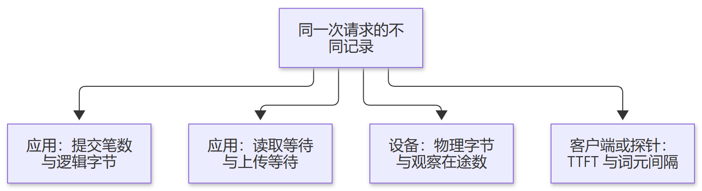

图 31：逻辑工作、应用等待、设备读与端到端时间分开 · [SVG 原图](assets/llama-vs-strata/visual-guide/figure-31.svg)

<details>
<summary>查看原始图代码</summary>

```mermaid
flowchart TD
A["同一次请求的不同记录"] --> B["应用：提交笔数与逻辑字节"]
A --> C["应用：读取等待与上传等待"]
A --> D["设备：物理字节与观察在途数"]
A --> E["客户端或探针：TTFT 与词元间隔"]
```

</details>
<!-- 图 31：逻辑工作、应用等待、设备读与端到端时间分开 -->

第 31 张图中的支路是不同观察口，不是可直接相加的耗时分解。比如应用等待可能与设备活动重叠，逻辑字节也可能因对齐、合并或页缓存而不同于物理字节。

### 想深挖

底座第 14.1–14.2 节；[三方报告][R-Q5-REPORT]、[深度消融报告][R-Q5-DEPTH]。权重 SSD 实验不证明会话 KV 的 L2 容量收益；早期 KV 工作集未真正越过 RAM 预算，这一证据边界沿用底座第 14.2 节。

## 第 15 章 下一步机制：深度、批量提交与区间合并分别改什么

**一句话结论** 增加槽位、集中提交与少发几笔较大的读，是三个独立变量，都须保留预算与数据寿命契约。

### 用大白话讲

**15.1 把“多读几份”拆开。** 假设这一层已经选出若干专家，程序需要从同一分片取得它们的角色字节。你可以给更多请求留槽，可以先收集一批再提交，也可以把相近范围合成一笔大读。这些动作可能一起使用，但不能拿其中一个名称解释全部收益。

| 机制 | 改了什么 | 没有自动保证什么 |
| --- | --- | --- |
| 在途深度 | 同时允许多少份工作占用受管理的槽；P 的槽跨读取与上传生命周期 | 设备始终有同样数量的磁盘读在途 |
| 批量提交 | 先收集若干请求，在首次等待之前尽量提交这些请求 | 字节更少、请求被合并，或设备 QD/I 一定增加 |
| 区间合并 | 用一个覆盖多个有效区间的较大区间替代若干读，再把有效字节分发回去 | 物理字节减少，或对所有存储路径都有收益 |

源码事实：P 在 [llama-expert-store.cpp:686–708][P-TRANSFER] 检查槽是否已满，满了才 `reap`；末尾再排空剩余工作。它已经能填到当前深度，不是“发一笔就立即等一笔”。`reap` 仍按队首处理读取、RAM 填充与上传等待，见 [同文件:516–559][P-REAP]。这是推断：即使重新整理为批量列表，如果相同槽仍被上传等待占住，实际设备队列也未必变深。第 14 章的应用深度 8 与浅设备队列，正说明两者不能画等号。

**15.2 Strata 的 Windows 路径实际怎样做。** 新增定点源码核查见 [expert_source.cpp:2753][S-READ-DIRECT]，只用于细化底座第 6.3 节已有的“对齐、排序、合并与批量读取”，不新增性能结论。

1. 对每个原有效范围计算向外取整的 4096 字节对齐窗口，保留原范围相对窗口的偏移与目标地址；原始 GGUF 布局可按不同角色所在文件组织，见 `expert_source.cpp:2779–2797`。
2. 按文件身份、窗口起点排序；只考虑同文件合并。追加窗口的起点不晚于当前末端加 `kGap = 1 MiB`，且合并跨度不超过 `kMerge = 32 MiB` 时合并，见 `expert_source.cpp:2802–2827`。这是追加合并的条件，不是把任意单独的大区间自动切成该大小。
3. 为这批合并请求准备对齐临时缓冲（scratch）与事件，然后在首次等待前逐笔调用 `ReadFile` 提交整批；若中途提交失败，也要等已经提交的工作收束，见 `expert_source.cpp:2829–2860`。这里是多个异步调用组成一个批次，不是 Windows 提供了一个“整批完成”的原子读。
4. 等完成后核对各原有效区间所需字节确已到齐，再按记录的偏移回拷至各角色目标；合并读到的间隙字节不成为模型权重，见 `expert_source.cpp:2861–2864`。

源码在 [expert_source.cpp:2759][S-READ-DIRECT] 定义这三个常量。它们描述 S 的这条 Windows 路径，不能直接变成 P 的默认参数，也不能把源码注释里的其他机器计时当成本文实测。

**15.3 Linux 语义另列。** Linux 分支同样使用 4096 字节对齐与 32 MiB 合并跨度限制，但只合并相接或重叠窗口，不跨 Windows 那种允许的小间隙；`x.a0 <= end` 是关键区别。它采用 `O_DIRECT` 与内核异步 I/O，每线程按最多 256 请求一波，先提交该波，再收完成事件，最后检查与回拷，见 [expert_source.cpp:2873–3006][S-READ-DIRECT-LINUX]。提交可能分几次完成，错误也须收束已排队工作。不能把“Windows 的小间隙阈值”写成跨平台统一策略。

**15.4 看一组纯示意偏移。** 第 33 张图假设同文件有 A、B、C 三段所需字节，区间左闭右开，单位 KiB，边界已为 4 KiB 的倍数。A 为 0–8，B 为 12–20，C 为 28–36；原有效量共 24 KiB，合成 0–36 后读取 36 KiB，其中 12 KiB 是间隙。请求由 3 笔变 1 笔，读取量却变为有效量的 1.5 倍。这些只是教学算例，不是性能测量，也不是模型实际偏移。

合并必须覆盖原来每一段的全部有效字节，并保持角色、专家、目标偏移的映射；只回拷 A、B、C。这里的 36 KiB 是计划读取字节，不是设备跟踪或 SSD 内部流量。间隙过大或跨度过大就应分开，跨文件不能直接拼成一个文件区间。读取放大（read amplification）描述为取得有效数据多读了多少；减少调用数可能节省提交成本，也可能被多读、回拷与 scratch 占用抵消。这是推断，须测量后才能判断净收益。

**15.5 候选仍是候选。** P 当前 `transfer` 没有 S 这套排序合并规划，生产深度仍默认 2；深度 8 只在既有隔离报告中完成两轮短测。讨论中的 M3/M1 应保留在待验证方案栏，不能当作已存在的生产接口或新性能结果。其读取规划与流水线调整的具体拆分、参数和验收，要在实现方案中固定；本文不凭代号补造已实现行为。

候选共同需要验证：固定总预算下是否真有更多磁盘读在途；是否覆盖完全相同的原有效区间；多读多少间隙与对齐字节；取消后能否排空；最后消费者用完前是否仍持有缓冲与租约；相同执行路径的数值是否保持。S 的 scratch 可随批次增长，P 的原型则强调有界 staging，所以不能直接复制增长容器而宣称预算契约保留。读取规划、区间合并与上传调度应分开消融，预期改善不是已测收益。

**两个 32 MiB 的含义不同。** S 的 `kMerge` 限制追加窗口时单笔合并请求的跨度，P 默认的 32 MiB 则是整个专家 staging 的总预算，见 [S 合并入口][S-READ-DIRECT] 与 [P 预算说明][P-DOC]。如果 P 以后增加合并缓冲，这块内存必须与原有中转槽、对齐余量一起计入预算；不能在原来 32 MiB 之外再加一块同样大小的缓冲，还把它称为“同预算对照”。

作为待验证设计，**M3** 可以先收集有界请求、集中提交，但保持区间不合并；**M1** 再在同一批次骨架上打开同文件区间合并。这样才有机会区分提交安排与合并各自的影响。这里是方案说明，不是 P 已有的接口；读与上传是否独立推进仍应作为另一个明确变量。

如果进一步做合并开关与深度 1、2、4、8 的交叉对照，候选协议应把深度统一定义为“同时在途的文件读请求数”，并按该上限分波提交。合并后，一笔读可能包含多个专家，不能把“8 笔合并请求”仍叫作“8 个专家”；还应另报合并前后请求数、有效字节、计划读取字节、ETW 物理字节和内存峰值。这些是后续实验的验收建议，本次没有执行该矩阵。

**15.6 四条目标路线。** 第 34 张图给的是工程决策推断，与底座第 15 节一致；不是新增实现承诺。

- **超 RAM 模型慢读：** 保持相同轨迹、预算与计算条件，先分清读提交、完成、RAM 填充和上传等待，再验证深度或提交规划；合并单独记录读放大。慢段根因未定，不优先把删除映射当修复。
- **交互 TTFT：** 先选客户端可见内容的边界，分离启动、排队、前缀恢复与预填充，再判断应改状态复用还是独立供给流；不拿短解码吞吐代替长提示响应。
- **KV 的 L1/L2：** 先用引擎自身完整状态接口保持语义，再测键、预算、恢复与淘汰；工作集须真正越过 RAM 预算，才有条件证明后备存储的容量收益。
- **LMCache 接口：** 先选前缀状态字节包（Prefix State Blob）桥接，还是有类型的 KV 张量协议（KV Tensor Protocol）。前者只由生成它的兼容引擎解释；后者要明确层、词元范围、类型、布局与生命周期。专家键不是前缀状态键，会话文件存在也不会自动给出连接器；术语依 [CONTEXT.md:14–22][R-CONTEXT]。

### 看图


图 32：读取规划、批量提交、深度与消费约束分层 · [SVG 原图](assets/llama-vs-strata/visual-guide/figure-32.svg)

<details>
<summary>查看原始图代码</summary>

```mermaid
flowchart LR
A["原始有效范围列表"] --> B["可选排序与区间合并"]
B --> C["形成待提交请求批次"] --> D["受深度与字节预算限制提交"]
D --> E["等待完成并分发有效字节"] --> F["上传与消费寿命管理"]
```

</details>
<!-- 图 32：读取规划、批量提交、深度与消费约束分层 -->

第 32 张图是候选机制的拆分示意，不表示 P 已实现全部方框。合并改变请求集合，批次改变提交安排，深度与字节预算限制可同时持有多少工作；尾部消费又会反过来限制空槽。

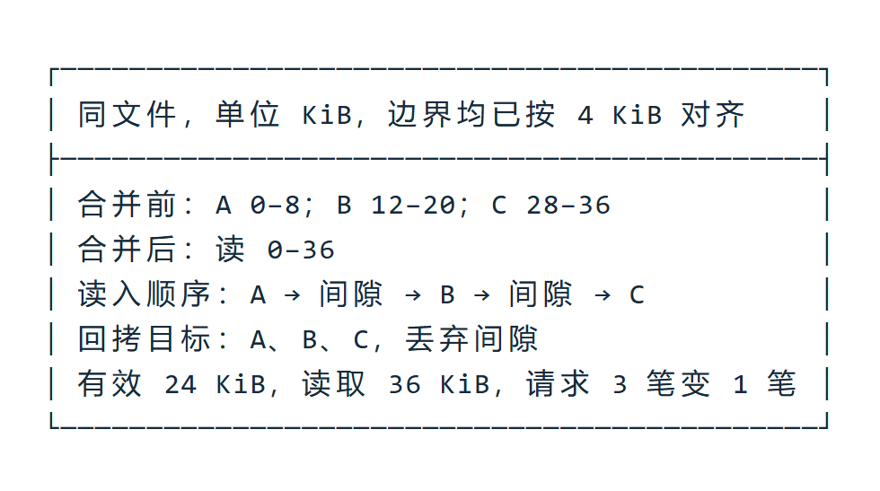

图 33：合并覆盖全部有效字节，同时增加间隙读取的教学算例 · [SVG 原图](assets/llama-vs-strata/visual-guide/figure-33.svg)

<details>
<summary>查看原始图代码</summary>

```text
┌────────────────────────────────────────────┐
│ 同文件，单位 KiB，边界均已按 4 KiB 对齐    │
├────────────────────────────────────────────┤
│ 合并前：A 0–8；B 12–20；C 28–36            │
│ 合并后：读 0–36                            │
│ 读入顺序：A → 间隙 → B → 间隙 → C          │
│ 回拷目标：A、B、C，丢弃间隙                │
│ 有效 24 KiB，读取 36 KiB，请求 3 笔变 1 笔 │
└────────────────────────────────────────────┘
```

</details>
<!-- 图 33：合并覆盖全部有效字节，同时增加间隙读取的教学算例 -->

第 33 张图先看前三个有效区间，再看包住它们的整段；原区间一个也不能丢。请求数下降与读量上升可以同时发生，不能把“大读”直接写成“少读”。

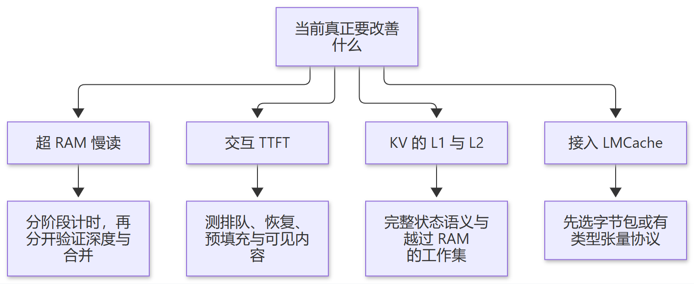

图 34：四种目标对应不同证据与改造入口 · [SVG 原图](assets/llama-vs-strata/visual-guide/figure-34.svg)

<details>
<summary>查看原始图代码</summary>

```mermaid
flowchart TD
A["当前真正要改善什么"] --> B["超 RAM 慢读"] --> B1["分阶段计时，再分开验证深度与合并"]
A --> C["交互 TTFT"] --> C1["测排队、恢复、预填充与可见内容"]
A --> D["KV 的 L1 与 L2"] --> D1["完整状态语义与越过 RAM 的工作集"]
A --> E["接入 LMCache"] --> E1["先选字节包或有类型张量协议"]
```

</details>
<!-- 图 34：四种目标对应不同证据与改造入口 -->

第 34 张图从目标走向下一份证据，而不是走向某个必然更快的实现。同样访问 SSD，权重慢读与 KV 容量实验仍需要不同工作集与验收条件。

### 想深挖

底座第 6.3、13、15 节；[S Windows 对齐合并与提交][S-READ-DIRECT]、[S Linux 分支][S-READ-DIRECT-LINUX]、[P 填槽与排空][P-TRANSFER]、[已有深度报告的下一步][R-Q5-DEPTH]。本章只核查和提出候选，没有修改引擎或获得新的性能结果。

## 第 16 章 源码阅读导航：沿一个词元追到底

**一句话结论** 先追输入、状态、执行、专家供给和输出的完整链，再进入单个内核。

### 用大白话讲

**16.1 给一次生成设观察点。** 从已分词的一个输入位置开始，先确认它属于哪条序列、前面有多少有效状态；再看计算图或验证窗口怎样安排，路由选了哪些专家、权重由谁提供；然后看新状态怎样保留，候选分数怎样选成输出词元，服务层怎样交付。词元本身不会作为一个 C++ 对象一路穿过所有模块，真正沿链变化的是编号、位置、中间数值与状态引用。

L 的上游主链按第 4 章的 `HEAD:src/llama-context.cpp:4905 → :4887 → :2001 → :1678` 阅读；这些行号来自上游提交，不能直接当 P 当前文件的位置。当前 P 的公开 `llama_decode` 已在 [llama-context.cpp:5162][P-DECODE]，微批执行在 [同文件:1763][P-PROCESS-UBATCH]。两者差别主要是插入造成的定位变化，具体行为差异仍须看 diff，不能只比较行数。

S 的 Flash-Next native 路径从 [generate.cpp:21089][S-GEN-DECODE] 调入验证器；看 [verify.cpp:3229][S-VERIFY-RUN] 如何准备输入，首次对应窗口由 [verify.cpp:1339][S-VERIFY] 的 `record_window` 描述计算，再看专家主机服务与 [verify.cpp:3876][S-VERIFY-COMMIT] 的状态提交。实际读取是否发生，要追专家源分支；看到文件句柄存在，不表示该词元真的读盘。

**16.2 带着问题找入口。** 下表链接是可点击的当前本地位置；其中 L 文件若被 P 修改，须配合上游 `HEAD` 阅读。S 的入口也只代表所标模型族路径，不能据此覆盖其全部引擎。

| 问题 | L 与 P 的入口 | S 的入口 |
| --- | --- | --- |
| 模型如何描述计算 | [models/llama.cpp:94][L-MODEL-EXAMPLE]；Qwen 当前图入口 [qwen4exp.cpp:325][P-QWEN-GRAPH] | [verify.cpp:1339][S-VERIFY] |
| 一批输入怎样执行 | 上游看第 4 章 HEAD 主链；当前 [llama-context.cpp:1763][P-PROCESS-UBATCH] | [verify.cpp:3229][S-VERIFY-RUN] |
| 操作怎样安排设备 | [ggml-backend.cpp:1305][L-SCHEDULER]；P 指派在 [llama-context.cpp:3160][P-FILE-GRAPH] | 在专用窗口及其设备执行路径中追踪：[verify.cpp:1339][S-VERIFY] |
| 专家驻留如何组织 | [llama-moe-cache.cpp:291][L-MOE-BANK] | [expert_source.cpp:3525][S-COMPLEMENT] |
| 专家缺失后谁供给 | [llama-expert-store.cpp:665][P-TRANSFER]；先区分 L 原生与 P 文件模式 | [expert_source.cpp:5042][S-EXPERT-DISPATCH] |
| 文件区间如何组织 | P 当前是有界传输，见 [llama-expert-store.cpp:665][P-TRANSFER] | [expert_source.cpp:2753][S-READ-DIRECT] |
| 长提示怎样供给 | 当前一般上传：[llama-moe-cache.cpp:944][P-GENERAL-UPLOAD] | [prefill.cpp:711][S-PREFILL-STAGER] |
| 前缀能复用多少 | [server-common.cpp:821][L-LCP] → [server-context.cpp:4121][L-PREFIX-REUSE] | [conversation_cache.hpp:226][S-CONV-CACHE] |
| 状态怎样保存恢复 | [server-task.cpp:1756][L-RAM-CACHE] 与 [server-context.cpp:3254][L-SLOT-SAVE] | [conversation_state.cpp:696][S-CONV-CAPTURE] 与 [conversation_file.hpp:166][S-SESSION-FILE] |
| 草稿怎样变成输出 | [sampling.cpp:690][L-SPEC-SAMPLING] | [generate.cpp:21089][S-GEN-DECODE] 与 [verify.cpp:3876][S-VERIFY-COMMIT] |
| 请求为什么排队或合批 | [server-context.cpp:3983][L-CONT-BATCH] | [server.py:2229][S-BATCH-IPC] |
| JSON 在哪受约束或校验 | [sampling.cpp:647][L-GRAMMAR] | [structured.py:1][S-STRUCTURED] |

**16.3 复核身份与工作树。** 在工作区根目录运行下列只读命令，可以看到提交身份、已有改动，以及同一文件的上游版本。`HEAD:` 是 Git 对象路径，不是磁盘目录前缀；diff 只帮助定位改动，不能替代对调用方和失败路径的阅读。

```powershell
git -C llama.cpp rev-parse HEAD
git -C strata rev-parse HEAD
git -C llama.cpp status --short
git -C strata status --short
git -C llama.cpp show HEAD:src/llama-context.cpp
git -C llama.cpp diff -- src/llama-context.cpp src/llama-moe-cache.cpp ggml/src/ggml-backend.cpp
```

不要在读源码时把 B 的二进制实验、L 的上游函数、P 的当前补丁与 S 的另一模型族串成一条不存在的调用链。第 35 张图只画两边共享的逻辑阶段；遇到缓存命中或全驻留配置，相应的文件读或主机服务可以不发生。

### 看图

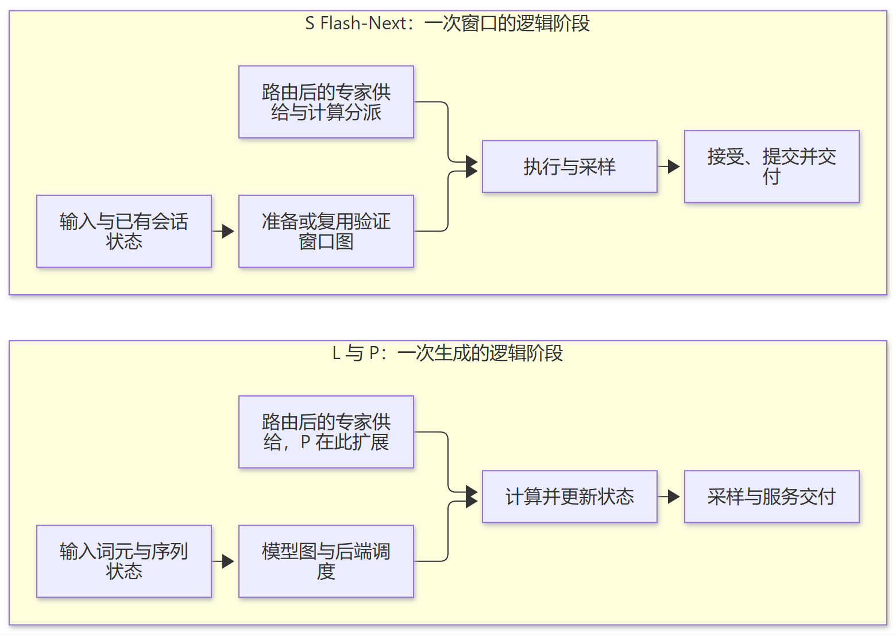

图 35：按完整阶段追踪两边执行，专家供给是其中一条支路 · [SVG 原图](assets/llama-vs-strata/visual-guide/figure-35.svg)

<details>
<summary>查看原始图代码</summary>

```mermaid
flowchart LR
subgraph LRUN["L 与 P：一次生成的逻辑阶段"]
LA["输入词元与序列状态"] --> LB["模型图与后端调度"] --> LC["计算并更新状态"]
LX["路由后的专家供给，P 在此扩展"] --> LC
LC --> LD["采样与服务交付"]
end
subgraph SRUN["S Flash-Next：一次窗口的逻辑阶段"]
SA["输入与已有会话状态"] --> SB["准备或复用验证窗口图"] --> SC["执行与采样"]
SX["路由后的专家供给与计算分派"] --> SC
SC --> SD["接受、提交并交付"]
end
```

</details>
<!-- 图 35：按完整阶段追踪两边执行，专家供给是其中一条支路 -->

第 35 张图把供给放在侧面，提醒你数据准备会参与计算依赖，却不等于整个引擎。读到某个 CUDA 内核以后，仍应回到上层确认其输入、状态、设备分派和结果提交，才算追完一个词元的生成链。

### 想深挖

底座第 5、6、7、8、9、16 节；先用本章入口表缩小范围，再回到对应严谨分析段落。文件与行号是本地快照定位；后续源码移动时应重新核查入口，不能把旧行号当永久接口。

## 附录 A 术语速查

本表压缩前文定义，配合例子阅读；它不是新的性能或平台支持承诺。L0、L1、L2、Slot、Prefix State Blob、Cache ROI 与 TTFT 沿用 [CONTEXT.md:1][R-CONTEXT]。

| 术语 | 在本文中怎样理解 | 容易混淆的对象 |
| --- | --- | --- |
| 词元 token | 模型输入输出的编号单位，不固定等于字或词 | 字符数、可见文字长度 |
| 分词器 tokenizer | 文字与词元编号之间的编码、解码工具 | 把整句话直接当一个模型输入单位 |
| 预填充 prefill | 处理提示并建立运行状态 | 引擎启动、模型加载 |
| 解码 decode | 利用已有状态继续生成 | L 名为 `llama_decode` 的接口；它也处理提示 |
| 键值缓存 KV cache | 注意力后续读取的键和值数值 | 专家权重、完整聊天文本 |
| 循环与混合 recurrent、hybrid | 持续更新历史状态，或与注意力并用 | 可任意截取的纯文本历史 |
| 检查点 checkpoint | 某个可恢复位置的必要状态 | 必然独立包含全部历史 KV 的完整镜像 |
| 完整会话镜像 snapshot | 关联运行状态与必要数值数据 | 只保存消息列表 |
| 最长公共前缀 LCP | 从开头连续相同的词元长度 | 实际可恢复长度或语义相似度 |
| 槽位 Slot | 服务中一条请求或会话的执行通道 | GPU 专家槽；后者存放权重位置 |
| L0 | 引擎活动 KV 等运行状态 | 一律只在显存的所有缓存 |
| L1 | 近引擎的状态缓存层，通常在主机内存 | P 的专家 RAM 缓存与所有 RAM 分配的总称 |
| L2 | L1 外的后备存储层，可为磁盘或其他存储 | 已经证明有额外容量收益的保证 |
| 前缀状态字节包 Prefix State Blob | 只由兼容引擎解释的已保存前缀状态负载 | 可跨引擎任意互读的 KV 张量 |
| KV Tensor Protocol | 按类型、布局、层和词元范围交换 KV 的接口契约 | 一个会话文件名或专家缓存键 |
| 缓存净收益 Cache ROI | 省掉的工作扣除查询、保存、恢复、搬运与维护成本 | 命中率本身 |
| 首词元延迟 TTFT | 从约定的提交点到约定首词元事件 | 启动时间、首个空事件、完整 JSON 时间 |
| 混合专家 MoE | 路由选择部分专家权重参与计算 | 每个词元都用全部专家 |
| PLE 行 | 模型固定查表权重的一行 | 前缀 KV、历史草稿查找结果 |
| 张量 tensor 与 DAG | 带形状的数值描述，以及操作依赖图 | 已经算好的结果 |
| 后端 backend 与内核 kernel | 设备执行接口，以及实际执行计算的程序 | 名字相同就数值与性能相同 |
| GGUF | 承载模型权重与元数据的文件格式，可有多个分片 | 数值计算一致或模型包完全兼容的保证 |
| 量化与 dtype | 紧凑数值编码，以及单个张量的数据类型 | 整个模型包只有一种编码 |
| layout 与 scale | 字节布局与解释量化数值的缩放参数 | 仅凭文件后缀便可省略的元数据 |
| staging | I/O 或上传过程的中转空间 | RAM 缓存本身 |
| H2D 与 D2D | 主机到设备、设备到设备的数据传输 | 在 CPU 上算专家或重新算权重 |
| 租约 lease 与完成事件 | 保证消费者用完前，源数据不被逐出或覆盖 | “提交了”就等于“完成了” |
| io_depth | 应用管理的在途槽数，须说明生命周期 | 设备 QD/I、SSD 内部队列 |
| 批量提交与区间合并 | 一批请求先提交，或把多个范围包成较大读 | 二者天然减少相同数量的字节 |
| logits | 采样前的候选词元分数 | 已交付给用户的文字 |
| MTP 与投机解码 | 一种草稿来源，以及提出候选再验证的流程 | 默认已启用或所有模式都同一接受算法 |
| 专家尾跳与 KVA | 改变主模型计算的选项 | 普通精确缓存命中 |
| replica、RPC 与 split serve | 完整引擎副本、远端设备执行、本地阶段交接 | 同一种多卡或网络 KV 机制 |

## 附录 B 本文结论如何追到证据

“源码事实”只证明机制与边界，“既有实测”只证明报告条件下的观察，“推断或候选”不代表收益已实现。第 15 章的 `read_direct` 定点核查是在底座既有结论范围内补充具体分支；M3/M1 与 P 合并读取仍无新性能结果。

| 本文结论 | 严谨版节号 | 源码或报告入口 | 证据性质 |
| --- | --- | --- | --- |
| S、L、P、G 与 B 不能混为一个版本 | 1、3.2 | [AGENTS.md:1][S-AGENTS]、[UPSTREAM.md:8][S-UPSTREAM]；B 身份见[三方 REPORT][R-Q5-REPORT] | 身份与报告条件 |
| 通用图与专用流水线的组织中心不同 | 2、5.1–5.4 | [ggml.h:690][L-TENSOR]、[verify.cpp:1339][S-VERIFY] | 源码事实 |
| S 复制部分 ggml，不是直接沿用整套 L 引擎 | 3.1 | [UPSTREAM.md:18][S-UPSTREAM] | 源码清单事实 |
| 图复用仍要填入并计算新输入 | 5.1、8.5 | [llama-graph.cpp:1491][L-GRAPH-REUSE]；第 4 章 HEAD 主链 | 源码事实 |
| L 已有 GPU 专家缓存与 ClassLRU | 6.1 | [llama-moe-cache.cpp:21][L-MOE-POLICY]、[同文件:291][L-MOE-BANK] | 源码事实 |
| S 协调多来源与 CPU、GPU 专家计算 | 6.2 | [expert_source.cpp:3525][S-COMPLEMENT]、[同文件:5042][S-EXPERT-DISPATCH] | 源码事实 |
| 五种缓存对象不能互相替代 | 6.5、8.5 | [llama-weight-rows.cpp:5][P-WEIGHT-ROWS]、[server-common.cpp:821][L-LCP]、[cache_drop.py:36][S-CACHE-DROP] | 源码对象与指标解释 |
| S 有独立预填充流，KVA 默认关闭且近似 | 7 | [prefill.cpp:711][S-PREFILL-STAGER]、[kva.hpp:1][S-KVA] | 源码事实 |
| LCP 不等于任意位置都能恢复 | 8.1–8.3 | [server-context.cpp:4121][L-PREFIX-REUSE]、[conversation_cache.hpp:24、226][S-CONV-CACHE] | 源码事实 |
| L 的 RAM 缓存与状态文件不等于自动三级淘汰 | 8.2 | [server-task.cpp:1756][L-RAM-CACHE]、[server-context.cpp:3254][L-SLOT-SAVE] | 源码边界 |
| S 检查点、完整镜像、文件、内存准入各司其职 | 8.3 | [conversation_state.cpp:696][S-CONV-CAPTURE]、[conversation_file.hpp:166][S-SESSION-FILE]、[conversation_memory.hpp:70][S-CONV-MEMORY] | 源码事实 |
| 两边状态文件不是通用 KV 交换协议 | 8.4 | [llama-kv-cache.cpp:2359][L-KV-STATE]、[conversation_file.hpp:94][S-SESSION-IDENTITY] | 格式与身份边界 |
| MTP 两边都有，接受规则要看具体分支 | 9.1–9.2 | [speculative.cpp:1542][L-SPEC-MTP]、[sampling.cpp:736][L-SPEC-REJECTION]、[coupled_draft.hpp:3][S-COUPLED] | 源码事实 |
| 尾跳与 KVA 需单列计算及质量档位 | 7、9.3 | [expert_source.cpp:4872][S-TAIL-SKIP]、[kva.hpp:1][S-KVA] | 源码边界 |
| 并发、批次与内容交付时间不是同一口径 | 10.1–10.3、10.5 | [server-context.cpp:3983][L-CONT-BATCH]、[server.py:2229、7306][S-STRUCTURED-STREAM] | 源码与测量边界 |
| 语法约束生成不同于生成后验证 | 10.6 | [sampling.cpp:647][L-GRAMMAR]、[structured.py:1][S-STRUCTURED] | 源码事实 |
| 多设备须按拆分对象区分，split serve 非现成 LMCache | 6.4、10.4 | [arg.cpp:2799][L-SPLIT]、[remote_experts.hpp:18][S-REMOTE]、[serve/split.py:378][S-SPLIT-SERVE] | 源码与接口边界 |
| 36 个有效类型不等于 44 种量化格式 | 11.1 | [ggml.h:391–436][L-GGML-TYPES] | 源码枚举事实 |
| pack 名称与平台可执行性需逐项核对 | 11.2、12.1 | [QUANTS.md:14][S-QUANTS]、[后端注册:186][L-BACKEND-REG]、[sycl/CMakeLists.txt:3][S-SYCL-CMAKE] | 源码事实；维护成本为推断 |
| P 的供给、租约、预算与失败传播有独立契约 | 13 | [llama-expert-store.cpp:665][P-TRANSFER]、[ggml-backend.cpp:2126、2421][P-RESERVE-API]、[补丁文档:42][P-DOC] | 源码事实 |
| 三方对照必须同时看启动与 READY 后 TTFT | 14.1 | [q5-strata-compare-20261111/REPORT.zh-CN.md][R-Q5-REPORT] | 各臂 3 样本的初步实测 |
| 加深应用槽可减少部分等待，但本轨迹读量不变 | 13、15；深度报告补充 | [q5-io-depth-20261111/REPORT.zh-CN.md][R-Q5-DEPTH] | 两轮短轨迹筛选 |
| Windows 合并与 Linux 合并语义不同 | 6.3，定点核查细化 | [expert_source.cpp:2753][S-READ-DIRECT]、[同文件:2873][S-READ-DIRECT-LINUX] | 源码事实，无新性能测量 |
| P 已填槽再回收，不能保证改成批量就提高设备队列 | 13、15，定点核查细化 | [llama-expert-store.cpp:686–719][P-TRANSFER]；[深度 REPORT][R-Q5-DEPTH] | 源码事实与明确推断 |
| M3/M1、P 区间合并与四条目标路线仍需验证 | 15 | [S 读取机制][S-READ-DIRECT]、[P 现有传输][P-TRANSFER]、[CONTEXT.md:14–21][R-CONTEXT] | 候选与工程推断 |

## 引用索引

[R-BASE]: llama-vs-strata-source-analysis.md
[S-AGENTS]: C:/Users/Administrator/Documents/Code/my-code/lm-llama/strata/AGENTS.md:1
[S-UPSTREAM]: C:/Users/Administrator/Documents/Code/my-code/lm-llama/strata/third_party/strata-ggml/UPSTREAM.md:1
[L-TENSOR]: C:/Users/Administrator/Documents/Code/my-code/lm-llama/llama.cpp/ggml/include/ggml.h:690
[S-VERIFY-RUN]: C:/Users/Administrator/Documents/Code/my-code/lm-llama/strata/src/core/verify.cpp:3229
[P-DOC]: C:/Users/Administrator/Documents/Code/my-code/lm-llama/llama.cpp/docs/development/file-expert-store.md:1
[L-HTTP]: C:/Users/Administrator/Documents/Code/my-code/lm-llama/llama.cpp/tools/server/server-http.cpp:150
[S-PIPE]: C:/Users/Administrator/Documents/Code/my-code/lm-llama/strata/serve/server.py:1101
[L-KV-BUFFERS]: C:/Users/Administrator/Documents/Code/my-code/lm-llama/llama.cpp/src/llama-kv-cache.cpp:214
[R-Q5-REPORT]: q5-strata-compare-20261111/REPORT.zh-CN.md
[R-CONTEXT]: C:/Users/Administrator/Documents/Code/my-code/lm-llama/CONTEXT.md:1
[L-MOE-BANK]: C:/Users/Administrator/Documents/Code/my-code/lm-llama/llama.cpp/src/llama-moe-cache.cpp:291
[L-MODEL-EXAMPLE]: C:/Users/Administrator/Documents/Code/my-code/lm-llama/llama.cpp/src/models/llama.cpp:94
[L-SCHEDULER]: C:/Users/Administrator/Documents/Code/my-code/lm-llama/llama.cpp/ggml/src/ggml-backend.cpp:1305
[L-LCP]: C:/Users/Administrator/Documents/Code/my-code/lm-llama/llama.cpp/tools/server/server-common.cpp:821
[L-GRAPH-REUSE]: C:/Users/Administrator/Documents/Code/my-code/lm-llama/llama.cpp/src/llama-graph.cpp:1491
[L-MOE-POLICY]: C:/Users/Administrator/Documents/Code/my-code/lm-llama/llama.cpp/src/llama-moe-cache.cpp:21
[S-COMPLEMENT]: C:/Users/Administrator/Documents/Code/my-code/lm-llama/strata/src/core/expert_source.cpp:3525
[S-EXPERT-DISPATCH]: C:/Users/Administrator/Documents/Code/my-code/lm-llama/strata/src/core/expert_source.cpp:5042
[P-TRANSFER]: C:/Users/Administrator/Documents/Code/my-code/lm-llama/llama.cpp/src/llama-expert-store.cpp:665
[P-START-READ]: C:/Users/Administrator/Documents/Code/my-code/lm-llama/llama.cpp/src/llama-expert-store.cpp:446
[P-REAP]: C:/Users/Administrator/Documents/Code/my-code/lm-llama/llama.cpp/src/llama-expert-store.cpp:516
[P-RAM-HIT]: C:/Users/Administrator/Documents/Code/my-code/lm-llama/llama.cpp/src/llama-expert-store.cpp:705
[R-Q5-DEPTH]: q5-io-depth-20261111/REPORT.zh-CN.md
[S-PREFILL-STAGER]: C:/Users/Administrator/Documents/Code/my-code/lm-llama/strata/src/prefill/prefill.cpp:711
[S-KVA]: C:/Users/Administrator/Documents/Code/my-code/lm-llama/strata/include/strata/prefill/kva.hpp:1
[P-WEIGHT-ROWS]: C:/Users/Administrator/Documents/Code/my-code/lm-llama/llama.cpp/src/llama-weight-rows.cpp:5
[S-PLE-READER]: C:/Users/Administrator/Documents/Code/my-code/lm-llama/strata/src/ngram/ple_reader.cpp:32
[S-CACHE-DROP]: C:/Users/Administrator/Documents/Code/my-code/lm-llama/strata/serve/cache_drop.py:36
[L-PREFIX-REUSE]: C:/Users/Administrator/Documents/Code/my-code/lm-llama/llama.cpp/tools/server/server-context.cpp:4121
[S-CONV-TYPES]: C:/Users/Administrator/Documents/Code/my-code/lm-llama/strata/include/strata/core/conversation_cache.hpp:24
[S-CONV-CACHE]: C:/Users/Administrator/Documents/Code/my-code/lm-llama/strata/include/strata/core/conversation_cache.hpp:226
[L-MEMORY]: C:/Users/Administrator/Documents/Code/my-code/lm-llama/llama.cpp/src/llama-memory.h:82
[L-RAM-CACHE]: C:/Users/Administrator/Documents/Code/my-code/lm-llama/llama.cpp/tools/server/server-task.cpp:1756
[L-SLOT-SAVE]: C:/Users/Administrator/Documents/Code/my-code/lm-llama/llama.cpp/tools/server/server-context.cpp:3254
[S-CONV-CAPTURE]: C:/Users/Administrator/Documents/Code/my-code/lm-llama/strata/src/core/conversation_state.cpp:696
[S-SESSION-FILE]: C:/Users/Administrator/Documents/Code/my-code/lm-llama/strata/include/strata/core/conversation_file.hpp:166
[S-CONV-MEMORY]: C:/Users/Administrator/Documents/Code/my-code/lm-llama/strata/include/strata/core/conversation_memory.hpp:70
[S-KV-HOST]: C:/Users/Administrator/Documents/Code/my-code/lm-llama/strata/include/strata/core/layer.hpp:233
[S-SESSION-IDENTITY]: C:/Users/Administrator/Documents/Code/my-code/lm-llama/strata/include/strata/core/conversation_file.hpp:94
[L-KV-STATE]: C:/Users/Administrator/Documents/Code/my-code/lm-llama/llama.cpp/src/llama-kv-cache.cpp:2359
[L-SPEC-SAMPLING]: C:/Users/Administrator/Documents/Code/my-code/lm-llama/llama.cpp/common/sampling.cpp:690
[S-VERIFY-COMMIT]: C:/Users/Administrator/Documents/Code/my-code/lm-llama/strata/src/core/verify.cpp:3876
[L-SPEC-MTP]: C:/Users/Administrator/Documents/Code/my-code/lm-llama/llama.cpp/common/speculative.cpp:1542
[S-MTP]: C:/Users/Administrator/Documents/Code/my-code/lm-llama/strata/include/strata/core/mtp.hpp:3
[L-SPEC-REJECTION]: C:/Users/Administrator/Documents/Code/my-code/lm-llama/llama.cpp/common/sampling.cpp:736
[S-COUPLED]: C:/Users/Administrator/Documents/Code/my-code/lm-llama/strata/include/strata/core/coupled_draft.hpp:3
[S-SAMPLER]: C:/Users/Administrator/Documents/Code/my-code/lm-llama/strata/src/kernels/cuda/sampler.cu:1048
[S-GATED]: C:/Users/Administrator/Documents/Code/my-code/lm-llama/strata/src/program/generate.cpp:3152
[S-TAIL-SKIP]: C:/Users/Administrator/Documents/Code/my-code/lm-llama/strata/src/core/expert_source.cpp:4872
[L-CONT-BATCH]: C:/Users/Administrator/Documents/Code/my-code/lm-llama/llama.cpp/tools/server/server-context.cpp:3983
[S-BATCH-IPC]: C:/Users/Administrator/Documents/Code/my-code/lm-llama/strata/serve/server.py:2229
[L-ROUTER]: C:/Users/Administrator/Documents/Code/my-code/lm-llama/llama.cpp/tools/server/server-models.cpp:1215
[L-BATCH-PARAMS]: C:/Users/Administrator/Documents/Code/my-code/lm-llama/llama.cpp/include/llama.h:369
[S-BATCHING]: C:/Users/Administrator/Documents/Code/my-code/lm-llama/strata/docs/BATCHING.md:1
[S-STRUCTURED-STREAM]: C:/Users/Administrator/Documents/Code/my-code/lm-llama/strata/serve/server.py:7306
[L-GRAMMAR]: C:/Users/Administrator/Documents/Code/my-code/lm-llama/llama.cpp/common/sampling.cpp:647
[L-JSON-GRAMMAR]: C:/Users/Administrator/Documents/Code/my-code/lm-llama/llama.cpp/common/json-schema-to-grammar.cpp:1025
[S-STRUCTURED]: C:/Users/Administrator/Documents/Code/my-code/lm-llama/strata/serve/structured.py:1
[L-SPLIT]: C:/Users/Administrator/Documents/Code/my-code/lm-llama/llama.cpp/common/arg.cpp:2799
[S-MULTI-GPU]: C:/Users/Administrator/Documents/Code/my-code/lm-llama/strata/docs/MULTI_GPU.md:95
[S-SPLIT-ENGINE]: C:/Users/Administrator/Documents/Code/my-code/lm-llama/strata/docs/SPLIT_ENGINE.md:3
[S-PEER]: C:/Users/Administrator/Documents/Code/my-code/lm-llama/strata/include/strata/core/peer_experts.hpp:3
[S-REMOTE]: C:/Users/Administrator/Documents/Code/my-code/lm-llama/strata/include/strata/core/remote_experts.hpp:18
[S-REPLICAS]: C:/Users/Administrator/Documents/Code/my-code/lm-llama/strata/serve/replicas.py:513
[L-RPC]: C:/Users/Administrator/Documents/Code/my-code/lm-llama/llama.cpp/tools/rpc/README.md:76
[S-SPLIT-SERVE]: C:/Users/Administrator/Documents/Code/my-code/lm-llama/strata/serve/split.py:378
[S-QUANTS]: C:/Users/Administrator/Documents/Code/my-code/lm-llama/strata/docs/QUANTS.md:14
[L-GGML-TYPES]: C:/Users/Administrator/Documents/Code/my-code/lm-llama/llama.cpp/ggml/include/ggml.h:391
[S-TQ-TYPES]: C:/Users/Administrator/Documents/Code/my-code/lm-llama/strata/third_party/strata-ggml/ggml/src/ggml-cuda-tq/include/ggml.h:433
[S-NVFP4]: C:/Users/Administrator/Documents/Code/my-code/lm-llama/strata/docs/NVFP4.md:6
[L-BACKEND-REG]: C:/Users/Administrator/Documents/Code/my-code/lm-llama/llama.cpp/ggml/src/ggml-backend-reg.cpp:186
[S-METAL-CMAKE]: C:/Users/Administrator/Documents/Code/my-code/lm-llama/strata/metal/CMakeLists.txt:1
[S-SYCL-CMAKE]: C:/Users/Administrator/Documents/Code/my-code/lm-llama/strata/sycl/CMakeLists.txt:3
[S-GEOMETRY]: C:/Users/Administrator/Documents/Code/my-code/lm-llama/strata/include/strata/core/geometry.hpp:1
[S-CAPABILITIES]: C:/Users/Administrator/Documents/Code/my-code/lm-llama/strata/docs/CAPABILITIES.md:1
[P-GENERAL-UPLOAD]: C:/Users/Administrator/Documents/Code/my-code/lm-llama/llama.cpp/src/llama-moe-cache.cpp:944
[P-CONSUMER]: C:/Users/Administrator/Documents/Code/my-code/lm-llama/llama.cpp/src/llama-expert-store.h:86
[P-ACQUIRE]: C:/Users/Administrator/Documents/Code/my-code/lm-llama/llama.cpp/src/llama-expert-store.cpp:597
[P-UPLOAD]: C:/Users/Administrator/Documents/Code/my-code/lm-llama/llama.cpp/src/llama-expert-store.cpp:759
[P-COPY-API]: C:/Users/Administrator/Documents/Code/my-code/lm-llama/llama.cpp/ggml/include/ggml-backend.h:346
[P-COPY-FAILURE]: C:/Users/Administrator/Documents/Code/my-code/lm-llama/llama.cpp/ggml/src/ggml-backend.cpp:2126
[P-RESERVE-API]: C:/Users/Administrator/Documents/Code/my-code/lm-llama/llama.cpp/ggml/src/ggml-backend.cpp:2421
[P-FILE-GRAPH]: C:/Users/Administrator/Documents/Code/my-code/lm-llama/llama.cpp/src/llama-context.cpp:3160
[P-WORKSPACE]: C:/Users/Administrator/Documents/Code/my-code/lm-llama/llama.cpp/src/llama-context.cpp:883
[P-SCOPE]: C:/Users/Administrator/Documents/Code/my-code/lm-llama/llama.cpp/src/llama-context.cpp:201
[S-READ-DIRECT]: C:/Users/Administrator/Documents/Code/my-code/lm-llama/strata/src/core/expert_source.cpp:2753
[S-READ-DIRECT-LINUX]: C:/Users/Administrator/Documents/Code/my-code/lm-llama/strata/src/core/expert_source.cpp:2873
[L-CUDA-GRAPH]: C:/Users/Administrator/Documents/Code/my-code/lm-llama/llama.cpp/ggml/src/ggml-cuda/ggml-cuda.cu:5101
[P-DECODE]: C:/Users/Administrator/Documents/Code/my-code/lm-llama/llama.cpp/src/llama-context.cpp:5162
[P-PROCESS-UBATCH]: C:/Users/Administrator/Documents/Code/my-code/lm-llama/llama.cpp/src/llama-context.cpp:1763
[S-GEN-DECODE]: C:/Users/Administrator/Documents/Code/my-code/lm-llama/strata/src/program/generate.cpp:21089
[S-VERIFY]: C:/Users/Administrator/Documents/Code/my-code/lm-llama/strata/src/core/verify.cpp:1339
[P-QWEN-GRAPH]: C:/Users/Administrator/Documents/Code/my-code/lm-llama/llama.cpp/src/models/qwen4exp.cpp:325
